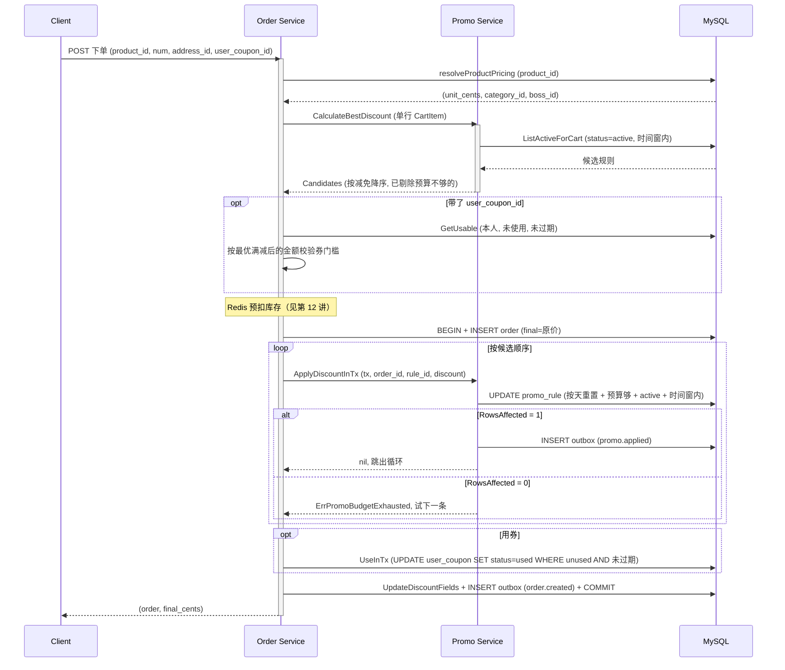
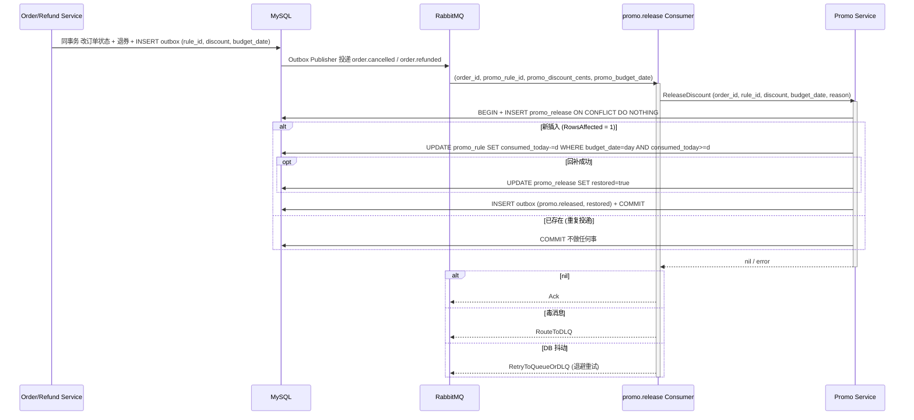
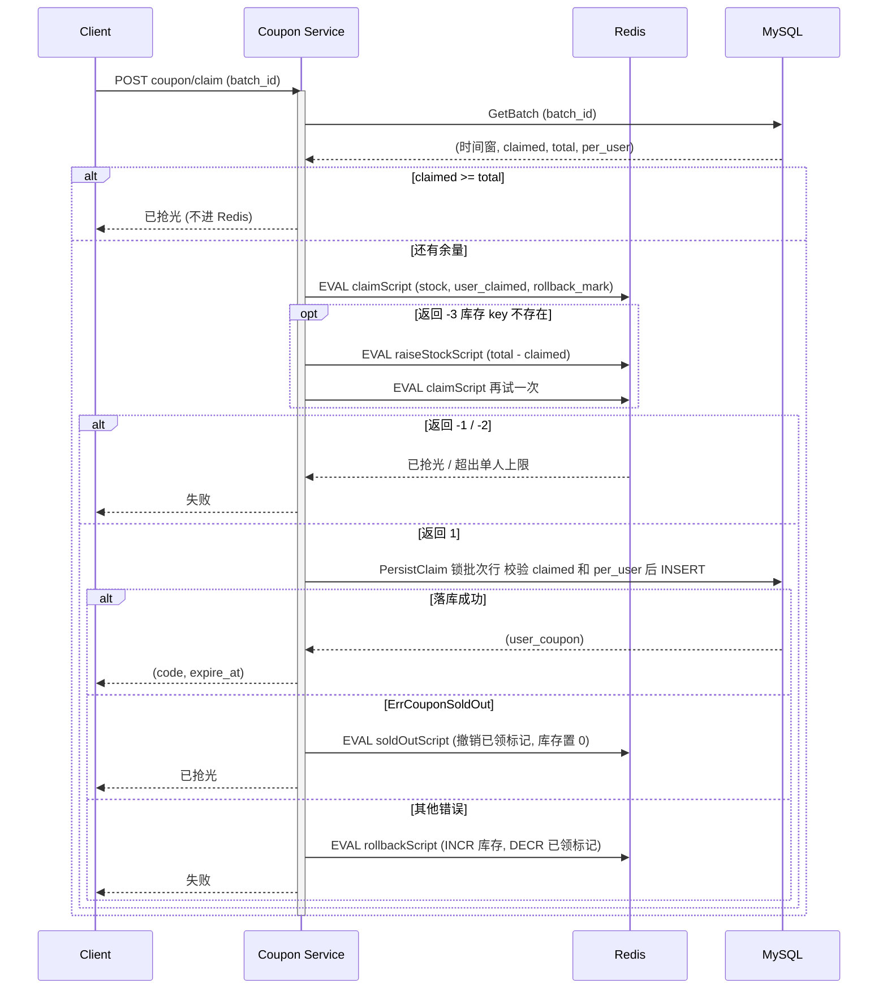

# 16 营销补贴：满减预算防超发、降级与回收（附优惠券领取与核销）

> gomall · `internal/promo` / `internal/coupon` / 下单链路里的 `quoteOrder` 与 `applyDiscountsInTx`
>
> 这一讲回答一个问题：平台拿出一笔按天计算的补贴预算，怎样保证并发下单时不超发，最优规则的预算被抢光时不挡单，订单取消或退款后预算按天收回来；以及用户自己领的券怎样在同一个下单事务里核销、在关单退款时退回。

## 本讲目标

讲完后，学生应该能：

- 说清满减引擎“一单一条、按减免排序、按作用范围算门槛”的规则，以及为什么试算和下单都只信服务端价格；
- 解释下单时“事务外排出候选、事务内条件 UPDATE 扣预算”的两段式设计，和预算挤光时依次降到次优规则的做法；
- 说明 `budget_date` 怎样让一条 UPDATE 同时完成“按天重置”和“防超发”，以及退预算为什么只回补同一天的额度；
- 画出 `order.cancelled` / `order.refunded` 驱动预算回收的链路，指出幂等落在哪张表的哪个索引，以及消费者进了 DLQ 之后谁来兜底；
- 说清“先满减、后券”的计算顺序，券怎样在下单事务里用条件 UPDATE 核销，关单退款时怎样退回；
- 对比优惠券领取的 Redis Lua 闸门与 DB 行锁兜底，说明 Redis 库存偏少和偏多时各由谁修正。

---

## 一、促销是平台在花钱：先看三起事故

**本节判断：满减不是“显示一个更低的价格”，而是平台在给每笔订单付补贴；所以要像管钱一样管预算，超发、漏收、配错都是资损。**

运营上线一条规则：“全场满 200 减 20，每日预算 10 万元”。活动开始后，客服和财务陆续收到这几类问题：

| 场景 | 现象 | 本质 |
|---|---|---|
| 零点开抢，几千单同时命中 | 预算显示 10 万，实际补贴了 10.3 万 | 并发扣预算超发 |
| 运营把“满 200 减 20”配成“满 2 分减 20 元” | 20 元以下的订单实付 0 元 | 规则配置缺校验 |
| 大量订单超时未付被关单 | 下午三点活动就“没钱了”，后面用户拿不到折扣 | 关单后预算没回收 |

gomall 的 promo 模块对这三件事分别给出了答案：条件 UPDATE 防超发、建规则校验加草稿审核、事件驱动的幂等回收。

先把业务规则定下来（`internal/promo/model.go:9-13`）：

```go
// 满减 / 阶梯折扣规则。与 CouponBatch 互补：
//   - Coupon 需要用户领取，PerUser 限领；
//   - PromoRule 不需要领取，结算时引擎自动取最优；
//   - 一笔订单只能匹配一条 PromoRule（不叠加），但 PromoRule 可与已领取的 Coupon 叠加 ——
//     业务规则：先满减、后券。引擎只负责前半段。
```

“不叠加”让补贴成本可预测：一笔订单最多花掉一条规则的预算。“先满减、后券”划清了两个模块的职责：promo 引擎只算满减；券是用户自己的资产，在满减后的金额上再减，由下单链路负责核销（第五节）。

规则本身的字段（`internal/promo/model.go:32-49`，删减了 tag）：

```go
type PromoRule struct {
    dbmodel.Model
    Name             string
    RuleType         int    // 1 满减 / 2 满折扣
    Scope            int    // 1 全场 / 2 类目 / 3 商品
    ScopeRefID       int64  // 类目 id 或商品 id；全场 = 0
    ThresholdCents   int64  // 满 X 分
    DiscountCents    int64  // 减 Y 分（RuleType=1）
    DiscountBps      int    // 折扣 bps（RuleType=2），9 折 = 9000
    DailyBudgetCents int64  // 当日预算分；0 = 不限
    ConsumedToday    int64  // BudgetDate 那一天已消耗分
    // BudgetDate ConsumedToday 所属的自然日（YYYY-MM-DD，服务器时区）。不靠 0 点 cron 清零：
    // 扣预算时发现日期不是今天，就在同一条 UPDATE 里把计数从 0 重新起算（惰性重置）。
    BudgetDate string
    StartAt    time.Time
    EndAt      time.Time
    Status     int       // 0 draft / 1 active / 2 stopped
}
```

所有金额都是 `int64` 分，和支付、清算一样。预算由三个字段控制：`DailyBudgetCents` 是每天的上限，`0` 表示不限；`ConsumedToday` 是累计消耗；`BudgetDate` 标明这个累计属于哪一天。上限只由运营写，消耗和日期只由交易链路写，两者不会互相覆盖。

### 1.1 规则先建草稿，校验过才能生效

后台接口（`internal/promo/routes.go:18-24`）：`POST admin/promo/rules` 新建，一律是草稿；`PUT .../:id` 只能改草稿；`PATCH .../:id/activate` 把草稿变成生效，已过结束时间的不让启用；`PATCH .../:id/stop` 停用。

建和改共用一套校验 `validateRule`（`internal/promo/service.go:344-373`）：结束时间晚于开始时间；全场规则 `ScopeRefID` 必须为 0，类目 / 商品规则必须带 `ScopeRefID`；预算不能为负；折扣 bps 落在 (0, 10000)；满减金额必须小于门槛（`service.go:363-366`），“满 1 分减 100 元”这类配置在入口就被拒掉。

状态机靠 DAO 里的条件 UPDATE 落地（`internal/promo/repo.go:139-151`）：`Update` 的 WHERE 带 `status = draft`，`Activate` 带 `status = draft AND end_at > now`，影响 0 行就返回 `ErrPromoRuleNotDraft`。为什么生效后不许改？已经有订单按这条规则扣了预算，再改金额，补贴台账就和规则对不上。配错了的做法是停掉重建。

---

## 二、满减引擎：按减免排序、按范围算门槛、金额只信服务端

**本节判断：引擎是一组纯函数，输入购物车行和候选规则，输出“按减免从大到小排好的候选列表”；它不碰预算，价格真假由调用方负责。**

### 2.1 排序而不是只取第一名

`RankPromoRules`（`internal/promo/service.go:77-92`）：

```go
func RankPromoRules(items []CartItem, rules []*PromoRule) []PromoCandidate {
    var out []PromoCandidate
    for _, r := range rules {
        base := applicableSubtotal(items, r)
        if base < r.ThresholdCents {
            continue
        }
        if d := computeDiscountOnBase(base, r); d > 0 {
            out = append(out, PromoCandidate{Rule: r, DiscountCents: d})
        }
    }
    sort.SliceStable(out, func(i, j int) bool { return out[i].DiscountCents > out[j].DiscountCents })
    return out
}
```

减免相同时 `SliceStable` 保持入参顺序，而 `ListActiveForCart` 按 `id ASC` 拉规则，所以并列时 id 小的在前，结果是确定的。`PickBestPromoRule`（`service.go:63-69`）只是取 `ranked[0]`。

为什么要排出整张列表？因为第一名的预算可能在下单那一刻被别人抢光，这时候要按顺序试第二名（第三节）。给用户“最优”，平台成本反而最高，但这是行业惯例，不能偷偷给用户较小的那条。

### 2.2 门槛按作用范围内的子集算

`applicableSubtotal`（`internal/promo/service.go:107-129`）只累加命中规则范围的行：全场规则全部命中，类目规则比 `CategoryID == ScopeRefID`，商品规则比 `ProductID == ScopeRefID`。门槛和减免都落在同一个 base 上，避免“用 A 凑单、减的却是 B”。这也是建规则时强制类目 / 商品规则必须带 `ScopeRefID` 的原因：`ScopeRefID = 0` 的类目规则一个商品都匹配不到。

### 2.3 满减封顶，折扣向下取整

`computeDiscountOnBase`（`internal/promo/service.go:136-147`）：

```go
case PromoRuleTypeAmount:
    if r.DiscountCents > base {
        return base
    }
    return r.DiscountCents
case PromoRuleTypeDiscount:
    if r.DiscountBps <= 0 || r.DiscountBps >= PromoDiscountBpsBase {
        return 0
    }
    num := base * int64(PromoDiscountBpsBase-r.DiscountBps)
    return num / int64(PromoDiscountBpsBase)
```

- 满减封顶在 `base`。有了“减额小于门槛”的校验，正常规则走不到这个分支，它是给历史数据留的兜底；下单侧还有第三道：`FinalCents < 0` 时按 0 处理并打告警（`internal/order/service.go:299-304`）。
- 折扣金额整数除法向下取整，零头留给平台。99.99 元打 9 折，减免是 999 分。

### 2.4 试算只看预算还够的规则

`CalculateBestDiscount`（`internal/promo/service.go:186-222`）是纯读，但会按规则行的快照剔除今天剩余预算不够的规则：

```go
today := BudgetDay(now)
for _, c := range RankPromoRules(items, rules) {
    if budgetAllows(c.Rule, c.DiscountCents, today) {
        resp.Candidates = append(resp.Candidates, c)
    }
}
if len(resp.Candidates) == 0 {
    return resp, nil
}
best, discount := resp.Candidates[0].Rule, resp.Candidates[0].DiscountCents
```

`budgetAllows`（`service.go:94-105`）的关键是日期判断：规则行上的 `BudgetDate` 不是今天，说明今天还没人扣过，已用额度按 0 算。这样昨天花光的规则，今天试算时照样是候选，不需要任何 0 点清零任务。

`Candidates` 在 JSON 里是 `json:"-"`（`internal/promo/dto.go:34-35`），只给下单链路降级用，不暴露给前端。快照判断只是展示口径，真正的防超发在建单事务里那条条件 UPDATE（3.2）。

### 2.5 试算和下单用同一份价格

试算接口挂在 public 组，不要求登录（`internal/promo/routes.go:15-17`）。请求体只允许一行（`internal/promo/dto.go:15-19`）：

```go
// PromoCalculateReq 只收一行：一张订单只有一个商品，满减门槛按单笔订单算，
// 多行"凑单"试算会展示一个真实下单拿不到的折扣。
type PromoCalculateReq struct {
    Items []PromoCalculateItem `json:"items" binding:"required,min=1,max=1,dive"`
}
```

客户端传来的 `unit_cents` / `category_id` 不参与计算，`repriceItems`（`internal/promo/handler.go:16-40`）按 `product_id` 从商品表反查单价和类目，商品不存在、已下架或定价非法直接报错。下单侧的 `resolveProductPricing`（`internal/order/service.go:327-344`）用的也是 `p.UnitCents()`，两边取价口径一致。`OrderCreate` 一次下一个商品（见第 09 讲），门槛按单笔订单金额算，规则是“每单满 X 减 Y”。试算页看到的“预计减 20 元”，就是这个商品此刻下单能拿到的折扣；唯一的差异来自并发：两次请求之间别人把预算抢光了。

---

## 三、下单扣预算：一条条件 UPDATE 防超发，挤光就降到次优

**本节判断：候选在事务外排好，扣预算放在建单事务里，用一条条件 UPDATE 同时检查预算、规则状态、活动时间窗并完成按天重置；最优规则扣不到就按顺序试下一条，全扣不到才按原价，不让用户下不了单。**

### 3.1 两段式：事务外报价，事务内落实



`OrderCreate` 在事务外调用 `quoteOrder`（`internal/order/service.go:104-109`），结果是一个 `orderQuote`（`service.go:218-224`）：原价小计、满减候选列表、要用的券和券批次。`quoteOrder`（`service.go:226-257`）对满减和券的态度不同：

```go
apply, err := s.promo.CalculateBestDiscount(ctx, buildPromoCartItems(productID, categoryID, unitCents, qty))
if err != nil {
    // 失败降级：CalculateBestDiscount 不应阻断下单（SLO 承诺：不影响 happy path）。
    util.LogrusObj.Warnf(...)
} else {
    q.promos = promoCandidates(apply)
}
// ...
uc, batch, err := coupon.NewCouponDao(ctx).GetUsable(userID, userCouponID, time.Now())
if err != nil {
    return nil, err
}
```

满减是平台送的，试算失败（比如规则表查询超时）就按原价下，不挡单；券是用户主动选的，券不可用或不满门槛就拒单，不能悄悄按原价收钱。

为什么不把试算放进事务？试算要拉候选规则、跑排序，放进事务会拉长持锁时间。事务里只留必须原子的写。

### 3.2 一条 UPDATE：按天重置、防超发、守状态

`AtomicConsumeBudget`（`internal/promo/repo.go:99-120`）：

```go
now := time.Now()
today := BudgetDay(now)
res := tx.Exec(`UPDATE promo_rule
   SET consumed_today = CASE WHEN budget_date = ? THEN consumed_today + ? ELSE ? END,
       budget_date = ?
 WHERE id = ? AND status = ? AND start_at <= ? AND end_at >= ?
   AND (daily_budget_cents = 0 OR (CASE WHEN budget_date = ? THEN consumed_today ELSE 0 END) + ? <= daily_budget_cents)`,
    today, amount, amount, today,
    ruleID, PromoStatusActive, now, now,
    today, amount)
if res.Error != nil {
    return res.Error
}
if res.RowsAffected == 0 {
    return ErrPromoBudgetExhausted
}
```

一条语句做了四件事：

- **按天重置**：`budget_date` 不是今天，就把消耗从 `amount` 重新算起，顺手把日期改成今天。今天第一单就是“0 点清零”的时刻，不需要 cron，也不存在“cron 没跑，预算一直是满的”这种故障。
- **防超发**：WHERE 里用“今天已用 + 本单”与上限比较。这和第 12 讲 Redis Lua 扣库存是同一种思路，检查和扣减是一个不可分割的动作。InnoDB 的单条 UPDATE 会对命中行加行锁，并在锁内重新求值 WHERE；两个事务同时扣最后 20 元，后到的那个读到新的 `consumed_today`，条件不成立，`RowsAffected = 0`。
- **守状态**：`status = active`。运营在用户试算之后、提交之前点了停用，这笔订单自然走到降级分支。
- **守时间窗**：活动在试算与提交之间结束，同样扣不到。

SET 的顺序有讲究（注释在 `repo.go:96`）：MySQL 的多列 SET 从左到右求值，后面的表达式看到的是前面已经改过的新值，所以 `consumed_today` 必须写在 `budget_date` 前面，否则 CASE 里的 `budget_date = 今天` 永远成立，重置就失效了。

“今天”是哪一天？`BudgetDay`（`internal/promo/repo.go:80-83`）：

```go
// BudgetDay 预算日口径：服务器时区的自然日。
// 先转到 time.Local：从 DB 读回的 CreatedAt 带的是驱动的时区（DSN 没设 loc 时是 UTC），
// 直接 Format 会让北京时间 0–8 点的订单落到前一天，和扣预算时的 BudgetDay(time.Now()) 对不上。
func BudgetDay(t time.Time) string { return t.In(time.Local).Format("2006-01-02") }
```

扣预算、关单、退款、补偿任务都通过这一个函数算日期，口径只有一处。第四节会看到，退预算是否生效完全取决于这个日期能不能对上。

扣成功后，`ApplyDiscountInTx`（`internal/promo/service.go:265-280`）在同一个事务里写 `promo.applied` outbox，给财务统计每条规则的真实补贴成本。扣失败时预算没扣、事件也没写。

### 3.3 降级循环：先满减、后券、一次写回

`applyDiscountsInTx`（`internal/order/service.go:274-311`）：

```go
for _, c := range q.promos {
    err := s.promo.ApplyDiscountInTx(tx, o.ID, c.Rule.ID, c.DiscountCents)
    if err == nil {
        o.PromoRuleID, o.PromoDiscountCents = c.Rule.ID, c.DiscountCents
        break
    }
    if !errors.Is(err, promo.ErrPromoBudgetExhausted) {
        return err
    }
    util.LogrusObj.Warnf("[promo] downgrade rule=%d budget exhausted, order=%d tries next candidate",
        c.Rule.ID, o.ID)
}

base := q.subtotal - o.PromoDiscountCents
if q.coupon != nil {
    d := coupon.ComputeDiscount(q.batch, base)
    if d <= 0 {
        return coupon.ErrCouponThresholdNotMet
    }
    if err := coupon.NewCouponDaoByDB(tx).UseInTx(q.coupon.ID, o.UserID, o.ID, time.Now()); err != nil {
        return err
    }
    o.UserCouponID, o.CouponDiscountCents = q.coupon.ID, d
}
o.FinalCents = base - o.CouponDiscountCents
```

三个要点：

- **降级到次优**。最优那条被挤光，就试下一条；全部挤光才是无折扣。每条规则的扣减都是独立的条件 UPDATE，失败的那条不留任何痕迹，持锁的只是成功的那一行。`TestConcurrentOrdersFallBackToNextPromoWhenBudgetExhausted`（`internal/order/discount_test.go:25`）验证了这一点：最优规则的预算只够 2 单，10 单并发下单，结果是 2 单拿最优、8 单拿次优，最优规则的消耗恰好等于预算。
- **券的门槛按满减后的金额算**。`quoteOrder` 用最优满减后的金额校验过一次门槛（`service.go:247-254`）；事务里满减只可能降级，减得更少，券的基数只会变大，所以事务外按最优满减判门槛是最严的口径，事务内这次校验是兜底。
- **非预算错误整单回滚**。DB 报错、券被并发用掉（`UseInTx` 返回 `ErrCouponUnavailable`），都直接返回错误，事务回滚，`OrderCreate` 释放 Redis 预占库存。

最后五个字段一次写回（`internal/order/repo.go:83-96`）：

```go
func (d *OrderDao) UpdateDiscountFields(o *Order) error {
    return d.DB.Model(&Order{}).
        Where("id = ?", o.ID).
        Updates(map[string]interface{}{
            "promo_rule_id":         o.PromoRuleID,
            "promo_discount_cents":  o.PromoDiscountCents,
            "user_coupon_id":        o.UserCouponID,
            "coupon_discount_cents": o.CouponDiscountCents,
            "final_cents":           o.FinalCents,
        }).Error
}
```

五列必须同进同退，因为下游各读其中几列：

- 支付、清算、退款都通过 `Order.PayableCents()` 取应付 / 应退金额（`internal/order/model.go:146-154`）：命中满减或用了券就取 `FinalCents`，否则取 `Money*Num`。payment（`internal/payment/settle.go:42-47`）、clearing（`internal/clearing/service.go:358-360`）、refund（`internal/refund/service.go:250-254`）三处都只是转调它。
- 判据用的是 `PromoRuleID != 0 || UserCouponID != 0`，而不是 `FinalCents > 0`：满减加券全额抵扣时 `FinalCents == 0` 是合法实付，按 `> 0` 判会回退到折前原价多收多退。
- 关单、退款事件把 `PromoRuleID`、`PromoDiscountCents` 带给预算回收（第四节），券 id 用于退券（5.5）。

### 3.4 降级、拒单还是次优

| 方案 | 用户体验 | 平台风险 |
|---|---|---|
| 拒单并提示预算用尽 | 用户需要重新确认 | 转化率下降 |
| 直接降为原价 | 下单成功，但比试算时贵很多 | 客诉“说好的减 20 呢” |
| 依次降到次优规则（gomall 的选择） | 下单成功，折扣尽量接近试算 | 事务里可能多跑几条 UPDATE |

gomall 选了第三种。代价可控：候选已经在事务外排好，事务里只是按顺序执行条件 UPDATE，不再跑引擎；候选数量就是这一单命中的规则数，通常只有一两条。用户拿到的 `final_cents` 是下单接口的返回值，前端据此展示实付。取舍放在 order 一侧，promo 只如实报告 `ErrPromoBudgetExhausted`。`ApplyDiscountInTx` 本身不决定拒单还是降级；秒杀单干脆不走满减和券（`internal/order/consumer.go:199-202`），秒杀价就是成交价。

### 3.5 排队下单走同一套事务

高峰期的排队下单由 MQ 消费者落库。`resolveTaskSettlement`（`internal/order/consumer.go:185-195`）对普通单调用同一个 `quoteOrder`，`persistAsyncOrder`（`consumer.go:39-68`）在建单事务里调用同一个 `applyDiscountsInTx`（`consumer.go:54`）。两条入口共用一份报价和落实逻辑，`TestAsyncOrderTaskAppliesPromoAndCoupon`（`internal/order/promo_coupon_test.go:22`）验证排队下单同样扣预算、核销券。

---

## 四、关单与退款：预算怎样只退一次，只退回同一天

**本节判断：预算回收由订单事件驱动，消费者不反查订单表；`promo_release.order_id` 唯一索引是幂等的唯一依据；只有扣预算那天仍是规则当前的预算日才回补，台账如实记录回补了没有。**

### 4.1 事件自带要退多少、退到哪一天

超时关单和退款获批两处，都在改订单状态的同一事务里写 outbox，并把促销字段带进 payload（`internal/order/cancel.go:65-78`，删减了 OrderNum 等字段）：

```go
events.OrderCancelled{
    OrderID:            order.ID,
    Reason:             "timeout",
    PromoRuleID:        order.PromoRuleID,
    PromoDiscountCents: order.PromoDiscountCents,
    PromoBudgetDate:    promo.BudgetDay(order.CreatedAt),
},
```

`internal/refund/service.go:175-187` 的 `order.refunded` 同理，`Amount` 取 `refundAmount(order)`，和实际打款同一口径。`PromoBudgetDate` 是订单扣预算的那一天：建单和扣预算在同一个事务里先后执行，扣预算用的是 `BudgetDay(time.Now())`，所以 `BudgetDay(order.CreatedAt)` 能还原出扣预算那天。

消费侧直接用 payload 里的值，不再查订单表。前提是第三节的“五字段同进同退”成立。没有命中满减的订单 `PromoRuleID = 0`，消费者直接放行（`internal/promo/consumer.go:33-35`）。



### 4.2 台账先写，预算后退

`ReleaseDiscount`（`internal/promo/service.go:294-335`，删减了台账构造和 outbox 写入）：

```go
return db.Transaction(func(tx *gorm.DB) error {
    txDao := NewPromoDaoByDB(tx)
    // rec := &PromoRelease{OrderID, RuleID, DiscountCents, Reason}
    created, err := txDao.CreateReleaseOnce(rec)
    // if err != nil { return err }
    if !created {
        // 台账已存在：本次是重复投递，预算与事件均已落，幂等返回。
        return nil
    }
    restored, err := txDao.RestoreBudget(tx, ruleID, discountCents, budgetDay)
    // if err != nil { return err }
    if restored {
        if err := tx.Model(rec).UpdateColumn("restored", true).Error; err != nil {
            return err
        }
    }
    // ... 写 outbox promo.released，带 Restored
})
```

`CreateReleaseOnce` 用 `ON CONFLICT DO NOTHING`，看 `RowsAffected` 判断是不是第一次（`internal/promo/repo.go:29-37`）。唯一索引建在 `order_id` 上（`internal/promo/model.go:57-66`），因为一笔订单要么超时关单，要么付款后退款，两者互斥，整个生命周期最多退一次。

这里没有“先 SELECT 台账，没有再处理”：两条重复消息并发时都会查到“没有”，这是经典的 check-then-act 竞态。直接 INSERT，让唯一索引做裁判，只有一个事务插入成功，另一个拿到 `created = false` 后什么都不做。台账、预算、事件在同一个事务里，任何一步失败一起回滚，消息重试时从头再来。

### 4.3 退回同一天的额度

`RestoreBudget`（`internal/promo/repo.go:127-137`，省略了 `amount <= 0` 的提前返回）：

```go
func (d *PromoDao) RestoreBudget(tx *gorm.DB, ruleID uint, amount int64, day string) (bool, error) {
    q := tx.Model(&PromoRule{}).Where("id = ? AND consumed_today >= ?", ruleID, amount)
    if day != "" {
        q = q.Where("budget_date = ?", day)
    }
    res := q.UpdateColumn("consumed_today", gorm.Expr("consumed_today - ?", amount))
    return res.RowsAffected > 0, res.Error
}
```

四个条件各有用意：

- **`budget_date = day`**：预算是按天给的。昨天下的单今天关掉，昨天的额度已经作废，如果退进今天的计数，今天就能多花这笔钱，等于把昨天没用完的预算挪到今天。所以跨天的订单只记台账、不回补，`promo_release.restored = false`，`promo.released` 事件也带 `restored`，财务据此区分“已退还”和“过期作废”。
- **`day` 为空时不加日期条件**：兼容升级前投递、payload 里没有 `promo_budget_date` 的旧事件，按旧口径回补。
- **WHERE 里没有 status 条件**：规则停用后也能退，否则停用前下的单关掉以后，那笔预算就丢了（`internal/promo/service.go:286-287`）。扣和退对状态的要求不对称，正是为了让“停用前已扣的钱”一定能收回来。
- **不允许减成负数**：`consumed_today` 是计数器，减成负数等于凭空多出预算。条件不满足时返回 `restored = false`，不报错，这种情况重试多少次结果都一样。

日期对得上的前提是 4.1 和 3.2 用的是同一个 `BudgetDay`。`TestReleaseDiscountRestoresForUTCCreatedAtInEarlyLocalHours`（`internal/promo/service_test.go:283`）专门覆盖了时区：进程时区设为 Asia/Shanghai，订单 `CreatedAt` 是 UTC 的 17:30（北京时间次日 01:30），预算日必须算成次日，并发重复退 5 次只回补一次。`TestReleaseDiscountIdempotentAndSkipsOtherDays`（`service_test.go:193`）覆盖并发重复投递和跨天订单。

### 4.4 消费者的失败分流和兜底

`StartReleaseConsumer`（`internal/promo/consumer.go:72-99`）绑定两个 routing key，分流规则和第 05、11 讲的结算消费者一致：成功 Ack；JSON 解析失败、未知 routing key 属于 `errReleasePoisonMessage`，`RouteToDLQ`；DB 抖动按 `SettleRetryDelays`（10 秒到 6 小时共 6 级，`repository/rabbitmq/retry.go:21-25`）退避重试。`DispatchReleaseEvent` 是纯函数（`consumer.go:52-63`），可以不连 MQ 直接测。`order.cancelled` 和 `order.refunded` 在 outbox 的资金事件白名单里（`internal/shared/outbox/publisher.go:75`），投递失败会一直重试，不会被标成 dead。

重试用完进了 DLQ 怎么办？退款模块的资金兜底 cron `RunSettleCompensation`（每 10 分钟，`initialize/cron.go:130`）最后一步是 `compensatePromoRelease`（`internal/refund/service.go:584-607`），扫“已关单 / 已退款、命中满减、却没有 `promo_release` 台账”的订单，调用同一个 `ReleaseDiscount`。它和正常消费者并发也只退一次，靠的还是 `order_id` 唯一索引；跨天的单同样只记台账。只回看 24 小时（`promoReleaseLookback`），超过一天的订单反正已经跨了预算日，补也只是补一行台账。

---

## 五、优惠券：Redis 是闸门，DB 是权威，下单时同事务核销

**本节判断：领券用 Redis Lua 挡住洪峰，发放总量和单人上限以 DB 行锁下的二次校验为准；Redis 偏少由对账抬回，偏多由 DB 守卫拦住后清零。用券和建单在同一个事务里，用条件 UPDATE 保证一张券只用一次。**

券和满减不同：用户要先领，每批有总量 `Total` 和单人上限 `PerUser`（`internal/coupon/model.go:52-65`）。建批次只有 admin 能调，领券、看批次、看我的券要登录（`internal/coupon/routes.go:8-14`）。

建批次时 `validateBatch`（`internal/coupon/service.go:55-78`）校验金额：折扣券的 `Amount` 表示几折，必须在 (0,100)；满减券减额为正，有门槛时不能超过门槛。批次落库后把库存装进 Redis，过期时间设为活动结束；装载失败不影响建批次，领券时会按 DB 重新装载。

### 5.1 领券入口：先看 DB，再进 Redis

`Claim`（`internal/coupon/service.go:96-149`）进 Lua 之前先看一眼 DB 的计数：

```go
if batch.Claimed >= batch.Total {
    // DB 已发满直接拒，不再进 Redis，避免 Redis 库存偏多时压力落到批次热行上。
    return nil, cache.ErrCouponSoldOut
}

ok, err := cache.ClaimCouponAtomic(ctx, u.Id, batchId, batch.PerUser)
if errors.Is(err, cache.ErrCouponStockMissing) {
    // key 丢了（预热失败 / 淘汰 / Redis 重启）：按 DB 剩余量重新装载再试一次，
    // 不能把"Redis 没数据"当成"已抢光"拒掉所有人。
    if _, rerr := cache.RaiseCouponStock(ctx, batchId, batch.Total-batch.Claimed, stockTTL(batch.EndAt)); rerr != nil {
        return nil, rerr
    }
    ok, err = cache.ClaimCouponAtomic(ctx, u.Id, batchId, batch.PerUser)
}
```

`GetBatch` 是普通读，不加锁，所以这只是一个短路：批次发满以后，后续请求连 Redis 都不用进。

### 5.2 快速路径：一段 Lua 完成检查和扣减

`claimScript`（`repository/cache/coupon.go:41-57`）：

```lua
local stock = tonumber(redis.call('GET', KEYS[1]))
if stock == nil then
    return -3
end
if stock <= 0 then
    return -1
end
local owned = tonumber(redis.call('GET', KEYS[2]))
if owned == nil then owned = 0 end
if owned >= tonumber(ARGV[1]) then
    return -2
end
redis.call('DECR', KEYS[1])
redis.call('INCR', KEYS[2])
redis.call('EXPIRE', KEYS[2], tonumber(ARGV[2]))
redis.call('DEL', KEYS[3])
return 1
```

机制和第 12 讲的库存预扣一样。值得注意的是 `-3` 和 `-1` 分开了：key 不存在不等于抢光，前者交给 5.1 的重新装载，后者才是真的没了。

### 5.3 落库：在批次行锁下再查一遍

Lua 通过后，`PersistClaim` 开事务、锁批次行，重新校验总量和单人上限（`internal/coupon/repo.go:111-139`，删减了单人上限查询和建券记录）：

```go
var batch CouponBatch
if err := tx.Clauses(clause.Locking{Strength: "UPDATE"}).
    Where("id = ?", batchId).First(&batch).Error; err != nil {
    return err
}
// 总量守卫：db 模式只加 claimed 不扣 Redis，两种模式混用时 Redis 库存会偏多。
if batch.Claimed >= batch.Total {
    return cache.ErrCouponSoldOut
}
// COUNT user_coupon，owned >= PerUser 返回 ErrPerUserLimitReached
// claimed + 1，INSERT user_coupon
```

为什么 Redis 扣成功了还要再查？因为 Redis 计数可能和 DB 不一致：

- 用户已领标记的 TTL 只有 24 小时（`repository/cache/coupon.go:136`），过期后 Redis 会忘记这个用户领过；
- 服务端打开 `COUPON_ALLOW_DB_MODE` 后，DB 模式只加 `claimed`，不扣 Redis 库存（`internal/coupon/service.go:102-104`）；
- 重新装载和对账（5.4）可能把正在落库的领取算重，让 Redis 偏多。

`ErrPerUserLimitReached` 和 Lua 路径的 `cache.ErrCouponPerUserExceed` 是同一个错误值（`internal/coupon/model.go:20-23`），三条路径都能用 `errors.Is` 统一判断。

### 5.4 落库失败：偏少要还，偏多要清零



调用方按错误类型选补偿脚本（`internal/coupon/service.go:135-146`）：`PersistClaim` 返回 `ErrCouponSoldOut` 用 `cache.MarkCouponSoldOut`，其他错误用 `cache.RollbackCouponStock`，补偿失败只打错误日志。

**普通失败，把库存还回去，而且只还一次**（`repository/cache/coupon.go:71-76`）：

```lua
if redis.call('SET', KEYS[3], '1', 'NX', 'EX', tonumber(ARGV[1])) == false then
    return 0
end
redis.call('INCR', KEYS[1])
redis.call('DECR', KEYS[2])
return 1
```

per-(user, batch) 的 `SET NX` 标记保证同一次领取只回滚一次；领券脚本成功时 `DEL` 掉这个标记，让下一次领取失败时仍然能回滚。

**DB 已发满，把库存清零**（`repository/cache/coupon.go:86-96`）：

```lua
if redis.call('SET', KEYS[3], '1', 'NX', 'EX', tonumber(ARGV[1])) == false then
    return 0
end
redis.call('DECR', KEYS[2])
local ttl = redis.call('PTTL', KEYS[1])
if ttl > 0 then
    redis.call('SET', KEYS[1], 0, 'PX', ttl)
elseif ttl == -1 then
    redis.call('SET', KEYS[1], 0)
end
return 1
```

DB 说发满了，而 Redis 还放了这个请求进来，说明 Redis 偏多。这时候再 INCR 归还，偏多的那几个就永远降不下来，每个后续请求都会穿过 Redis 去抢批次行锁，闸门等于没了。所以直接清零，保留原来的过期时间；key 不存在时不新建，留给下次领取按 DB 重新装载。它和回滚脚本共用同一个幂等标记。

**偏少由对账抬回**。`RunStockReconcile`（`internal/coupon/service.go:172-191`，每 5 分钟，`initialize/cron.go:132`）对进行中的批次调用 `RaiseCouponStock`，只在 Redis 低于 `Total - Claimed` 时写成 DB 口径，只升不降（`repository/cache/coupon.go:106-114`）。偏少的来源是落库失败后回滚也失败，或者 key 丢了。

两个方向合起来：Redis 偏少，对账抬回；抬多了，DB 守卫拦住多出来的那次领取，`MarkCouponSoldOut` 清零。发放上限始终以 DB 为准，Redis 只决定挡掉多少请求。

`TestOverRaisedStockCollapsesToZeroOnDBSoldOut`（`internal/coupon/service_test.go:61`）验证这条路径：Redis 预置 13 个库存（比实际多 3 个），30 人并发抢 10 张，成功 10 个，DB 正好发出 10 张，Redis 库存最后是 0 且过期时间还在。`TestClaimReloadsMissingStockKeyFromDB`、`TestStockReconcileRaisesGhostConsumption` 分别覆盖 key 丢失重载和对账抬回。

### 5.5 用券：同事务核销，关单退款同事务退回

下单请求带 `user_coupon_id`（`internal/order/dto.go:32-33`）。券能减多少由 `ComputeDiscount`（`internal/coupon/model.go:30-50`）计算，入参 `base` 是满减之后的金额：不到门槛返回 0；满减券减 `Amount` 并封顶到 `base`；折扣券 `Amount = 85` 表示 85 折，减 `base*(100-Amount)/100`，向下取整。无门槛的满减券可能把实付减到 0，这时 `PayableCents` 仍按 `UserCouponID != 0` 取 `FinalCents = 0`（3.3）。

核销是建单事务里的一条条件 UPDATE（`internal/coupon/repo.go:186-202`）：

```go
res := d.DB.Model(&UserCoupon{}).
    Where("id = ? AND user_id = ? AND status = ? AND expire_at > ?",
        userCouponId, userId, UserCouponStatusUnused, now).
    Updates(map[string]interface{}{
        "status":        UserCouponStatusUsed,
        "used_order_id": orderId,
        "used_at":       now,
    })
// RowsAffected == 0 返回 ErrCouponUnavailable
```

和扣预算是同一个套路。同一张券被两笔并发订单同时选中，后到的那笔 `RowsAffected = 0`，整单回滚。`TestUseCouponOnceAndRelease`（`internal/coupon/service_test.go:209`）让 10 单并发核销同一张券，只有一单成功。

关单和批准退款时，退券和改订单状态在同一个事务里（`internal/order/cancel.go:56-59`、`internal/refund/service.go:172-174`），调用 `ReleaseForOrderInTx`（`internal/coupon/repo.go:206-217`）：

```go
return d.DB.Model(&UserCoupon{}).
    Where("id = ? AND used_order_id = ? AND status = ?", userCouponId, orderId, UserCouponStatusUsed).
    Updates(map[string]interface{}{
        "status":        gorm.Expr("CASE WHEN expire_at > ? THEN ? ELSE ? END", now, UserCouponStatusUnused, UserCouponStatusExpired),
        "used_order_id": 0,
        "used_at":       nil,
    }).Error
```

还没过期的回到未使用，已过期的直接记为已过期。WHERE 带 `used_order_id = 本单`，重复调用是 no-op，也不会误退被别的订单用掉的券。

注意预算和券的回收方式不同：券是用户资产，和订单状态同事务改，强一致；预算是平台的计数器，走事件异步回收，靠台账幂等和 cron 兜底。

### 5.6 过期与券码
- **过期**：`RunExpireCoupons`（`internal/coupon/service.go:160-170`，每 10 分钟，`initialize/cron.go:131`）把过了 `expire_at` 的未使用券批量翻成已过期。两次任务之间，`ListUserCoupons`（`internal/coupon/repo.go:147-164`）按 `expire_at` 把已过期但还没翻状态的券归到“已过期”，不出现在“未使用”里；`GetUsable` 和 `UseInTx` 的 WHERE 都带 `expire_at > now`，过期券用不了。
- **券码**：秒级时间戳、批次、用户和 4 字节 `crypto/rand` 组成（`internal/coupon/repo.go:227-237`）。没有随机段的话，同一用户同一秒连续领取（`PerUser > 1`）会撞 `code` 唯一索引。

---

## 六、故障演练 / 课堂演示

演示前准备两条全场规则并启用：A“满 100 减 20”，`daily_budget_cents = 3000`；B“满 100 减 10”，预算不限。每一步先让学生预测结果，再看数据。

**演练 0：草稿与校验。** 用 admin 接口建一条“满 100 分减 10000 分”的规则：直接返回“满减金额必须小于门槛金额”。再建一条正常规则：状态是 0（草稿），试算看不到它；调 `PATCH .../activate` 后才出现。对已生效的规则调 `PUT`：返回“规则不存在或已不是草稿”。

**演练 1：预算挤穿时降到次优。** 连续下两笔 100 元以上的单。

- 第一单：命中 A，`final_cents` 少 2000；A 的 `consumed_today = 2000`、`budget_date` 是今天；outbox 有一条 `promo.applied`。
- 第二单：试算阶段 A 剩余 1000 不够，已被剔除，直接命中 B，少 1000。
- 让学生思考：什么时候会出现日志 `[promo] downgrade rule=... tries next candidate`？答案是两单同时试算、都看到 A 有余量，后提交的那单在事务里扣不到。用压测工具并发打 20 单，确认 A 的 `consumed_today` 永远不超过 3000，其余订单都落在 B。

**演练 2：按天重置。** 把 A 的 `budget_date` 手工改成昨天（模拟过了 0 点），`consumed_today` 保持 3000。试算：A 重新成为最优；下一单后 `consumed_today = 2000`，`budget_date` 变成今天。全程没有任何 cron 参与。

**演练 3：关单退预算，重复投递不重复退。** 让一笔今天命中 A 的订单超时关单。

- `promo_release` 多一行，`reason = cancel`、`restored = true`；`consumed_today` 减回去；outbox 有 `promo.released`。
- 在 RabbitMQ 管理台把同一条 `order.cancelled` 再发一次：`promo_release` 仍只有一行，`consumed_today` 不变。
- 发一条非 JSON 的 body：消息进 DLQ，业务队列不阻塞。

**演练 4：跨天只记台账，停用照退。** 先让学生预测，再看结果。

- 下一单命中 A，把 A 的 `budget_date` 改成明天（模拟订单是昨天下的），再关单：`restored = false`，`consumed_today` 不变，因为 `RestoreBudget` 的 WHERE 带 `budget_date = 订单那天`（4.3）。
- 再下一单命中 A，调用 `PATCH admin/promo/rules/{id}/stop` 后关单：`consumed_today` 减回去，`restored = true`。停用后新下的单不再命中 A；就算停用发生在试算之后、建单之前，`AtomicConsumeBudget` 的 `status = active` 条件也会让它降到 B。

**演练 5：满减加券。** 建一张“满 50 减 30”的满减券并领取。下一笔 100 元的单带上 `user_coupon_id`：

- 满减先减 20（A）或 10（B），券在 80 或 90 上再减 30；订单 `promo_discount_cents`、`coupon_discount_cents`、`final_cents` 三者相加等于原价。
- 再用同一张券下一单：`quoteOrder` 阶段就返回“优惠券不可用”。并发两单同时用这张券：只有一单成功，另一单整单回滚，Redis 预占库存释放。
- 让第一单超时关单：券回到未使用（`status = 1`，`used_order_id = 0`），可以再用。

**演练 6：领券并发不超发。** 建一个 `Total=10`、`PerUser=1` 的券批次。

- 50 个不同用户同时领：恰好 10 个成功，`claimed = 10`，其余“已抢光”；同一用户并发领 5 次只成功 1 次。
- 批次满了以后再来新用户：在 `claimed >= total` 处短路，Redis 的 stock key 不变，说明请求没进 Lua。
- 另建一个 `Total=10` 的批次，把 stock key 手工 SET 成 13（模拟对账抬多了），30 人并发领：成功 10 个，DB 发出 10 张，stock key 最后是 0 而不是 3。
- 再建一个批次，删掉它的 stock key 后领取：第一个请求触发重新装载，正常领到，不会被当成“已抢光”。

---

## 课后练习

1. **推演并发扣预算。** A 剩余预算 20 元，两个事务同时各扣 20 元。按时间顺序写出两条 `AtomicConsumeBudget` 的加锁、WHERE 求值和提交过程，说明第二个事务为什么一定拿到 `RowsAffected = 0`，以及它在 3.3 的循环里接下来做什么。
2. **SET 顺序。** 把 3.2 那条 UPDATE 的两个 SET 子句对调，在 `budget_date` 是昨天的情况下推演 MySQL 的结果，说明为什么重置会失效。
3. **0 点附近的订单。** 一单的 `CreatedAt` 是 23:59:59.999，事务里扣预算时已经过了 0 点。关单时会发生什么？台账会怎样记？为什么这不会造成多退？
4. **给引擎写表驱动测试。** 覆盖：子集不满门槛、两条规则按减免排序、减免相同按 id 排序、满减封顶、9 折向下取整、bps 越界返回 0。可以对照 `TestRankPromoRulesScopeThresholdAndOrder`（`internal/promo/service_test.go:20`）。
5. **券门槛的两次校验。** `quoteOrder` 按最优满减后的金额校验券门槛，`applyDiscountsInTx` 再校验一次。构造一个场景说明：如果事务外按“无满减”的金额校验，会出现什么问题？
6. **分析 Redis 与 DB 的偏差方向。** 对 5.3 列出的三种不一致、5.4 的回滚失败和重新装载，逐一判断 Redis 计数相对 DB 是偏多还是偏少，分别由哪段代码修正，并说明为什么无论哪个方向都不会超发。

---

## 代码索引

| 想看的内容 | 文件 | 入口 |
|---|---|---|
| 规则与台账模型 | `internal/promo/model.go` | `PromoRule`、`PromoRelease` |
| 引擎、试算、扣退预算、规则校验 | `internal/promo/service.go` | `RankPromoRules`、`CalculateBestDiscount`、`ApplyDiscountInTx`、`ReleaseDiscount`、`validateRule` |
| 条件 UPDATE、台账、草稿状态机 | `internal/promo/repo.go` | `BudgetDay`、`AtomicConsumeBudget`、`RestoreBudget`、`CreateReleaseOnce`、`Activate` |
| 预算回收消费者与兜底 | `internal/promo/consumer.go`、`internal/refund/service.go` | `StartReleaseConsumer`、`compensatePromoRelease` |
| 试算与后台接口 | `internal/promo/handler.go`、`internal/promo/routes.go` | `PromoCalculateHandler`、`repriceItems` |
| 下单报价与落实 | `internal/order/service.go`、`internal/order/consumer.go` | `quoteOrder`、`applyDiscountsInTx`、`persistAsyncOrder` |
| 五字段写回与实付口径 | `internal/order/repo.go`、`internal/order/model.go` | `UpdateDiscountFields`、`PayableCents` |
| 事件 payload | `internal/order/cancel.go`、`internal/refund/service.go`、`service/events/events.go` | `OrderCancelled`、`OrderRefundedEvent`、`PromoReleased` |
| 领券、核销、退券、cron | `internal/coupon/service.go`、`internal/coupon/repo.go`、`internal/coupon/model.go` | `Claim`、`PersistClaim`、`UseInTx`、`ReleaseForOrderInTx`、`ComputeDiscount`、`RunStockReconcile` |
| Lua 闸门与补偿 | `repository/cache/coupon.go` | `claimScript`、`rollbackScript`、`soldOutScript`、`raiseStockScript` |
| 测试 | `internal/promo/service_test.go`、`internal/order/discount_test.go`、`internal/order/promo_coupon_test.go`、`internal/coupon/service_test.go`、`internal/coupon/repo_test.go` | `TestDailyBudgetResetsLazilyAndCalculateRespectsIt`、`TestConcurrentOrdersFallBackToNextPromoWhenBudgetExhausted`、`TestCouponAppliesAfterPromoAndIsUsedOnce`、`TestOverRaisedStockCollapsesToZeroOnDBSoldOut`、`TestMixedClaimModesNeverExceedTotal` |
