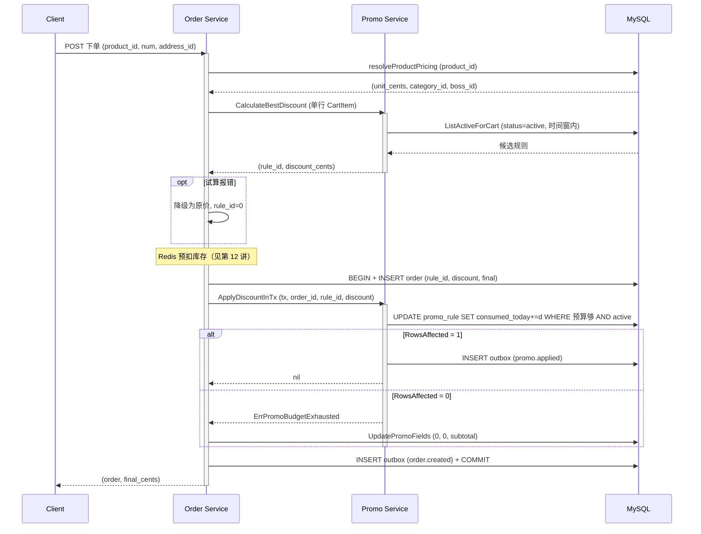
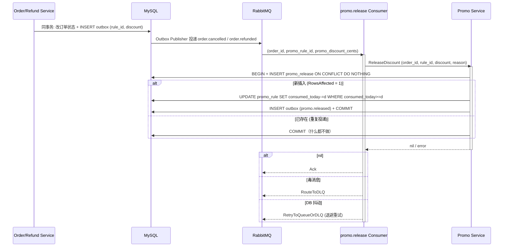
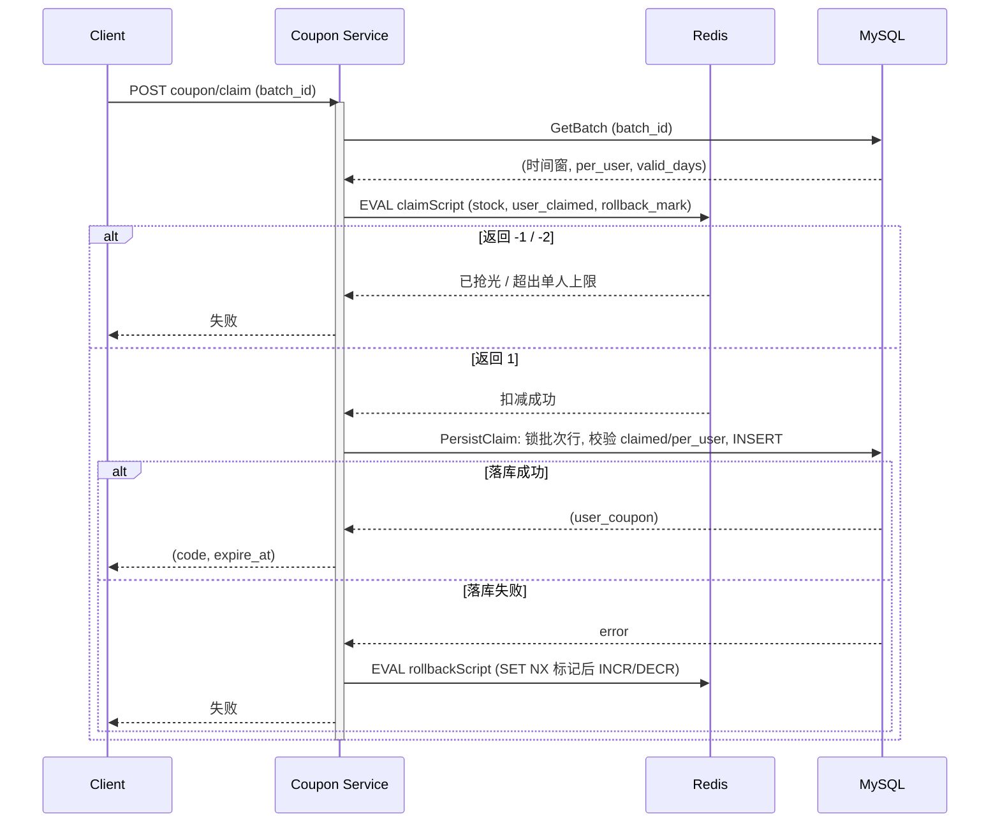

# 16 营销补贴：满减预算防超发、降级与回收（附优惠券领取）

> gomall · `internal/promo` / `internal/coupon` / 下单链路里的 `ApplyDiscountInTx`
>
> 这一讲只回答一个问题：平台拿出一笔有限的补贴预算，怎样保证并发下单时不超发，预算不够时不挡单，订单取消或退款后预算一分不差地收回来。

## 本讲目标

讲完后，学生应该能：

- 说清满减引擎“一单一条、取最优、按作用范围算门槛”的规则，以及为什么实付只信服务端价格；
- 解释下单时“事务外试算、事务内条件 UPDATE 扣预算”的两段式设计，和预算用尽时降级而不拒单的取舍；
- 画出 `order.cancelled` / `order.refunded` 驱动预算回收的链路，指出幂等落在哪张表的哪个索引；
- 对比优惠券领取的 Redis Lua 闸门与 DB 行锁兜底，说明发放上限以谁为准；
- 说清几处边界条件的处理：满减封顶到 0、规则停用后仍可退预算、退预算不减成负数、Redis 回滚只做一次。

---

## 一、促销是平台在花钱：先看三起事故

**本节判断：满减不是“显示一个更低的价格”，而是平台在给每笔订单付补贴；所以要像管钱一样管预算，超发、漏收、配错都是资损。**

运营上线一条规则：“全场满 200 减 20，每日预算 10 万元”。活动开始后，客服和财务陆续收到这几类问题：

| 场景 | 现象 | 本质 |
|---|---|---|
| 零点开抢，几千单同时命中 | 预算显示 10 万，实际补贴了 10.3 万 | 并发扣预算超发 |
| 运营把“满 200 减 20”配成“满 2 分减 20 元” | 20 元以下的订单实付 0 元，其余每单白减 20 元 | 规则配置缺校验 |
| 大量订单超时未付被关单 | 下午三点活动就“没钱了”，后面用户都拿不到折扣 | 关单后预算没回收 |

gomall 的 promo 模块对这三件事分别给出了答案：条件 UPDATE 防超发、计算层封顶加下单侧 clamp 双重兜底、事件驱动的幂等回收。

先把业务规则定下来，引擎代码就是照着它写的（`internal/promo/model.go:9-13`）：

```go
// 满减 / 阶梯折扣规则。与 CouponBatch 互补：
//   - Coupon 需要用户领取，PerUser 限领；
//   - PromoRule 不需要领取，结算时引擎自动取最优；
//   - 一笔订单只能匹配一条 PromoRule（不叠加），但 PromoRule 可与已领取的 Coupon 叠加 ——
//     业务规则：先满减、后券。引擎只负责前半段。
```

“不叠加”让补贴成本可预测：一笔订单最多花掉一条规则的预算。“先满减、后券”划清了两个模块的职责：promo 引擎只算满减，券是用户自己的资产，本讲的券部分聚焦领取这一侧的并发控制（第五节）。

规则本身的字段（`internal/promo/model.go:32-46`，删减了 tag）：

```go
type PromoRule struct {
    dbmodel.Model
    Name             string
    RuleType         int    // 1 满减 / 2 满折扣
    Scope            int    // 1 全场 / 2 类目 / 3 商品
    ScopeRefID       int64  // 类目 id 或商品 id；全场 = 0
    ThresholdCents   int64  // 满 X 分
    DiscountCents    int64  // 减 Y 分（RuleType=1）
    DiscountBps      int    // 折扣 bps（RuleType=2），9 折 = 9000
    DailyBudgetCents int64  // 当日预算分；0 = 不限
    ConsumedToday    int64  // 当日已消耗分（每日 0 点重置 —— cron 路线图）
    StartAt, EndAt   time.Time
    Status           int    // 0 draft / 1 active / 2 stopped
}
```

所有金额都是 `int64` 分，和支付、清算一样。预算靠 `DailyBudgetCents` 和 `ConsumedToday` 这一对字段控制：前者是上限，`0` 表示不限；后者是累计消耗，下单扣、关单退都只改它。上限只由运营写，消耗只由交易链路写，两者不会互相覆盖。

---

## 二、满减引擎：取最优、按范围算门槛、金额只信服务端

**本节判断：引擎是一组纯函数，输入购物车行和候选规则，输出“减得最多的那一条”；它不碰预算，也不判断价格真假，真假由调用方负责。**

### 2.1 取最优

`PickBestPromoRule`（`internal/promo/service.go:63-81`）：

```go
func PickBestPromoRule(items []CartItem, rules []*PromoRule) (*PromoRule, int64) {
    var best *PromoRule
    var bestDiscount int64
    for _, r := range rules {
        base := applicableSubtotal(items, r)
        if base < r.ThresholdCents {
            continue
        }
        d := computeDiscountOnBase(base, r)
        if d <= 0 {
            continue
        }
        if d > bestDiscount {
            best = r
            bestDiscount = d
        }
    }
    return best, bestDiscount
}
```

注释里写了取舍：给用户“最优”，平台成本反而最高，但这是行业惯例，不能偷偷给用户较小的那条。

### 2.2 门槛按作用范围内的子集算

`applicableSubtotal` 只累加命中规则范围的行（`internal/promo/service.go:84-105`）：

```go
func itemMatchesRule(it CartItem, r *PromoRule) bool {
    switch r.Scope {
    case PromoScopeAll:
        return true
    case PromoScopeCategory:
        return it.CategoryID == r.ScopeRefID
    case PromoScopeProduct:
        return it.ProductID == r.ScopeRefID
    default:
        return false
    }
}
```

举例：购物车里有 150 元的鞋和 80 元的袜子，规则是“鞋类满 200 减 30”。全场合计 230，但鞋类子集只有 150，不满足门槛。门槛和减免都落在同一个 base 上，避免“用袜子凑单、减的却是鞋”。

### 2.3 满减封顶，折扣向下取整

`computeDiscountOnBase`（`internal/promo/service.go:110-127`）：

```go
case PromoRuleTypeAmount:
    if r.DiscountCents > base {
        return base
    }
    return r.DiscountCents
case PromoRuleTypeDiscount:
    if r.DiscountBps <= 0 || r.DiscountBps >= PromoDiscountBpsBase {
        return 0
    }
    num := base * int64(PromoDiscountBpsBase-r.DiscountBps)
    return num / int64(PromoDiscountBpsBase)
```

两个细节：

- 满减封顶在 `base`，减免永远不会超过参与计算的那部分金额，实付最低到 0，不会出现负数。下单侧还有第二道保险：`finalCents < 0` 时按 0 处理并打告警（`internal/order/service.go:112-118`），引擎和调用方各守一层。
- 折扣金额用整数除法向下取整，舍掉的零头留给平台。99.99 元打 9 折，减免是 999 分而不是 999.9 分。

### 2.4 公开试算和下单用的是两份价格

试算接口挂在 public 组，不要求登录（`internal/promo/routes.go:15-17`），客户端直接把单价传上来（`internal/promo/handler.go:23-32`）：

```go
items = append(items, CartItem{
    ProductID:  it.ProductID,
    CategoryID: it.CategoryID,
    UnitCents:  it.UnitCents, // 客户端传入，只用于展示
    Quantity:   it.Quantity,
})
resp, err := GetPromoSrv().CalculateBestDiscount(c.Request.Context(), items)
```

这个结果只能拿来在结算页上展示“预计减 20 元”。真正下单时，`OrderCreate` 先用 `resolveProductPricing` 从商品表反查单价、类目和卖家（`internal/order/service.go:90-98`），再用服务端价格重新试算。用户把 `unit_cents` 改成 1 分，最多让自己看到一个假的试算结果，改不了实付。

下单侧给引擎喂的是服务端组装的购物车行（`internal/order/service.go:250-257`）：

```go
func buildPromoCartItems(productID uint, categoryID, unitCents, qty int64) []promo.CartItem {
    return []promo.CartItem{{
        ProductID:  int64(productID),
        CategoryID: categoryID,
        UnitCents:  unitCents,
        Quantity:   qty,
    }}
}
```

`OrderCreate` 一次下一个商品（见第 09 讲），所以门槛按这一笔订单本身的金额计算，规则是“每单满 X 减 Y”。每一行的单价、类目都来自 `resolveProductPricing`，引擎拿到的输入没有一个字段来自客户端。同一个引擎函数同时服务试算接口和下单，规则只有一份实现，不会出现两套算法。

`CalculateBestDiscount` 是纯读（`internal/promo/service.go:161-190`），只决定“哪条规则最优、减多少”，不判断预算够不够。预算是否真正扣得到，留到建单事务里那条条件 UPDATE 去裁决（3.2）。这样试算可以放心地被频繁调用，不会占用任何锁；对应地，结算页文案写成“预计可减”，以下单返回的 `final_cents` 为准。

---

## 三、下单扣预算：一条条件 UPDATE 防超发，用尽就降级

**本节判断：试算放在事务外，扣预算放在建单事务里，用一条带条件的 UPDATE 同时检查预算和规则状态；预算没了就把订单改成无折扣，而不是让用户下不了单。**

### 3.1 两段式：先读后写



试算在事务外做（`internal/order/service.go:100-109`）：

```go
// 满减计算先于事务发生：纯读路径，DB 慢一点也不影响事务保持时间。
cartItems := buildPromoCartItems(req.ProductID, categoryID, unitCents, qty)
promoApply, promoErr := s.promo.CalculateBestDiscount(ctx, cartItems)
if promoErr != nil {
    // 失败降级：CalculateBestDiscount 不应阻断下单
    promoApply = &promo.PromoApplyResp{OriginalCents: subtotalCents, FinalCents: subtotalCents}
}
```

试算失败（比如规则表查询超时）不挡单，按原价下。这是第一层降级。

为什么不把试算也放进事务？试算要拉候选规则、跑循环，放进事务会拉长持锁时间。事务里只留一条必须原子的写。

### 3.2 一条 UPDATE 同时守住预算和状态

`AtomicConsumeBudget`（`internal/promo/repo.go:93-108`）：

```go
func (d *PromoDao) AtomicConsumeBudget(tx *gorm.DB, ruleID uint, amount int64) error {
    if amount <= 0 {
        return nil
    }
    res := tx.Model(&PromoRule{}).
        Where("id = ? AND status = ? AND (daily_budget_cents = 0 OR consumed_today + ? <= daily_budget_cents)",
            ruleID, PromoStatusActive, amount).
        UpdateColumn("consumed_today", gorm.Expr("consumed_today + ?", amount))
    if res.Error != nil {
        return res.Error
    }
    if res.RowsAffected == 0 {
        return ErrPromoBudgetExhausted
    }
    return nil
}
```

这和第 12 讲 Redis Lua 扣库存是同一种思路：“检查”和“扣减”必须是一个不可分割的动作。这里不需要 `SELECT ... FOR UPDATE` 再判断，因为 InnoDB 的单条 UPDATE 会对命中行加行锁，并在锁内重新求值 WHERE。两个事务同时扣最后 20 元，后到的那个在锁释放后读到新的 `consumed_today`，条件不成立，`RowsAffected = 0`。

`status = active` 也写进了 WHERE。运营在用户试算之后、提交之前点了“停用”，这笔订单会自然走到降级分支，不需要额外加锁或广播。

扣成功后，同一个事务里写 `promo.applied` outbox（`internal/promo/service.go:233-248`），给财务统计每条规则的真实补贴成本。outbox 为什么必须同事务，见第 00 讲（下）。

### 3.3 预算用尽：降级，三个字段同进同退

建单事务里的处理（`internal/order/service.go:148-169`）：

```go
if order.PromoRuleID != 0 && order.PromoDiscountCents > 0 {
    applyErr := s.promo.ApplyDiscountInTx(tx, order.ID, order.PromoRuleID, order.PromoDiscountCents)
    if applyErr != nil {
        if errors.Is(applyErr, promo.ErrPromoBudgetExhausted) {
            order.PromoRuleID = 0
            order.PromoDiscountCents = 0
            order.FinalCents = subtotalCents
            if uerr := NewOrderDaoByDB(tx).UpdatePromoFields(order.ID,
                order.PromoRuleID, order.PromoDiscountCents, order.FinalCents); uerr != nil {
                return uerr
            }
        } else {
            return applyErr
        }
    }
}
```

`UpdatePromoFields` 一次改三列（`internal/order/repo.go:86-94`），注释要求只在下单事务里调用。三列必须同进同退，因为下游各自读其中一列：

- 支付和结算用 `PromoRuleID != 0` 判断是否命中促销，命中才读 `FinalCents`（`internal/payment/settle.go:48-53`，见第 02 讲）；
- 退款打款的 `refundAmount` 同样按 `PromoRuleID` 选口径（`internal/refund/service.go:214-219`），命中促销就退实付，否则退原价；
- 关单、退款事件把 `PromoRuleID` 和 `PromoDiscountCents` 原样带给预算回收（第四节）。

只改了 `FinalCents` 没改 `PromoRuleID`，用户付原价，退款时却按“命中促销”口径计算，结算和对账就对不上。

### 3.4 降级还是拒单

代码里的注释是“宁可不给折扣也不能让用户下不了单”（`internal/order/service.go:142`）。这个取舍值得在课堂上讨论：

| 方案 | 用户体验 | 平台风险 |
|---|---|---|
| 降级为原价（gomall 的选择） | 下单成功，但比试算时贵 | 客诉“说好的减 20 呢” |
| 拒单并提示预算用尽 | 用户需要重新确认 | 转化率下降 |
| 降级到次优规则 | 体验最好 | 要在事务里再跑一次引擎，逻辑复杂 |

gomall 选了第一种，而且直接降到无折扣，不去试候选里的第二条规则。理由有三：事务里只做一次条件 UPDATE，持锁时间可控；降级路径只改三列，逻辑简单好测；用户拿到的 `final_cents` 是下单接口的返回值，前端据此展示实付，不会出现“扣了钱却不知道为什么”。

这个取舍放在 order 一侧做，promo 只负责如实报告 `ErrPromoBudgetExhausted`。`ApplyDiscountInTx` 本身不决定拒单还是降级，调用方按自己的业务口径处理；换一个对价格更敏感的场景（比如秒杀），同样的错误可以直接映射成拒单。

---

## 四、关单与退款：预算怎样只退一次

**本节判断：预算回收由订单事件驱动，消费者不反查订单表；`promo_release.order_id` 唯一索引是幂等的唯一依据，重复投递不会重复回补。**

### 4.1 事件自带要退多少

超时关单和退款获批两处，都在改订单状态的同一事务里写 outbox，并把促销字段带进 payload：

```go
// internal/order/cancel.go:54-66（删减了 OrderNum 等字段）
outbox.NewOutboxDaoByDB(tx).Insert(
    "order", "OrderCancelled", "order.cancelled", order.ID,
    events.OrderCancelled{
        OrderID:            order.ID,
        Reason:             "timeout",
        PromoRuleID:        order.PromoRuleID,
        PromoDiscountCents: order.PromoDiscountCents,
    },
)
```

`internal/refund/service.go:140-151` 的 `order.refunded` 同理。消费侧直接用 payload 里的值，不再查订单表。好处是消费者和订单表解耦；前提是第三节的“三字段同进同退”成立，否则 payload 里带出去的就是错的。

降级订单的 `PromoRuleID = 0`，消费者直接放行（`internal/promo/consumer.go:33-35`），不会退一笔从没扣过的预算。



### 4.2 台账先写，预算后退

`ReleaseDiscount`（`internal/promo/service.go:260-293`，删减了 outbox 写入）：

```go
return db.Transaction(func(tx *gorm.DB) error {
    txDao := NewPromoDaoByDB(tx)
    created, err := txDao.CreateReleaseOnce(&PromoRelease{
        OrderID:       orderID,
        RuleID:        ruleID,
        DiscountCents: discountCents,
        Reason:        reason,
    })
    if err != nil {
        return err
    }
    if !created {
        // 台账已存在：本次是重复投递，预算与事件均已落，幂等返回。
        return nil
    }
    if err := txDao.RestoreBudget(tx, ruleID, discountCents); err != nil {
        return err
    }
    // ... 写 outbox promo.released
})
```

`CreateReleaseOnce` 用 `ON CONFLICT DO NOTHING`，看 `RowsAffected` 判断是不是第一次（`internal/promo/repo.go:31-37`）。唯一索引建在 `order_id` 上（`internal/promo/model.go:54-60`），因为一笔订单要么超时关单，要么付款后退款，两者互斥，整个生命周期最多退一次。

这里没有“先 SELECT 台账，没有再处理”：两条重复消息并发时都会查到“没有”，这是经典的 check-then-act 竞态。直接 INSERT，让唯一索引做裁判，数据库保证只有一个事务插入成功，另一个拿到 `created = false` 后什么都不做。台账、预算、事件在同一个事务里，任何一步失败一起回滚，消息重试时从头再来。

### 4.3 退还的两个边界

`RestoreBudget`（`internal/promo/repo.go:113-120`）：

```go
return tx.Model(&PromoRule{}).
    Where("id = ? AND consumed_today >= ?", ruleID, amount).
    UpdateColumn("consumed_today", gorm.Expr("consumed_today - ?", amount)).Error
```

- **WHERE 里没有 status 条件**。规则停用后也能退，否则停用前下的单关掉以后，预算就算丢了（`internal/promo/service.go:253-254`）。
- **不允许减成负数**。条件不满足时 `RowsAffected = 0`，不报错。`consumed_today` 是一个计数器，减成负数等于凭空多出预算，下一单就能超发；所以宁可这次少退，也不让计数越过 0。不报错是有意的：这种情况重试多少次结果都一样，返回错误只会让消息在重试队列里空转。台账照常写入，同一订单后续的重复消息仍然被 `order_id` 唯一索引挡住。

### 4.4 消费者的失败分流

`StartReleaseConsumer`（`internal/promo/consumer.go:72-98`）绑定两个 routing key，分流规则和第 05、11 讲的结算消费者一致：

```go
err := DispatchReleaseEvent(ctx, key, d.Body)
if err == nil {
    _ = d.Ack(false)
    return
}
if errors.Is(err, errReleasePoisonMessage) {
    rabbitmq.RouteToDLQ(d, releaseQueue, key, true)
    return
}
rabbitmq.RetryToQueueOrDLQ(d, releaseQueue, key)
```

JSON 解析失败、未知 routing key 进 DLQ；DB 抖动按 `SettleRetryDelays`（10 秒到 6 小时共 6 级，`repository/rabbitmq/retry.go:23-25`）退避重试。重试能放心做，靠的是 4.2 的台账幂等。`DispatchReleaseEvent` 是纯函数（`internal/promo/consumer.go:54-63`），可以不连 MQ 直接测。`order.cancelled` 和 `order.refunded` 都在 outbox 的资金事件白名单里（`internal/shared/outbox/publisher.go:74-77`），投递失败会一直重试，不会被标成 dead。

---

## 五、优惠券领取：Redis 是闸门，DB 才是权威

**本节判断：领券用 Redis Lua 挡住洪峰，但发放总量和单人上限最终以 DB 行锁下的二次校验为准；Redis 和 DB 不一致时宁可少发，不能超发。**

券和满减不同：用户要先领，每批有总量 `Total` 和单人上限 `PerUser`（`internal/coupon/model.go:23-35`）。领券接口要登录，建批次只有 admin 能调（`internal/coupon/routes.go:8-13`）。

### 5.1 快速路径：一段 Lua 完成检查和扣减

`claimScript`（`repository/cache/coupon.go:40-55`）：

```lua
local stock = tonumber(redis.call('GET', KEYS[1]))
if stock == nil or stock <= 0 then
    return -1
end
local owned = tonumber(redis.call('GET', KEYS[2]))
if owned == nil then owned = 0 end
if owned >= tonumber(ARGV[1]) then
    return -2
end
redis.call('DECR', KEYS[1])
redis.call('INCR', KEYS[2])
redis.call('EXPIRE', KEYS[2], tonumber(ARGV[2]))
redis.call('DEL', KEYS[3])
return 1
```

机制和第 12 讲的两桶库存预扣一样，不再展开。这里换个角度看：这个 Lua 只是闸门，挡掉绝大多数注定领不到的请求，让它们碰不到 MySQL。

### 5.2 落库：在批次行锁下再查一遍

Lua 通过后，`PersistClaim` 开事务、锁批次行，重新校验总量和单人上限（`internal/coupon/repo.go:107-136`，删减了建券记录）：

```go
var batch CouponBatch
if err := tx.Clauses(clause.Locking{Strength: "UPDATE"}).
    Where("id = ?", batchId).First(&batch).Error; err != nil {
    return err
}
if batch.Claimed >= batch.Total {
    return cache.ErrCouponSoldOut
}
var owned int64
if err := tx.Model(&UserCoupon{}).
    Where("user_id = ? AND batch_id = ?", userId, batchId).
    Count(&owned).Error; err != nil {
    return err
}
if owned >= batch.PerUser {
    return ErrPerUserLimitReached
}
// claimed + 1，INSERT user_coupon
```

为什么 Redis 扣成功了还要再查？因为 Redis 计数可能和 DB 不一致：

- 用户已领标记的 TTL 只有 24 小时（`repository/cache/coupon.go:94`），过期后 Redis 会忘记这个用户领过；
- 服务端打开 `COUPON_ALLOW_DB_MODE` 后，DB 模式只加 `claimed`，不扣 Redis 库存（`internal/coupon/service.go:71-73`），两种模式混用时 Redis 库存偏多；
- Redis 重启、key 被淘汰。

`repo_test.go` 用混用场景证明不超发（`internal/coupon/repo_test.go:19-55`）：Total=3，先用 DB 模式发 2 张，再走 `PersistClaim` 发第 3 张，之后第 4、5 张 `PersistClaim` 和第 6 张 DB 模式都返回 `ErrCouponSoldOut`，最终发放量等于 3。这个测试在 SQLite 上串行执行，验证的是总量守卫的判断逻辑；并发下的互斥由 MySQL 的 `FOR UPDATE` 行锁提供：同一批次的落库请求在批次行上排队，每个请求读到的 `claimed` 都是上一个提交后的值。

### 5.3 落库失败要把 Redis 还回去，而且只还一次



回滚脚本（`repository/cache/coupon.go:67-74`）：

```lua
if redis.call('SET', KEYS[3], '1', 'NX', 'EX', tonumber(ARGV[1])) == false then
    return 0
end
redis.call('INCR', KEYS[1])
redis.call('DECR', KEYS[2])
return 1
```

用 per-(user, batch) 的 `SET NX` 标记保证同一次领取只回滚一次；领券脚本成功时 `DEL` 掉这个标记（5.1 那段 Lua 的倒数第二行），让下一次领取失败时仍然能回滚。回滚失败打错误日志（`internal/coupon/service.go:94-97`）。即使回滚没成功，后果也只是 Redis 库存偏少、少发几张，DB 侧的总量和单人上限不受影响，符合本节“宁可少发，不能超发”的方向。

还有一个可以讨论的点：DB 返回 `ErrCouponSoldOut` 时也会回滚，Redis 库存被加回 1。由于 DB 是权威，多出来的这 1 只会让后续请求多跑一次落库再被拦下，不会超发。

### 5.4 券码

券码由秒级时间戳、批次、用户和 4 字节 `crypto/rand` 组成（`internal/coupon/repo.go:155-163`）。没有随机段的话，同一用户同一秒连续领取（`PerUser > 1`）会撞 `code` 唯一索引。

---

## 六、故障演练 / 课堂演示

演示前准备一条规则：全场满 100 元减 20 元，`daily_budget_cents = 3000`（只够一单半）。每一步先让学生预测结果，再看数据。

**演练 1：预算挤穿时降级。** 连续下两笔 100 元以上的单。

- 第一单：`orders.promo_rule_id` 为规则 id，`final_cents` 少 2000；`consumed_today = 2000`；outbox 有一条 `promo.applied`。
- 第二单：日志出现 `[promo] downgrade rule=... budget exhausted`；订单三字段为 `0 / 0 / 原价`；`consumed_today` 仍是 2000；没有第二条 `promo.applied`。
- 再并发打 20 单，确认 `consumed_today` 永远不超过 3000。

**演练 2：关单退预算，重复投递不重复退。** 让第一单超时关单（或直接触发关单逻辑）。

- `promo_release` 多一行，`reason = cancel`；`consumed_today` 回到 0；outbox 有 `promo.released`。
- 在 RabbitMQ 管理台把同一条 `order.cancelled` 再发一次：`promo_release` 仍只有一行，`consumed_today` 不变。
- 发一条非 JSON 的 body：消息进 DLQ，业务队列不阻塞。

**演练 3：停用后关单，预算照退。** 演练 2 之后预算已回到 0，新下一单命中规则，然后调用 `PATCH admin/promo/rules/{id}/stop` 停用规则，再让这一单超时关单。

- 先让学生预测：规则已经 stopped，预算还退不退？
- 结果：`promo_release` 多一行，`consumed_today` 减回去。原因是 `RestoreBudget` 的 WHERE 里没有 status 条件（4.3）。
- 对照：停用后再下一单，`ListActiveForCart` 只拉 active 规则，这条规则不再是候选，订单按原价；就算停用发生在试算之后、建单之前，`AtomicConsumeBudget` 的 WHERE 带 `status = active`，也只会走降级（3.2）。扣和退对状态的要求不对称，正是为了让“停用前已扣的钱”一定能收回来。

**演练 4：封顶边界。** 用 admin 接口建一条“满 1 分减 10000 分”的全场规则，下一笔 50 元订单：`final_cents = 0`，日志里没有 clamp 告警，因为引擎已经把减免封顶在 `base`，实付恰好为 0 而不是负数，下单侧的 clamp 不需要出手。问学生：这一单还需要支付吗，下游怎么判断它命中了促销（答案：`PromoRuleID != 0`，见第 02 讲）。

**演练 5：领券并发不超发。** 建一个 `Total=10`、`PerUser=1` 的券批次，用压测工具让 50 个不同用户同时领，再让同一个用户并发领 5 次。

- 50 个用户里恰好 10 个成功，`coupon_batch.claimed = 10`，`user_coupon` 10 行，其余返回“已抢光”，绝大多数在 Lua 闸门就被挡下，没有碰 MySQL。
- 同一用户并发 5 次只成功 1 次，其余返回超出单人上限。
- 收尾时对一下 Redis 的 stock key 和 DB 的 `Total - Claimed`：在没有落库失败的情况下两者相等。

---

## 课后练习

1. **设计按自然日滚动的预算。** 如果运营希望预算每天 0 点恢复，你会怎样设计？思考：前一天扣的单在第二天被取消，`RestoreBudget` 的 `consumed_today >= amount` 守卫会怎样保护计数器？要不要在台账里记“扣减日期”，只把当日的消耗退回当日？
2. **推演并发扣预算。** 规则剩余预算 20 元，两个事务同时各扣 20 元。按时间顺序写出两条 `AtomicConsumeBudget` 的加锁、WHERE 求值和提交过程，说明为什么第二个事务一定拿到 `RowsAffected = 0`，以及它在 3.3 里会走哪条分支。
3. **给引擎写表驱动测试。** 覆盖：子集不满门槛、两条规则取大、满减封顶、9 折向下取整、bps 越界返回 0。
4. **给下单降级写测试。** 用 `NewOrderSrv` 注入一个 `ApplyDiscountInTx` 返回 `ErrPromoBudgetExhausted` 的替身，断言订单三字段被改回无折扣，且事务提交成功。
5. **设计券的核销。** 下单时传 `coupon_code`，按“先满减、后券”计算；说明核销必须和建单在同一事务里，以及关单、退款时券如何退回 `unused`，怎样做幂等。
6. **分析 Redis 与 DB 的偏差方向。** 对 5.2 列出的三种不一致和 5.3 的回滚失败，逐一判断 Redis 计数相对 DB 是偏多还是偏少，各自会让用户看到什么，并说明为什么无论哪个方向都不会超发。

---

## 代码索引

| 想看的内容 | 文件 | 入口 |
|---|---|---|
| 规则与台账模型 | `internal/promo/model.go` | `PromoRule`、`PromoRelease` |
| 引擎纯函数 | `internal/promo/service.go` | `PickBestPromoRule`、`computeDiscountOnBase` |
| 试算、扣预算、退预算 | `internal/promo/service.go` | `CalculateBestDiscount`、`ApplyDiscountInTx`、`ReleaseDiscount` |
| 条件 UPDATE 与台账 | `internal/promo/repo.go` | `AtomicConsumeBudget`、`RestoreBudget`、`CreateReleaseOnce` |
| 预算回收消费者 | `internal/promo/consumer.go` | `StartReleaseConsumer`、`DispatchReleaseEvent` |
| 试算与后台接口 | `internal/promo/handler.go`、`internal/promo/routes.go` | `PromoCalculateHandler` |
| 下单应用促销与降级 | `internal/order/service.go` | `OrderCreate`、`buildPromoCartItems` |
| 三字段同进同退 | `internal/order/repo.go` | `UpdatePromoFields` |
| 事件 payload | `internal/order/cancel.go`、`internal/refund/service.go`、`service/events/events.go` | `OrderCancelled`、`OrderRefundedEvent`、`PromoApplied` |
| 领券服务 | `internal/coupon/service.go` | `CreateBatch`、`Claim` |
| DB 兜底与券码 | `internal/coupon/repo.go` | `PersistClaim`、`ClaimWithDBLock`、`generateCouponCode` |
| Lua 闸门与回滚 | `repository/cache/coupon.go` | `claimScript`、`rollbackScript` |
| 混用模式不超发测试 | `internal/coupon/repo_test.go` | `TestMixedClaimModesNeverExceedTotal` |
