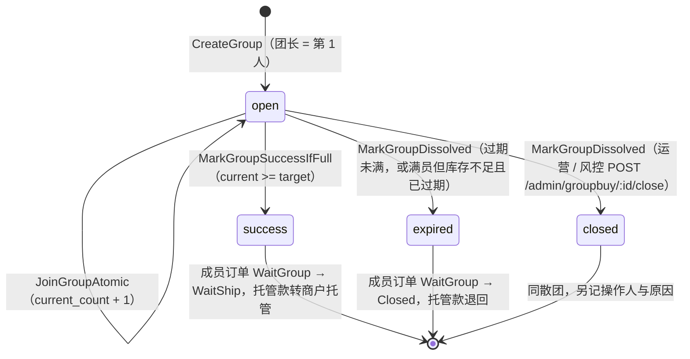
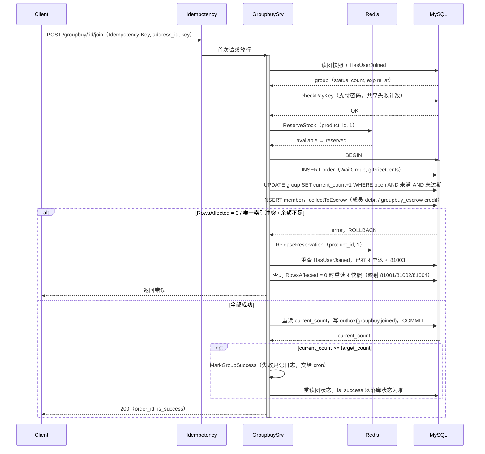
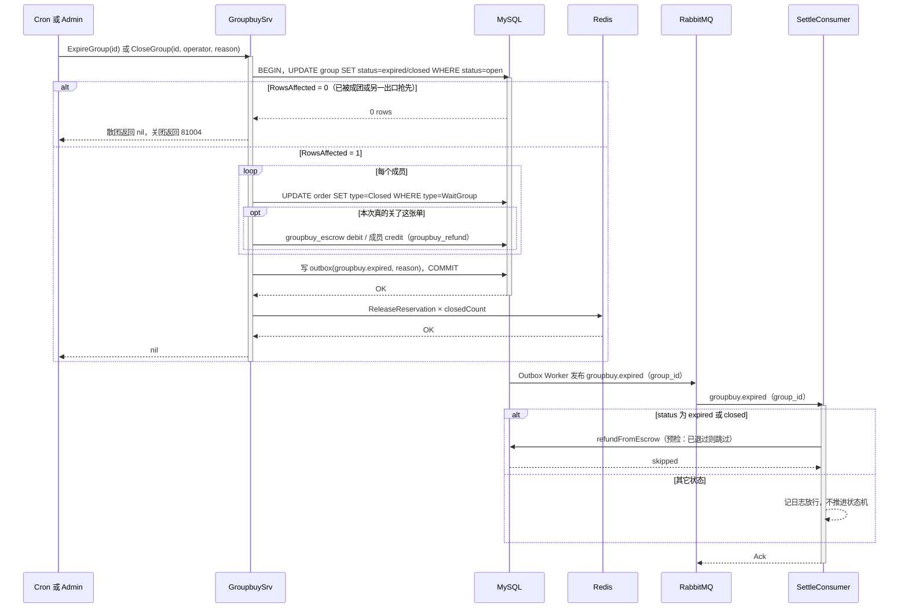

# 17 拼团：多人凑单的状态机、托管资金与散团 Saga

> gomall · `internal/groupbuy` / `WaitGroup` 订单 / 团级条件更新 / 拼团托管转商户托管 / 散团与关团补偿

---

## 一、先看四个客诉：拼团为什么需要单独的状态机

**拼团订单在“付了钱但还没成交”的中间态停留最长 24 小时，必须有一个独立的订单状态和一个团级状态来表达它，否则名额、资金、库存三件事都无法收口。**

上线拼团第一周，客服收到四类工单：

1. “3 人团最后一个名额，我和另一个人同时点了参团，两个人都显示成功”；
2. “明明凑齐了，页面却显示拼团失败”；
3. “团散了，钱一直没退”；
4. “拼团页显示有货，成团时会不会卖超”。

四条分别落在名额、成团判定、退款和库存上：第一条看第二节的条件更新，第二条看第五节的补成团，第三条看第五节的同事务退款，第四条看第四节的 DB 条件扣减。

普通订单的状态链是 `WaitPay → WaitShip → ...`（见第 09 讲）。拼团加入时就扣钱，但卖家还不能发货，所以 gomall 加了一个过渡态 `WaitGroup`，它只有两条出边：

```go
// internal/order/state.go:21-28（节选）
var orderStateTransitions = map[uint][]uint{
	consts.OrderWaitPay:     {consts.OrderWaitShip, consts.OrderClosed},
	// ……省略其它状态
	consts.OrderWaitGroup:   {consts.OrderWaitShip, consts.OrderClosed},
}
```

一个人的订单状态说不清“团凑齐没有”，于是团本身也有状态：

```go
// internal/groupbuy/model.go:10-19
const (
	GroupbuyStatusOpen    uint = 0 // 进行中，可加入
	GroupbuyStatusSuccess uint = 1 // 成团：成员订单已从 WaitGroup → WaitShip
	GroupbuyStatusExpired uint = 2 // 超时未凑齐 → Saga 散团
	GroupbuyStatusClosed  uint = 3 // 人工 / 风控关团

	GroupbuyMemberJoined   uint = 0 // 已加入，订单处于 WaitGroup
	GroupbuyMemberSucceed  uint = 1 // 成团：订单已推进到 WaitShip
	GroupbuyMemberRefunded uint = 2 // 散团：订单已 Closed，预扣库存已归还
)
```



`expired` 和 `closed` 的资金、订单、库存动作完全一样，区别只在谁触发、是否留审计字段。四张表的分工：

| 实体 | 表 | 负责的事实 |
|---|---|---|
| 团 | `groupbuy_group` | 目标人数、当前人数、拼团价、截止时间、团状态；人工关团时的 `closed_by` / `close_reason` |
| 成员 | `groupbuy_member` | 谁在团里、对应哪张订单；`uk_gb_group_user(group_id, user_id)` 唯一 |
| 订单 | `order` | 每个成员一张独立订单，`Type = WaitGroup` |
| 通知 | `groupbuy_notice` | 参团 / 成团 / 散团的站内通知，见 5.6 |

两个字段从建团起就不再变：`price_cents` 和 `product_id`（`model.go:26` 的注释）。参团者付的钱以团上落库的价格为准，而这个价格在开团时只从商品表取：

```go
// internal/groupbuy/service.go:106-112
// 卖家与拼团价都以商品表为准：boss_id 决定货款打给谁，拼团价由商家在商品上配置，
// 均不接收客户端传值；商品未开放拼团（拼团价为 0）直接拒绝。
priceCents, bossID, err := product.NewProductDao(ctx).ResolveGroupbuyPricing(productID)
if err != nil {
	// 省略日志
	return nil, err
}
```

`ResolveGroupbuyPricing`（`internal/product/pricing.go:59-75`）拒绝三种商品：未配置拼团价、未上架、拼团价越界。参团时卖家再用 `ResolveBossID` 反查一次（`service.go:237`），价格直接用 `g.PriceCents`（`service.go:272`）。即使请求体里带了 `boss_id`（`handler.go:24、30`），service 也以商品表反查的结果覆盖它（`service.go:266` 的注释“已由商品表反查覆盖”）：收款方和价格都不信客户端。

开团还有两个服务端上限（`service.go:95-104`）：成团人数在 2 到 `MaxGroupbuyTarget = 100` 之间；客户端传的时效为 0 时取 `DefaultGroupbuyTTL = 24h`，超过 24 小时直接拒绝。两个上限保护的是同一件事：团没结束前，每个成员的钱和 1 份预扣库存都押在平台手里，人数越多、时效越长，押得越久。

---

## 二、抢名额：一条条件 UPDATE 加唯一索引

**名额是团行上的一个计数器，“检查还有没有位置”和“占一个位置”必须是同一条 SQL；“同一个人只能进一次”交给唯一索引，而不是交给先查后写。**

### 2.1 入口：幂等中间件挡掉连点

开团和参团都会扣钱，两个 POST 都挂了第 03 讲的幂等中间件：

```go
// internal/groupbuy/routes.go:15-20
public.GET("/groupbuy/:id", GroupbuyShowHandler())
authed.POST("/groupbuy/create", middleware.Idempotency(), GroupbuyCreateHandler())
authed.POST("/groupbuy/:id/join", middleware.Idempotency(), GroupbuyJoinHandler())
authed.GET("/groupbuy/notices", GroupbuyNoticesHandler())

admin.POST("groupbuy/:id/close", AdminCloseGroupHandler())
```

同一个 `Idempotency-Key` 的第二次请求直接拿到第一次的响应，不会再开一个团。这一层要求前端每次点击生成一个 key 并在重试时复用；它挡的是“同一次操作被发了两遍”，挡不住“用户在两台设备各点一次”，后者交给下面的数据库约束。分享落地页 `GET /groupbuy/:id` 放在 public 组，免登录可看。

### 2.2 前置校验只负责给出好看的错误码

`JoinGroup` 进事务前会读一次团，按状态返回不同业务码：

```go
// internal/groupbuy/service.go:215-233
if g == nil {
	return nil, ErrGroupbuyNotFound
}
// 状态前置校验，给出准确业务码
switch g.Status {
case GroupbuyStatusSuccess, GroupbuyStatusClosed:
	return nil, ErrGroupbuyClosed
case GroupbuyStatusExpired:
	return nil, ErrGroupbuyExpired
}
if !g.ExpireAt.After(time.Now()) {
	return nil, ErrGroupbuyExpired
}
if g.CurrentCount >= g.TargetCount {
	return nil, ErrGroupbuyFull
}
if joined, e := gbDao.HasUserJoined(groupID, userID); e == nil && joined {
	return nil, ErrGroupbuyDuplicateJoin
}
```

这些都是“读后判断”，两个请求可以同时通过。它们的价值是让绝大多数正常请求在开事务、扣库存之前就拿到准确提示（`pkg/e/code.go:66-70`：81001 满员 / 81002 超时 / 81003 重复 / 81004 已关闭 / 81005 不存在），**不是并发安全的依据**。这些 sentinel 都用 `e.New` 构造（`service.go:37-43`），走统一错误出口时自动透出业务码和客服话术，handler 不写映射，`errors.Is` 判定照常。

### 2.3 真正的并发闸门在 JoinGroupAtomic

```go
// internal/groupbuy/repo.go:55-72
func (d *GroupbuyDao) JoinGroupAtomic(groupID uint, member *GroupbuyMember) error {
	res := d.DB.Model(&GroupbuyGroup{}).
		Where("id=? AND status=? AND current_count<target_count AND expire_at>?",
			groupID, GroupbuyStatusOpen, time.Now()).
		UpdateColumn("current_count", gorm.Expr("current_count + 1"))
	if res.Error != nil {
		return res.Error
	}
	if res.RowsAffected == 0 {
		// 满 / 超时 / 关 / 不存在 —— service 层根据 group 当前快照判定具体业务码
		return ErrGroupbuyFull
	}
	if err := d.DB.Create(member).Error; err != nil {
		// 唯一索引冲突 → 81003 重复加入
		return err
	}
	return nil
}
```

回到客诉 1：3 人团已有 2 人，A、B 同时参团。两条 `UPDATE` 落在同一行上，InnoDB 行锁让它们串行执行。先执行的把 `current_count` 从 2 改成 3，后执行的再求值 `current_count<target_count` 时条件已不成立，`RowsAffected=0`。不会出现两个人都进来的情况。

这条 SQL 一次守住四个条件：团仍是 `open`、没满、没过期、团存在。`status=open` 让它和人工关团互斥：团一旦被关，后续抢名额全部落空。`expire_at>?` 保证“满员一定发生在截止前”，第五节的补成团逻辑依赖这个结论。

### 2.4 失败之后：先认人，再重读快照

事务失败后，service 先回滚库存预扣，再决定返回哪个业务码：

```go
// internal/groupbuy/service.go:324-351（节选）
if err != nil {
	// ……Saga 回滚：ReleaseReservation 释放本次预扣
	// 并发重复参团：两次请求都过了上面的 HasUserJoined 预检，后到的那次撞 uk_gb_group_user，
	// 或者先到的那次正好拿走最后一个名额，后到的那次在 JoinGroupAtomic 影响 0 行报"满员"。
	// 事务已整体回滚（名额、扣款都没生效），先重查一次成员表，用户已在团里就统一返回 81003。
	if joined, e := gbDao.HasUserJoined(groupID, userID); e == nil && joined {
		return nil, ErrGroupbuyDuplicateJoin
	}
	// JoinGroupAtomic 抛出 ErrGroupbuyFull 时，需要再读一次团状态决定真正业务码
	if atomicErr != nil && errors.Is(atomicErr, ErrGroupbuyFull) {
		latest, _ := gbDao.GetGroupByID(groupID)
		if latest != nil {
			switch latest.Status {
			case GroupbuyStatusClosed, GroupbuyStatusSuccess:
				return nil, ErrGroupbuyClosed
			case GroupbuyStatusExpired:
				return nil, ErrGroupbuyExpired
			}
			if !latest.ExpireAt.After(time.Now()) {
				return nil, ErrGroupbuyExpired
			}
		}
		return nil, ErrGroupbuyFull
	}
	return nil, err
}
```

顺序有讲究。同一用户连点两次、抢的又恰好是最后一个名额时，后到的那次在 `JoinGroupAtomic` 里拿到的是 `RowsAffected=0`，表面上像“满员”。如果先看满员，用户会收到 81001，以为自己没进团；先重查成员表，就能认出“你已经在团里了”，统一返回 81003。

`RowsAffected=0` 只说明“四个条件至少一个不成立”，不说明是哪个，所以再重读一次团。这个模式值得记住：**用条件更新拿到“能不能做”的权威结论，再用一次普通读拿到“为什么不能做”的解释**。解释读到的可能已经是下一刻的状态，但它只影响提示文案，不影响资金和名额。

### 2.5 同一个人进两次：三道防线

“一个用户在一个团里只能占一个名额”分成三层：

| 层 | 代码 | 作用 |
|---|---|---|
| 幂等中间件 | `routes.go:16-17` | 同一次点击被重发，直接回放第一次的响应 |
| 预检 | `HasUserJoined`（`repo.go:145-154`，`service.go:231`） | 顺序重复点击在开事务、扣库存之前就拿到 81003 |
| 兜底 | `uk_gb_group_user(group_id, user_id)`（`model.go:50-51`） | 两个设备同时点参团、都通过了预检时，由数据库拒绝第二行，事后重查给出 81003 |

并发场景下，两次请求都可能先抢到名额（`current_count+1`），第二次在 `Create(member)` 撞上唯一索引。关键在于抢名额、写成员行、扣钱进托管在同一个事务里（`service.go:280-323`）：成员行写不进去，前面那次 `+1` 和订单行一起回滚，后面的 `collectToEscrow` 根本不会执行；事务外再走 Saga 释放本次预扣的 1 份库存。所以无论第二次请求拿到什么提示，名额、余额、库存三者都只被占了一份。

**正确性交给条件更新和唯一索引，先查后判只负责体验**。预检可以有竞态，数据库约束不会有。

---

## 三、钱先进拼团托管：三段式资金流

**拼团加入即扣款，但这笔钱在成团之前既不属于卖家也不再属于买家，只能先放在独立的拼团托管账户 `groupbuy_escrow`；成团时转进 `merchant_escrow` 并建清算单，此后与普通订单走同一套清算；散团或关团时原路退回。三段各用一个 `biz_type`，靠流水唯一索引保证每段只发生一次。**

### 3.1 三段分录

```go
// internal/groupbuy/settle.go:19-36
// 拼团资金分三段流转，每段在台账上是一对方向相反、SUM(debit)=SUM(credit) 守恒的流水。
// ……
//	加入 → 成员钱包 debit、groupbuy_escrow credit（钱先托管在平台，不直接进卖家）
//	成团 → groupbuy_escrow debit、merchant_escrow credit + 清算单（凑齐人数才算成交，但仍要等履约完成才结算给卖家）
//	散团 / 关团 → groupbuy_escrow debit、成员钱包 credit（没成团，托管款原路退回成员）
//
// 托管账户是 user_id=0 的系统账户，用独立的 account_code=groupbuy_escrow，与外部清算、商户托管、红包分开对账；
// 系统账户不维护钱包行，流水 balance_after 记 0。
const (
	BizTypeGroupBuyPay    = "groupbuy_pay"    // 加入收款：成员 debit / 拼团托管 credit
	BizTypeGroupBuySettle = "groupbuy_settle" // 成团转清算：拼团托管 debit / 商户托管 credit
	BizTypeGroupBuyRefund = "groupbuy_refund" // 散团退款：拼团托管 debit / 成员 credit
)

// escrowAccount 拼团在途托管账户。
const escrowAccount = money.AccountCodeGroupbuyEscrow
```

系统账户共用 `user_id=0`，靠 `account_code` 区分资金语义（`internal/money/ledger_model.go:44-55`）：`external_clearing` 是外部已收资金，`merchant_escrow` 是支付后、履约前暂不归卖家的托管款，`redpacket_escrow` 是红包在途资金，`groupbuy_escrow` 是参团已扣买家钱包、尚未成团的钱。`AppendSystemTransaction` 只接受这几个系统账户（`internal/money/ledger_repo.go:48-53`），写错账户名直接报错。拼团托管单独一个账户，对账时就能单独回答“现在有多少钱押在没结束的团里”，不会和红包或商户托管混在一起。历史上写在 `legacy_system` 下的 `groupbuy_*` 流水，由启动迁移里可重复执行的 `backfillAccountCodes`（`internal/migrate/migrate.go:64-67`）回填到 `groupbuy_escrow`；滚动发布时旧实例仍可能写旧账户，所以旧实例全部下线后要再重启一次（或手动执行同样的 UPDATE）收尾。

以一个 2 人团、拼团价 80 元为例，成团时台账是：

| 时刻 | ref_order_id | 账户 | 方向 | 金额 | biz_type |
|---|---|---|---|---:|---|
| 团长开团 | 101 | 团长钱包 | debit | 8000 | groupbuy_pay |
| 团长开团 | 101 | groupbuy_escrow | credit | 8000 | groupbuy_pay |
| 成员参团 | 102 | 成员钱包 | debit | 8000 | groupbuy_pay |
| 成员参团 | 102 | groupbuy_escrow | credit | 8000 | groupbuy_pay |
| 成团 | 101 | groupbuy_escrow | debit | 8000 | groupbuy_settle |
| 成团 | 101 | merchant_escrow | credit | 8000 | groupbuy_settle |
| 成团 | 102 | groupbuy_escrow | debit | 8000 | groupbuy_settle |
| 成团 | 102 | merchant_escrow | credit | 8000 | groupbuy_settle |

成团后卖家余额仍是 0，两笔钱都停在 `merchant_escrow`，同时每张订单各有一张 `payment_clearing(status=cleared)`。如果散团或关团，后四行换成 `groupbuy_escrow debit / 成员 credit, groupbuy_refund`。无论哪条路，团一结束，`groupbuy_escrow` 上属于这个团的 credit 合计都等于 debit 合计。

幂等落在流水表的唯一索引上：

```go
// internal/money/ledger_model.go:68-77（节选）
type AccountTransaction struct {
	// ……
	AccountCode string `gorm:"size:32;not null;default:user_wallet;index:idx_acct_tx_account"`
	Direction   string `gorm:"...;uniqueIndex:uniq_acct_tx_order_dir,priority:2"`
	RefOrderID  uint   `gorm:"...;uniqueIndex:uniq_acct_tx_order_dir,priority:1"`
	BizType     string `gorm:"...;uniqueIndex:uniq_acct_tx_order_dir,priority:3"`
}
```

`biz_type` 进键是三段能共存在同一个 `ref_order_id` 上的前提；同一段重复执行会撞索引，事务整体回滚。余额加密读改写、`FOR UPDATE` 锁钱包行这些细节和第 02 讲完全一样。

### 3.2 收款与订单同生共死

```go
// internal/groupbuy/settle.go:48-78（节选）
func collectToEscrow(tx *gorm.DB, memberID uint, amountCents int64, refOrderID uint) error {
	// ……省略 amount<=0 短路
	u, err := userDao.GetUserByIdForUpdate(memberID)
	// ……解密余额
	if bal-amountCents < 0 {
		return errors.New("余额不足，无法加入拼团")
	}
	after := bal - amountCents
	// ……加密写回 users.money
	if err = ledgerDao.AppendTransaction(memberID, refOrderID, money.DirectionDebit, amountCents, after, BizTypeGroupBuyPay); err != nil {
		return err
	}
	return ledgerDao.AppendSystemTransaction(escrowAccount, refOrderID, money.DirectionCredit, amountCents, BizTypeGroupBuyPay)
}
```

`JoinGroup` 的事务把五件事放在一起：建订单、抢名额、写成员行、扣钱进拼团托管、写 outbox（`service.go:280-323`）。余额不足会让整个事务回滚，名额计数器的 `+1` 也一起撤销。这就是“加入成功但没扣到钱”或“扣了钱但不在团里”不会发生的原因。



扣钱之前还有一道支付密码。`checkPayKey` 和 `paydown` 共用失败计数与锁定（`service.go:642-650`），并且放在预扣库存之前：密码错了不占库存，也不开事务。否则拼团接口会变成绕过支付密码锁定的爆破入口。

### 3.3 成团：先转商户托管，再翻状态

成团时，每个成员的订单要从 `WaitGroup` 推进到 `WaitShip`。代码先扣库存、把钱转进商户托管并建清算单，再改订单状态：

```go
// internal/groupbuy/service.go:410-444（节选）
// 成员订单 WaitGroup → WaitShip，并在同事务内把该成员的托管款转进商户托管、建清算单。
// 关键：先清算资金、再翻状态。只有钱确实进了商户托管，订单才允许进 WaitShip，
// 从源头堵住"没收钱就发货"；卖家要等订单完成才拿到钱。任一失败回滚整个成团操作，cron 重新拉起。
for _, m := range members {
	o, e := orderDao.GetOrderByIdOnly(uint(m.OrderID))
	// ……省略缺单检查
	ok, e := productDao.DeductStock(o.ProductID, o.Num)
	// ……库存不足返回 errGroupbuyStockShort（见第四节）
	// 托管款转商户托管 + 建清算单（o.Money 即加入时收的拼团价），履约完成后才结算给卖家。
	if e = clearToMerchantEscrow(tx, o); e != nil {
		return e
	}
	res := tx.Model(&orderpkg.Order{}).
		Where("id=? AND type=?", m.OrderID, consts.OrderWaitGroup).
		Update("type", consts.OrderWaitShip)
	// ……RowsAffected==0 视为状态异常，整体回滚
}
```

由于它们在同一个事务里，“先后”本身不提供原子性；顺序的意义在于失败语义：如果哪天有人把清算挪出事务改成异步，这段注释和顺序会提醒他，`WaitShip` 必须以“钱已进商户托管”为前提。

`clearToMerchantEscrow`（`settle.go:85-87`）只有一行，调用的是清算模块为“钱已经在某个平台系统账户里”准备的入口：

```go
// internal/clearing/service.go:99-129（节选）
// RecordClearedFromSystemTx 买家的钱已经在另一个平台系统账户里（如拼团在途托管 groupbuy_escrow），
// 成交时把整笔从 fromAccountCode 转进 merchant_escrow 并建清算单。买家钱包在入那个账户时已扣过，这里不再碰；
// 之后与普通订单一样：order.completed 才结算给卖家，履约前退款从 merchant_escrow 退。
func RecordClearedFromSystemTx(tx *gorm.DB, o *order.Order, fromAccountCode, bizType string) error {
	// ……省略入参校验，gross := orderPayableCents(o)
	record := &PaymentClearing{
		OrderID: o.ID, BuyerID: o.UserID, SellerID: o.BossID, Channel: ChannelWallet,
		GrossCents: gross, NetCents: gross, Currency: "CNY", Status: StatusCleared, ClearedAt: time.Now(),
	}
	if err := tx.Create(record).Error; err != nil {
		return err
	}
	ledger := money.NewLedgerDaoByDB(tx)
	if err := ledger.AppendSystemTransaction(fromAccountCode, o.ID, money.DirectionDebit, gross, bizType); err != nil {
		return err
	}
	return ledger.AppendSystemTransaction(money.AccountCodeMerchantEscrow, o.ID, money.DirectionCredit, gross, bizType)
}
```

成团这一段的幂等有三层：团状态 `status=open` 条件更新保证成团只跑一次；清算单 `order_id` 唯一（`internal/clearing/model.go:26`）；流水 `(ref, direction, groupbuy_settle)` 唯一。退款那一段则在写账前先 `ledgerCount` 预检（`settle.go:101-108`），已经有 credit 流水就直接返回，让重复调用安静地成功，唯一索引在并发场景下兜底。

### 3.4 成团之后：和普通订单汇合

第 04、05 讲的普通订单是：支付成功进 `merchant_escrow` 并建清算单，订单 `Completed` 后才结算给卖家，履约前退款从 `merchant_escrow` 退回买家。拼团在成团那一刻就汇入了这条线，`groupbuy_escrow` 只解决一件事：**等人这段时间钱归谁**。

| 团结局 | 托管款去向 | 订单去向 | 之后 |
|---|---|---|---|
| 成团 | 每张订单一笔 `groupbuy_settle`，转进 `merchant_escrow`，建 `cleared` 清算单 | `WaitGroup → WaitShip` | 发货前退款：`merchant_escrow` 原路退回，卖家余额不动；`Completed`：clearing 结算给卖家 |
| 散团 / 关团 | 每张订单一笔 `groupbuy_refund`，退回成员钱包 | `WaitGroup → Closed` | 无 |

按 `ref_order_id` 看，每张拼团订单在 `groupbuy_escrow` 里要么是 `pay + settle`，要么是 `pay + refund`；成团之后的履约、退款、结算全部复用第 05 讲的清算代码，拼团模块不再自己写给卖家打款的逻辑。

这样还有一个好处：发货前退款不碰卖家钱包，不会出现“卖家已经把货款提走，退款把他扣成负数”的情况。结算后的退款（已经打给卖家的钱再扣回）由 refund 模块处理：卖家余额不够时整笔回滚，落一张 `refund_seller_shortfall` 异常单转人工，这部分对所有订单类型一致，见第 05 讲。

---

## 四、库存 Saga：预扣、真扣、归还

**拼团库存复用第 12 讲的两桶模型，每个成员加入时预扣 1 份，成团时 DB 真扣并把 reserved 提交为 sold，散团或关团时只归还本次真正关掉的订单那几份；Redis 操作都在事务外，失败靠补偿。**

两桶 `available / reserved` 和 Reserve / Commit / Release 三个 Lua 脚本见第 12 讲。拼团没有另写脚本（`service.go:61-62` 的注释），只是在四个时刻调用它们：

| 时刻 | Redis | MySQL `product.num` | 代码 |
|---|---|---|---|
| 开团 / 参团 | `available → reserved` 1 份 | 不动 | `service.go:126、255` |
| 开团 / 参团事务失败 | `reserved → available` 1 份 | 不动 | `service.go:187-191、324-328` |
| 成团 | 每个成员 `reserved → sold` | 每个成员条件扣 1 | `service.go:423-430、473-476` |
| 散团 / 关团 | 实际关单数 × `reserved → available` | 不动 | `service.go:602-609` |

### 4.1 成团才算真正卖出

加入时只动 Redis，DB 库存保持不变；成团时在事务内按成员逐个条件扣减：

```go
// internal/product/repo.go:135-143
func (d *ProductDao) DeductStock(productId uint, num int) (ok bool, err error) {
	res := d.DB.Model(&Product{}).
		Where("id=? AND num>=?", productId, num).
		Update("num", gorm.Expr("num-?", num))
	// ……
	return res.RowsAffected > 0, nil
}
```

任何一个成员扣不动，`MarkGroupSuccess` 返回 `errGroupbuyStockShort`，整个成团事务回滚，团仍是 `open`，钱也还在 `groupbuy_escrow`。为什么 Redis 预扣过了 DB 还可能不够？因为 Redis 和 DB 是两套水位，商家改库存、缓存重建都可能让它们短暂不一致（第 12 讲讨论过）。DB 条件扣减是最后的防超卖闸门，客诉 4 就落在这里：`num>=?` 和扣减是同一条 SQL，扣不动就整团不成，不会出现卖出比库存多的情况。

事务提交后，再把每个成员的 reserved 提交为 sold：

```go
// internal/groupbuy/service.go:473-476
// 库存：每位成员 reserved -> sold（真扣）
for _, m := range members {
	orderpkg.CommitStockReservation(ctx, uint(m.OrderID), g.ProductID, 1)
}
```

`CommitStockReservation`（`internal/order/task.go:69`）自带重试，并用 `context.WithoutCancel` 防止请求断开导致核销中断；重试仍失败就给订单打 `StockCommitPending` 标记，由库存对账补核销。它在事务外，所以存在“DB 已成团、Redis 核销失败”的窗口，这和第 12 讲支付成功后的核销是同一类最终一致问题。

### 4.2 散团只还自己关掉的那几份

```go
// internal/groupbuy/service.go:551-576（节选）
for _, m := range members {
	res := tx.Model(&orderpkg.Order{}).
		Where("id=? AND type=?", m.OrderID, consts.OrderWaitGroup).
		Update("type", consts.OrderClosed)
	// ……
	// RowsAffected=0 不报错：可能已被其它路径关掉；
	// 但对应的库存预扣也已由那条路径归还，这里不重复释放。
	if res.RowsAffected == 0 {
		continue
	}
	closedCount++
	// ……同事务退款，见第五节
}
```

事务外按 `closedCount` 释放（`service.go:602-609`），而不是按成员数。当前代码里除了 `dissolveGroup` 没有别的路径会关 `WaitGroup` 订单（普通关单只认 `WaitPay`，`internal/order/repo.go:370-376`），所以这个分支是防御性的。如果按成员数释放，一张已被别处关掉的订单会让 `available` 多出 1 份，下一位顾客就能买到一件不存在的商品。这是第 12 讲“谁关单谁释放”原则在多订单场景下的写法。

---

## 五、成团、散团与关团：互斥、补成团与消费者兜底

**成团、超时散团、人工关团是同一个团的三个互斥结局，靠 `WHERE status=open` 的条件更新抢状态，谁的 `RowsAffected>0` 谁推进；在线成团失败不报错给用户，由 cron 补成团；散团和关团共用一套流程，退款在事务内同步完成，消费者只做幂等重放。**

### 5.1 三个出口，一把“锁”

```go
// internal/groupbuy/repo.go:78-98（节选）
func (d *GroupbuyDao) MarkGroupSuccessIfFull(groupID uint) (bool, error) {
	res := d.DB.Model(&GroupbuyGroup{}).
		Where("id=? AND status=? AND current_count>=target_count", groupID, GroupbuyStatusOpen).
		Update("status", GroupbuyStatusSuccess)
	// ……
	return res.RowsAffected > 0, nil
}

// MarkGroupDissolved 把仍 open 的团切到 expired（超时散团）或 closed（人工关团）。返回是否真的切了状态。
// 仅当当前 status=open 时生效，幂等；与 MarkGroupSuccessIfFull 靠同一个 status=open 条件互斥。
func (d *GroupbuyDao) MarkGroupDissolved(groupID, toStatus, operatorID uint, reason string) (bool, error) {
	res := d.DB.Model(&GroupbuyGroup{}).
		Where("id=? AND status=?", groupID, GroupbuyStatusOpen).
		Updates(map[string]interface{}{"status": toStatus, "closed_by": operatorID, "close_reason": reason})
	// ……
	return res.RowsAffected > 0, nil
}
```

两个方法都是对应事务里的第一条写语句。成团事务和散团（或关团）事务同时到达时，团行的行锁让它们串行，后到的那个读到的 `status` 已经不是 `open`，`RowsAffected=0`，事务直接 `return nil`，后面的清算或退款都不会执行。这和第 05 讲“结算与退款锁同一条清算记录”是同一个思路，只是锁的对象换成了团行。超时散团写入 `closed_by=0, close_reason=''`，人工关团写入操作人和原因。

### 5.2 满员的团不能散

散团 cron 每 5 分钟扫一次（`initialize/cron.go:113-128`），扫描条件特意排除满员的团：

```go
// internal/groupbuy/repo.go:108-109
err := d.DB.Model(&GroupbuyGroup{}).
	Where("status=? AND expire_at<=? AND current_count<target_count", GroupbuyStatusOpen, now).
```

客诉 2“凑齐了却显示失败”就是这条条件要防的。什么时候会出现“满员但仍 open”？`JoinGroup` 把成团放在加入事务之外，失败只记日志：

```go
// internal/groupbuy/service.go:354-363
isSuccess := false
if currentCnt >= targetCount {
	if mkErr := s.MarkGroupSuccess(ctx, groupID); mkErr != nil {
		// 成团失败只记录日志，cron 仍会兜底
		util.LogrusObj.Errorf("mark group success group=%d err=%v", groupID, mkErr)
	} else if latest, e := gbDao.GetGroupByID(groupID); e == nil && latest != nil {
		// MarkGroupSuccess 没抢到状态也返回 nil（可能已被 cron 成团，也可能刚被人工关团），以落库状态为准
		isSuccess = latest.Status == GroupbuyStatusSuccess
	}
}
```

最后一个成员的钱已经进托管、名额已经占上，这时成团失败（比如 DB 抖动、库存不足）不应该让他的加入也失败。于是团停在“满员 + open”，交给每 5 分钟一次的补成团 cron（`initialize/cron.go:129`）。

`is_success` 不看 `MarkGroupSuccess` 有没有报错，而是重读一次团状态。原因是 `MarkGroupSuccess` 没抢到状态时也返回 `nil`：最后一人刚加入、运营恰好在这一刻关团，团已经是 `closed`、钱已经退回，这时绝不能告诉用户“拼团成功”。

`MarkGroupSuccessIfFull` 的条件里没有 `expire_at`。原因在注释里（`repo.go:74-77`）：`JoinGroupAtomic` 已经保证满员发生在截止前，过了截止线才来成团，只说明之前那次成团失败了，不能因此判失败。

### 5.3 补成团也成不了时怎么办

```go
// internal/groupbuy/service.go:628-639
for _, g := range groups {
	err := s.MarkGroupSuccess(ctx, g.ID)
	if err == nil {
		continue
	}
	util.LogrusObj.Errorf("补成团失败 groupID=%d err=%v", g.ID, err)
	if errors.Is(err, errGroupbuyStockShort) && !g.ExpireAt.After(time.Now()) {
		if err := s.ExpireGroup(ctx, g.ID); err != nil {
			// ……
		}
	}
}
```

只有“库存确实不够”且“已经过了截止时间”两个条件同时满足才散团。DB 抖动之类的临时错误只记日志，下个周期再试；库存不够但还没到截止时间，也继续等，商家可能会补货。不能无限等下去，因为成员的钱一直押在 `groupbuy_escrow` 里。

### 5.4 人工关团：复用散团流程

运营或风控发现刷单等问题时，可以通过 `POST /admin/groupbuy/:id/close` 关掉一个进行中的团，请求体只有一个必填的 `reason`（`handler.go:116-144`）：

```go
// internal/groupbuy/service.go:488-503（节选）
func (s *GroupbuySrv) CloseGroup(ctx context.Context, groupID, operatorID uint, reason string) error {
	reason = strings.TrimSpace(reason)
	if reason == "" {
		return ErrGroupbuyCloseReason
	}
	// ……超过 255 字截断
	switched, err := s.dissolveGroup(ctx, groupID, GroupbuyStatusClosed, operatorID, reason, dissolveReasonManual)
	// ……
	if !switched {
		return ErrGroupbuyClosed
	}
```

`ExpireGroup` 是同一个函数换一组参数：`dissolveGroup(ctx, groupID, GroupbuyStatusExpired, 0, "", dissolveReasonTimeout)`（`service.go:481-484`）。两者的差别只有三处：

| | 超时散团 `ExpireGroup` | 人工关团 `CloseGroup` |
|---|---|---|
| 团状态 | `expired` | `closed`，写 `closed_by` / `close_reason` |
| 没抢到状态 | 返回 `nil`，cron 静默跳过 | 返回 81004，告诉运营团已结束 |
| 事件 | `groupbuy.expired`，`reason=timeout` | `groupbuy.expired`，`reason=manual` |

原因为空返回参数错误码 400（`service.go:43`），团不存在返回 81005。满员但还没成团的团（比如库存不足卡在补成团）也是 `open`，同样可以关。

审计字段只给内部看。分享落地页免登录，`ClosedBy`、`CloseReason` 和成员的 `OrderID` 都标了 `json:"-"`（`model.go:38-39、52`），否则任何人都能看到运营 id、“疑似刷单”这类风控原因和别人的订单号。

### 5.5 散团退款：同步完成，消费者幂等重放

`dissolveGroup` 在关单的同一个事务里调用 `refundFromEscrow`（`service.go:564-575`），并写 `groupbuy.expired` outbox。也就是说，正常情况下团切到 `expired` 或 `closed` 的那一刻，钱已经回到成员钱包。客诉 3“散团钱没退”在这条路径上不会出现。

另有一条 `groupbuy.settle` 队列消费 `groupbuy.expired`（`consumer.go:56-81`），作用是重放时补退：

```go
// internal/groupbuy/settle.go:158-163
if g.Status != GroupbuyStatusExpired && g.Status != GroupbuyStatusClosed {
	// 仅对已散团 / 已关团做退款兜底；open（尚未散）/ success 一律幂等放行，
	// 不在消费者里推进状态机——散团状态推进归 ExpireGroup，避免双写冲突。
	util.LogrusObj.Infof("groupbuy settle skip: group=%d status=%d not expired", groupID, g.Status)
	return nil
}
```

消费者遵守两条纪律：只处理已经是 `expired` 或 `closed` 的团，不碰 `open` 的团，避免和成团清算抢同一笔托管款；不推进状态机，状态归 `dissolveGroup` 一家写。退款本身靠 `refundFromEscrow` 的预检和唯一索引去重。毒消息直接进 DLQ，业务错误按退避重试，这部分机制见第 05 讲 2.3 和第 16 讲。

退款和 outbox 在同一个事务里，事件存在就意味着退款已经落账，所以这个消费者正常情况下走的是“已退过”分支。它的定位是重放兜底：消息重复投递、人工重放时，它保证结果仍然是“每张订单只退一次”。



### 5.6 站内通知：第二个消费者

拼团的事件不只给退款兜底用。`groupbuy.notify` 队列订阅 `joined / success / expired` 三个事件，写站内通知（`notify.go:20-22`）：

| 事件 | 通知谁 | 内容 |
|---|---|---|
| `groupbuy.joined` | 团长（团长自己的加入不通知） | “有新成员参团，当前 x/y 人” |
| `groupbuy.success` | 全体成员 | “拼团成功，等待商家发货” |
| `groupbuy.expired`，`reason=timeout` | 全体成员 | “拼团超时未成团，款项已原路退回钱包” |
| `groupbuy.expired`，`reason=manual` | 全体成员 | “拼团已被平台关闭，款项已原路退回钱包” |

`groupbuy.created` 不订阅：团长刚开的团，同步响应已经告诉他了。重复投递靠 `groupbuy_notice` 上的唯一索引 `uk_gb_notice(user_id, group_id, kind, ref_id)` 吸收（`model.go:67-76`）：`joined` 的 `ref_id` 是新成员的 user_id，团长每来一人收一条，其余类型为 0。写入用 `ON CONFLICT DO NOTHING`（`notify.go:89`），重放三遍也只落一条。用户通过 `GET /groupbuy/notices` 查看自己最新的 50 条。两个消费者在 `initialize/groupbuy_settle.go:16-32` 里先后启动，通知消费者启动失败不影响退款兜底；错误处理与 settle 消费者一致：毒消息进 DLQ，业务错误退避重试。

---

## 六、故障演练 / 课堂演示

### 6.1 先跑现有测试

测试用 SQLite 内存库，并 stub 了库存 Lua，不依赖 MySQL 和 Redis：

```bash
go test ./internal/groupbuy/ -race -v
```

| 测试 | 验证点 |
|---|---|
| `TestCreateGroupIgnoresClientPrice`（`service_test.go:40`） | 请求体带 `price_cents:1`，团和订单仍是商家配置的 8000 分 |
| `TestCreateGroupRejectsProductNotOpen`（`service_test.go:67`） | 未开放拼团的商品不能开团 |
| `TestGroupbuyRequiresPayPassword`（`service_test.go:85`） | 支付密码错误时余额不变 |
| `TestMarkGroupSuccessDeductsProductStock`（`service_test.go:111`） | 2 人团成团后 DB 库存从 5 变 3 |
| `TestFullOpenGroupIsCompletedNotExpired`（`service_test.go:139`） | 满员且已过期的团不会被散团扫描捡到，补成团 cron 把它推进到 `success` |
| `TestCreateAndJoinRequireIdempotencyKey`（`join_test.go:46`） | 开团、参团不带 `Idempotency-Key` 被拦截 |
| `TestConcurrentDuplicateJoinReturnsDuplicateCode`（`join_test.go:75`） | 同一用户真并发参团两次，第二次是 81003 而不是数据库原始错误 |
| `TestConcurrentDuplicateJoinOnLastSlotReturnsDuplicateCode`（`join_test.go:116`） | 连点抢的正好是最后一个名额，仍返回 81003，钱只扣一次 |
| `TestConcurrentLastSlotOnlyOneWins`（`join_test.go:151`） | 两人并发抢最后一个名额只有一人成功，失败者不扣钱 |
| `TestGroupSuccessClearsToMerchantEscrowNotSeller`（`settle_test.go:28`） | 成团后卖家余额 0、`merchant_escrow` 16000；发货前退款不扣卖家；订单完成后卖家入账 8000 |
| `TestCloseGroupRouteIsAdminOnly`（`close_test.go:22`） | 关团路由挂在 admin 组 |
| `TestCloseGroupRefundsAndAudits`（`close_test.go:37`） | 关团全额退款、记操作人和原因；不填原因 400、团不存在 81005、重复关团被拒；落地页不输出审计字段 |
| `TestCloseGroupRacesWithLastJoin`（`close_test.go:114`） | 关团与抢最后名额真并发，结果只能是“成团”或“全员退款”，且不会对已关的团回 `is_success=true` |
| `TestExpireGroupRefundsOnceUnderConcurrencyAndReplay`（`expire_test.go:18`） | 4 个 goroutine 并发散同一个团、再重放两次事件，每人只退一次 |
| `TestCreateGroupValidatesTargetAndTTL`（`expire_test.go:96`） | 人数 2 到 100、时效不超过 24 小时 |
| `TestNotifyJoinedAndSuccessIdempotent`（`notify_test.go:48`） | 事件并发重放 3 遍，每条通知只落一次 |
| `TestNotifyManualCloseToAllMembers`（`notify_test.go:78`） | 关团通知全员，话术和超时散团不同 |
| `TestDispatchSettleEventRejectsPoisonMessage`、`TestNotifyRejectsPoisonMessage`（`expire_test.go:85`、`notify_test.go:113`） | 两个消费者的坏消息都进死信 |

并发测试里的请求在 Go 里是真并发，但 SQLite 内存库只有一条连接，写库会被串行化。行锁的真实表现要在 MySQL 上看，下面的演示建议接 MySQL 做。

### 6.2 现场演示

**演示 1：并发抢最后一个名额。** 读 `TestConcurrentLastSlotOnlyOneWins`，然后换 MySQL 跑同样的逻辑：种一个 `target_count=3, current_count=2` 的团，两个有余额的用户各开一个 goroutine 调 `JoinGroup`。预期：恰好一个成功，另一个拿到 `ErrGroupbuyFull` 或 `ErrGroupbuyClosed`（取决于成团是否已完成），失败者余额不变。

**演示 2：成团与散团抢同一个团。** 种一个已满员（`current_count=target_count=2`）、`expire_at` 已过、仍是 `open` 的团，两个 goroutine 同时调 `MarkGroupSuccess` 和 `CloseGroup`。预期：团最终只会是 `success` 或 `closed` 之一；按 `ref_order_id` 查流水，每张订单要么只有 `groupbuy_settle`，要么只有 `groupbuy_refund`，不会两样都有；成团赢时 `CloseGroup` 返回 81004，关团赢时 `MarkGroupSuccess` 返回 `nil` 且没有任何写入。这验证的是 5.1 的结论：三个出口都以 `WHERE status=open` 的条件更新开头，团行就是互斥锁。

**演示 3：重放 `groupbuy.expired`。** 先让一个未满的团过期并调用 `ExpireGroup`，记下成员余额；再连续调用三次 `SettleExpiredRefund(ctx, groupID)`，并用同一份 payload 调三次 `DispatchNotifyEvent`。预期：余额不变，`groupbuy_refund` 方向 credit 的流水每张订单只有一条，每个成员只有一条 `expired` 通知。再对一个 `open` 的团调用一次 `SettleExpiredRefund`，预期直接放行，团状态不变。
---

## 课后练习

1. **读懂重复参团的三层防线。** 对照 `join_test.go` 里的两个重复参团测试，说明 `joinTxHook`（`service.go:49-50`）在测试中起什么作用；如果把 `service.go:332-334` 的重查挪到满员判断之后，哪个测试会失败、用户会看到什么码？
2. **散团测试。** 构造一个 3 人团只有 2 人、已过期，调用 `runGroupbuyExpireSweep` 的等价逻辑，断言：两张订单变 `Closed`、两个成员余额恢复、`groupbuy_escrow` 的 `groupbuy_pay` credit 合计等于 `groupbuy_refund` debit 合计、`ReleaseReservation` 被调用 2 次、每个成员收到一条 `expired` 通知。
3. **追踪成团订单的售后。** 一张拼团订单成团后、发货前被买家退款，写出它在台账上从加入到退款的全部分录（含 `account_code`），并指出退款那一步复用的是第 05 讲哪段代码。如果是确认收货、结算给卖家之后才退款，又走哪条路径？
4. **关团的边界。** 满员但库存不足、卡在补成团的团能不能关？关团后补成团 cron 下一轮会怎样？写一个测试验证你的结论。
5. **思考题。** `JoinGroup` 为什么把 `MarkGroupSuccess` 放在加入事务之外，而不是同一个事务里？如果放进去，最后一个成员会遇到什么体验？`is_success` 为什么要重读团状态而不是看 `MarkGroupSuccess` 的返回值？

---

## 代码索引

| 主题 | 文件 | 入口 |
|---|---|---|
| 团 / 成员 / 通知表结构 | `internal/groupbuy/model.go` | `GroupbuyGroup`、`GroupbuyMember`、`GroupbuyNotice` |
| 路由与幂等中间件 | `internal/groupbuy/routes.go` | `RegisterRoutes` |
| 开团 / 参团 / 成团 / 散团 / 关团 / 补成团 | `internal/groupbuy/service.go` | `CreateGroup`、`JoinGroup`、`MarkGroupSuccess`、`ExpireGroup`、`CloseGroup`、`dissolveGroup`、`RunCompleteFullGroups` |
| 关团管理接口与通知查询 | `internal/groupbuy/handler.go` | `AdminCloseGroupHandler`、`GroupbuyNoticesHandler` |
| 抢名额与状态条件更新 | `internal/groupbuy/repo.go` | `JoinGroupAtomic`、`MarkGroupSuccessIfFull`、`MarkGroupDissolved`、`ExpireOpenGroupsBefore`、`ListFullOpenGroups` |
| 三段资金流 | `internal/groupbuy/settle.go` | `collectToEscrow`、`clearToMerchantEscrow`、`refundFromEscrow`、`SettleExpiredRefund` |
| 成团转清算 | `internal/clearing/service.go` | `RecordClearedFromSystemTx` |
| 散团重放消费者 | `internal/groupbuy/consumer.go` | `StartSettleConsumer` |
| 站内通知消费者 | `internal/groupbuy/notify.go` | `DispatchNotifyEvent`、`StartNotifyConsumer` |
| 消费者启动 | `initialize/groupbuy_settle.go` | `InitGroupbuySettleConsumer` |
| 散团 / 补成团 cron | `initialize/cron.go` | `runGroupbuyExpireSweep`、`RunCompleteFullGroups` 注册 |
| 拼团定价 | `internal/product/pricing.go` | `ResolveGroupbuyPricing` |
| 订单状态迁移 | `internal/order/state.go` | `orderStateTransitions` |
| 系统账户与流水唯一索引 | `internal/money/ledger_model.go`、`internal/money/ledger_repo.go` | `AccountCodeGroupbuyEscrow`、`AccountTransaction`、`AppendSystemTransaction` |
| 历史流水回填 | `internal/migrate/migrate.go` | `backfillAccountCodes` |
| 业务码 | `pkg/e/code.go` | `ErrGroupbuyFull` … `ErrGroupbuyNotFound` |
| 测试 | `internal/groupbuy/*_test.go` | 19 个 `Test*` |
