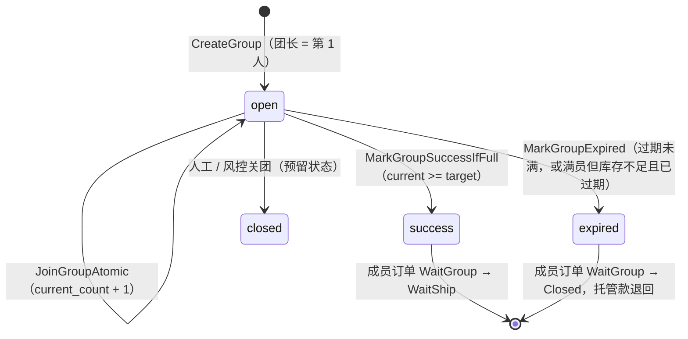
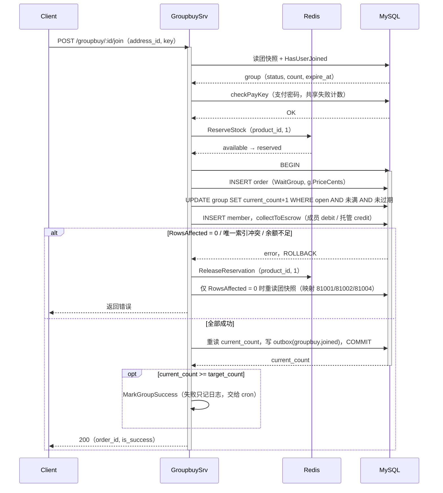
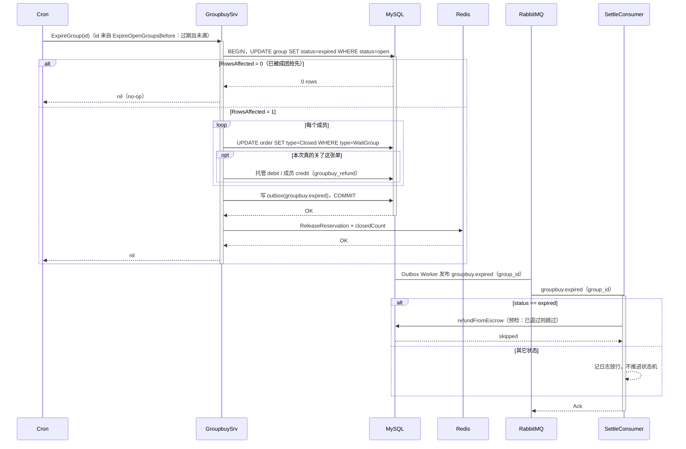

# 17 拼团：多人凑单的状态机、托管资金与散团 Saga

> gomall · `internal/groupbuy` / `WaitGroup` 订单 / 团级条件更新 / 托管三段式资金 / 散团补偿
>
> 这一讲只回答一个问题：一笔交易要等 N 个人都付了钱才算成交，钱、名额和库存在“等人”的这段时间里归谁，等不到人时怎样原路退回。

## 本讲目标

讲完后，学生应该能：

- 画出团状态 `open / success / expired / closed` 与订单状态 `WaitGroup` 的对应关系；
- 解释为什么抢名额要用一条条件 `UPDATE`，以及 `RowsAffected=0` 之后为什么要重读快照；
- 说清拼团资金的三段流水：加入进托管、成团给卖家、散团退成员，以及幂等落在哪；
- 说清库存在开团、参团、成团、散团四个出口的 Reserve / Commit / Release；
- 说清成团与散团怎样靠团行条件更新互斥，以及补成团 cron 为什么不按截止时间判失败。

---

## 一、先看四个客诉：拼团为什么需要单独的状态机

**判断：拼团订单在“付了钱但还没成交”的中间态停留最长 24 小时，必须有一个独立的订单状态和一个团级状态来表达它，否则名额、资金、库存三件事都无法收口。**

上线拼团第一周，客服收到四类工单：

1. “3 人团最后一个名额，我和另一个人同时点了参团，两个人都显示成功”；
2. “明明凑齐了，页面却显示拼团失败”；
3. “团散了，钱一直没退”；
4. “拼团页显示有货，成团时会不会卖超”。

四条分别落在名额、成团判定、退款和库存上：第一条看第二节的条件更新，第二条看第五节的补成团，第三条看第五节的同事务退款，第四条看第四节的 DB 条件扣减。

普通订单的状态链是 `WaitPay → WaitShip → ...`（见第 09 讲）。拼团加入时就扣钱，但卖家还不能发货，所以 gomall 加了一个过渡态 `WaitGroup`，它只有两条出边：

```go
// internal/order/state.go:21-28（节选）
var orderStateTransitions = map[uint][]uint{
	consts.OrderWaitPay:     {consts.OrderWaitShip, consts.OrderClosed},
	// ……省略其它状态
	consts.OrderWaitGroup:   {consts.OrderWaitShip, consts.OrderClosed},
}
```

一个人的订单状态说不清“团凑齐没有”，于是团本身也有状态：

```go
// internal/groupbuy/model.go:10-19
const (
	GroupbuyStatusOpen    uint = 0 // 进行中，可加入
	GroupbuyStatusSuccess uint = 1 // 成团：成员订单已从 WaitGroup → WaitShip
	GroupbuyStatusExpired uint = 2 // 超时未凑齐 → Saga 散团
	GroupbuyStatusClosed  uint = 3 // 人工 / 风控关团

	GroupbuyMemberJoined   uint = 0 // 已加入，订单处于 WaitGroup
	GroupbuyMemberSucceed  uint = 1 // 成团：订单已推进到 WaitShip
	GroupbuyMemberRefunded uint = 2 // 散团：订单已 Closed，预扣库存已归还
)
```



三张表的分工：

| 实体 | 表 | 负责的事实 |
|---|---|---|
| 团 | `groupbuy_group` | 目标人数、当前人数、拼团价、截止时间、团状态 |
| 成员 | `groupbuy_member` | 谁在团里、对应哪张订单；`uk_gb_group_user(group_id, user_id)` 唯一 |
| 订单 | `order` | 每个成员一张独立订单，`Type = WaitGroup` |

两个字段从建团起就不再变：`price_cents` 和 `product_id`（`model.go:26` 的注释）。参团者付的钱以团上落库的价格为准，而这个价格在开团时只从商品表取：

```go
// internal/groupbuy/service.go:93-99
// 卖家与拼团价都以商品表为准：boss_id 决定货款打给谁，拼团价由商家在商品上配置，
// 均不接收客户端传值；商品未开放拼团（拼团价为 0）直接拒绝。
priceCents, bossID, err := product.NewProductDao(ctx).ResolveGroupbuyPricing(productID)
if err != nil {
	// 省略日志
	return nil, err
}
```

`ResolveGroupbuyPricing`（`internal/product/pricing.go:59-75`）拒绝三种商品：未配置拼团价、未上架、拼团价越界。参团时卖家再用 `ResolveBossID` 反查一次（`service.go:222`），价格直接用 `g.PriceCents`（`service.go:252`）。即使请求体里带了 `boss_id`（`handler.go:23、30`），service 也以商品表反查的结果覆盖它（`service.go:247` 的注释“已由商品表反查覆盖”）：收款方和价格都不信客户端。

---

## 二、抢名额：一条条件 UPDATE 加唯一索引

**判断：名额是团行上的一个计数器，“检查还有没有位置”和“占一个位置”必须是同一条 SQL；“同一个人只能进一次”交给唯一索引，而不是交给先查后写。**

### 2.1 前置校验只负责给出好看的错误码

`JoinGroup` 进事务前会读一次团，按状态返回不同业务码：

```go
// internal/groupbuy/service.go:203-218
switch g.Status {
case GroupbuyStatusSuccess, GroupbuyStatusClosed:
	return nil, ErrGroupbuyClosed
case GroupbuyStatusExpired:
	return nil, ErrGroupbuyExpired
}
if !g.ExpireAt.After(time.Now()) {
	return nil, ErrGroupbuyExpired
}
if g.CurrentCount >= g.TargetCount {
	return nil, ErrGroupbuyFull
}
if joined, e := gbDao.HasUserJoined(groupID, userID); e == nil && joined {
	return nil, ErrGroupbuyDuplicateJoin
}
```

这些都是“读后判断”，两个请求可以同时通过。它们的价值是让绝大多数正常请求在开事务、扣库存之前就拿到准确提示（81001 满员 / 81002 过期 / 81003 重复 / 81004 已关闭），**不是并发安全的依据**。

### 2.2 真正的并发闸门在 JoinGroupAtomic

```go
// internal/groupbuy/repo.go:55-72
func (d *GroupbuyDao) JoinGroupAtomic(groupID uint, member *GroupbuyMember) error {
	res := d.DB.Model(&GroupbuyGroup{}).
		Where("id=? AND status=? AND current_count<target_count AND expire_at>?",
			groupID, GroupbuyStatusOpen, time.Now()).
		UpdateColumn("current_count", gorm.Expr("current_count + 1"))
	if res.Error != nil {
		return res.Error
	}
	if res.RowsAffected == 0 {
		// 满 / 超时 / 关 / 不存在 —— service 层根据 group 当前快照判定具体业务码
		return ErrGroupbuyFull
	}
	if err := d.DB.Create(member).Error; err != nil {
		// 唯一索引冲突 → 81003 重复加入
		return err
	}
	return nil
}
```

回到客诉 1：3 人团已有 2 人，A、B 同时参团。两条 `UPDATE` 落在同一行上，InnoDB 行锁让它们串行执行。先执行的把 `current_count` 从 2 改成 3，后执行的再求值 `current_count<target_count` 时条件已不成立，`RowsAffected=0`。不会出现两个人都进来的情况。

这条 SQL 一次守住四个条件：团仍是 `open`、没满、没过期、团存在。`expire_at>?` 放在这里很关键，它保证“满员一定发生在截止前”，第五节的补成团逻辑依赖这个结论。

### 2.3 RowsAffected=0 之后重读快照

`RowsAffected=0` 只说明“这四个条件至少一个不成立”，不说明是哪个。service 在事务回滚后重读一次团：

```go
// internal/groupbuy/service.go:309-324
if atomicErr != nil && errors.Is(atomicErr, ErrGroupbuyFull) {
	latest, _ := gbDao.GetGroupByID(groupID)
	if latest != nil {
		switch latest.Status {
		case GroupbuyStatusClosed, GroupbuyStatusSuccess:
			return nil, ErrGroupbuyClosed
		case GroupbuyStatusExpired:
			return nil, ErrGroupbuyExpired
		}
		if !latest.ExpireAt.After(time.Now()) {
			return nil, ErrGroupbuyExpired
		}
	}
	return nil, ErrGroupbuyFull
}
return nil, err
```

这个模式值得记住：**用条件更新拿到“能不能做”的权威结论，再用一次普通读拿到“为什么不能做”的解释**。解释读到的可能已经是下一刻的状态，但它只影响提示文案，不影响资金和名额。

### 2.4 同一个人进两次：预检加唯一索引两道防线

“一个用户在一个团里只能占一个名额”同样分成两层：

| 层 | 代码 | 作用 |
|---|---|---|
| 预检 | `HasUserJoined`（`repo.go:143-145`，`service.go:216`） | 顺序重复点击在开事务、扣库存之前就拿到 81003 |
| 兜底 | `uk_gb_group_user(group_id, user_id)`（`model.go:46-47`） | 两个设备同时点参团、都通过了预检时，由数据库拒绝第二行 |

并发场景下，两次请求都可能先抢到名额（`current_count+1`），第二次在 `Create(member)` 撞上唯一索引。关键在于抢名额、写成员行、扣钱进托管在同一个事务里（`service.go:260-303`）：成员行写不进去，前面那次 `+1` 和订单行一起回滚，后面的 `collectToEscrow` 根本不会执行；事务外再走 Saga 释放本次预扣的 1 份库存（`service.go:305-308`）。所以无论第二次请求拿到什么提示，名额、余额、库存三者都只被占了一份。

这就是本节开头那句话的落地：**正确性交给条件更新和唯一索引，先查后判只负责体验**。预检可以有竞态，数据库约束不会有。

---

## 三、钱先进托管：三段式资金流

**判断：拼团加入即扣款，但这笔钱在成团之前既不属于卖家也不再属于买家，只能先放在平台托管账户；成团把它转给卖家，散团把它原路退回，三段各用一个 `biz_type`，靠流水唯一索引保证每段只发生一次。**

### 3.1 三段分录

```go
// internal/groupbuy/settle.go:18-32
// 加入 → 成员钱包 debit、平台托管账户 credit（钱先托管在平台，不直接进卖家）
// 成团 → 平台托管账户 debit、卖家钱包 credit（凑齐人数才把托管款结算给卖家）
// 散团 → 平台托管账户 debit、成员钱包 credit（超时未成团，托管款原路退回成员）
const (
	BizTypeGroupBuyPay    = "groupbuy_pay"    // 加入收款：成员 debit / 托管 credit
	BizTypeGroupBuySettle = "groupbuy_settle" // 成团结算：托管 debit / 卖家 credit
	BizTypeGroupBuyRefund = "groupbuy_refund" // 散团退款：托管 debit / 成员 credit
)
```

以一个 2 人团、拼团价 80 元为例，成团时台账是：

| 时刻 | ref_order_id | 账户 | 方向 | 金额 | biz_type |
|---|---|---|---|---:|---|
| 团长开团 | 101 | 团长钱包 | debit | 8000 | groupbuy_pay |
| 团长开团 | 101 | 托管（user_id=0） | credit | 8000 | groupbuy_pay |
| 成员参团 | 102 | 成员钱包 | debit | 8000 | groupbuy_pay |
| 成员参团 | 102 | 托管 | credit | 8000 | groupbuy_pay |
| 成团 | 101 | 托管 | debit | 8000 | groupbuy_settle |
| 成团 | 101 | 卖家钱包 | credit | 8000 | groupbuy_settle |
| 成团 | 102 | 托管 | debit | 8000 | groupbuy_settle |
| 成团 | 102 | 卖家钱包 | credit | 8000 | groupbuy_settle |

如果散团，后四行换成 `托管 debit / 成员 credit, groupbuy_refund`。无论哪条路，托管账户最终的 credit 合计都等于 debit 合计。

幂等落在流水表的唯一索引上：

```go
// internal/money/ledger_model.go:65-73（节选）
type AccountTransaction struct {
	// ……
	Direction  string `gorm:"...;uniqueIndex:uniq_acct_tx_order_dir,priority:2"`
	RefOrderID uint   `gorm:"...;uniqueIndex:uniq_acct_tx_order_dir,priority:1"`
	BizType    string `gorm:"...;uniqueIndex:uniq_acct_tx_order_dir,priority:3"`
}
```

`biz_type` 进键是三段能共存在同一个 `ref_order_id` 上的前提；同一段重复执行会撞索引，事务整体回滚。余额加密读改写、`FOR UPDATE` 锁钱包行这些细节和第 02 讲完全一样，这里不重讲。

### 3.2 收款与订单同生共死

```go
// internal/groupbuy/settle.go:47-78（节选）
func collectToEscrow(tx *gorm.DB, memberID uint, amountCents int64, refOrderID uint) error {
	// ……省略 amount<=0 短路
	u, err := userDao.GetUserByIdForUpdate(memberID)
	// ……解密余额
	if bal-amountCents < 0 {
		return errors.New("余额不足，无法加入拼团")
	}
	after := bal - amountCents
	// ……加密写回 users.money
	if err = ledgerDao.AppendTransaction(memberID, refOrderID, money.DirectionDebit, amountCents, after, BizTypeGroupBuyPay); err != nil {
		return err
	}
	// 托管入账：系统清算账户不维护真实钱包行，balance_after 记 0，仅保账本守恒。
	return ledgerDao.AppendTransaction(escrowUserID, refOrderID, money.DirectionCredit, amountCents, 0, BizTypeGroupBuyPay)
}
```

`JoinGroup` 的事务把五件事放在一起：建订单、抢名额、写成员行、扣钱进托管、写 outbox（`service.go:260-303`）。余额不足会让整个事务回滚，名额计数器的 `+1` 也一起撤销。这就是“加入成功但没扣到钱”或“扣了钱但不在团里”不会发生的原因。



扣钱之前还有一道支付密码。`checkPayKey` 和 `paydown` 共用失败计数与锁定（`service.go:583-591`），并且放在预扣库存之前：密码错了不占库存，也不开事务。否则拼团接口会变成绕过支付密码锁定的爆破入口。

### 3.3 先结算再翻状态

成团时，每个成员的订单要从 `WaitGroup` 推进到 `WaitShip`。代码先把钱划给卖家，再改订单状态：

```go
// internal/groupbuy/service.go:383-417（节选）
// 关键：先结算资金、再翻状态。只有钱真的从托管账户划到卖家，订单才允许进 WaitShip，
// 从源头堵住"没收钱就发货"。任一失败回滚整个成团操作，cron 重新拉起。
for _, m := range members {
	o, e := orderDao.GetOrderByIdOnly(uint(m.OrderID))
	// ……省略缺单检查
	ok, e := productDao.DeductStock(o.ProductID, o.Num)
	// ……库存不足返回 errGroupbuyStockShort（见第四节）
	if e = settleToSeller(tx, o.BossID, o.Money, o.ID); e != nil {
		return e
	}
	res := tx.Model(&orderpkg.Order{}).
		Where("id=? AND type=?", m.OrderID, consts.OrderWaitGroup).
		Update("type", consts.OrderWaitShip)
	// ……RowsAffected==0 视为状态异常，整体回滚
}
```

由于它们在同一个事务里，“先后”本身不提供原子性；顺序的意义在于失败语义：如果哪天有人把结算挪出事务改成异步，这段注释和顺序会提醒他，`WaitShip` 必须以“钱已到位”为前提。

`settleToSeller` 和 `refundFromEscrow` 都在写账前先 `ledgerCount` 预检一次（`settle.go:94-100、140-146`），已经有 credit 流水就直接返回。预检让重复调用安静地成功，唯一索引在并发场景下兜底。

### 3.4 和第 04 讲清算模型的差别

第 04、05 讲的普通订单是：支付成功进 `merchant_escrow`，订单 `Completed` 后才结算给卖家。拼团的托管解决的是另一个问题：**等人这段时间钱归谁**。它的生命周期和团绑定，团一结束（成团或散团），托管里属于这个团的钱就全部流出，托管余额回到零：

| 团结局 | 托管款去向 | 订单去向 |
|---|---|---|
| 成团 | 每张订单一笔 `groupbuy_settle`，划给卖家钱包 | `WaitGroup → WaitShip` |
| 散团 | 每张订单一笔 `groupbuy_refund`，退回成员钱包 | `WaitGroup → Closed` |

这样设计的好处是对账口径简单：按 `ref_order_id` 看，每张拼团订单要么是 `pay + settle`，要么是 `pay + refund`，三段 `biz_type` 足以描述它在托管里的全部历史，不需要另建清算单。代价是成团之后的履约期资金不再经过托管；如果业务要求“确认收货后才给卖家”，可以在成团这一步把去向从卖家钱包换成 `merchant_escrow`，见课后练习 3。

---

## 四、库存 Saga：预扣、真扣、归还

**判断：拼团库存复用第 12 讲的两桶模型，每个成员加入时预扣 1 份，成团时 DB 真扣并把 reserved 提交为 sold，散团时只归还本次真正关掉的订单那几份；Redis 操作都在事务外，失败靠补偿。**

两桶 `available / reserved` 和 Reserve / Commit / Release 三个 Lua 脚本见第 12 讲。拼团没有另写脚本（`service.go:52-53` 的注释），只是在四个时刻调用它们：

| 时刻 | Redis | MySQL `product.num` | 代码 |
|---|---|---|---|
| 开团 / 参团 | `available → reserved` 1 份 | 不动 | `service.go:112、239` |
| 开团 / 参团事务失败 | `reserved → available` 1 份 | 不动 | `service.go:172-177、304-308` |
| 成团 | 每个成员 `reserved → sold` | 每个成员条件扣 1 | `service.go:397-403、446-449` |
| 散团 | 实际关单数 × `reserved → available` | 不动 | `service.go:543-550` |

### 4.1 成团才算真正卖出

加入时只动 Redis，DB 库存保持不变；成团时在事务内按成员逐个条件扣减：

```go
// internal/product/repo.go:135-143
func (d *ProductDao) DeductStock(productId uint, num int) (ok bool, err error) {
	res := d.DB.Model(&Product{}).
		Where("id=? AND num>=?", productId, num).
		Update("num", gorm.Expr("num-?", num))
	// ……
	return res.RowsAffected > 0, nil
}
```

任何一个成员扣不动，`MarkGroupSuccess` 返回 `errGroupbuyStockShort`，整个成团事务回滚，团仍是 `open`。为什么 Redis 预扣过了 DB 还可能不够？因为 Redis 和 DB 是两套水位，商家改库存、缓存重建都可能让它们短暂不一致（第 12 讲讨论过）。DB 条件扣减是最后的防超卖闸门，客诉 4 就落在这里：`num>=?` 和扣减是同一条 SQL，扣不动就整团不成，不会出现卖出比库存多的情况。

事务提交后，再把每个成员的 reserved 提交为 sold：

```go
// internal/groupbuy/service.go:446-449
// 库存：每位成员 reserved -> sold（真扣）
for _, m := range members {
	orderpkg.CommitStockReservation(ctx, uint(m.OrderID), g.ProductID, 1)
}
```

`CommitStockReservation`（`internal/order/task.go:66`）自带重试，并用 `context.WithoutCancel` 防止请求断开导致核销中断。它在事务外，所以存在“DB 已成团、Redis 核销失败”的窗口，这和第 12 讲支付成功后的核销是同一类最终一致问题。

### 4.2 散团只还自己关掉的那几份

```go
// internal/groupbuy/service.go:492-504（节选）
for _, m := range members {
	res := tx.Model(&orderpkg.Order{}).
		Where("id=? AND type=?", m.OrderID, consts.OrderWaitGroup).
		Update("type", consts.OrderClosed)
	// ……
	// RowsAffected=0 不报错：可能已被其它路径关掉；
	// 但对应的库存预扣也已由那条路径归还，这里不重复释放。
	if res.RowsAffected == 0 {
		continue
	}
	closedCount++
	// ……同事务退款，见第五节
}
```

事务外按 `closedCount` 释放（`service.go:545-550`），而不是按成员数。当前代码里除了 `ExpireGroup` 没有别的路径会关 `WaitGroup` 订单（普通关单只认 `WaitPay`，`internal/order/repo.go:363-366`），所以这个分支目前是防御性的。如果按成员数释放，一张已被别处关掉的订单会让 `available` 多出 1 份，下一位顾客就能买到一件不存在的商品。这是第 12 讲“谁关单谁释放”原则在多订单场景下的写法。

---

## 五、成团与散团：互斥、补成团与消费者兜底

**判断：成团和散团是同一个团的两个互斥结局，靠 `WHERE status=open` 的条件更新抢状态，谁的 `RowsAffected>0` 谁推进；在线成团失败不报错给用户，由 cron 补成团；散团退款在事务内同步完成，消费者只做幂等重放。**

### 5.1 两个出口，一把“锁”

```go
// internal/groupbuy/repo.go:78-98（节选）
func (d *GroupbuyDao) MarkGroupSuccessIfFull(groupID uint) (bool, error) {
	res := d.DB.Model(&GroupbuyGroup{}).
		Where("id=? AND status=? AND current_count>=target_count", groupID, GroupbuyStatusOpen).
		Update("status", GroupbuyStatusSuccess)
	// ……
	return res.RowsAffected > 0, nil
}

func (d *GroupbuyDao) MarkGroupExpired(groupID uint) (bool, error) {
	res := d.DB.Model(&GroupbuyGroup{}).
		Where("id=? AND status=?", groupID, GroupbuyStatusOpen).
		Update("status", GroupbuyStatusExpired)
	// ……
	return res.RowsAffected > 0, nil
}
```

两个方法都是对应事务里的第一条写语句。成团事务和散团事务同时到达时，团行的行锁让它们串行，后到的那个读到的 `status` 已经不是 `open`，`RowsAffected=0`，事务直接 `return nil`，后面的结算或退款都不会执行。这和第 05 讲“结算与退款锁同一条清算记录”是同一个思路，只是锁的对象换成了团行。

### 5.2 满员的团不能散

散团 cron 每 5 分钟扫一次（`initialize/cron.go:78-93`），扫描条件特意排除满员的团：

```go
// internal/groupbuy/repo.go:108-109
err := d.DB.Model(&GroupbuyGroup{}).
	Where("status=? AND expire_at<=? AND current_count<target_count", GroupbuyStatusOpen, now).
```

客诉 2“凑齐了却显示失败”就是这条条件要防的。什么时候会出现“满员但仍 open”？`JoinGroup` 把成团放在加入事务之外，失败只记日志：

```go
// internal/groupbuy/service.go:328-336
isSuccess := false
if currentCnt >= targetCount {
	if mkErr := s.MarkGroupSuccess(ctx, groupID); mkErr != nil {
		// 成团失败只记录日志，cron 仍会兜底
		util.LogrusObj.Errorf("mark group success group=%d err=%v", groupID, mkErr)
	} else {
		isSuccess = true
	}
}
```

最后一个成员的钱已经进托管、名额已经占上，这时成团失败（比如 DB 抖动、库存不足）不应该让他的加入也失败。于是团停在“满员 + open”，交给每 5 分钟一次的补成团 cron（`initialize/cron.go:94`）。

`MarkGroupSuccessIfFull` 的条件里没有 `expire_at`。原因在注释里（`repo.go:74-77`）：`JoinGroupAtomic` 已经保证满员发生在截止前，过了截止线才来成团，只说明之前那次成团失败了，不能因此判失败。

### 5.3 补成团也成不了时怎么办

```go
// internal/groupbuy/service.go:569-580
for _, g := range groups {
	err := s.MarkGroupSuccess(ctx, g.ID)
	if err == nil {
		continue
	}
	util.LogrusObj.Errorf("补成团失败 groupID=%d err=%v", g.ID, err)
	if errors.Is(err, errGroupbuyStockShort) && !g.ExpireAt.After(time.Now()) {
		if err := s.ExpireGroup(ctx, g.ID); err != nil {
			// ……
		}
	}
}
```

只有“库存确实不够”且“已经过了截止时间”两个条件同时满足才散团。DB 抖动之类的临时错误只记日志，下个周期再试；库存不够但还没到截止时间，也继续等，商家可能会补货。不能无限等下去，因为成员的钱一直押在托管里。

### 5.4 散团退款：同步完成，消费者幂等重放

`ExpireGroup` 在关单的同一个事务里调用 `refundFromEscrow`（`service.go:505-516`），并写 `groupbuy.expired` outbox。也就是说，正常情况下团切到 `expired` 的那一刻，钱已经回到成员钱包。客诉 3“散团钱没退”在这条路径上不会出现。

另有一条 `groupbuy.settle` 队列消费 `groupbuy.expired`（`consumer.go:56-81`），作用是重放时补退：

```go
// internal/groupbuy/settle.go:196-201
if g.Status != GroupbuyStatusExpired {
	// 仅对已散团做退款兜底；open（尚未散）/ success / closed 一律幂等放行，
	// 不在消费者里推进状态机——散团状态推进归 ExpireGroup，避免双写冲突。
	util.LogrusObj.Infof("groupbuy settle skip: group=%d status=%d not expired", groupID, g.Status)
	return nil
}
```

消费者遵守两条纪律：只处理已经是 `expired` 的团，不碰 `open` 的团，避免和成团结算抢同一笔托管款；不推进状态机，状态归 `ExpireGroup` 一家写。退款本身靠 `refundFromEscrow` 的预检和唯一索引去重。毒消息直接进 DLQ，业务错误按退避重试，这部分机制见第 05 讲 2.3 和第 16 讲。

退款和 outbox 在同一个事务里，事件存在就意味着退款已经落账，所以这个消费者正常情况下走的是“已退过”分支。它的定位是重放兜底：消息重复投递、人工重放、或将来有人把退款挪出事务时，它保证结果仍然是“每张订单只退一次”。



---

## 六、故障演练 / 课堂演示

### 6.1 先跑现有测试

测试用 SQLite 内存库，并 stub 了库存 Lua，不依赖 MySQL 和 Redis：

```bash
go test ./internal/groupbuy/ -v
```

| 测试 | 证明的判断 |
|---|---|
| `TestCreateGroupIgnoresClientPrice`（`service_test.go:39`） | 请求体带 `price_cents:1`，团和订单仍是商家配置的 8000 分 |
| `TestCreateGroupRejectsProductNotOpen`（`service_test.go:66`） | 未开放拼团的商品不能开团 |
| `TestGroupbuyRequiresPayPassword`（`service_test.go:84`） | 支付密码错误时余额不变 |
| `TestMarkGroupSuccessDeductsProductStock`（`service_test.go:110`） | 2 人团成团后 DB 库存从 5 变 3 |
| `TestFullOpenGroupIsCompletedNotExpired`（`service_test.go:138`） | 满员且已过期的团不会被散团扫描捡到，补成团 cron 把它推进到 `success` |

### 6.2 现场补三个演示

**演示 1：并发抢最后一个名额。** 种一个 `target_count=3, current_count=2` 的团，两个有余额的用户各开一个 goroutine 调 `JoinGroup`。预期：恰好一个成功，另一个拿到 `ErrGroupbuyFull` 或 `ErrGroupbuyClosed`（取决于成团是否已完成），失败者余额不变。注意 SQLite 的并发写行为和 InnoDB 不同，这个演示在 MySQL 上做更有说服力。

**演示 2：成团与散团抢同一个团。** 种一个已满员（`current_count=target_count=2`）、`expire_at` 已过、仍是 `open` 的团，两个 goroutine 同时调 `MarkGroupSuccess` 和 `ExpireGroup`。预期：团最终只会是 `success` 或 `expired` 之一；按 `ref_order_id` 查流水，每张订单要么只有 `groupbuy_settle`，要么只有 `groupbuy_refund`，不会两样都有；输的那一方返回 `nil`，没有任何写入。这验证的是 5.1 的结论：两个出口都以 `WHERE status=open` 的条件更新开头，团行就是互斥锁。

**演示 3：重放 `groupbuy.expired`。** 先让一个未满的团过期并调用 `ExpireGroup`，记下成员余额；再连续调用三次 `SettleExpiredRefund(ctx, groupID)`。预期：余额不变，`groupbuy_refund` 方向 credit 的流水每张订单只有一条。再对一个 `open` 的团调用一次，预期直接放行，团状态不变。

---

## 课后练习

1. **验证重复参团。** 写两个测试：其一，同一用户顺序参团两次，断言第二次返回 `ErrGroupbuyDuplicateJoin`、余额只扣一次、`current_count` 只加 1；其二，绕过预检直接在事务里调两次 `JoinGroupAtomic` 写同一 `(group_id, user_id)`，断言第二次报错且事务回滚后 `current_count` 不变。思考：第二个测试证明的是 2.4 表里的哪一层？
2. **散团测试。** 构造一个 3 人团只有 2 人、已过期，调用 `runGroupbuyExpireSweep` 的等价逻辑，断言：两张订单变 `Closed`、两个成员余额恢复、托管账户 `groupbuy_pay` credit 合计等于 `groupbuy_refund` debit 合计、`ReleaseReservation` 被调用 2 次。
3. **设计扩展：成团后延迟结算。** 如果业务要求确认收货后才给卖家，设计一个方案：成团时不给卖家钱包加钱，而是托管 debit、`merchant_escrow` credit，并为每个成员订单创建 `payment_clearing(status=cleared)`。写出分录，并说明之后的确认收货、退款分别复用第 05 讲哪段代码。
4. **设计扩展：人工关团。** `closed` 是为运营 / 风控预留的团状态。给 admin 组设计一个关团接口，要求和散团、成团三者互斥。思考：关团应该复用 `ExpireGroup` 的哪一部分？满员但未成团的团能不能关？
5. **思考题。** `JoinGroup` 为什么把 `MarkGroupSuccess` 放在加入事务之外，而不是同一个事务里？如果放进去，最后一个成员会遇到什么体验？

---

## 代码索引

| 主题 | 文件 | 入口 |
|---|---|---|
| 团 / 成员状态与表结构 | `internal/groupbuy/model.go` | `GroupbuyGroup`、`GroupbuyMember` |
| 路由 | `internal/groupbuy/routes.go` | `RegisterRoutes` |
| 开团 / 参团 / 成团 / 散团 / 补成团 | `internal/groupbuy/service.go` | `CreateGroup`、`JoinGroup`、`MarkGroupSuccess`、`ExpireGroup`、`RunCompleteFullGroups` |
| 抢名额与状态条件更新 | `internal/groupbuy/repo.go` | `JoinGroupAtomic`、`MarkGroupSuccessIfFull`、`MarkGroupExpired`、`ExpireOpenGroupsBefore` |
| 三段资金流 | `internal/groupbuy/settle.go` | `collectToEscrow`、`settleToSeller`、`refundFromEscrow`、`SettleExpiredRefund` |
| 散团重放消费者 | `internal/groupbuy/consumer.go` | `StartSettleConsumer` |
| 散团 / 补成团 cron | `initialize/cron.go` | `runGroupbuyExpireSweep`、`RunCompleteFullGroups` 注册 |
| 拼团定价 | `internal/product/pricing.go` | `ResolveGroupbuyPricing` |
| 订单状态迁移 | `internal/order/state.go` | `orderStateTransitions` |
| 流水唯一索引与记账 | `internal/money/ledger_model.go`、`internal/money/ledger_repo.go` | `AccountTransaction`、`AppendTransaction` |
| 测试 | `internal/groupbuy/service_test.go` | 5 个 `Test*` |
