# 18 红包：Redis 分发与 DB 记账的一致性

> **模块定位**：`gomall` · `internal/redpacket`（发包、抢包、退款与对账） / `repository/cache/redpacket.go`（二倍均值拆包与 Lua 脚本）
>
> **怎么用**：`---` 是分页线，一页一个要点、一张图。每页底部的「讲稿」是上课照着念的话。
>
> **幻灯片版**：[18-redpacket-slides.html](./18-redpacket-slides.html)，浏览器直接打开。→ 下一步，← 上一步，N 显示讲稿，F 全屏。

| 部分 | 讲什么 | 对应工单 |
|---|---|---|
| 00 | 为什么要两套存储，谁说了算 | |
| 一 | 四张客诉单与数据结构 | A B C D |
| 二 | 分发：发包时预拆，抢包只 `LPOP` | |
| 三 | 资金：钱先进托管账户 | |
| 四 | 一致性：Redis 先扣，DB 说了算 | A B |
| 五 | 三道兜底防线 | C D |
| 六 | 故障演练、课后思考、代码索引 | |

> **讲稿**　这一讲讲红包。红包看着是个小功能，其实它同时是两件事：一件是高并发争抢，一件是真金白银的转账。我们用 Redis 管争抢，用 MySQL 管钱，今天所有的内容都围绕一个问题：这两边对不上的时候怎么办。先看四张客诉单，再一张一张把它们解决掉。

---

## 00-1 只用 MySQL：所有人排同一把锁

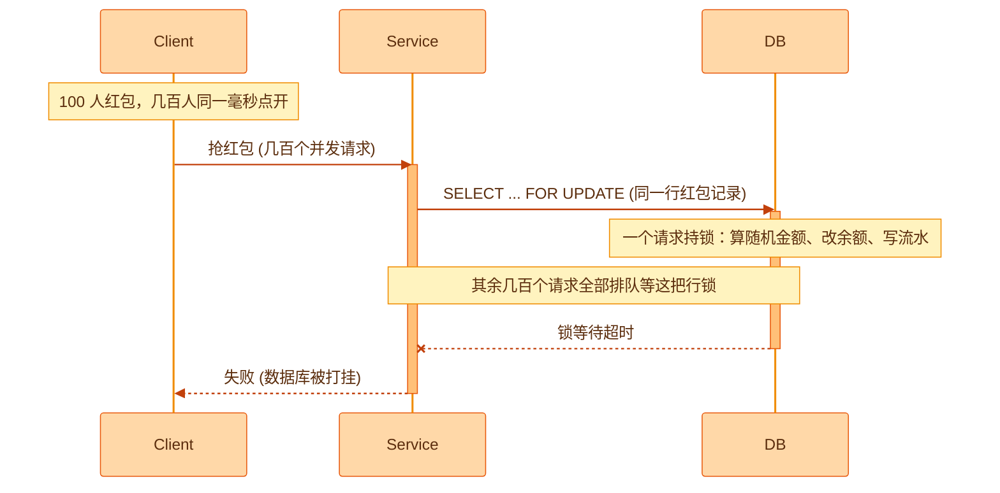

> **讲稿**　先想最简单的做法：全放 MySQL。大年三十群里发个一百人的红包，几百人同一毫秒点开，所有请求抢的是同一行红包记录的行锁。拿到锁的那个人还要在锁里算随机金额、改余额、写流水，其他人只能排队。队一长，连接池耗尽，数据库就挂了。所以只用 MySQL 的问题是一个字：慢。

---

## 00-2 只用 Redis：扣了份额，钱不一定到账

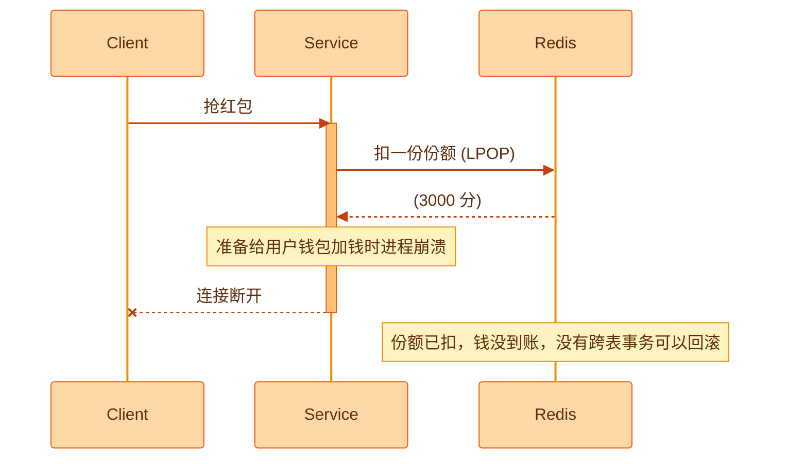

> **讲稿**　那全放 Redis 呢？快是够快了。但 Redis 不是账本，它没有跨表事务。份额扣掉了，正准备给钱包加钱，进程崩了，这笔钱就凭空消失，没有任何东西能把它回滚回来。所以只用 Redis 的问题是：它管不了钱。

---

## 00-3 铁律：Redis 发号码牌，MySQL 发钱

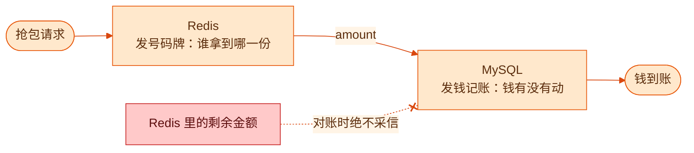

红包结束时，数据库里必须满足**资金守恒**：

```text
红包总金额 (Total) = 所有领取人落库金额之和 SUM(red_packet_claim.amount) + 过期退回发包人的金额 (Leftover)
```

- 公式里每一项都**只从 MySQL 算**。
- 两边不一致，一律向 MySQL 对齐。

> **讲稿**　所以 gomall 的分工是这样的：Redis 只负责发号码牌，决定谁拿到哪一份；MySQL 才负责真正发钱记账。请大家记住下面这条等式：红包总额，等于所有人落库领走的钱，加上过期退给发包人的钱。无论中间网络超时多少次、进程崩多少次、Redis 重启多少次，这条等式都必须成立，而且每一项都只从 MySQL 算，Redis 里剩多少我们不信。

---

## 00-4 全景图：发红包、抢红包、退红包


> **讲稿**　这张是全景图，现在不用看懂每个框，只看三段。第一段发红包：先在内存里把金额拆好，再开事务扣钱，最后把拆好的金额推进 Redis。第二段抢红包：先在 Redis 里抢到一份，再开事务落库入账，失败了有一套回补逻辑。第三段是后台两个定时任务兜底。后面每一节讲的都是这张图里的一个框，讲完再回来看就全通了。

---

## 一、先看四张客诉单

| 工单 | 用户看到的现象 | 底层原因 | 解决章节 |
|---|---|---|---|
| **A** | 点“抢”报错失败；再点提示“您已领取过该红包”，钱也没到账 | Redis 扣了份额、打了已领标记，DB 事务失败后没把标记和份额退回 Redis | **4.1、4.5**：失败先查库 + Saga 原子回补 |
| **B** | 到期同一秒最后一份被抢走；抢包人拿到钱，发包人也收到这笔的过期退款，平台亏钱 | 领取事务与过期退款事务并发，读了旧的 MVCC 快照，同一份钱发两次 | **4.3、4.4**：`SELECT ... FOR UPDATE` 置于事务首行 |
| **C** | 抢的时候转圈断开；半小时后份额没退回红包池，钱包也没收到钱（孤儿份额） | 抢完 Redis 后服务器断电重启，回补没跑成，份额卡在半空 | **5.2**：`claimed` 孤儿对账自动补领（`:r` 抢占锁） |
| **D** | 发包人被扣了 100 元，群里所有人点开都显示“红包已抢完” | DB 扣款事务提交成功，紧接着写 Redis 金额列表时 Redis 挂了 | **5.3**：发包失败立即逆向退款 + 份额池丢失检测提前退款 |

> **讲稿**　红包上线以后，边界没处理好，客服会收到四类投诉。A：我点抢，提示失败，再点却说我领过了，钱没到。B：红包到期那一秒最后一份被抢走，结果抢的人拿到了钱，发包人也收到了这笔钱的退款，平台亏了。C：抢的时候转圈断开了，半小时过去，钱没到账，红包里也没有这一份了。D：发红包扣了我一百块，群里所有人点开都是已抢完。这四张单子有一个共同点：全都出在 Redis 和 MySQL 的交界处，一边做了，另一边没做。带着这四张单子往下听。

---

## 1.1 Redis 侧：两个 Key，抢包前后怎么变

`repository/cache/redpacket.go:16-22`，例子：100 元拆 3 份（30、50、20 元）。

| Redis Key | 类型 | 存什么 |
|---|---|---|
| `redpacket:{id}:amounts` | `LIST` | 发包时一次性 `RPUSH` 预拆好的金额数组（分），抢包时 `LPOP` 弹出 |
| `redpacket:{id}:claimed` | `HASH` | 谁抢了多少、什么时候抢的：`userID -> "金额:unix秒[:r]"` |

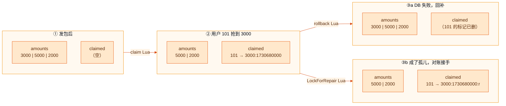

> **讲稿**　Redis 这边一场红包只有两个 key。第一个是 LIST，发包的时候把拆好的金额一次性推进去，抢就是从头上弹一个。第二个是 HASH，记谁抢了多少、什么时候抢的。看图：发包后 LIST 里三份，HASH 是空的；101 抢走三十块，LIST 剩两份，HASH 多一条。之后有两种走向：DB 失败了，就把三十块塞回 LIST、删掉标记；或者这一份成了孤儿，对账任务接手，在标记后面加一个冒号 r。这里有个问题：HASH 里为什么不只存个 1，而要存金额和时间？因为这三十块弹出来以后 LIST 里已经没有了，这时候断电，只有 HASH 还记得该给他补多少钱；时间是用来判断这笔领取是还在路上，还是已经卡死了。

---

## 1.1 MySQL 侧：两张核心表

`internal/redpacket/model.go:20-44`

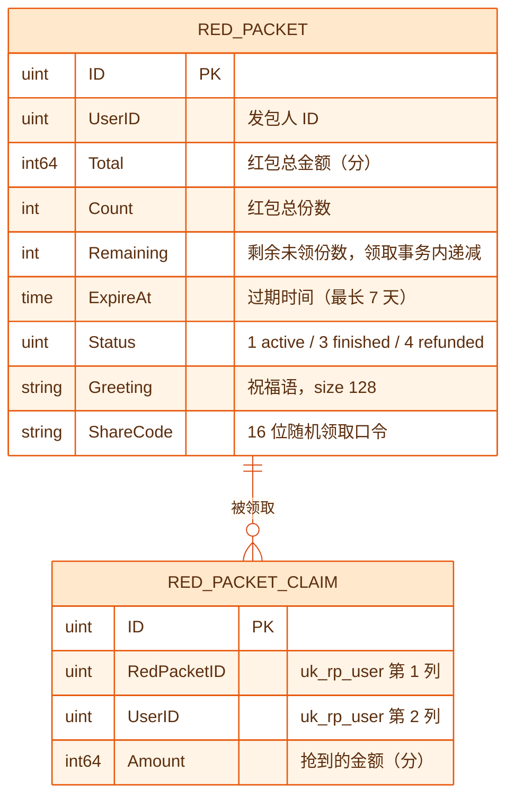

- `Status`：`1` 进行中、`3` 已抢完、`4` 已过期退款。
- 唯一索引 `uk_rp_user (red_packet_id, user_id)`：DB 层兜底“同一用户只能领一次”。

> **讲稿**　MySQL 这边两张表。红包主表记总金额、总份数、剩余份数、过期时间和状态，状态只有三个：进行中、已抢完、已退款。领取表一个人领一次就是一行。注意领取表上的唯一索引，红包 ID 加用户 ID，这是数据库层面的最后一道保险，同一个人无论从哪条路进来，最多只能成功落一行。后面对账补领敢放心重试，靠的就是它。

---

## 1.2 防扫号口令 `ShareCode`

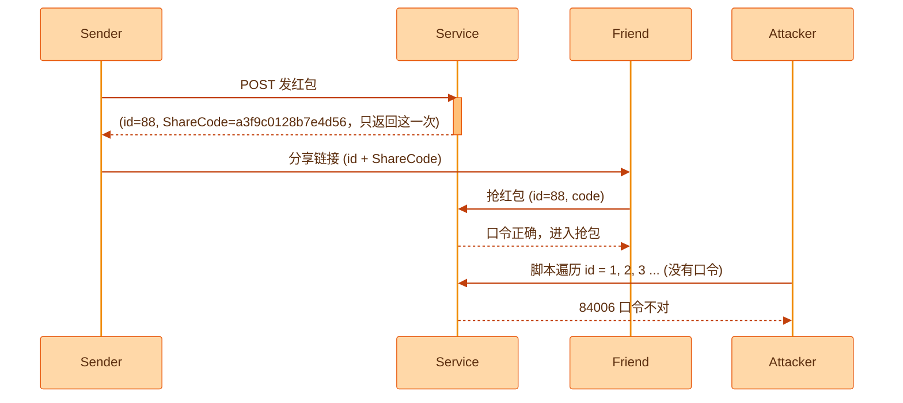

```go
// internal/redpacket/service.go:161-166
func codeMatches(rp *RedPacket, code string, legacyOK bool) bool {
	if rp.ShareCode == "" {
		return legacyOK
	}
	return subtle.ConstantTimeCompare([]byte(rp.ShareCode), []byte(code)) == 1
}
```

- 普通 `==` 逐字节比较，第 1 位错就立刻返回，前 15 位都对才比第 16 位。
- 攻击者测微秒级时间差，能一位一位猜出口令，这叫**计时攻击（Timing Attack）**。
- `ConstantTimeCompare` 永远比完所有字节，耗时恒定。

> **讲稿**　红包 ID 是自增主键，一二三四往上涨。如果抢红包只要传 ID，写个循环脚本就能把全平台正在发的红包全抢光。所以发包时后端会生成一个十六位的随机口令，只在创建成功那一次响应里返回给发包人，由他拼进分享链接。没有口令的请求直接拒掉。再看代码里一个细节：口令比较没有用等号，用的是常量时间比较。因为等号是一个字节一个字节比的，第一位错了马上返回，前十五位都对才会比到第十六位，耗时不一样。攻击者量这个时间差，可以一位一位把口令猜出来。常量时间比较不管对了几位都比到底，时间差就不泄露信息了。

---

## 二、分发模型：发包时预拆好，抢包只做 `LPOP`

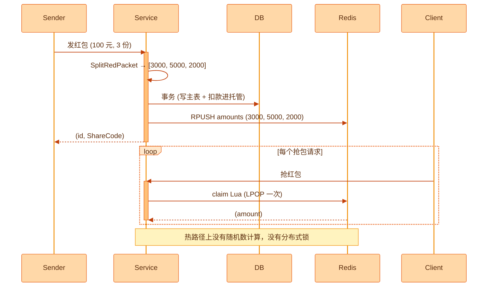

- 抢 = `LPOP` 拿走一张固定面额的“代金券”；失败回补 = `LPUSH` 原样塞回一张。
- 如果抢的时候实时算：要读剩余金额和份数、生成随机数、扣减写回，回补时退回去的金额还会让平均值变形。

> **讲稿**　第二部分讲怎么分。核心就一句话：金额在发包的时候一次算完，抢包的时候只做一次 LPOP。发包是低频操作，慢一点没关系，所以拆金额、扣钱、推进 Redis 都在这里做。抢包是高并发热路径，这条路上没有随机数计算，没有分布式锁，就是从 LIST 头上弹一个数。有同学会问，为什么不在抢的时候用 Lua 实时算？因为那样脚本里要读剩余金额、读剩余份数、算随机数、再写回去，更麻烦的是 DB 失败要回补的时候，退回去的金额会把平均值搞乱。预拆以后，LIST 里就是一张张固定面额的代金券，抢是拿走一张，回补是原样放回一张，总额永远不会错。

---

## 2.1 二倍均值：10 元（1000 分）拆 3 份

`SplitRedPacket`，`repository/cache/redpacket.go:127-167`。每次随机的上限是**当前剩余人均金额的 2 倍**。

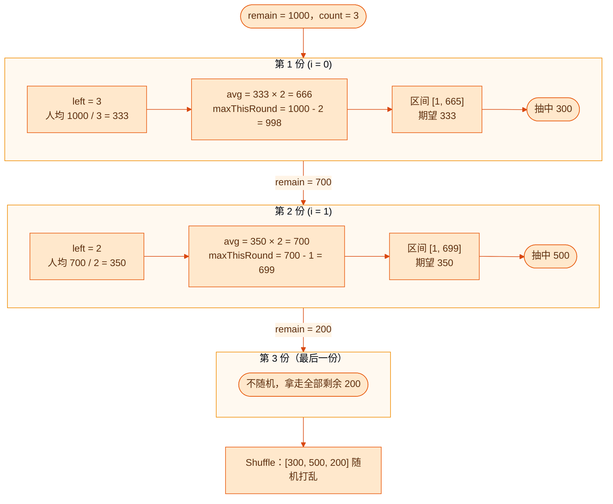

```go
avg := remain / left * 2                  // 二倍均值上界
maxThisRound := remain - int64(count-1-i) // 保底：后面每份至少留 1 分
hi := avg - 1                             // 再和 maxThisRound 取小
amt := splitRand.r.Int63n(hi) + 1         // 在 [1, hi] 内均匀随机
```

- 纯随机 `[1, 剩余总额]`：第一个人可能拿走 100 元里的 99 元。
- 最后一份直接拿走全部剩余，总和分毫不差。
- `Shuffle`：前面抽得小时最后一份会特别大，打乱后大额不会固定便宜最后一个人。

> **讲稿**　金额怎么拆？最朴素的想法是在一到剩余总额之间随机，但这样第一个人可能直接拿走九十九块，后面的人只剩几分钱。gomall 用的是二倍均值法：每次随机的上限，是当前剩余人均金额的两倍。我们手算一遍，十块钱一千分拆三份。第一份：剩一千分三个人，人均三百三十三，两倍是六百六十六，所以在一到六百六十五之间随机，期望正好是人均。假设抽中三百。第二份：剩七百分两个人，人均三百五，两倍七百，在一到六百九十九之间随机，假设抽中五百。第三份不随机，直接拿走剩下的两百，这样总和一分不差。代码里还有一个保底：每一轮都要给后面没拆的每份至少留一分钱。最后为什么要洗牌？如果前两份运气不好都抽得很小，最后一份就特别大，不打乱的话大红包永远在最后一个位置。

---

## 2.2 抢包 Lua：去重、出队、打标记，一次原子完成

`repository/cache/redpacket.go:55-66`

```lua
-- KEYS[1]: redpacket:{id}:amounts (LIST)
-- KEYS[2]: redpacket:{id}:claimed (HASH)
-- ARGV[1]: userID, ARGV[2]: TTL秒数, ARGV[3]: 当前unix秒时间戳

if redis.call('HEXISTS', KEYS[2], ARGV[1]) == 1 then
    return -2                      -- 1. 已经领过了，直接挡回！
end
local amt = redis.call('LPOP', KEYS[1])
if not amt then
    return -1                      -- 2. LIST 空了，红包已抢完！
end
-- 3. 写入抢包标记，例如 HSET redpacket:10:claimed 101 "3000:1730680000"
redis.call('HSET', KEYS[2], ARGV[1], amt .. ':' .. ARGV[3])
redis.call('EXPIRE', KEYS[2], tonumber(ARGV[2]))
return tonumber(amt)               -- 4. 返回抢到的金额（分）
```

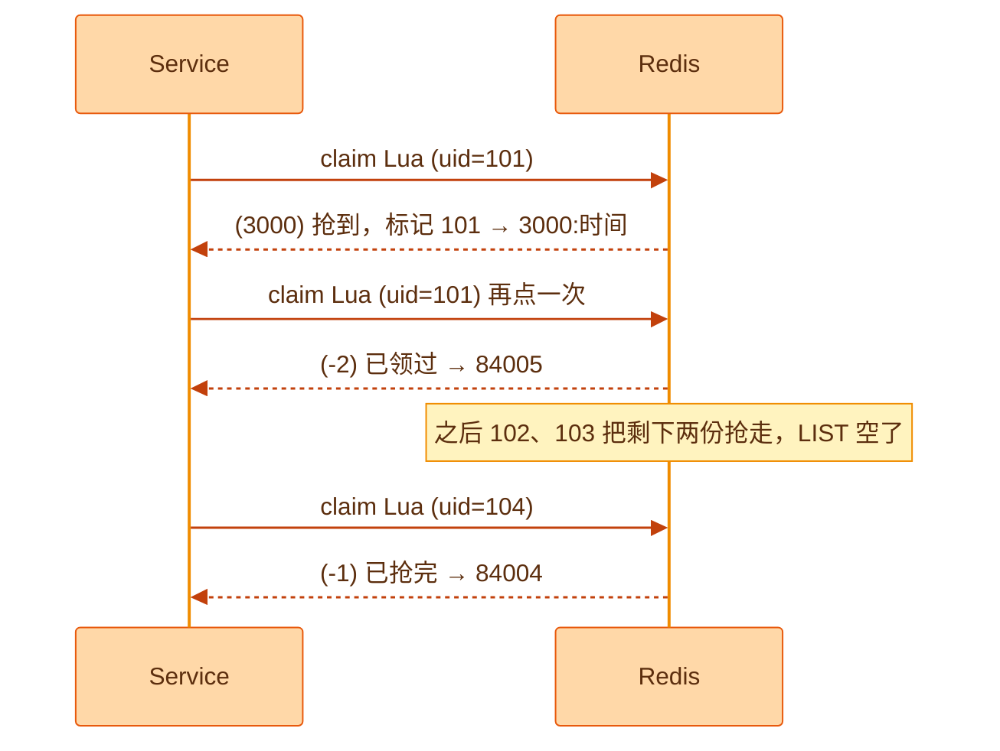

> **讲稿**　抢包的脚本只有十行。第一步查 HASH，这个人领过没有，领过返回负二。第二步 LPOP，弹不出来说明抢完了，返回负一。第三步弹出来了，就在 HASH 里记一条，金额加当前时间，然后返回金额。重点是这三步写在一段 Lua 里，Redis 会把它当成一个整体原子执行，中间不会被别的命令插进来，所以不会出现两个人弹到同一份，也不会出现弹走了但没打上标记。下面这张图是三次调用的结果：101 第一次抢到三十块；他再点一次，返回负二；等另外两份被抢走以后，104 再来就是负一。

---

## 三、资金模型：钱先进红包托管，再分给领取人

算例：A 发 100 元（`10000` 分）3 份红包（红包 `ID = 88`）。B 抢到 30 元（`claim.ID = 501`），C 抢到 50 元（`claim.ID = 502`），第 3 份 20 元没人领，24 小时后过期退回 A。

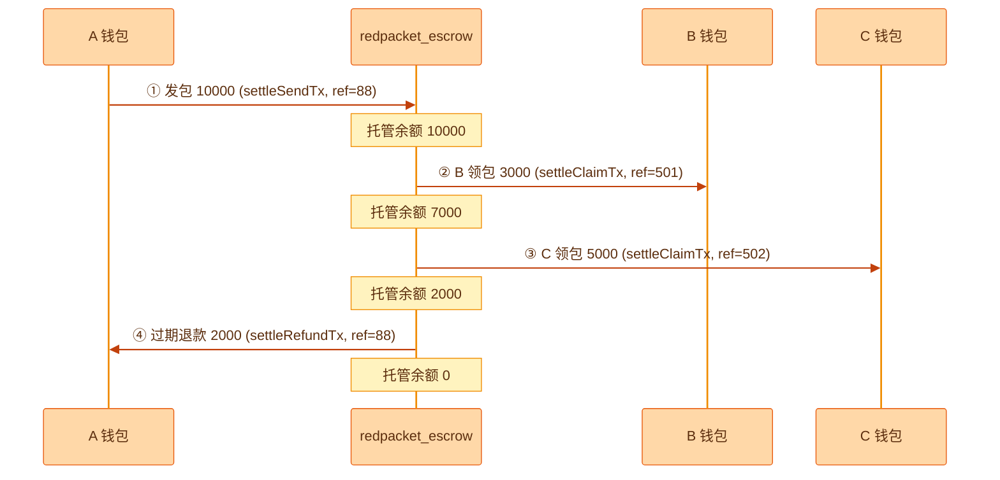

- 发包时钱**不直接进任何领取人的钱包**，先进系统托管账户 `redpacket_escrow`。
- 每个箭头是一组**一借一贷**的复式分录，4 个箭头共 8 条流水。
- 发包、领包、退款三段各自独立幂等。

> **讲稿**　第三部分讲钱怎么走。发红包的时候，钱不是直接打给谁，因为这时候还不知道谁会抢到。钱先从发包人钱包扣出来，进一个系统托管账户。有人抢到一份，就从托管账户转一份到他钱包。过期没领完的，再从托管账户退回发包人。看这个例子：A 发一百块，托管里有一万分；B 领三十，剩七千；C 领五十，剩两千；过期退二十给 A，托管归零。托管账户最后必须是零，多一分少一分都说明出事了。

---

## 3.1 完整台账：`account_transaction` 的 8 条流水

| 阶段 | 结算函数 | `ref_order_id` | 账户 (`account_code`) | 方向 | 金额(分) | `biz_type` | 说明 |
|---|---|---|---|---|---:|---|---|
| **1. 发包** | `settleSendTx` | `88` (红包ID) | A 的个人钱包 | `debit` | 10000 | `redpacket_send` | 发包人 A 扣款 100 元 |
| **1. 发包** | `settleSendTx` | `88` (红包ID) | `redpacket_escrow` | `credit` | 10000 | `redpacket_send` | 红包托管池入账 100 元 |
| **2. B 领包** | `settleClaimTx` | `501` (领取ID) | `redpacket_escrow` | `debit` | 3000 | `redpacket_claim` | 红包托管池支出 30 元 |
| **2. B 领包** | `settleClaimTx` | `501` (领取ID) | B 的个人钱包 | `credit` | 3000 | `redpacket_claim` | 领取人 B 入账 30 元 |
| **3. C 领包** | `settleClaimTx` | `502` (领取ID) | `redpacket_escrow` | `debit` | 5000 | `redpacket_claim` | 红包托管池支出 50 元 |
| **3. C 领包** | `settleClaimTx` | `502` (领取ID) | C 的个人钱包 | `credit` | 5000 | `redpacket_claim` | 领取人 C 入账 50 元 |
| **4. 过期退款** | `settleRefundTx` | `88` (红包ID) | `redpacket_escrow` | `debit` | 2000 | `redpacket_refund` | 红包托管池支出剩余 20 元 |
| **4. 过期退款** | `settleRefundTx` | `88` (红包ID) | A 的个人钱包 | `credit` | 2000 | `redpacket_refund` | 发包人 A 退回 20 元 |

`redpacket_escrow` 净余额：`+10000 (发包) - 3000 (B领) - 5000 (C领) - 2000 (退回A) = 0`

> **讲稿**　上一页的四个箭头，落到流水表里就是这八行，每个箭头两行，一借一贷。大家重点看第三列 ref_order_id：发包和退款这四行填的是红包 ID 八十八，领包这四行填的是领取记录的 ID，五百零一和五百零二。为什么不一样，下一页讲。最下面算一下托管账户：进一万，出三千、五千、两千，净额是零。

---

## 3.2 领包的 `ref_order_id` 为什么用“领取记录 ID”？

流水表防重唯一索引：`uniq_acct_tx_order_dir (ref_order_id, direction, biz_type)`，**唯一键里没有 `user_id`**。

```mermaid
%%{init: {'theme':'base','themeVariables':{'fontFamily':'PingFang SC, Microsoft YaHei, sans-serif','background':'#FFFBF5','primaryColor':'#FFE8CC','primaryBorderColor':'#E8590C','primaryTextColor':'#5C2E0E','secondaryColor':'#FFF4E6','tertiaryColor':'#FFF9F0','lineColor':'#D9480F','textColor':'#5C2E0E','clusterBkg':'#FFF9F0','clusterBorder':'#F08C00','edgeLabelBackground':'#FFF4E6','actorBkg':'#FFD8A8','actorBorder':'#E8590C','actorTextColor':'#5C2E0E','actorLineColor':'#F08C00','signalColor':'#C2410C','signalTextColor':'#5C2E0E','noteBkgColor':'#FFF3BF','noteBorderColor':'#F08C00','noteTextColor':'#5C2E0E','activationBkgColor':'#FFC078','activationBorderColor':'#E8590C','labelBoxBkgColor':'#FFE8CC','labelBoxBorderColor':'#E8590C','labelTextColor':'#5C2E0E','loopTextColor':'#5C2E0E'}}}%%
flowchart TD
    subgraph Bad ["领包也用红包 ID 做 ref"]
        direction LR
        B1["B 领包写入<br/>(88, credit, redpacket_claim)"] --> B2["C 领包写入<br/>(88, credit, redpacket_claim)"]
        B2 --> B3["撞唯一索引报错"]
    end
    subgraph Good ["领包用 RedPacketClaim.ID 做 ref"]
        direction LR
        G1["B 领包写入<br/>(501, credit, redpacket_claim)"] --> G2["C 领包写入<br/>(502, credit, redpacket_claim)"]
        G2 --> G3["互不冲突"]
    end
    classDef bad fill:#FFC9C9,stroke:#C92A2A,color:#5C0E0E
    classDef good fill:#FFE066,stroke:#E67700,color:#5C2E0E
    class B3 bad
    class G3 good
```

- **发包和过期退款**：一个红包只发一次、最多退一次，用红包 ID (`88`)，靠 `redpacket_send` / `redpacket_refund` 区分。
- **多人领包**：每人用自己那条 `RedPacketClaim.ID`（`501`、`502`）。

> **讲稿**　流水表靠一个唯一索引防重复记账，三列：关联单号、方向、业务类型。注意里面没有用户 ID。发包和退款，一个红包只会发一次、最多退一次，用红包 ID 做单号没问题。但领包是多个人领同一个红包，如果也用红包 ID，B 领完写了一行八十八、入账、领包，C 再来写的还是八十八、入账、领包，直接撞唯一索引。所以领包用的是每个人自己那条领取记录的 ID，五百零一、五百零二，互不冲突。

---

## 3.3 记账顺序：先改用户钱包，后记系统托管

`internal/redpacket/settle.go:101-110`

```go
func settleSendTx(tx *gorm.DB, rpID, senderID uint, total int64) (wrote bool, err error) {
	if total <= 0 {
		return false, errors.New("redpacket settle: invalid total")
	}
	// 第 1 腿：先操作用户个人钱包（带行锁 FOR UPDATE + 余额不足检查 + 幂等预检）
	skipped, _, err := adjustWallet(tx, senderID, rpID, -total, money.BizTypeRedPacketSend)
	if err != nil || skipped {
		return false, err
	}
	// 第 2 腿：用户钱包扣成功后，再追加系统托管账户流水
	return true, adjustClearing(tx, rpID, total, money.BizTypeRedPacketSend)
}
```

- **先难后易**：钱包一侧要加行锁、解密余额、校验够不够扣，最容易失败；余额不够直接返回，托管表不用碰。
- **幂等短路**：重复调用时 `adjustWallet` 查到台账已存在，返回 `skipped = true`，两条腿一起跳过。

> **讲稿**　每个结算函数都是两条腿，而且顺序固定：先改用户钱包，再记托管账户。原因有两个。第一，先难后易。用户钱包这条腿要加行锁、解密余额、检查够不够扣，是最容易失败的；它失败了直接返回，托管那边根本不用碰。第二，幂等。如果这是一次重复调用，第一条腿会发现流水已经存在，返回 skipped，整个函数直接结束，两条腿一起跳过，不会只记一半。

---

## 四、一致性边界：Redis 先扣，DB 说了算

### 4.1 领取主链路与异常分支

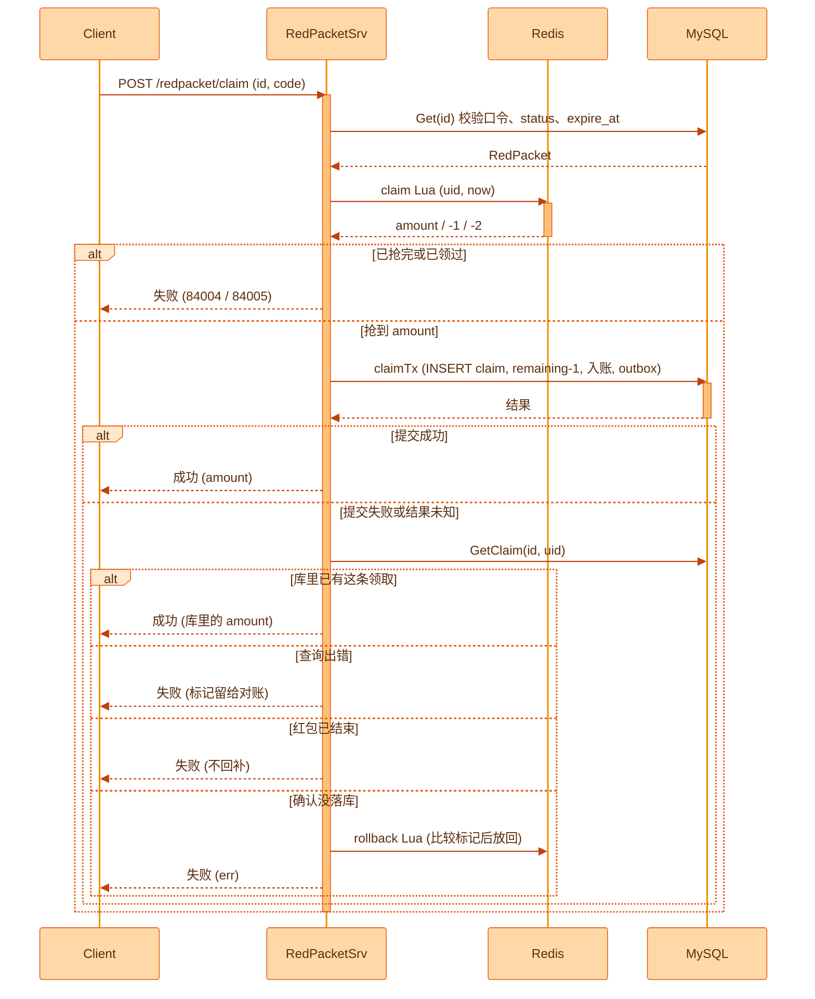

> **讲稿**　第四部分是这一讲的核心。先定一个认知：Redis 里 LPOP 成功，只代表你拿到了一张号码牌，钱有没有进钱包，由后面那个 DB 事务决定。这张图是一次完整的抢包。前半段很顺：校验口令和状态，Redis 抢一份，DB 事务落库入账，成功返回。要看的是下半段，DB 事务报错以后怎么办。注意它没有直接回补 Redis，而是先去数据库查了一次，然后分成四种情况处理。为什么要这么麻烦，看下一页。

---

## 4.2 无脑回补：一份 30 元被发了两次

```go
// ❌ 极其危险的错误写法！
amount := redisClaim()
if err := dbClaimTx(amount); err != nil {
    redisRollback(amount) // 只要报错就无脑把份额塞回 Redis！
}
```

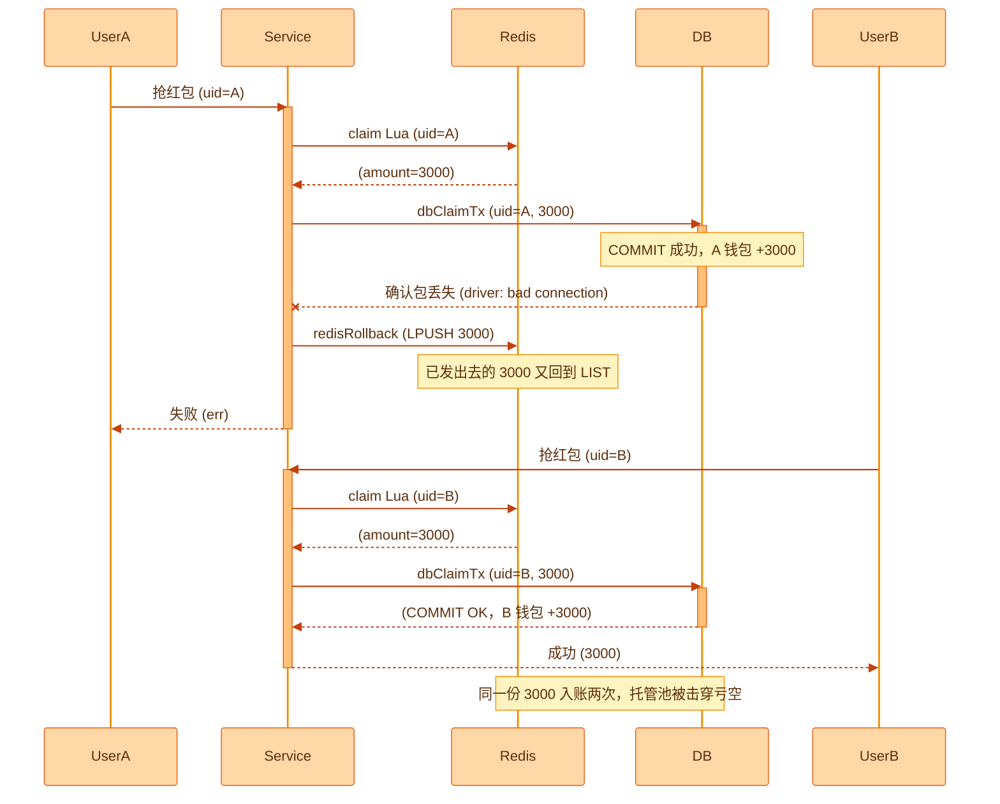

> **讲稿**　很多同学会这么写：Redis 抢到了，DB 报错了，那就把份额塞回 Redis。看着很对称，其实很危险。问题在于：报错不等于没提交。看图，A 抢到三十块，DB 事务在 MySQL 里其实已经提交成功，钱已经进了 A 的钱包，但 MySQL 回确认包的路上网络断了，Go 进程收到的是一个连接错误。这时候无脑回补，把三十块塞回 LIST。下一个人 B 来了，又把这三十块抢走并且入账。同一份三十块发了两次，托管账户被多扣了三十。

---

## 4.2 正确做法：四分支判定

`internal/redpacket/service.go:213-238`

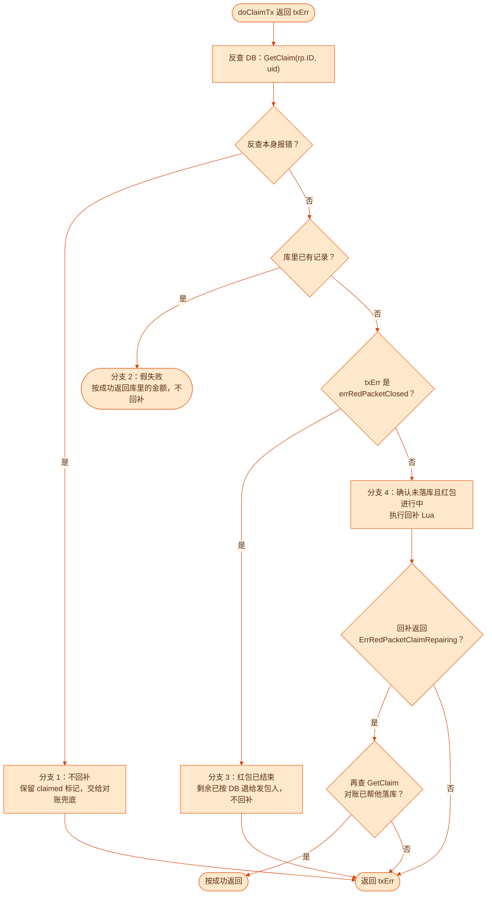

- 四个分支里**只有分支 4 会回补**。

> **讲稿**　gomall 的做法是：DB 报错以后，先去数据库反查这条领取记录，再分四种情况。第一，连反查都报错，数据库彻底连不上了，这时候什么都不知道，就什么都不动，标记留在 Redis 里，交给后台对账。第二，库里查到了记录，说明刚才是假失败，直接按成功返回。第三，事务报的是红包已结束，说明剩下的钱已经退给发包人了，这一份不能再放回去给别人抢。第四，确认库里没有、红包还在进行中，这时候才回补。大家记一个结论：四个分支里只有一个会回补。分支四后面还有个小尾巴，回补的时候发现对账任务已经接手了，就再查一次库，这个放到第五部分讲。

---

## 4.3 工单 B：抢最后一份与过期退款同时发生

**场景**：100 元红包 `12:00:00` 到期，前两人领走 80 元，还剩最后一份 20 元。同一毫秒，用户 C 在执行 `claimTx`，过期回收任务在执行 `refundRedPacketLeft`（`internal/redpacket/task.go:59-105`）。

情况一，领取事务先拿到行锁：

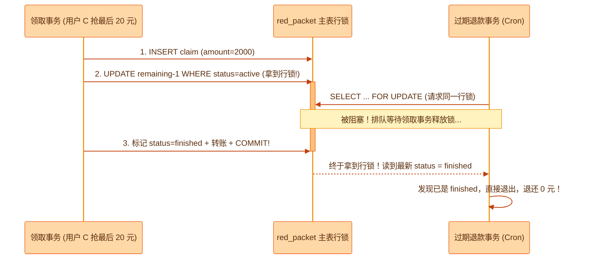

> **讲稿**　现在解决工单 B。一百块的红包十二点整到期，还剩最后一份二十块。就在十二点整这一毫秒，用户 C 抢到了这二十块，正在落库；同时过期回收任务也扫到了这个红包，准备把没领完的钱退给发包人。两边怎么不撞车？靠红包主表这一行的行锁。先看领取事务先到的情况：它执行扣减剩余份数的 UPDATE，拿到行锁。退款事务的第一句是 SELECT FOR UPDATE，要的是同一把锁，只能等。等领取事务提交了，退款事务拿到锁，读到状态已经是已抢完，直接退出，一分钱不退。

---

## 4.3 情况二：退款事务先拿到行锁

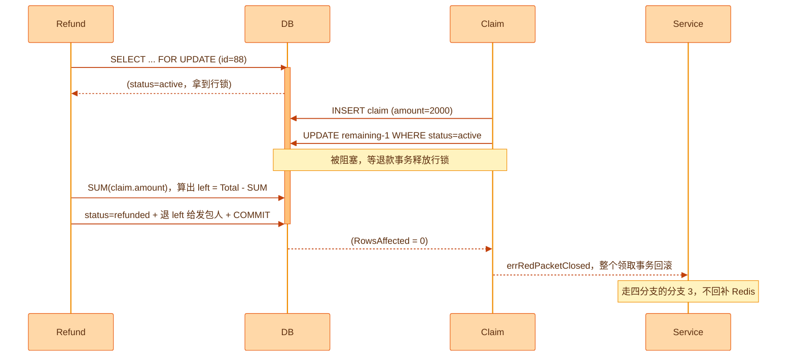

`DecrRemaining`（`internal/redpacket/repo.go`）：

```sql
UPDATE red_packet SET remaining = remaining - 1
WHERE id = ? AND remaining > 0 AND status = 1 /* active */
```

- 两种顺序都**串行**，同一份钱只会走一条路。

> **讲稿**　反过来，退款事务先拿到锁。它把已领金额加总，算出该退多少，把状态改成已退款，提交。这时候领取事务的 UPDATE 才轮到执行，但这条 UPDATE 带着条件：状态必须是进行中。现在状态已经是已退款，影响零行，代码看到零行就抛红包已结束，整个领取事务回滚，包括前面那条 INSERT。回到上层，正好落进四分支里的分支三，不回补。所以不管谁先谁后，两个事务都是排着队来的，这二十块要么给 C，要么退给发包人，不会两边都给。

---

## 4.4 为什么 `FOR UPDATE` 必须是事务第一条语句？

MySQL InnoDB 默认 **RR（可重复读）**：

- 事务里**第一条普通 `SELECT`** 执行的瞬间建立 ReadView 快照，此后所有普通读（含 `SUM`）只看得到快照时刻的数据。
- `SELECT ... FOR UPDATE` **不建快照**，等行锁，读最新已提交数据。

反面推演：红包 `88` 共 100 元 3 份，B 已领 30 元；到期瞬间 C 抢到 50 元（还剩一份，状态仍是 `active`）。

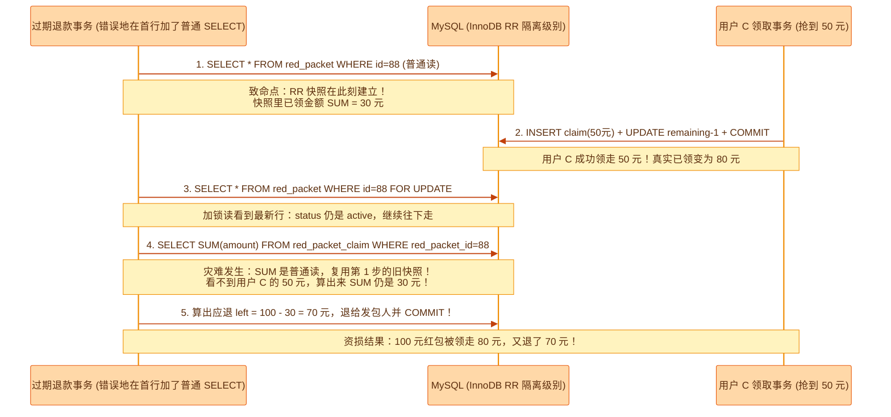

> **讲稿**　退款事务的代码里有一句很严厉的注释：加锁读必须是事务的第一条语句，前面不能插任何普通查询。为什么？这是 MySQL 可重复读隔离级别的机制。事务里第一条普通 SELECT 执行的那一刻，数据库给这个事务拍一张快照，之后所有普通读看到的都是这张快照。而加锁读不拍快照，它等锁，读最新数据。现在假设有人在加锁读前面手滑加了一句普通查询。看图：第一步普通读，快照拍下来了，这时候已领三十。第二步，C 抢到五十并且提交，真实已领变成八十。第三步加锁读，读到的是最新的行，状态还是进行中，继续往下。第四步求和，这是普通读，用的是第一步那张旧快照，看不到 C 的五十，算出来还是三十。第五步，一百减三十，退七十。结果一百块的红包，领走八十，又退了七十。

---

## 4.4 正确顺序：快照在拿到锁之后才建

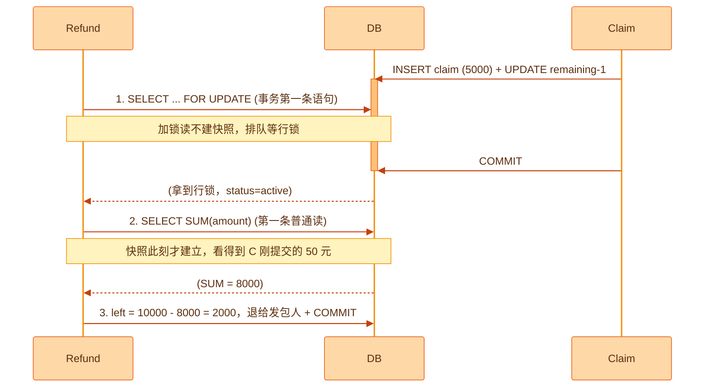

- 拿到行锁 = 排在它前面的领取事务都已 `COMMIT`。
- 之后的第一条普通读 `SumClaimed` 建的快照，一定包含这些领取。

> **讲稿**　正确的顺序是这样：加锁读放在第一句。它不拍快照，只是排队等锁。等它拿到锁，说明排在前面的领取事务都已经提交了。这时候再执行求和，这才是事务里第一条普通读，快照是现在才拍的，C 的五十块看得见，算出来已领八十，退二十，对了。同样两条 SQL，只是先后顺序不同，结果差了五十块钱。这就是那条注释存在的原因。

---

## 4.5 工单 A：回补 Lua 与 `:r` 补领锁

确认 DB 真的失败且未落库时，调 `RollbackRedPacketClaim`（`repository/cache/redpacket.go:92-99`）：

```lua
-- KEYS[1]: redpacket:{id}:amounts (LIST)
-- KEYS[2]: redpacket:{id}:claimed (HASH)
-- ARGV[1]: userID, ARGV[2]: 刚才抢到的金额 amount

local v = redis.call('HGET', KEYS[2], ARGV[1])
if not v then
    return 0                       -- 标记已经不在了（已被回补过），直接幂等返回 0
end
if string.sub(v, -2) == ':r' then
    return -1                      -- 标记末尾有 ":r"，说明后台对账任务已接手补领，绝不放回！
end
redis.call('LPUSH', KEYS[1], ARGV[2]) -- 把同一个金额原样塞回 LIST 头部
redis.call('HDEL', KEYS[2], ARGV[1])  -- 删掉该用户的已领标记，允许他再点一次重抢！
return 1
```

| 返回值 | 含义 | 动作 |
|---|---|---|
| `0` | 标记不存在，已回补过 | 幂等返回，什么都不做 |
| `-1` | 标记末尾有 `:r`，对账已接手 | 不放回 |
| `1` | 普通标记 | `LPUSH` 放回金额 + `HDEL` 删标记，用户可重抢 |

> **讲稿**　现在回到工单 A：点抢失败，再点提示已领过。原因是 DB 失败以后，Redis 里的已领标记没删。解决它的就是这段回补脚本，分支四调的就是它。它先读这个用户的标记，分三种情况。标记不在了，说明已经回补过，直接返回，这是幂等。标记末尾有冒号 r，说明后台对账已经接手这一份，绝不放回。只有普通标记才真正回补：把金额塞回 LIST，再把标记删掉。删掉标记这一步，就是工单 A 的解药，用户再点一次就能重新抢。

---

## 五、三道兜底防线

### 5.1 红包状态机

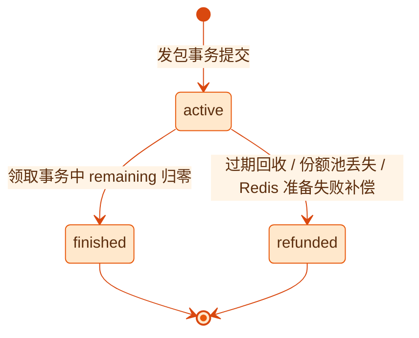

| 防线 | 触发 | 解决 |
|---|---|---|
| 5.2 孤儿对账补领 | 每 2 分钟 | 工单 C：抢到了但钱没到账 |
| 5.3 份额池丢失补偿 | 发包当场 + 每 2 分钟 | 工单 D：扣了钱但没人能抢 |
| 5.4 过期回收 | 每 5 分钟 | 没领完的钱退回发包人 |

> **讲稿**　前面讲的都是请求还活着的时候怎么处理。但请求可能直接死掉，比如服务器断电。所以第五部分是三道后台防线。先看状态机，很简单：红包从进行中出发，只有两个终点，抢完了，或者退款了。退款有三个来源：过期、份额池丢失、发包时 Redis 写入失败。下面三道防线，分别对应工单 C、工单 D，还有正常的过期。

---

## 5.2 工单 C：孤儿领取与对账补领

**孤儿领取**：Redis Lua 抢包成功，紧接着服务器断电重启，或 DB 事务超时且回补也因网络抖动失败。

- `LIST` 里已经没有这 30 元。
- `red_packet_claim` 里没有用户 101 的记录，钱没进钱包。
- `claimed` 里一直挂着 101，他再点只会收到“您已领取过”。

`RunRedPacketClaimReconcile` 每 2 分钟一次（`internal/redpacket/task.go:179-211`）：

```mermaid
%%{init: {'theme':'base','themeVariables':{'fontFamily':'PingFang SC, Microsoft YaHei, sans-serif','background':'#FFFBF5','primaryColor':'#FFE8CC','primaryBorderColor':'#E8590C','primaryTextColor':'#5C2E0E','secondaryColor':'#FFF4E6','tertiaryColor':'#FFF9F0','lineColor':'#D9480F','textColor':'#5C2E0E','clusterBkg':'#FFF9F0','clusterBorder':'#F08C00','edgeLabelBackground':'#FFF4E6','actorBkg':'#FFD8A8','actorBorder':'#E8590C','actorTextColor':'#5C2E0E','actorLineColor':'#F08C00','signalColor':'#C2410C','signalTextColor':'#5C2E0E','noteBkgColor':'#FFF3BF','noteBorderColor':'#F08C00','noteTextColor':'#5C2E0E','activationBkgColor':'#FFC078','activationBorderColor':'#E8590C','labelBoxBkgColor':'#FFE8CC','labelBoxBorderColor':'#E8590C','labelTextColor':'#5C2E0E','loopTextColor':'#5C2E0E'}}}%%
flowchart TD
    S(["遍历 claimed 里每条标记"]) --> D1{"DB 里已有领取记录？"}
    D1 -- "有" --> SKIP(["正常，跳过"])
    D1 -- "没有" --> D2{"抢到不足 1 分钟？<br/>claimOrphanGrace"}
    D2 -- "是" --> PEND(["在途，pending = true，先别动"])
    D2 -- "否" --> LOCK{"CAS 抢占：标记追加 :r<br/>LockRedPacketClaimForRepair"}
    LOCK -- "改写失败" --> GONE(["原请求刚完成回补，跳过"])
    LOCK -- "拿到 :r 锁" --> TX["替用户调同一个 claimTx<br/>把这份金额补发到钱包"]
    TX --> DONE(["repaired++"])
```

> **讲稿**　工单 C：抢到了，钱没到账。什么情况会这样？Redis 抢成功了，LIST 里少了一份，HASH 里记了他的名字，然后服务器断电。这时候三十块不在 LIST 里，也不在数据库里，卡在半空，我们叫它孤儿领取。唯一的线索就是 HASH 里那条标记，上面有金额和时间。对账任务每两分钟跑一次，把每条标记和数据库比。库里有，正常，跳过。库里没有，但抢到还不到一分钟，可能 DB 事务还在跑，先不动。超过一分钟还没落库，就是孤儿：先把标记改成带冒号 r 的，抢占成功以后，替用户调同一个领取事务，把钱补给他。注意是补给抢到的人，不是退给发包人，因为这一份确实是他抢到的。

---

## 5.2 `:r` 锁互斥（一）：对账先到

用户请求卡了整整 1 分钟才走失败回补，恰好对账协程也扫到这个标记：

```mermaid
%%{init: {'theme':'base','themeVariables':{'fontFamily':'PingFang SC, Microsoft YaHei, sans-serif','background':'#FFFBF5','primaryColor':'#FFE8CC','primaryBorderColor':'#E8590C','primaryTextColor':'#5C2E0E','secondaryColor':'#FFF4E6','tertiaryColor':'#FFF9F0','lineColor':'#D9480F','textColor':'#5C2E0E','clusterBkg':'#FFF9F0','clusterBorder':'#F08C00','edgeLabelBackground':'#FFF4E6','actorBkg':'#FFD8A8','actorBorder':'#E8590C','actorTextColor':'#5C2E0E','actorLineColor':'#F08C00','signalColor':'#C2410C','signalTextColor':'#5C2E0E','noteBkgColor':'#FFF3BF','noteBorderColor':'#F08C00','noteTextColor':'#5C2E0E','activationBkgColor':'#FFC078','activationBorderColor':'#E8590C','labelBoxBkgColor':'#FFE8CC','labelBoxBorderColor':'#E8590C','labelTextColor':'#5C2E0E','loopTextColor':'#5C2E0E'}}}%%
sequenceDiagram
    participant Claim as 慢请求协程 (准备回补放回份额)
    participant Redis as Redis claimed 标记
    participant Rec as 后台对账协程 (准备替用户补领入账)
    participant DB as MySQL

    Note over Redis: 当前标记值: "3000:1730680000"
    Rec->>Redis: 1. LockForRepair Lua (对比原值一致，追加 :r)
    Note over Redis: 标记变为: "3000:1730680000:r"
    Redis-->>Rec: 返回 1 (加锁成功!)
    Rec->>DB: 2. 执行 claimTx 替用户落库并加钱 30 元，COMMIT!
    Claim->>Redis: 3. 慢请求终于醒来，执行 rollback Lua
    Note over Claim,Redis: 发现标记末尾是 ":r"，拒绝 LPUSH 放回！
    Redis-->>Claim: 返回 -1 (ErrRedPacketClaimRepairing)
    Claim->>DB: 4. 慢请求再次反查 GetClaim，发现对账已帮他落库！
    Claim-->>Claim: 直接向客户端返回：抢包成功 (30元)！
```

> **讲稿**　这里有个并发问题。原来那个请求其实没死，只是卡了一分多钟，现在醒过来要回补；同一时刻对账也盯上了这条标记要补领。一个要把钱放回 Redis，一个要把钱发给用户，两个都做了就又多发一份。冒号 r 就是用来让它们二选一的。先看对账先到：对账把标记改成带冒号 r 的，然后落库发钱。慢请求醒来执行回补，脚本一看标记末尾是冒号 r，拒绝放回，返回负一。慢请求收到这个返回值，再去查一次库，发现对账已经帮他把钱发了，于是直接告诉用户：抢包成功。这就是四分支里分支四的那个小尾巴。

---

## 5.2 `:r` 锁互斥（二）：回补先到

```mermaid
%%{init: {'theme':'base','themeVariables':{'fontFamily':'PingFang SC, Microsoft YaHei, sans-serif','background':'#FFFBF5','primaryColor':'#FFE8CC','primaryBorderColor':'#E8590C','primaryTextColor':'#5C2E0E','secondaryColor':'#FFF4E6','tertiaryColor':'#FFF9F0','lineColor':'#D9480F','textColor':'#5C2E0E','clusterBkg':'#FFF9F0','clusterBorder':'#F08C00','edgeLabelBackground':'#FFF4E6','actorBkg':'#FFD8A8','actorBorder':'#E8590C','actorTextColor':'#5C2E0E','actorLineColor':'#F08C00','signalColor':'#C2410C','signalTextColor':'#5C2E0E','noteBkgColor':'#FFF3BF','noteBorderColor':'#F08C00','noteTextColor':'#5C2E0E','activationBkgColor':'#FFC078','activationBorderColor':'#E8590C','labelBoxBkgColor':'#FFE8CC','labelBoxBorderColor':'#E8590C','labelTextColor':'#5C2E0E','loopTextColor':'#5C2E0E'}}}%%
sequenceDiagram
    participant Service
    participant Redis
    participant Reconcile
    participant DB

    Reconcile->>Redis: HGETALL claimed
    Redis-->>Reconcile: (101 → 3000:1730680000)
    Service->>Redis: rollback Lua (uid=101, 3000)
    activate Redis
    Note over Redis: 普通标记：LPUSH 3000 回 LIST + HDEL 101
    Redis-->>Service: (1 已回补)
    deactivate Redis
    Reconcile->>Redis: LockForRepair Lua (uid=101, 原值)
    activate Redis
    Note over Redis: 标记已不存在，和原值对不上
    Redis-->>Reconcile: (0 抢占失败)
    deactivate Redis
    Note over Reconcile,DB: 跳过这一份，不调 claimTx
```

- 两段 Lua 都**先看标记再动手**：谁先改到标记谁处理这一份，另一方让路。

> **讲稿**　再看回补先到。对账先读到了这条标记，还没来得及加锁，慢请求的回补脚本先执行了：金额放回 LIST，标记删掉。对账接着去加锁，加锁脚本要求标记的值和刚才读到的一模一样，现在标记已经没了，对不上，返回零。对账就跳过这一份，不去发钱。所以规则很简单：两段脚本都是先看标记再动手，谁先改到标记，这一份就归谁处理，另一个让路。

---

## 5.3 工单 D：份额池丢失的两道防线

`redpacket:{id}:amounts` 这个 `LIST` 不存在，别人一点开就提示“红包已抢完”。

```mermaid
%%{init: {'theme':'base','themeVariables':{'fontFamily':'PingFang SC, Microsoft YaHei, sans-serif','background':'#FFFBF5','primaryColor':'#FFE8CC','primaryBorderColor':'#E8590C','primaryTextColor':'#5C2E0E','secondaryColor':'#FFF4E6','tertiaryColor':'#FFF9F0','lineColor':'#D9480F','textColor':'#5C2E0E','clusterBkg':'#FFF9F0','clusterBorder':'#F08C00','edgeLabelBackground':'#FFF4E6','actorBkg':'#FFD8A8','actorBorder':'#E8590C','actorTextColor':'#5C2E0E','actorLineColor':'#F08C00','signalColor':'#C2410C','signalTextColor':'#5C2E0E','noteBkgColor':'#FFF3BF','noteBorderColor':'#F08C00','noteTextColor':'#5C2E0E','activationBkgColor':'#FFC078','activationBorderColor':'#E8590C','labelBoxBkgColor':'#FFE8CC','labelBoxBorderColor':'#E8590C','labelTextColor':'#5C2E0E','loopTextColor':'#5C2E0E'}}}%%
flowchart TD
    subgraph P1 ["防线 1：发包当场立即逆向退款 (service.go:137-146)"]
        A1(["Create：DB 扣款事务已提交"]) --> A2{"PrepareRedPacket<br/>写 Redis 成功？"}
        A2 -- "成功" --> A3(["红包可抢"])
        A2 -- "失败" --> A4["当场调 refundRedPacketLeft(ctx, rp.ID)<br/>redpacket_escrow 全额退回发包人，状态置 refunded"]
    end
    subgraph P2 ["防线 2：对账发现池丢失提前退款 (task.go:155-229)"]
        B1(["每 2 分钟对账"]) --> B2{"创建已超过 1 分钟？"}
        B2 -- "是" --> B3{"amounts LIST 不存在？"}
        B3 -- "是" --> B4{"没有在途孤儿标记？"}
        B4 -- "是" --> B5{"DB 里仍 active<br/>且 remaining > 0？"}
        B5 -- "是" --> B6["提前退款<br/>不用让发包人傻等 7 天过期"]
    end
    A4 -. "补偿也失败 / 运行中途 Redis 丢数据" .-> B1
```

> **讲稿**　工单 D：发包扣了钱，但没人能抢。原因是扣款事务提交了，往 Redis 推金额的时候 Redis 挂了，或者运行中途 Redis 数据丢了，那个 LIST 根本不存在。这里有两道防线。第一道在发包接口里：写 Redis 失败的那一刻，当场把钱全额退回发包人，状态置为已退款。第二道在对账任务里：如果红包创建超过一分钟，LIST 不存在，没有在途的标记，数据库里却还有剩余份数，那就说明份额池丢了，没人能再抢到，直接提前退款，不用让发包人等七天过期。

---

## 5.3 池丢失检查：正确顺序（先 `EXISTS`，后读 `claimed`）

难点：最后一份被**正常抢走**时，`LPOP` 弹出最后一个元素，Redis 自动删除空 `LIST`，`EXISTS amounts` 同样是 `false`。

```mermaid
%%{init: {'theme':'base','themeVariables':{'fontFamily':'PingFang SC, Microsoft YaHei, sans-serif','background':'#FFFBF5','primaryColor':'#FFE8CC','primaryBorderColor':'#E8590C','primaryTextColor':'#5C2E0E','secondaryColor':'#FFF4E6','tertiaryColor':'#FFF9F0','lineColor':'#D9480F','textColor':'#5C2E0E','clusterBkg':'#FFF9F0','clusterBorder':'#F08C00','edgeLabelBackground':'#FFF4E6','actorBkg':'#FFD8A8','actorBorder':'#E8590C','actorTextColor':'#5C2E0E','actorLineColor':'#F08C00','signalColor':'#C2410C','signalTextColor':'#5C2E0E','noteBkgColor':'#FFF3BF','noteBorderColor':'#F08C00','noteTextColor':'#5C2E0E','activationBkgColor':'#FFC078','activationBorderColor':'#E8590C','labelBoxBkgColor':'#FFE8CC','labelBoxBorderColor':'#E8590C','labelTextColor':'#5C2E0E','loopTextColor':'#5C2E0E'}}}%%
sequenceDiagram
    participant Service
    participant Redis
    participant Reconcile
    participant DB

    Note over Redis: amounts 只剩最后 1 份
    Service->>Redis: claim Lua (uid=Z)
    activate Redis
    Note over Redis: LPOP 和 HSET claimed 原子完成，空 LIST 被自动删除
    Redis-->>Service: (amount=2000)
    deactivate Redis
    Reconcile->>Redis: 1. EXISTS amounts
    Redis-->>Reconcile: (false)
    Reconcile->>Redis: 2. HGETALL claimed
    Redis-->>Reconcile: (一定含 Z 的标记，抢到不足 1 分钟)
    Reconcile->>DB: ListClaims (id)
    DB-->>Reconcile: (还没有 Z)
    Note over Reconcile: Z 在途，r.pending = true，判定为正常抢完，不退款
    Service->>DB: claimTx (uid=Z, 2000)
    DB-->>Service: (COMMIT OK)
```

> **讲稿**　判断份额池丢没丢，有一个坑。LIST 不存在有两种可能：一种是真丢了，一种是最后一份刚被正常抢走，因为 Redis 会自动删掉空的 LIST。怎么区分？靠检查顺序：必须先查 LIST 在不在，再读 HASH 里的标记。看图，用户 Z 抢走最后一份，LIST 消失。对账查 LIST，不存在。然后读标记，因为抢包脚本里 LPOP 和打标记是原子的，只要 LIST 是被抢空的，Z 的标记这时候一定已经在 HASH 里了，而且是刚刚打上的，不到一分钟。对账看到有在途标记，就知道这是正常抢完，不退款。

---

## 5.3 池丢失检查：错误顺序（先读 `claimed`，后 `EXISTS`）

```mermaid
%%{init: {'theme':'base','themeVariables':{'fontFamily':'PingFang SC, Microsoft YaHei, sans-serif','background':'#FFFBF5','primaryColor':'#FFE8CC','primaryBorderColor':'#E8590C','primaryTextColor':'#5C2E0E','secondaryColor':'#FFF4E6','tertiaryColor':'#FFF9F0','lineColor':'#D9480F','textColor':'#5C2E0E','clusterBkg':'#FFF9F0','clusterBorder':'#F08C00','edgeLabelBackground':'#FFF4E6','actorBkg':'#FFD8A8','actorBorder':'#E8590C','actorTextColor':'#5C2E0E','actorLineColor':'#F08C00','signalColor':'#C2410C','signalTextColor':'#5C2E0E','noteBkgColor':'#FFF3BF','noteBorderColor':'#F08C00','noteTextColor':'#5C2E0E','activationBkgColor':'#FFC078','activationBorderColor':'#E8590C','labelBoxBkgColor':'#FFE8CC','labelBoxBorderColor':'#E8590C','labelTextColor':'#5C2E0E','loopTextColor':'#5C2E0E'}}}%%
sequenceDiagram
    participant Service
    participant Redis
    participant Reconcile
    participant DB

    Note over Redis: amounts 只剩最后 1 份，还没人抢
    Reconcile->>Redis: 1. HGETALL claimed
    Redis-->>Reconcile: (没有 Z 的标记)
    Service->>Redis: claim Lua (uid=Z)
    activate Redis
    Note over Redis: 微秒间隙里 Z 抢走最后 1 份，LIST 变空消失
    Redis-->>Service: (amount=2000)
    deactivate Redis
    Reconcile->>Redis: 2. EXISTS amounts
    Redis-->>Reconcile: (false)
    Note over Reconcile: 没有在途标记 + LIST 不存在，误以为 Redis 数据丢了
    Reconcile->>DB: Get (id)
    DB-->>Reconcile: (active，remaining = 1)
    Reconcile->>DB: refundRedPacketLeft (退 2000 给发包人，status=refunded)
    Service->>DB: claimTx (uid=Z, 2000)
    DB-->>Service: (errRedPacketClosed)
    Note over Service,DB: Z 正在入账的这笔钱被当成未领余额退给了发包人
```

> **讲稿**　如果顺序反过来，先读标记再查 LIST。对账读标记的时候，最后一份还没人抢，没有 Z。就在这之后的一瞬间，Z 抢走了最后一份，LIST 消失。对账接着查 LIST，不存在。它手里的信息是：没有在途标记，LIST 没了，数据库里还剩一份，于是误判成份额池丢失，把这二十块退给了发包人。等 Z 的领取事务跑到扣减那一步，红包已经是已退款，被拒掉。Z 明明抢到了，钱却退给了发包人。两次读取调个顺序，结论就完全不一样。

---

## 5.4 过期回收：先补齐孤儿，再按 DB 退剩余

`RunRedPacketExpireCheck` 每 5 分钟一次（`internal/redpacket/task.go:32-50`）：

```mermaid
%%{init: {'theme':'base','themeVariables':{'fontFamily':'PingFang SC, Microsoft YaHei, sans-serif','background':'#FFFBF5','primaryColor':'#FFE8CC','primaryBorderColor':'#E8590C','primaryTextColor':'#5C2E0E','secondaryColor':'#FFF4E6','tertiaryColor':'#FFF9F0','lineColor':'#D9480F','textColor':'#5C2E0E','clusterBkg':'#FFF9F0','clusterBorder':'#F08C00','edgeLabelBackground':'#FFF4E6','actorBkg':'#FFD8A8','actorBorder':'#E8590C','actorTextColor':'#5C2E0E','actorLineColor':'#F08C00','signalColor':'#C2410C','signalTextColor':'#5C2E0E','noteBkgColor':'#FFF3BF','noteBorderColor':'#F08C00','noteTextColor':'#5C2E0E','activationBkgColor':'#FFC078','activationBorderColor':'#E8590C','labelBoxBkgColor':'#FFE8CC','labelBoxBorderColor':'#E8590C','labelTextColor':'#5C2E0E','loopTextColor':'#5C2E0E'}}}%%
flowchart TD
    S(["扫出已过期的红包"]) --> R["第 1 步：reconcileRedPacket<br/>先把孤儿标记补发给领取人"]
    R --> D1{"对账出错或还有在途标记？"}
    D1 -- "是" --> D2{"过期不足 1 小时？<br/>refundHoldForReconcile"}
    D2 -- "是" --> W(["本轮跳过，下轮再看"])
    D2 -- "否，超时保底" --> D3
    D1 -- "否" --> D3{"对账里已提前退款？<br/>r.refunded"}
    D3 -- "是" --> E(["结束"])
    D3 -- "否" --> F["第 2 步：refundRedPacketLeft<br/>严格按 MySQL：Total - SUM(claim.amount)"]
    F --> G(["退回发包人，状态 refunded<br/>提交后清 Redis 剩余份额"])
```

- 顺序铁律：**必须先补孤儿，再退剩余**。
- 先退了剩余，状态变成 `refunded`，抢到红包却卡在半空的孤儿用户就再也补不进去。
- 还有在途未决的标记时最多宽限 1 小时，超时保底退回发包人。

> **讲稿**　最后一道防线，过期回收，每五分钟一次。它对每个过期的红包做两步，顺序不能反。第一步，先跑一遍对账，把孤儿补给领取人。第二步，再按数据库算，总额减去已领总和，退给发包人。为什么必须先补孤儿？因为一旦退款，状态就变成已退款，那个抢到了却卡在半空的用户，他的领取事务会被拒，这份钱就再也补不给他了。还有一个细节：如果对账出错，或者还有在途的标记没下结论，这一轮先不退，最多等一小时；一小时还没结果，保底退给发包人，钱至少不会丢。

---

## 六、故障演练与课堂演示指南

每个演示都是：**先跑通测试，再动手破坏一行代码，看测试变红。**

**演示 1：Redis 清空后，过期退款依然严格按 DB 计算**

```bash
go test ./internal/redpacket -run TestExpireRefundsLeftoverFromDBWhenRedisIsEmpty -v
```

- 破坏：打开 `internal/redpacket/task.go`，把 `left = rp.Total - claimed` 改成使用 Redis 清理脚本返回的剩余金额。
- 现象：测试立刻失败。测试故意把 Redis 清空了，按 Redis 算就会退 0 元，发包人的钱就丢了。

**演示 2：回补与对账补领的 `:r` 锁互斥**

```bash
go test ./repository/cache -run 'TestRollbackAndRepairLockAreExclusive|TestRepairLockRequiresOriginalMark' -v
go test ./internal/redpacket -run 'TestClaimTxFailureRollsBackRedis|TestClaimCommitUnknownDoesNotRollback|TestClaimRollbackYieldsToReconcileRepair' -v
```

- 破坏：把 `repository/cache/redpacket.go:95` 回补 Lua 里的 `if string.sub(v, -2) == ':r' then return -1 end` 注释掉，再跑 `TestClaimRollbackYieldsToReconcileRepair`。
- 现象：对账帮用户补领入账后，慢请求又把份额塞回 Redis，触发 `"redis has an extra share"` 超发断言失败。

**演示 3：真 MySQL 下的行锁与 MVCC 快照时机**

```bash
REDPACKET_TEST_MYSQL_DSN='root@tcp(127.0.0.1:3306)/rptest?charset=utf8mb4&parseTime=True&loc=Local' \
  go test ./internal/redpacket -run TestClaimAndRefundRaceConservesMoney -count=3 -v
```

- 破坏：在 `internal/redpacket/task.go:67` 的 `txDao.GetForUpdate(rpID)` 前面插入一行普通查询 `_, _ = txDao.Get(rpID)`，在真 MySQL 下重跑。
- 现象：立刻复现 `claimed X + refunded Y != 2000` 的双倍退钱资损事故。

> **讲稿**　讲了这么多，怎么证明代码真的守住了？做三个破坏实验，每个都是先跑通测试，再改坏一行，看测试变红。第一个，把退款金额从按数据库算改成按 Redis 算，测试里 Redis 是空的，于是退了零元，测试失败，对应的是资金以数据库为准。第二个，把回补脚本里检查冒号 r 的那一行注释掉，对账补领以后慢请求又放回一份，测试报 Redis 多了一份，对应的是冒号 r 互斥。第三个，在加锁读前面插一句普通查询，测试报领取加退款不等于总额，对应的是加锁读必须在第一句。注意第三个必须连真的 MySQL 跑，默认的 SQLite 没有行锁也没有快照，改错了也测不出来。

---

## 课后思考与练习

1. **在途窗口调参推演**：`claimOrphanGrace` 设为 1 分钟。如果某次数据库发生慢查询锁等待，导致一个正常领取事务卡了整整 90 秒才报错进入回补分支，请结合 4.2 和 5.2 节推演：这 90 秒里对账任务做了什么？慢请求醒来去回补时会收到什么返回值？用户最终看到成功还是失败？
2. **设计口令轮换功能**：发包人把红包链接发错群了，想立刻换一个新口令（`POST /redpacket/rotate-code`）。请设计该接口：之前已经用旧口令领到红包的人还能不能打开详情页看明细？并发正在抢的人会受什么影响？
3. **验证二倍均值分布**：写一段小测试调用 `SplitRedPacket(10000, 10)` 十万次，统计第 1 个位置到第 10 个位置的平均金额和最大金额。如果把代码里的 `Shuffle` 删掉，第 10 个位置的最大值分布会发生什么变化？
4. **编写托管池守恒巡检 SQL**：请写出一条只读巡检 SQL，找出所有状态已经是 `finished` 或 `refunded`、但在 `account_transaction` 表中 `redpacket_escrow` 借贷净额不为 0 的异常红包（提示：注意发包/退款流水的 `ref_order_id` 是红包 ID，而领包流水的 `ref_order_id` 是 `red_packet_claim.id`）。

> **讲稿**　留四道题。第一道是今天内容的综合：一个领取事务卡了九十秒，对账会做什么，用户最后看到什么，把四分支和冒号 r 串起来推一遍。第二道是设计题，给红包加一个换口令的接口。第三道动手，统计二倍均值的分布，再把洗牌删掉看看。第四道写一条巡检 SQL，查托管账户不为零的红包，提示在题目里：领包流水的单号是领取记录 ID。最后用一句话收尾：Redis 决定谁拿到哪一份，MySQL 决定钱有没有动，两边对不上的时候，永远听 MySQL 的。

---

## 附录：核心代码索引

| 业务模块 / 技术点 | 文件路径 | 核心入口函数 / 脚本 |
|---|---|---|
| **Redis 存储结构与 4 段 Lua 脚本** | `repository/cache/redpacket.go` | `prepareRedPacketScript`、`claimRedPacketScript`、`rollbackRedPacketClaimScript`、`lockRedPacketClaimForRepairScript` |
| **二倍均值预拆算法** | `repository/cache/redpacket.go` | `SplitRedPacket` |
| **孤儿标记解析与份额池检查** | `repository/cache/redpacket.go` | `ListRedPacketClaimed`、`RedPacketPoolExists`、`LockRedPacketClaimForRepair` |
| **红包与领取记录表模型** | `internal/redpacket/model.go` | `RedPacket`、`RedPacketClaim` |
| **发包 / 抢包 / 详情 / 列表 / 手动对账** | `internal/redpacket/service.go` | `Create`、`Claim`、`claimTx`、`Show`、`ListMine`、`ListReceived`、`AdminReconcile` |
| **防扫号口令生成与恒定时间比对** | `internal/redpacket/service.go` | `newShareCode`、`codeMatches` |
| **DB 条件扣减与行锁查询** | `internal/redpacket/repo.go` | `DecrRemaining`、`GetForUpdate`、`SumClaimed`、`GetExpired`、`ListActive` |
| **三段式托管资金流复式记账** | `internal/redpacket/settle.go` | `adjustWallet`、`adjustClearing`、`settleSendTx`、`settleClaimTx`、`settleRefundTx` |
| **过期回收与孤儿对账定时任务** | `internal/redpacket/task.go` | `RunRedPacketExpireCheck`、`refundRedPacketLeft`、`RunRedPacketClaimReconcile`、`reconcileRedPacket` |
| **台账对账消费者** | `internal/redpacket/consumer.go` | `StartSettleConsumer`、`DispatchSettleEvent`、`reportRepair` |
| **路由与限流/幂等护栏** | `internal/redpacket/routes.go` | `RegisterRoutes` |
| **系统托管账户定义** | `internal/money/ledger_model.go` | `AccountCodeRedPacketEscrow` |
| **错误码定义** | `pkg/e/code.go` | `84001` ~ `84006` |
| **单元与并发测试集** | `internal/redpacket/service_test.go`、`claim_test.go`、`repository/cache/redpacket_test.go` | 覆盖拆包、并发抢、MVCC 快照竞态、孤儿补领与互斥 |
