# 18 红包：Redis 分发与 DB 记账的一致性

> **模块定位**：`gomall` · `internal/redpacket`（发包、抢包、退款与对账） / `repository/cache/redpacket.go`（二倍均值拆包与 Lua 脚本）
>
> **怎么用**：`---` 是分页线，一页一个要点、一张图。
>
> **幻灯片版**：[18-redpacket-slides.html](./18-redpacket-slides.html)，浏览器直接打开。→ 下一步，← 上一步，F 全屏。需要 PDF 时在浏览器里打印即可（每页一张，仓库不跟踪 PDF）。

| 部分 | 讲什么 | 对应工单 |
|---|---|---|
| 00 | 为什么要两套存储，谁说了算 | |
| 一 | 三张客诉单与数据结构 | A B C |
| 二 | 分发：发包时预拆，抢包只 `LPOP` | |
| 三 | 资金：钱先进托管账户 | |
| 四 | 一致性：Redis 先扣，DB 说了算 | A |
| 五 | 三道兜底防线 | B C |
| 六 | 故障演练、课后思考、代码索引 | |

---

## 开场：红包是拿来干什么的

用户从自己的钱包里拿出一笔钱，拆成若干份，发给一群人**先到先得**：每人最多领一份，金额随机，没领完的到期退回。它是商城里的一种营销玩法，和优惠券、秒杀同一类。


- **金额**：单个红包最多 200 元（`MaxRedPacketTotalCents`），每份至少 1 分，最多 1000 份。
- **公平**：每人只能领一次；每份金额随机，但总和必须等于总金额。
- **钱不能错**：发出去多少，领走的加退回的就必须是多少。

---

## 00-1 只用 MySQL：所有人排同一把锁

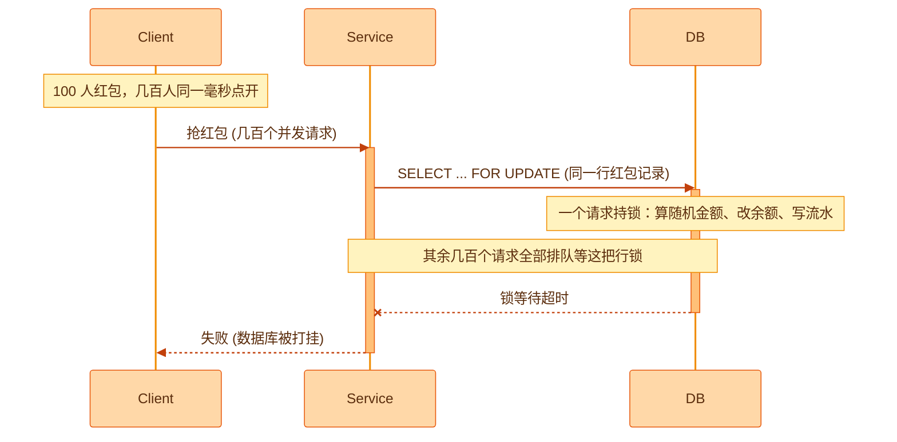

---

## 00-2 只用 Redis：扣了份额，钱不一定到账

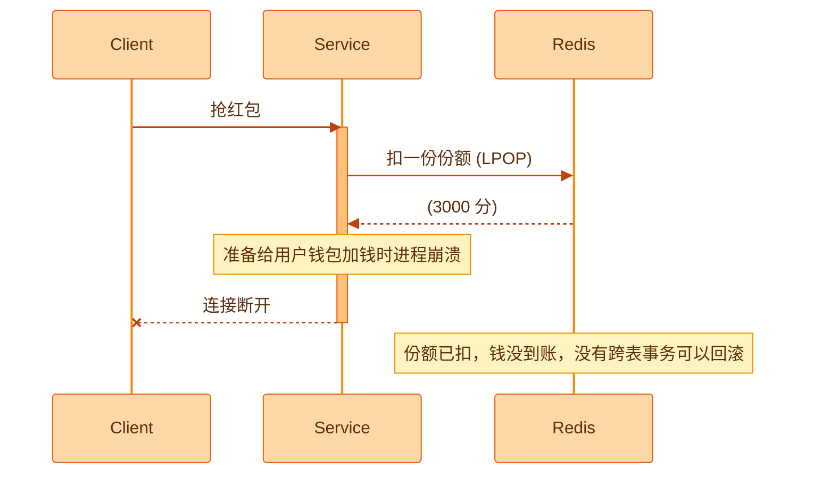

---

## 00-3 铁律：Redis 发号码牌，MySQL 发钱


红包结束时，数据库里必须满足**资金守恒**：

```text
红包总金额 (Total) = 所有领取人落库金额之和 SUM(red_packet_claim.amount) + 过期退回发包人的金额 (Leftover)
```

- 公式里每一项都**只从 MySQL 算**。
- 两边不一致，一律向 MySQL 对齐。

---

## 00-4 全景图：发红包、抢红包、退红包

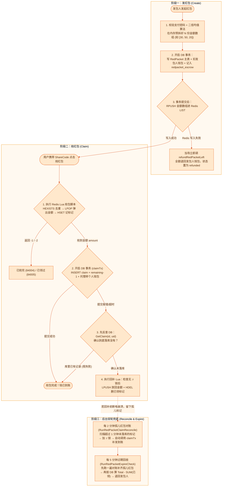

---

## 一、先看三张客诉单

| 工单 | 用户看到的现象 | 底层原因 | 解决章节 |
|---|---|---|---|
| **A** | 点“抢”报错失败；再点提示“您已领取过该红包”，钱也没到账 | Redis 扣了份额、打了已领标记，DB 事务失败后没把标记和份额退回 Redis | **4.2、4.3**：失败先查库 + Saga 原子回补 |
| **B** | 抢的时候转圈断开；半小时后份额没退回红包池，钱包也没收到钱（孤儿红包） | 抢完 Redis 后服务器断电重启，回补没跑成，份额卡在半空 | **5.2**：`claimed` 孤儿红包对账自动补领（`:r` 抢占锁） |
| **C** | 发包人被扣了 100 元，群里所有人点开都显示“红包已抢完” | DB 扣款事务提交成功，紧接着写 Redis 金额列表时 Redis 挂了 | **第五部分**：发包失败立即逆向退款 + 份额池丢失检测提前退款 |

---

## 1.1 Redis 侧：一摞红包，加一张“谁抢过了”的名单

`repository/cache/redpacket.go:16-22`，例子：100 元拆 3 份（30、50、20 元，即 3000、5000、2000 分）。

可以把两个 Key 想成两个小本子：`amounts` 是一摞还没被抢的红包，`claimed` 是抢过的人的名单。抢 = 从那一摞拿走一个，同时在名单上记一笔。

| Redis Key | 类型 | 存什么 |
|---|---|---|
| `redpacket:{id}:amounts` | `LIST` | 发包时一次性 `RPUSH` 预拆好的金额数组（分），抢包时 `LPOP` 弹出 |
| `redpacket:{id}:claimed` | `HASH` | 谁抢了多少、什么时候抢的：`userID -> "金额:unix秒[:r]"` |

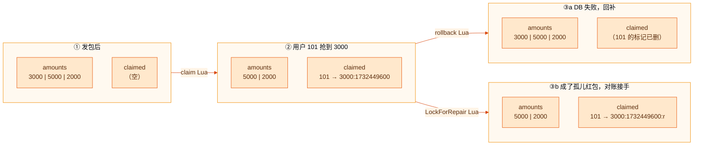

抢到之后钱还要写进数据库才算到账，这一步有两种走向：

- **数据库写失败**：反悔。把 30 元放回那一摞，把名单上 101 那行擦掉，他可以重新抢。
- **服务器断电**：来不及反悔。30 元已被拿走，数据库里又没有记录，这一份卡在半空，叫**孤儿红包**。后台任务找到它后在名单那行末尾加 `:r`，表示“这一份我来处理”，再替用户补进数据库。

**名单上为什么要记金额和时间，而不是只写个 1？**

- **记金额**：那 30 元已从一摞里拿走，数据库里也没有，名单是唯一还记得这个数的地方，后台才知道该补多少。
- **记时间**：不到 1 分钟的算还在写数据库，先不碰；超过 1 分钟还没到账的才当成孤儿红包去补。
- 所以名单不只是防重复领，它还是断电之后找回这笔钱的唯一线索。

---

## 1.1 MySQL 侧：两张核心表

`internal/redpacket/model.go:20-44`

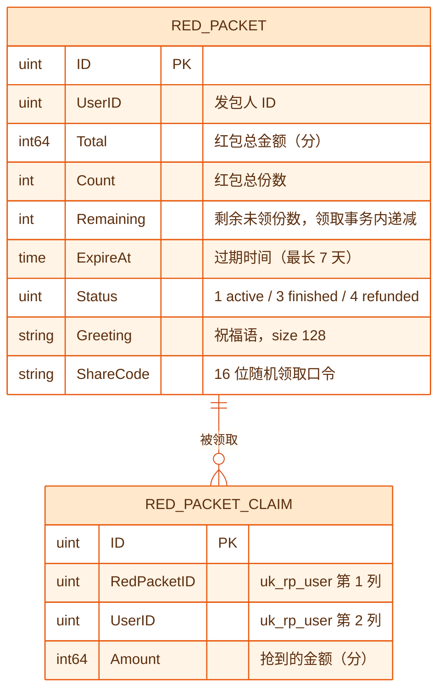

- `Status`：`1` 进行中、`3` 已抢完、`4` 已过期退款。
- 唯一索引 `uk_rp_user (red_packet_id, user_id)`：DB 层兜底“同一用户只能领一次”。

---

## 1.2 防扫号口令 `ShareCode`

`ShareCode` 是红包的**领取口令**：只有拿到分享链接的人才能抢这个红包，相当于微信里“只有群里的人能抢”。

- **为什么需要**：红包 ID 是自增的（1、2、3……），抢红包接口只要传一个 ID。没有口令时，写个循环从 1 抢到 10000，就能把全平台正在发的红包都抢一遍。
- **怎么起作用**：发红包时生成 16 位随机十六进制串，只在创建成功那一次响应里返回给发包人；发包人把 ID 和口令拼进链接发到群里；抢红包必须同时带上两者，口令不对返回 `84006`。
- **猜不中**：16 位十六进制约 1800 亿亿种组合，抢包接口每个用户每秒最多 3 次。

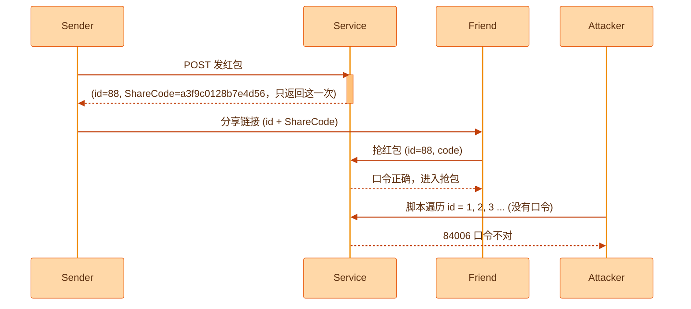

```go
// internal/redpacket/service.go:165-170
func codeMatches(rp *RedPacket, code string, legacyOK bool) bool {
	if rp.ShareCode == "" {
		return legacyOK
	}
	return subtle.ConstantTimeCompare([]byte(rp.ShareCode), []byte(code)) == 1
}
```

- 普通 `==` 逐字节比较，第 1 位错就立刻返回，前 15 位都对才比第 16 位。
- 攻击者测微秒级时间差，能一位一位猜出口令，这叫**计时攻击（Timing Attack）**。
- `ConstantTimeCompare` 永远比完所有字节，耗时恒定。

---

## 二-0 方案取舍：金额什么时候定、放在哪

| 方案 | 做法 | 省在哪 | 费在哪 |
|---|---|---|---|
| **A** 抢的时候实时算 | 只存剩余金额和剩余份数，每次抢都现算一份 | 发包最轻，不占额外存储 | 热路径要读、算、写回；失败回补会改变后面的分布 |
| **B** 发时预拆，只放 Redis（**gomall 现在用的**） | 金额数组一次算好，`RPUSH` 进 `LIST` | 抢包只有一次 `LPOP`，回补原样塞回 | 数组不落库，Redis 丢了没法重建，只能提前退款 |
| **C** 发时预拆，逐份落库 | 发之前每一份就定好，DB 里一份一行 | Redis 丢了能从 DB 重建；每份可审计、可指定金额 | 发包事务多写 N 行，领取多更新一行 |
| **D** 活动前批量预生成 | 平台按预算离线生成全部金额，开抢前预热进缓存 | 开抢时只扣库存，预算不会超 | 要提前知道总量，不适合用户随手发 |

- 越往下，金额定得越早、越可控，发包也越重。
- gomall 是用户随手发的小额红包，选 B：把丢份额的风险交给第五部分的“池丢失提前退款”兜底。

---

## 二-0 方案 C 展开：发之前就设计好，每一份都先落库

gomall 没有采用，用来和方案 B 对比。

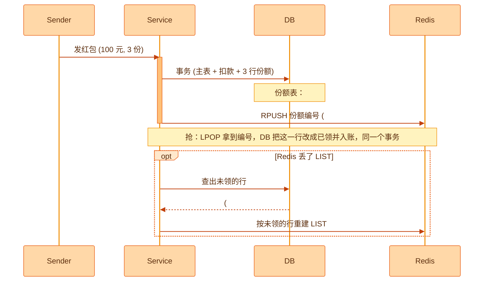

- 好处：可重建、可审计、可指定某一份的金额。
- 代价：1000 份的红包，发包事务要多写 1000 行。

---

## 二、分发模型：发包时预拆好，抢包只做 `LPOP`

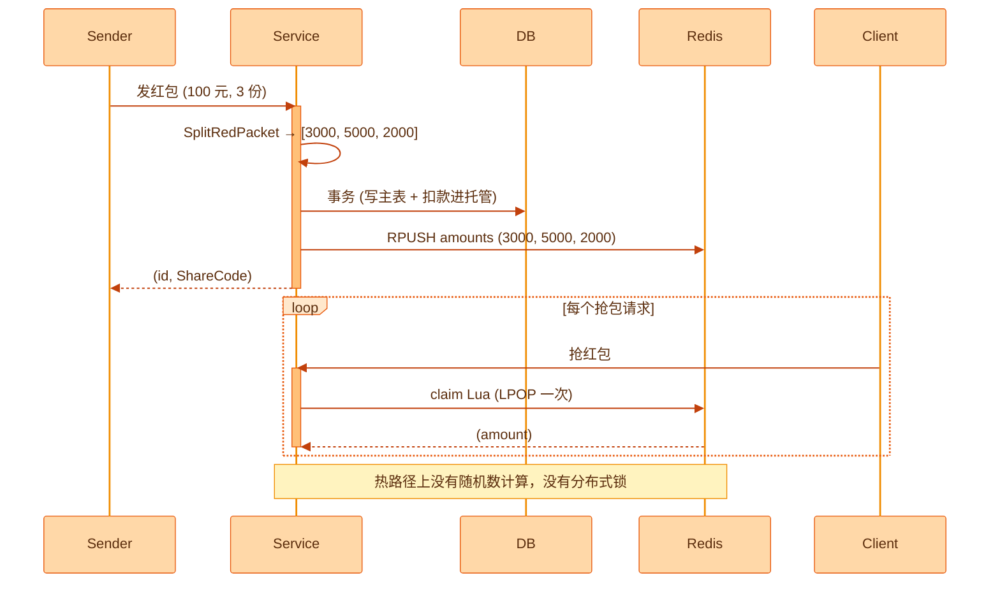

- 抢 = `LPOP` 拿走一张固定面额的“代金券”；失败回补 = `LPUSH` 原样塞回一张。
- 如果抢的时候实时算：要读剩余金额和份数、生成随机数、扣减写回，回补时退回去的金额还会让平均值变形。

---

## 2.1 二倍均值：10 元（1000 分）拆 3 份

`SplitRedPacket`，`repository/cache/redpacket.go:127-167`。每次随机的上限是**当前剩余人均金额的 2 倍**。


```go
avg := remain / left * 2                  // 二倍均值上界
maxThisRound := remain - int64(count-1-i) // 保底：后面每份至少留 1 分
hi := avg - 1                             // 再和 maxThisRound 取小
amt := splitRand.r.Int63n(hi) + 1         // 在 [1, hi] 内均匀随机
```

- 纯随机 `[1, 剩余总额]`：第一个人可能拿走 100 元里的 99 元。
- 最后一份直接拿走全部剩余，总和分毫不差。
- `Shuffle`：前面抽得小时最后一份会特别大，打乱后大额不会固定便宜最后一个人。

---

## 2.2 抢包 Lua：去重、出队、打标记，一次原子完成

`repository/cache/redpacket.go:55-66`

```lua
-- KEYS[1]: redpacket:{id}:amounts (LIST)
-- KEYS[2]: redpacket:{id}:claimed (HASH)
-- ARGV[1]: userID, ARGV[2]: TTL秒数, ARGV[3]: 当前unix秒时间戳

if redis.call('HEXISTS', KEYS[2], ARGV[1]) == 1 then
    return -2                      -- 1. 已经领过了，直接挡回！
end
local amt = redis.call('LPOP', KEYS[1])
if not amt then
    return -1                      -- 2. LIST 空了，红包已抢完！
end
-- 3. 写入抢包标记，例如 HSET redpacket:10:claimed 101 "3000:1732449600"
redis.call('HSET', KEYS[2], ARGV[1], amt .. ':' .. ARGV[3])
redis.call('EXPIRE', KEYS[2], tonumber(ARGV[2]))
return tonumber(amt)               -- 4. 返回抢到的金额（分）
```

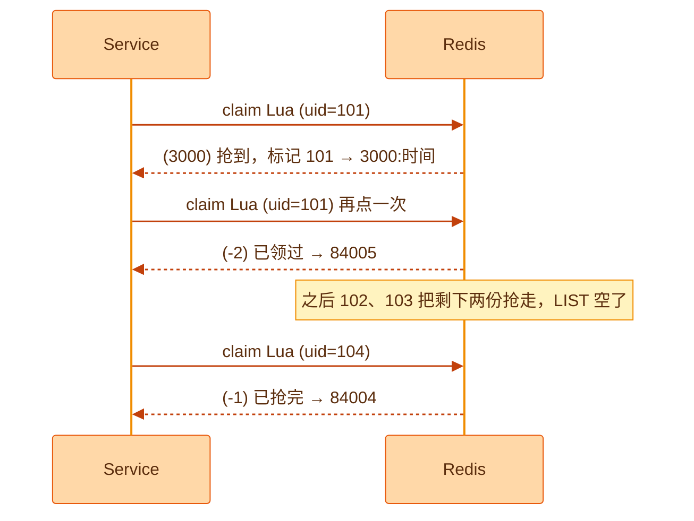

---

## 三、资金模型：钱先进红包托管，再分给领取人

算例：A 发 100 元（`10000` 分）3 份红包（红包 `ID = 88`）。B 抢到 30 元（`claim.ID = 501`），C 抢到 50 元（`claim.ID = 502`），第 3 份 20 元没人领，24 小时后过期退回 A。

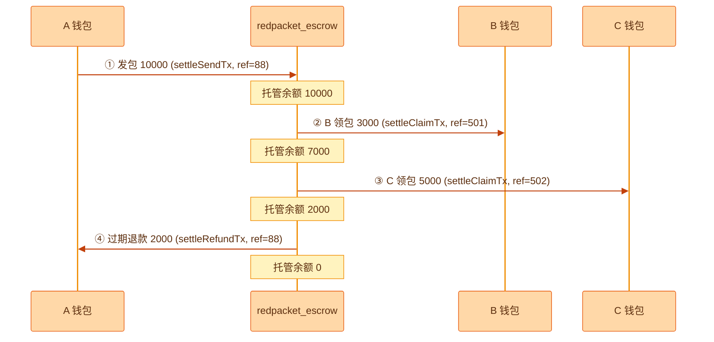

- 发包时钱**不直接进任何领取人的钱包**，先进系统托管账户 `redpacket_escrow`。
- 每个箭头是一组**一借一贷**的复式分录，4 个箭头共 8 条流水。
- 发包、领包、退款三段各自独立幂等。

---

## 3.1 完整台账：`account_transaction` 的 8 条流水

| 阶段 | 结算函数 | `ref_order_id` | 账户 (`account_code`) | 方向 | 金额(分) | `biz_type` | 说明 |
|---|---|---|---|---|---:|---|---|
| **1. 发包** | `settleSendTx` | `88` (红包ID) | A 的个人钱包 | `debit` | 10000 | `redpacket_send` | 发包人 A 扣款 100 元 |
| **1. 发包** | `settleSendTx` | `88` (红包ID) | `redpacket_escrow` | `credit` | 10000 | `redpacket_send` | 红包托管池入账 100 元 |
| **2. B 领包** | `settleClaimTx` | `501` (领取ID) | `redpacket_escrow` | `debit` | 3000 | `redpacket_claim` | 红包托管池支出 30 元 |
| **2. B 领包** | `settleClaimTx` | `501` (领取ID) | B 的个人钱包 | `credit` | 3000 | `redpacket_claim` | 领取人 B 入账 30 元 |
| **3. C 领包** | `settleClaimTx` | `502` (领取ID) | `redpacket_escrow` | `debit` | 5000 | `redpacket_claim` | 红包托管池支出 50 元 |
| **3. C 领包** | `settleClaimTx` | `502` (领取ID) | C 的个人钱包 | `credit` | 5000 | `redpacket_claim` | 领取人 C 入账 50 元 |
| **4. 过期退款** | `settleRefundTx` | `88` (红包ID) | `redpacket_escrow` | `debit` | 2000 | `redpacket_refund` | 红包托管池支出剩余 20 元 |
| **4. 过期退款** | `settleRefundTx` | `88` (红包ID) | A 的个人钱包 | `credit` | 2000 | `redpacket_refund` | 发包人 A 退回 20 元 |

`redpacket_escrow` 净余额：`+10000 (发包) - 3000 (B领) - 5000 (C领) - 2000 (退回A) = 0`

---

## 3.2 领包的 `ref_order_id` 为什么用“领取记录 ID”？

`ref_order_id`（关联单号）回答的是“这行流水是因为哪件事记的”：流水表只记钱的进出，靠它指回引发这笔钱的业务记录。

| 业务 | 关联单号填什么 | 这件事会发生几次 |
|---|---|---|
| 发红包 | 红包 ID | 一个红包只发 1 次 |
| 领红包 | 领取记录 ID | 一个红包被领 N 次，每次一条记录 |
| 过期退款 | 红包 ID | 一个红包最多退 1 次 |

一件事记两行、共用一个单号：B 领红包对应领取记录 501，托管账户出账 `(501, debit)`，B 的钱包入账 `(501, credit)`，靠方向区分。单号相同就是同一件事，重复记账会被拦；单号不同就是不同的事，放行。

流水表防重唯一索引：`uniq_acct_tx_order_dir (ref_order_id, direction, biz_type)`，**唯一键里没有 `user_id`**。

如果领包也用红包 ID，B 和 C 写入的三项完全一样，数据库分不清这是“C 的另一次领取”还是“B 那次被重复记账”，只能拒掉第二行。所以**单号的粒度要跟着“这件事发生几次”走**：发包、退款各一次，用红包 ID；领包有 N 次，用每次领取自己的 ID。

```mermaid
%%{init: {'theme':'base','themeVariables':{'fontFamily':'PingFang SC, Microsoft YaHei, sans-serif','background':'#FFFBF5','primaryColor':'#FFE8CC','primaryBorderColor':'#E8590C','primaryTextColor':'#5C2E0E','secondaryColor':'#FFF4E6','tertiaryColor':'#FFF9F0','lineColor':'#D9480F','textColor':'#5C2E0E','clusterBkg':'#FFF9F0','clusterBorder':'#F08C00','edgeLabelBackground':'#FFF4E6','actorBkg':'#FFD8A8','actorBorder':'#E8590C','actorTextColor':'#5C2E0E','actorLineColor':'#F08C00','signalColor':'#C2410C','signalTextColor':'#5C2E0E','noteBkgColor':'#FFF3BF','noteBorderColor':'#F08C00','noteTextColor':'#5C2E0E','activationBkgColor':'#FFC078','activationBorderColor':'#E8590C','labelBoxBkgColor':'#FFE8CC','labelBoxBorderColor':'#E8590C','labelTextColor':'#5C2E0E','loopTextColor':'#5C2E0E'}}}%%
flowchart TD
    subgraph Bad ["领包也用红包 ID 做 ref"]
        direction LR
        B1["B 领包写入<br/>(88, credit, redpacket_claim)"] --> B2["C 领包写入<br/>(88, credit, redpacket_claim)"]
        B2 --> B3["撞唯一索引报错"]
    end
    subgraph Good ["领包用 RedPacketClaim.ID 做 ref"]
        direction LR
        G1["B 领包写入<br/>(501, credit, redpacket_claim)"] --> G2["C 领包写入<br/>(502, credit, redpacket_claim)"]
        G2 --> G3["互不冲突"]
    end
    classDef bad fill:#FFC9C9,stroke:#C92A2A,color:#5C0E0E
    classDef good fill:#FFE066,stroke:#E67700,color:#5C2E0E
    class B3 bad
    class G3 good
```

- **发包和过期退款**：一个红包只发一次、最多退一次，用红包 ID (`88`)，靠 `redpacket_send` / `redpacket_refund` 区分。
- **多人领包**：每人用自己那条 `RedPacketClaim.ID`（`501`、`502`）。

---

## 四、一致性边界：Redis 先扣，DB 说了算

### 4.1 领取主链路与异常分支

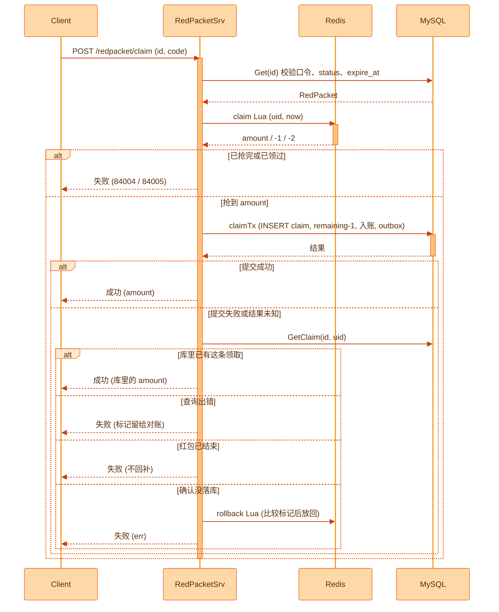

---

## 4.2 DB 报错了，先查库确认

**报错 ≠ 没提交。** Redis 抢到份额后，DB 事务报错有两种可能：

| | 实际情况 | 这一份该怎么办 |
|---|---|---|
| 可能一 | 事务真的没提交，钱没动 | 放回 Redis，让别人继续抢 |
| 可能二 | MySQL 里已经 COMMIT，钱已进用户钱包，只是确认包在路上丢了，Go 进程收到 `driver: bad connection` | 不能放回，放回就会被第二个人领走 |

两种情况服务端拿到的都只是一个 error，光看报错分不清。所以先用 `GetClaim` 反查：库里有记录就是已到账，没有才考虑放回。

---

## 4.2 四分支判定

`internal/redpacket/service.go:217-246`


- 四个分支里**只有分支 4 会回补**。

---

## 4.3 工单 A：回补 Lua 与 `:r` 补领锁

确认 DB 真的失败且未落库时，调 `RollbackRedPacketClaim`（`repository/cache/redpacket.go:92-99`）：

```lua
-- KEYS[1]: redpacket:{id}:amounts (LIST)
-- KEYS[2]: redpacket:{id}:claimed (HASH)
-- ARGV[1]: userID, ARGV[2]: 刚才抢到的金额 amount

local v = redis.call('HGET', KEYS[2], ARGV[1])
if not v then
    return 0                       -- 标记已经不在了（已被回补过），直接幂等返回 0
end
if string.sub(v, -2) == ':r' then
    return -1                      -- 标记末尾有 ":r"，说明后台对账任务已接手补领，绝不放回！
end
redis.call('LPUSH', KEYS[1], ARGV[2]) -- 把同一个金额原样塞回 LIST 头部
redis.call('HDEL', KEYS[2], ARGV[1])  -- 删掉该用户的已领标记，允许他再点一次重抢！
return 1
```

| 返回值 | 含义 | 动作 |
|---|---|---|
| `0` | 标记不存在，已回补过 | 幂等返回，什么都不做 |
| `-1` | 标记末尾有 `:r`，对账已接手 | 不放回 |
| `1` | 普通标记 | `LPUSH` 放回金额 + `HDEL` 删标记，用户可重抢 |

---

## 五、三道兜底防线

### 5.1 红包状态机

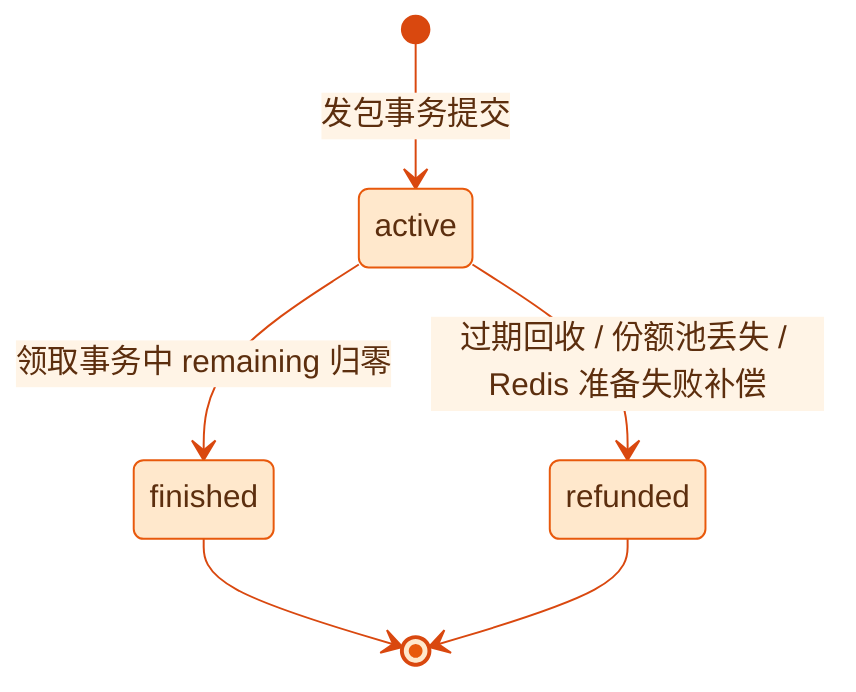

| 防线 | 触发 | 解决 |
|---|---|---|
| 5.2 孤儿红包补领 | 每 2 分钟 | 工单 B：抢到了但钱没到账 |
| 份额池丢失补偿 | 发包当场 + 每 2 分钟 | 工单 C：扣了钱但没人能抢。写 Redis 失败当场退款；运行中丢了，对账发现后退款 |
| 5.3 过期回收 | 每 5 分钟 | 没领完的钱退回发包人 |

---

## 5.2 工单 B：孤儿红包与对账补领

**孤儿红包**：Redis Lua 抢包成功，紧接着服务器断电重启，或 DB 事务超时且回补也因网络抖动失败。

- `LIST` 里已经没有这 30 元。
- `red_packet_claim` 里没有用户 101 的记录，钱没进钱包。
- `claimed` 里一直挂着 101，他再点只会收到“您已领取过”。

`RunRedPacketClaimReconcile` 每 2 分钟一次，对每个进行中的红包调 `reconcileRedPacket`，把标记和主库比（循环在 `internal/redpacket/task.go:197-233`）：

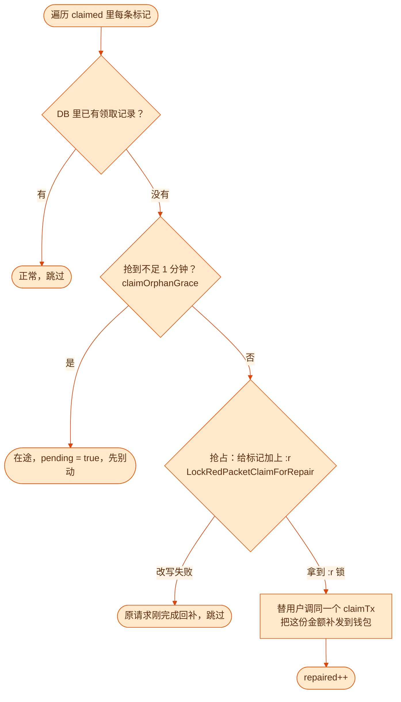

---

## 5.2 一个例子：用户 101 的 30 元是怎么补回来的

| 时间 | 发生了什么 | Redis 名单里 101 这一行 | MySQL |
|---|---|---|---|
| 12:00:00 | 101 抢到 30 元，服务器随即断电 | `3000:1732449600` | 没有领取记录 |
| 12:00:40 | 对账扫到：才过 40 秒，先不动 | `3000:1732449600` | 没有领取记录 |
| 12:02:40 | 对账再扫：超过 1 分钟，**加上 `:r`** | `3000:1732449600:r` | 没有领取记录 |
| 12:02:40 | 对账替 101 跑一遍领取事务 | `3000:1732449600:r` | 有领取记录，钱包 +30 元 |

这一行的格式是“金额（分）:领取时间（秒）”：`3000` 是 3000 分，也就是 30 元；后面那串数字是 12:00:00 换算成的秒数。

加上 `:r` 之后，原来那个请求就算醒过来、想把这 30 元放回 Redis，看到 `:r` 也会停手，这一份不会被发两次。

---

## 5.2 `:r` 锁互斥：对账先到

用户请求卡了整整 1 分钟才走失败回补，恰好对账协程也扫到这个标记：

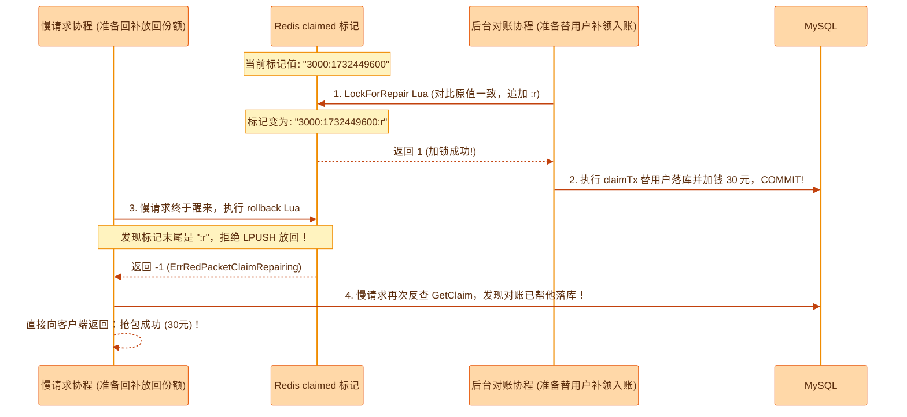

---

## 5.2 慢请求是怎么来的：Redis 抢到了，卡在数据库这一步

Redis 那一步是毫秒级的。慢请求都是卡在第二步“写数据库”上，一卡就超过 1 分钟。

| | 情况 | 怎么卡住的 |
|---|---|---|
| 1 | 排队等行锁 | 领取事务要先锁住这个红包的那一行。很多人同时抢同一个红包，或者过期退款正好也在处理它，后来的就得排队。MySQL 默认最多等 50 秒。 |
| 2 | 拿不到数据库连接 | 流量高峰时连接池被占满，请求连数据库的门都没进，一直在等空闲连接。 |
| 3 | 网络丢包 | 请求在去数据库的路上丢了，或者数据库的回复丢了。程序不知道对方收没收到，只能干等到超时。 |
| 4 | 数据库或服务卡住 | 主库故障正在切换；或者服务所在的机器负载太高，进程被暂停了几十秒。 |

这四种情况里请求都**没有死，只是慢**。它迟早会醒来走回补，而对账可能已经替它补了钱，`:r` 锁就是为这一刻准备的。

---

## 5.3 过期回收：先补齐孤儿红包，再按 DB 退剩余

`RunRedPacketExpireCheck` 每 5 分钟一次（`internal/redpacket/task.go:24-65`）：

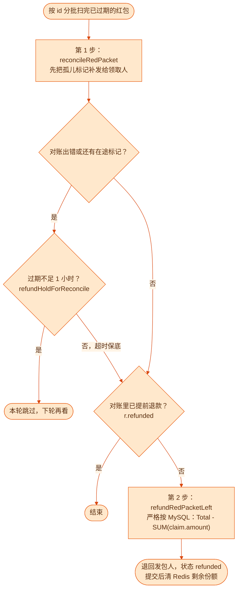

- 顺序铁律：**必须先补孤儿红包，再退剩余**。
- 先退了剩余，状态变成 `refunded`，抢到红包却卡在半空的孤儿用户就再也补不进去。
- 还有在途未决的标记时最多宽限 1 小时，超时保底退回发包人。

---

## 六、故障演练与课堂演示指南

每个演示都是：**先跑通测试，再动手破坏一行代码，看测试变红。**

**演示 1：Redis 清空后，过期退款依然严格按 DB 计算**

```bash
go test ./internal/redpacket -run TestExpireRefundsLeftoverFromDBWhenRedisIsEmpty -v
```

- 破坏：打开 `internal/redpacket/task.go`，把 `left = rp.Total - claimed` 改成使用 Redis 清理脚本返回的剩余金额。
- 现象：测试立刻失败。测试故意把 Redis 清空了，按 Redis 算就会退 0 元，发包人的钱就丢了。

**演示 2：回补与对账补领的 `:r` 锁互斥**

```bash
go test ./repository/cache -run 'TestRollbackAndRepairLockAreExclusive|TestRepairLockRequiresOriginalMark' -v
go test ./internal/redpacket -run 'TestClaimTxFailureRollsBackRedis|TestClaimCommitUnknownDoesNotRollback|TestClaimRollbackYieldsToReconcileRepair' -v
```

- 破坏：把 `repository/cache/redpacket.go:95` 回补 Lua 里的 `if string.sub(v, -2) == ':r' then return -1 end` 注释掉，再跑 `TestClaimRollbackYieldsToReconcileRepair`。
- 现象：对账帮用户补领入账后，慢请求又把份额塞回 Redis，触发 `"redis has an extra share"` 超发断言失败。

---

## 课后思考与练习

1. **在途窗口调参推演**：`claimOrphanGrace` 设为 1 分钟。如果某次数据库发生慢查询锁等待，导致一个正常领取事务卡了整整 90 秒才报错进入回补分支，请结合 4.2 和 5.2 节推演：这 90 秒里对账任务做了什么？慢请求醒来去回补时会收到什么返回值？用户最终看到成功还是失败？
2. **设计口令轮换功能**：发包人把红包链接发错群了，想立刻换一个新口令（`POST /redpacket/rotate-code`）。请设计该接口：之前已经用旧口令领到红包的人还能不能打开详情页看明细？并发正在抢的人会受什么影响？
3. **验证二倍均值分布**：写一段小测试调用 `SplitRedPacket(10000, 10)` 十万次，统计第 1 个位置到第 10 个位置的平均金额和最大金额。如果把代码里的 `Shuffle` 删掉，第 10 个位置的最大值分布会发生什么变化？
4. **编写托管池守恒巡检 SQL**：请写出一条只读巡检 SQL，找出所有状态已经是 `finished` 或 `refunded`、但在 `account_transaction` 表中 `redpacket_escrow` 借贷净额不为 0 的异常红包（提示：注意发包/退款流水的 `ref_order_id` 是红包 ID，而领包流水的 `ref_order_id` 是 `red_packet_claim.id`）。

---

## 附录：核心代码索引

| 业务模块 / 技术点 | 文件路径 | 核心入口函数 / 脚本 |
|---|---|---|
| **Redis 存储结构与 4 段 Lua 脚本** | `repository/cache/redpacket.go` | `prepareRedPacketScript`、`claimRedPacketScript`、`rollbackRedPacketClaimScript`、`lockRedPacketClaimForRepairScript` |
| **二倍均值预拆算法** | `repository/cache/redpacket.go` | `SplitRedPacket` |
| **孤儿标记解析与份额池检查** | `repository/cache/redpacket.go` | `ListRedPacketClaimed`、`RedPacketPoolExists`、`LockRedPacketClaimForRepair` |
| **红包与领取记录表模型** | `internal/redpacket/model.go` | `RedPacket`、`RedPacketClaim` |
| **发包 / 抢包 / 详情 / 列表 / 手动对账** | `internal/redpacket/service.go` | `Create`、`Claim`、`claimTx`、`Show`、`ListMine`、`ListReceived`、`AdminReconcile` |
| **防扫号口令生成与恒定时间比对** | `internal/redpacket/service.go` | `newShareCode`、`codeMatches` |
| **DB 条件扣减与行锁查询** | `internal/redpacket/repo.go` | `DecrRemaining`、`GetForUpdate`、`SumClaimed`、`GetExpired`、`ListActive` |
| **三段式托管资金流复式记账** | `internal/redpacket/settle.go` | `adjustWallet`、`adjustClearing`、`settleSendTx`、`settleClaimTx`、`settleRefundTx` |
| **过期回收与孤儿红包对账定时任务** | `internal/redpacket/task.go` | `RunRedPacketExpireCheck`、`refundRedPacketLeft`、`RunRedPacketClaimReconcile`、`reconcileRedPacket` |
| **台账对账消费者** | `internal/redpacket/consumer.go` | `StartSettleConsumer`、`DispatchSettleEvent`、`reportRepair` |
| **路由与限流/幂等护栏** | `internal/redpacket/routes.go` | `RegisterRoutes` |
| **系统托管账户定义** | `internal/money/ledger_model.go` | `AccountCodeRedPacketEscrow` |
| **错误码定义** | `pkg/e/code.go` | `84001` ~ `84006` |
| **单元与并发测试集** | `internal/redpacket/service_test.go`、`claim_test.go`、`repository/cache/redpacket_test.go` | 覆盖拆包、并发抢、孤儿红包补领与互斥 |
