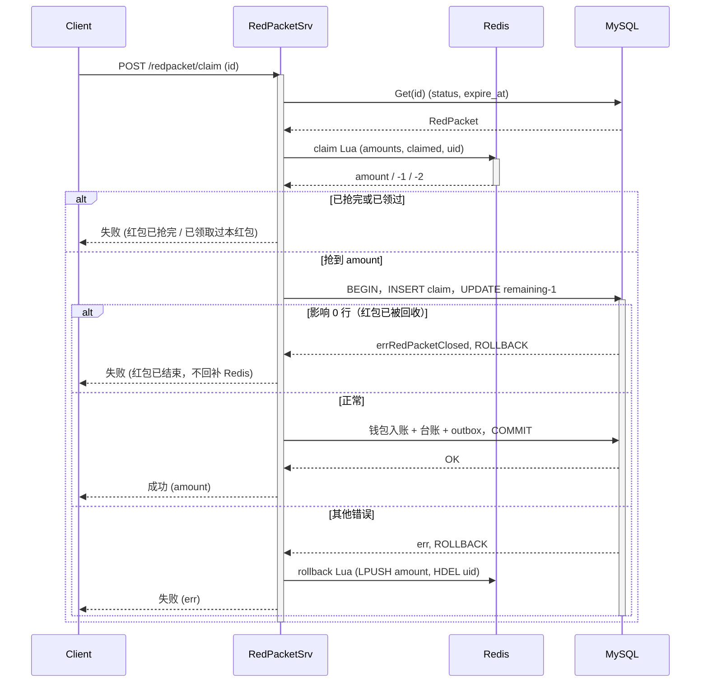
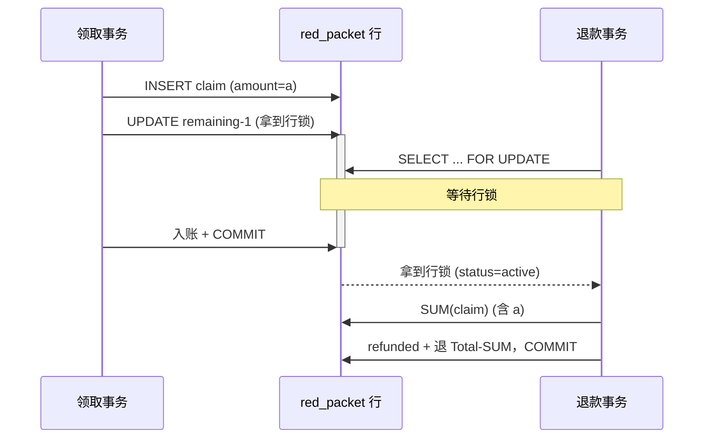
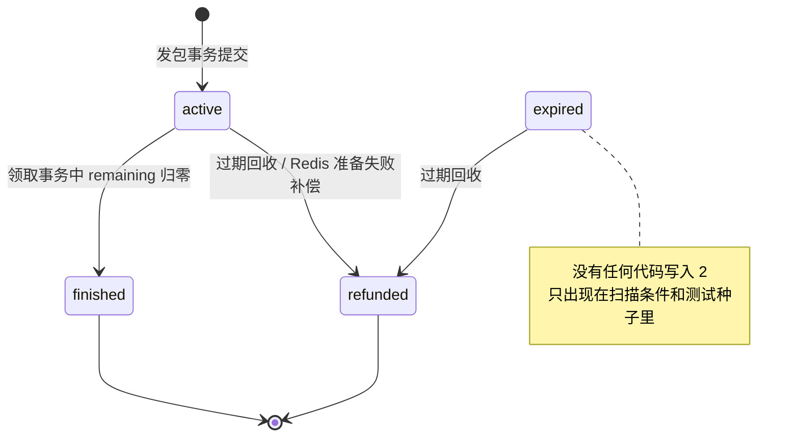
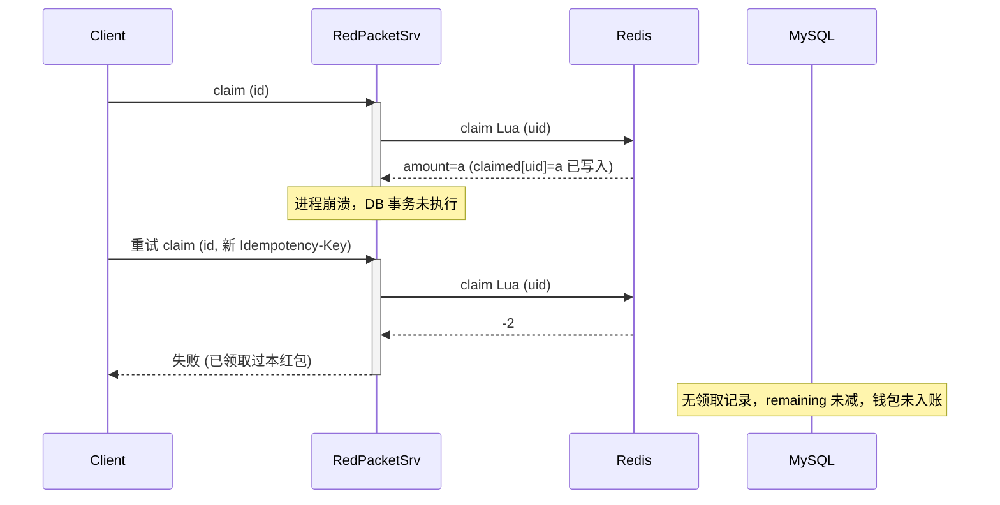

# 18 红包：抢到了却没到账——Redis 分发与 DB 记账的一致性

> 抢红包同时是高并发分发和小额资金转移。Redis 决定谁能拿到哪一份，DB 决定钱到底有没有动。两边对不上时，用户会看到“已领取过本红包”，钱包里却什么都没有。这一讲沿 `internal/redpacket` 和 `repository/cache/redpacket.go` 讲清楚：哪些不一致代码已经收敛，哪些还没有。

## 本讲目标

讲完后，学生应该能：

- 说清二倍均值预拆和 Lua `LPOP` 抢包的分工，以及为什么热路径上不算金额；
- 画出发包、领包、退款三段经过平台托管账户的复式分录，解释 `ref` 和 `biz_type` 怎样设计才幂等；
- 解释领取事务和过期退款之间靠哪一把行锁串行，为什么 `FOR UPDATE` 必须放在 `SUM` 前面；
- 指出“Redis 已标记、DB 没记录”和“提交结果未知时回补”这两条路径分别会造成什么后果；
- 列出当前实现的缺口，并说明每一处要补什么。

---

## 一、先看三张客诉单

**本节判断：红包的资金以 DB 为准，Redis 只负责发份额；所有事故都出在这两边的交界处。**

上线后客服可能收到三类工单：

| 工单 | 用户看到的现象 | 本讲对应位置 |
|---|---|---|
| A | 点了“抢”，提示“已领取过本红包”，钱包没到账 | 第四、六节 |
| B | 最后一份被抢走的同一秒红包过期，发包人退款金额和领取人金额加起来超过总额 | 第四节 |
| C | 发红包扣了钱，但所有人都抢不了 | 第五节 |

工单 B 在当前代码里已经被行锁挡住，工单 C 有立即补偿和定时兜底。工单 A 没有对账任务，只能等过期后把钱退给发包人，抢到的人拿不到。这是本讲最重要的一个缺口。

先看模块分工。存储结构写在缓存文件顶部（`repository/cache/redpacket.go:15-20`）：

```go
// 红包在 Redis 的存储结构：
//   redpacket:{id}:amounts   LIST  发包时一次性 RPUSH 预拆好的金额数组，LPOP 即抢
//   redpacket:{id}:claimed   HASH  userID -> 抢到金额 (兜底单用户去重)
```

DB 侧两张表（`internal/redpacket/model.go:21-41`）：

```go
type RedPacket struct {
	dbmodel.Model
	UserID    uint      // 发包人
	Total     int64     // 总额，单位：分
	Count     int       // 红包总份数
	Remaining int       // 剩余份数，领取事务内递减
	ExpireAt  time.Time // 过期时间
	Status    uint      // 1 active / 2 expired / 3 finished / 4 refunded
	Greeting  string    `gorm:"size:128"`
}

type RedPacketClaim struct {
	dbmodel.Model
	RedPacketID uint  `gorm:"not null;uniqueIndex:uk_rp_user,priority:1"`
	UserID      uint  `gorm:"not null;uniqueIndex:uk_rp_user,priority:2;index"`
	Amount      int64 `gorm:"not null"` // 抢到金额，单位：分
}
// （省略 gorm 标签中与本讲无关的部分）
```

记住一条守恒式，后面每一节都在守它：

```text
Total = SUM(red_packet_claim.amount) + 退回发包人的金额
```

它只用 DB 里的数算，Redis 里的数一个都不参与。

接入层的护栏只用一句话带过：发包挂 `Idempotency`，抢包挂按用户的 `SlidingWindow`（3 次/秒）和 `Idempotency`（`internal/redpacket/routes.go:17-25`），原理见第 15 讲。

---

## 二、分发模型：发包时拆好，抢包时只 LPOP

**本节判断：金额在发包时一次算完，抢包的热路径只做一次原子出队，不做任何计算和加锁。**

### 2.1 二倍均值预拆

`SplitRedPacket`（`repository/cache/redpacket.go:102-142`）：

```go
func SplitRedPacket(total int64, count int) ([]int64, error) {
	if count <= 0 || total < int64(count) {
		return nil, ErrRedPacketSplitInvalid
	}
	out := make([]int64, count)
	remain := total
	splitRand.Lock()
	defer splitRand.Unlock()

	for i := 0; i < count-1; i++ {
		left := int64(count - i)
		avg := remain / left * 2           // 二倍均值上界
		if avg < 2 {
			avg = 2
		}
		maxThisRound := remain - int64(count-1-i) // 给后面每份留 1 分
		// （省略 maxThisRound < 1 的兜底）
		hi := avg - 1
		if hi > maxThisRound {
			hi = maxThisRound
		}
		// （省略 hi < 1 的兜底）
		amt := splitRand.r.Int63n(hi) + 1  // [1, hi]
		out[i] = amt
		remain -= amt
	}
	out[count-1] = remain                  // 最后一份拿剩下的全部
	splitRand.r.Shuffle(count, func(i, j int) { out[i], out[j] = out[j], out[i] })
	return out, nil
}
```

三条规则要讲清楚：

1. **每份至少 1 分。** 入口先校验 `total >= count`（`internal/redpacket/service.go:53-55`），每轮的上界不超过 `remain - 后面份数`。
2. **总和严格等于 total。** 前 `count-1` 份随机，最后一份直接取余数，不存在舍入误差。
3. **单份期望等于当前均值。** 每轮在 `[1, 2*avg-1]` 上均匀取值，期望约等于 `remain/left`，所以“先抢后抢”的期望大致相同。

最后一份没有上界：前面每轮都抽到小值时，它可能远大于均值。代码用 `Shuffle` 打乱顺序，让这份大额不固定落在最后一个抢的人手里。这只是打乱位置，分布本身没变。

`splitRand` 是带锁的独立随机源（`repository/cache/redpacket.go:92-96`），注释说明是为了避开 `math/rand` 全局源的锁竞争。拆包只在发包时调用，不在抢包热路径上。

入口还有两个敞口限制：单个红包上限 200 元（`internal/redpacket/dto.go:5`、`service.go:56-58`），有效期最长 7 天（`service.go:68-74`）。

### 2.2 一个 Lua 写入，一个 Lua 抢

发包时把整组金额一次 `RPUSH` 进 LIST（`repository/cache/redpacket.go:34-43`），抢包时一个脚本完成去重、出队和标记（`repository/cache/redpacket.go:52-63`）：

```lua
if redis.call('HEXISTS', KEYS[2], ARGV[1]) == 1 then
    return -2                      -- 已领过
end
local amt = redis.call('LPOP', KEYS[1])
if not amt then
    return -1                      -- 已抢完
end
redis.call('HSET', KEYS[2], ARGV[1], amt)
redis.call('EXPIRE', KEYS[2], tonumber(ARGV[2]))
return tonumber(amt)
```

为什么不在抢包时实时算金额？实时拆需要读当前剩余金额和份数、计算、写回，三步必须原子，要么上分布式锁，要么把整个二倍均值算法写进 Lua。预拆以后，抢包只剩一个 `LPOP`，Redis 单线程执行脚本，天然不会超发，也不需要 `WATCH/MULTI`。

代价是金额序列在发包时就定了，写进 Redis 后不可再调整。对红包这种业务，这个代价可以接受。

和第 12 讲库存预占的思路一样：Redis 先扣，DB 为准，失败回补。区别是库存扣的是数量，这里扣的是一份带金额的值，回补时要把同一个金额还回去。

---

## 三、资金模型：钱先进托管，再分给领取人

**本节判断：发包时钱不直接进任何领取人的钱包，而是先进平台托管账户；三段资金流各自是一组复式分录，各自幂等。**

### 3.1 三段分录

`settle.go` 顶部注释写明了三段（`internal/redpacket/settle.go:15-22`）：

| 阶段 | 函数 | ref | biz_type | 分录 |
|---|---|---|---|---|
| 发包 | `settleSendTx` | 红包 id | `redpacket_send` | 发包人 debit / 平台 credit |
| 领包 | `settleClaimTx` | 领取记录 id | `redpacket_claim` | 平台 debit / 领取人 credit |
| 退款 | `settleRefundTx` | 红包 id | `redpacket_refund` | 平台 debit / 发包人 credit |

平台账户是 `user_id = 0`。一个 100 元、3 份的红包，领走 30 + 50，过期退 20：

```text
发包  发包人 debit 10000   平台 credit 10000
领包  平台 debit 3000      领取人1 credit 3000
领包  平台 debit 5000      领取人2 credit 5000
退款  平台 debit 2000      发包人 credit 2000
平台账户净额 = 10000 - 3000 - 5000 - 2000 = 0
```

平台账户在一个红包生命周期结束后归零，这就是对账时检查守恒的依据。

### 3.2 ref 和 biz_type 怎么选

台账唯一键是 `(ref_order_id, direction, biz_type)`（`internal/money/ledger_model.go:64-72`）。

- 发包和退款都用红包 id 做 ref，平台账户一个 credit、一个 debit，方向不同；但发包人也是一 debit 一 credit。如果共用一个 `biz_type`，发包人的退款 credit 会和平台的发包 credit 撞同一个唯一键。所以拆成 `redpacket_send` 和 `redpacket_refund`（`ledger_model.go:31-36`）。注意那段注释写的是“二者方向相同”，这个说法不准确：平台在发包和退款时方向相反，真正撞键的是“发包人退款 credit”和“平台发包 credit”，因为唯一键里没有 `user_id`。
- 领包用领取记录 id 做 ref。同一个红包有多个领取人，如果用红包 id，第二个领取人的 credit 就会撞第一个人的唯一键。

### 3.3 改余额和写台账在同一事务

`adjustWallet`（`internal/redpacket/settle.go:27-73`）：

```go
func adjustWallet(tx *gorm.DB, userID, refID uint, delta int64, bizType string) (skipped bool, balanceAfter int64, err error) {
	// （省略 direction 推导）
	var existing int64
	if err = tx.Model(&money.AccountTransaction{}).
		Where("ref_order_id=? AND direction=? AND biz_type=?", refID, direction, bizType).
		Count(&existing).Error; err != nil {
		return false, 0, err
	}
	if existing > 0 {
		return true, 0, nil                  // 已入过账，跳过
	}
	userDao := user.NewUserDaoByDB(tx)
	u, err := userDao.GetUserByIdForUpdate(userID)
	// （省略 err 判断）
	bal, err := u.DecryptMoney()
	// （省略 err 判断）
	balanceAfter = bal + delta
	if delta < 0 && balanceAfter < 0 {
		return false, 0, user.ErrInsufficientBalance   // 不允许透支
	}
	// （省略加密余额写回 UpdateUserMoney、amount 取绝对值）
	if err = money.NewLedgerDaoByDB(tx).AppendTransaction(userID, refID, direction, amount, balanceAfter, bizType); err != nil {
		return false, 0, err
	}
	return false, balanceAfter, nil
}
```

先查后写的预检加唯一索引兜底，加密余额加 `FOR UPDATE`，这套做法和第 02 讲余额支付一致，不再展开。平台账户没有 `users.money` 行，`adjustClearing` 只追加流水，`balance_after` 记 0（`settle.go:77-97`）。

发包时整笔都在一个事务里（`internal/redpacket/service.go:92-111`）：写红包主记录、`settleSendTx`、写 outbox。余额不足时整笔回滚。测试 `TestSendRejectsInsufficientBalance`（`internal/redpacket/service_test.go:23-43`）没有调用 `Create`，而是手写了同样形态的事务（建红包 + `settleSendTx`，不含 outbox），验证余额、台账和红包表都没有残留。发包前还要校验支付密码（`service.go:60-66`），和 `paydown` 一样。

### 3.4 当前实现的缺口：托管账户没有独立的 account_code

第 04 讲讲过，`user_id = 0` 上住着多个系统账户，靠 `account_code` 区分 `external_clearing` 和 `merchant_escrow`。红包的 `adjustClearing` 没有走 `AppendSystemTransaction`，而是走 `AppendTransaction`（`settle.go:96`），`user_id = 0` 时落成 `legacy_system`（`internal/money/ledger_repo.go:28-33`，代码第 17 讲已贴过）。

拼团的托管资金也落在这里（`internal/groupbuy/settle.go:35`）。按 `account_code` 汇总时，红包在途和拼团在途混在一个桶里，单看这个桶无法判断是哪个业务少了钱，只能再按 `biz_type` 拆。修复方向是新增一个红包专用的 `account_code`，让 `adjustClearing` 改调 `AppendSystemTransaction`。

---

## 四、一致性边界：Redis 先扣，DB 说了算

**本节判断：Redis 出队成功只代表“拿到了一份的资格”，钱是否到账由领取事务决定；领取和退款必须串行在同一行锁上。**

### 4.1 领取主链路



对应代码（`internal/redpacket/service.go:158-207`）：

```go
amount, err := cache.ClaimRedPacket(ctx, rp.ID, u.Id, claimedTTL)
if err != nil {
	return nil, err
}

txErr := rpDao.DB.Transaction(func(tx *gorm.DB) error {
	txDao := NewRedPacketDaoByDB(tx)
	claim := &RedPacketClaim{RedPacketID: rp.ID, UserID: u.Id, Amount: amount}
	if e := txDao.CreateClaim(claim); e != nil {
		return e
	}
	n, e := txDao.DecrRemaining(rp.ID)
	if e != nil {
		return e
	}
	if n == 0 {
		return errRedPacketClosed
	}
	if e := txDao.MarkFinishedIfDrained(rp.ID); e != nil {
		return e
	}
	if e := settleClaimTx(tx, claim.ID, u.Id, amount); e != nil {
		return e
	}
	return outbox.NewOutboxDaoByDB(tx).Insert(/* red_packet.claimed */)
})
if txErr != nil {
	if !errors.Is(txErr, errRedPacketClosed) {
		if rbErr := cache.RollbackRedPacketClaim(ctx, rp.ID, u.Id, amount); rbErr != nil {
			// （省略日志）
		}
	}
	return nil, txErr
}
```

DB 有两道兜底：

- `uk_rp_user (red_packet_id, user_id)` 唯一索引（`model.go:39-40`），Redis 的 `claimed` 被清掉以后，同一用户也插不进第二条领取记录；
- `DecrRemaining` 带条件 `remaining > 0 AND status = active`（`internal/redpacket/repo.go:50-55`），DB 的剩余份数才是权威。

失败后回补分两种。普通失败把这份金额 `LPUSH` 回去、撤掉 `claimed` 标记，让别人或本人还能再抢（`repository/cache/redpacket.go:86-90`）。红包已被回收时不能回补：剩余金额已经按 DB 退给发包人了，再塞回 Redis 等于同一笔钱发两次（`service.go:200-206`）。

### 4.2 领取和退款为什么不会把同一笔钱发两次

这是工单 B。退款事务的写法（`internal/redpacket/task.go:48-61`）：

```go
err := dao.NewDBClient(ctx).Transaction(func(tx *gorm.DB) error {
	txDao := NewRedPacketDaoByDB(tx)
	rp, err := txDao.GetForUpdate(rpID)       // 第一条语句：加锁读
	if err != nil {
		return err
	}
	if rp.Status == RedPacketStatusRefunded {
		return nil
	}
	claimed, err := txDao.SumClaimed(rpID)    // 之后才 SUM
	if err != nil {
		return err
	}
	left = rp.Total - claimed
	// （省略：MarkStatus(refunded)、settleRefundTx、outbox）
})
```

领取事务里的 `DecrRemaining` 是一条 `UPDATE red_packet ... WHERE id = ?`，会去拿同一行的 X 锁。两边谁先拿到锁，谁先走：



反过来，退款先拿到锁并提交，领取事务的 `UPDATE` 等到锁后发现 `status = refunded`，影响 0 行，返回 `errRedPacketClosed`，刚插入的领取记录随事务回滚。两种顺序都满足守恒式。

### 4.3 改一行就出事故：快照在什么时候建立

退款事务第一条语句是加锁读。MySQL InnoDB 在 RR 隔离级别下，普通 `SELECT` 的一致性快照在**事务里第一次普通读**时建立，加锁读不建快照、读最新已提交版本。所以 `SumClaimed` 这条普通读建快照时，已经拿到了行锁，排在它前面的领取事务都已提交，快照里能看到它们的领取记录。

假设有人“优化”一下，在 `GetForUpdate` 之前加一条普通读，比如先 `Get(rpID)` 判断是否已退款：

```text
退款: SELECT red_packet (普通读，快照在此建立)
领取: INSERT claim(a); UPDATE remaining-1; COMMIT
退款: SELECT ... FOR UPDATE (拿到锁，读到最新行)
退款: SUM(claim)            (用的是旧快照，看不到 a)
退款: 退 Total - SUM        (多退了 a)
```

领取人拿到了 a，发包人又被退了 a，平台托管账户变成负数。`repo.go:45-49` 的注释只说了锁串行，没写“前面不能有普通读”这个前提。这类约束最好用一个并发测试锁住，否则下一次重构就可能破坏它，见课后练习 2。

### 4.4 当前实现的缺口：提交结果未知时的回补

回补的前提是“DB 事务确定失败了”。`Transaction` 返回 error 并不总意味着没提交：`COMMIT` 已经在 MySQL 落盘，而连接在返回 OK 之前断开，客户端拿到的是错误。按 `service.go:197-207` 的代码推演，这时会发生：

1. 领取人 A 的领取记录和入账已经提交，金额 a1；
2. 代码把 a1 `LPUSH` 回 LIST 头部，并删掉 A 的 `claimed` 标记；
3. Redis 里的份数比 DB 的 `remaining` 多一份；
4. 下一个人 `LPOP` 就拿到这个 a1。如果过期前份数被抢完，DB 剩余份数归零时红包置为 `finished`，LIST 里还剩最后一份 an 没人能领（之后的请求在状态检查处就被拒）。

如果过期前没抢完，退款按 `Total - SUM` 算，守恒式仍然成立。抢完的情况下：已领总额 = Total - an + a1。a1 > an 时平台托管多付了 a1 - an；a1 < an 时少付，而状态是 `finished`，过期扫描不会再退款，发包人的 an - a1 永远留在托管里。两种情况都破坏守恒式。A 本人再抢时会被 DB 唯一索引拦住，不会拿到第二份。

这条路径没有测试覆盖，是从代码推出来的。修复思路很直接：回补前先用已有的 `GetClaim(rp.ID, u.Id)`（`repo.go:113-126`）查一次领取记录，存在就说明已经提交，不回补；查询本身也失败时，宁可不回补，让这一份在过期时按 DB 退给发包人。补偿只能用在确定失败的分支上。

---

## 五、兜底：发包补偿和过期回收

**本节判断：退款金额永远按 DB 算，不读 Redis；同一个退款函数既做发包失败的立即补偿，也做过期回收。**

### 5.1 状态机



`finished` 只在领取事务里 DB 剩余份数归零时写入（`repo.go:57-62`），一定没有余额，所以不扫。`refunded` 在退款事务里写入，退款函数遇到它直接返回。

### 5.2 发包后 Redis 写入失败

这是工单 C。钱已经进了托管，LIST 却没写进去，所有人抢都会得到“红包已抢完”。代码立即退款（`internal/redpacket/service.go:117-126`）：

```go
if e := cache.PrepareRedPacket(ctx, rp.ID, amounts, ttl+time.Hour); e != nil {
	// 钱已扣进 escrow 但红包抢不了：立即按 DB 把总额退回发包人。补偿也失败时，
	// 红包过期后回收任务按 DB 剩余金额兜底退款。
	if _, rbErr := refundRedPacketLeft(ctx, rp.ID); rbErr != nil {
		// （省略日志）
	}
	return nil, e
}
```

补偿也失败时，红包仍是 `active`。用户在有效期内抢不到，发包人要等到过期后 cron 扫到才拿回钱，最长 7 天。这段时间没有告警，也没有给发包人的提示，是体验上的缺口，资金不会丢。

LIST 的 TTL 比红包过期多 1 小时，给回收留出窗口（`service.go:117-118`）。

### 5.3 过期回收

cron 每 5 分钟跑一次（`initialize/cron.go:52-59`），扫描条件（`internal/redpacket/repo.go:132-138`）：

```go
err := d.DB.Where("status IN ? AND expire_at <= ?",
		[]uint{RedPacketStatusActive, RedPacketStatusExpired}, time.Now()).
	Where("total > (SELECT COALESCE(SUM(c.amount), 0) FROM red_packet_claim c WHERE c.red_packet_id = red_packet.id)").
	Limit(limit).
	Find(&out).Error
```

注意两点：

- 用 `total > 已领总额` 判断是否还有余额，而不是看 Redis 里 LIST 是否为空。Redis 被清空、过期，或者根本没写进去，DB 都能算出该退多少；
- 不写成 `status <> refunded`，否则抢完的红包每轮都要跑一次子查询（`repo.go:128-131` 的注释）。

退款提交以后才清 Redis 里剩下的份额（`task.go:84-86`）。清理失败只记日志：即使有人再从 LIST 里 `LPOP` 到一份，领取事务也会因为 `status = refunded` 影响 0 行而作废，并且不会回补。

测试 `TestExpireRefundsLeftoverFromDBWhenRedisIsEmpty`（`internal/redpacket/service_test.go:45-100`）把 Redis 回收函数替换成永远返回 0，种了四个红包：

| 红包 | 状态 | 已领 | 期望 |
|---|---|---|---|
| 1 | active，已过期 | 300 + 200 / 1000 | 退 500 |
| 2 | expired，已过期 | 100 / 800 | 退 700 |
| 3 | finished，已过期 | 500 / 500 | 不动 |
| 4 | active，未过期 | 0 / 600 | 不动 |

跑两遍 cron，断言发包人余额是 1200、退款台账 4 条（红包 1、2 各一借一贷）、Redis 清理只调用 2 次，证明退款按 DB 算、而且重跑幂等。

### 5.4 settle 消费者：当前结构下不会做任何事

`consumer.go` 订阅 `red_packet.*`，注释说它是“事件驱动的兜底再结算”（`internal/redpacket/consumer.go:16-19`）。但三笔资金流和 outbox 是在同一个事务里提交的：只要事件存在，台账一定已经存在，`adjustWallet` 必然走 `skipped` 分支。在当前结构下，这条 MQ 链路不会改变任何余额。

它什么时候才有意义？当资金结算从同步事务里拿出来、改成只靠事件驱动时。在那之前，它的价值只是验证毒消息进 DLQ、可重试错误退避这套机制（第 05 讲已讲），不要把它当成资金安全的一部分来讲。

---

## 六、“抢到了却没到账”：当前实现的缺口

**本节判断：Redis 的 `claimed` 和 DB 的领取记录之间没有对账任务，进程在两者之间崩溃时，用户只能找客服。**

### 6.1 工单 A 是怎么来的

Lua 抢包成功后，进程在 DB 事务开始前崩溃（发布重启、OOM、被 kill），回补代码根本没有机会执行。DB 事务确定失败、但回补 Lua 本身也失败时（`service.go:202-205` 只记日志），结果一样。

注意重试要换一个新的 `Idempotency-Key`：原来那个 key 停在 processing，重试只会得到“请求正在处理中”，直到 TTL 过期。



后果分三层：

| 角度 | 现象 |
|---|---|
| 领取人 | 提示已领过，钱包没钱，`claimed` 标记要到红包过期后 24 小时才过期（`service.go:157`） |
| 其他人 | LIST 比 DB 少一份；LIST 抢空后别人看到“红包已抢完”，DB 的 `remaining` 却停在 1（每丢一份多 1），红包一直是 `active` |
| 资金 | 守恒式没被破坏：过期后这一份按 `Total - SUM` 退给发包人 |

所以这不是资损，而是“钱退回了错误的人”。领取人看见的“已领取”来自 Redis，钱包看的是 DB，两边对不上，客服也没有工具查。

### 6.2 要补什么

最小的补法是一个对账任务，对每个仍是 `active` 的红包：

1. `HGETALL redpacket:{id}:claimed`，拿到 Redis 认为已领的用户和金额；
2. 和 `red_packet_claim` 按 `user_id` 比对；
3. Redis 有、DB 没有、且超过一个安全时间（比如 1 分钟，避开正在执行的领取事务）的，用和 `Claim` 相同的事务补写领取记录和入账，`ref` 仍是领取记录 id，台账唯一键保证不会重复入账。

补写时要拿红包行锁，并检查 `status = active`，否则会和过期退款再撞一次 4.2 的问题。

### 6.3 其他缺口

| 缺口 | 位置 | 影响 |
|---|---|---|
| 没有领取资格 | `service.go:139-160`，`routes.go:20-25` | 任何登录用户都能领任何红包，没有群或指定接收人；红包 id 是自增主键，脚本可以按顺序扫号；按用户 3 次/秒的限流挡不住多账号 |
| 详情对所有人公开 | `service.go:217-235` | 任意登录用户可以看任意红包的全部领取明细（用户 id + 金额） |
| `expired` 是死状态 | `model.go:12`，`repo.go:134` | 注释写“cron 标记”，但没有代码写入 2 |
| settle 消费者是空操作 | `consumer.go:16-19` | 见 5.4，多一条 MQ 链路，不增加任何保障 |
| 托管资金落在 `legacy_system` | `settle.go:96`，`ledger_repo.go:28-33` | 见 3.4，与拼团混在一起 |
| 没有“我收到的红包” | `routes.go:26-27`，`repo.go:90-102` | 只有 `ListMine`（我发出的） |
| `Greeting` 不校验长度 | `dto.go:11`，`model.go:29` | 超过 128 时，MySQL 严格模式下要到支付密码校验通过后、事务里才失败；非严格模式会被静默截断 |
| 测试覆盖薄 | `service_test.go` | 只有发包余额不足、过期退款两个用例；拆包算法、抢包 Lua、Saga 回补、领取与退款并发都没有测试 |

---

## 七、故障演练 / 课堂演示

**本节判断：每个演练都只看一件事——DB 里的守恒式是否还成立。**

### 演示 1：Redis 清空后照样按 DB 退款

```bash
go test ./internal/redpacket -run TestExpireRefundsLeftoverFromDBWhenRedisIsEmpty -v
```

现场把 `GetExpired` 的条件改成只扫 `active`，再跑一次：红包 2 不退款，发包人余额从 1200 变成 500，测试失败。说明扫描范围本身就是资金正确性的一部分。

### 演示 2：拆包算法的三条规则

现场补一个最小测试，对 `SplitRedPacket` 跑一万次随机参数，断言：

```go
// 每次：len(out) == count；每份 >= 1；sum(out) == total
amounts, err := cache.SplitRedPacket(total, count)
```

再试 `SplitRedPacket(5, 5)` 和 `SplitRedPacket(4, 5)`，前者全是 1，后者返回 `ErrRedPacketSplitInvalid`。

### 演示 3：在 Lua 和 DB 之间崩溃

本地起服务，在 `service.go:158-161` 的 err 判断之后、事务之前加一行 `os.Exit(1)`，发一个 2 份的红包，用户 A 抢一次，重启服务（去掉 `os.Exit`）后 A 换一个 `Idempotency-Key` 再抢：

- 接口返回“已领取过本红包”；
- `red_packet_claim` 没有 A 的记录，`remaining` 仍是 2；
- 用户 B 抢走另一份后，`remaining` 停在 1，红包一直是 `active`；
- 把 `expire_at` 改到过去，等 cron 或手动调 `RunRedPacketExpireCheck`，发包人拿回 A 那一份。

演示完一定删掉 `os.Exit`。

### 演示 4：快照时机

在 `refundRedPacketLeft` 的 `GetForUpdate` 前面加一条 `txDao.Get(rpID)`，用两个 MySQL 会话手工复现 4.3 的时序：退款会话先执行普通读，领取会话插入领取记录、扣份数并提交，退款会话再执行剩余语句，观察退款金额多出领取的那一份。注意 SQLite 测试库不能复现，单测里 `SetMaxOpenConns(1)` 把所有事务串行化了（`service_test.go:113`）。

---

## 课后练习

1. **回补前先确认。** 修改 `Claim` 的失败分支：回补前用 `GetClaim` 确认 DB 里没有这条领取记录。写一个测试，用替换函数模拟“事务已提交但返回错误”，断言 Redis 不回补、已领总额不超过 Total。
2. **领取与退款并发测试。** 在 MySQL 上起两个 goroutine，一个对最后一份执行领取事务，一个执行 `refundRedPacketLeft`，跑 1000 轮，断言每轮都有 `SUM(claim) + 退款 == Total`。再按 4.3 的方式在退款事务开头加一条普通读，确认测试能抓到。
3. **claimed 对账任务。** 按 6.2 写一个 cron，说清楚“安全时间”取多少、为什么必须拿行锁、补写时 `ref` 用什么。
4. **领取资格。** 给红包加一个可选的接收人列表或群 id，说明校验应该放在 Lua 之前还是 DB 事务里，`Show` 应该对谁返回领取明细。
5. **独立 account_code。** 给红包托管设计一个新的 `account_code`，写出迁移时历史 `legacy_system` 流水怎么按 `biz_type` 归类。
6. **删除还是启用 `expired`。** 二选一：要么删掉这个状态和扫描条件里的引用，要么让 cron 在过期时先写 `expired`，说明哪种更省事、哪种对客服查询更友好。

---

## 代码索引

| 主题 | 文件 | 入口 |
|---|---|---|
| Redis 存储结构与 Lua | `repository/cache/redpacket.go` | `prepareRedPacketScript`、`claimRedPacketScript`、`rollbackRedPacketClaimScript` |
| 二倍均值拆包 | `repository/cache/redpacket.go` | `SplitRedPacket` |
| 表结构与状态 | `internal/redpacket/model.go` | `RedPacket`、`RedPacketClaim` |
| 发包 / 抢包 / 详情 | `internal/redpacket/service.go` | `Create`、`Claim`、`Show`、`ListMine` |
| 剩余份数与扫描 | `internal/redpacket/repo.go` | `DecrRemaining`、`GetForUpdate`、`SumClaimed`、`GetExpired` |
| 三段资金流 | `internal/redpacket/settle.go` | `adjustWallet`、`settleSendTx`、`settleClaimTx`、`settleRefundTx` |
| 过期回收 | `internal/redpacket/task.go` | `RunRedPacketExpireCheck`、`refundRedPacketLeft` |
| 事件消费 | `internal/redpacket/consumer.go` | `StartSettleConsumer`、`DispatchSettleEvent` |
| 路由与护栏 | `internal/redpacket/routes.go` | `RegisterRoutes` |
| 台账与系统账户 | `internal/money/ledger_model.go`、`internal/money/ledger_repo.go` | `AccountTransaction`、`AppendTransaction` |
| 定时任务 | `initialize/cron.go` | `RunRedPacketExpireCheck` 注册 |
| 测试 | `internal/redpacket/service_test.go` | `TestSendRejectsInsufficientBalance`、`TestExpireRefundsLeftoverFromDBWhenRedisIsEmpty` |
