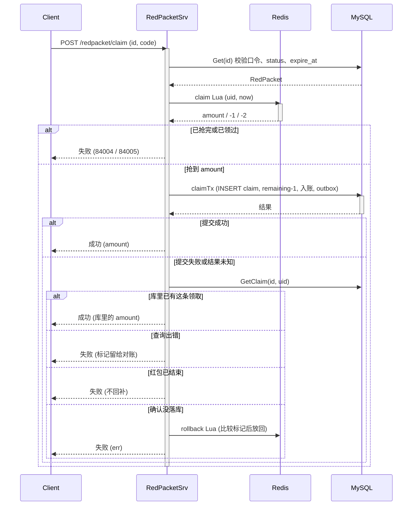
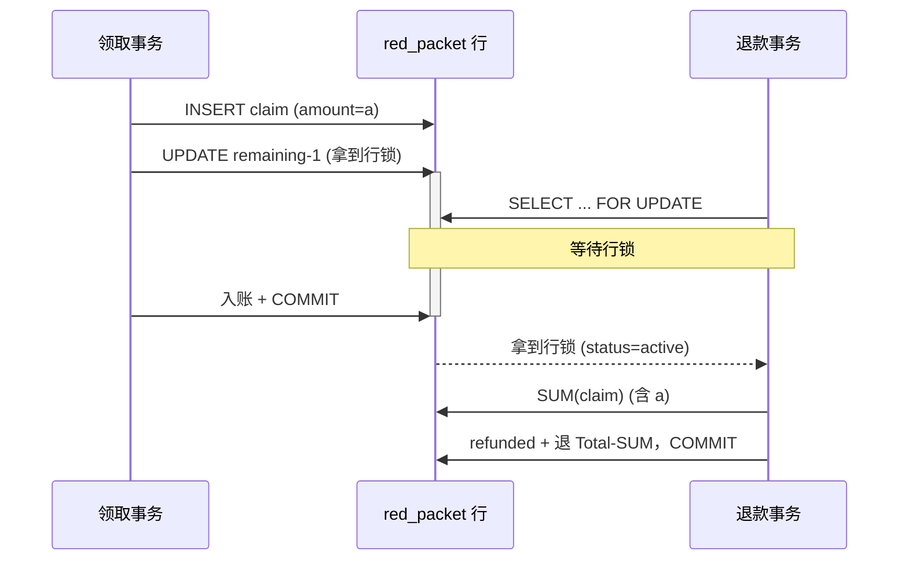
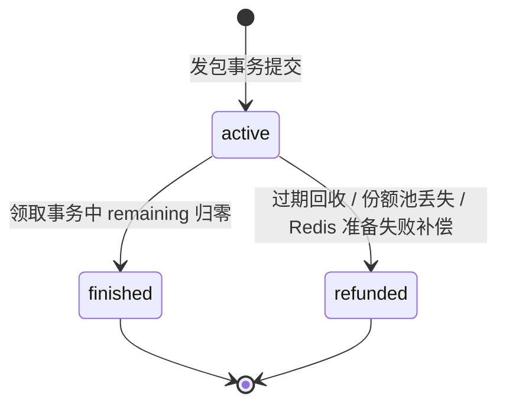
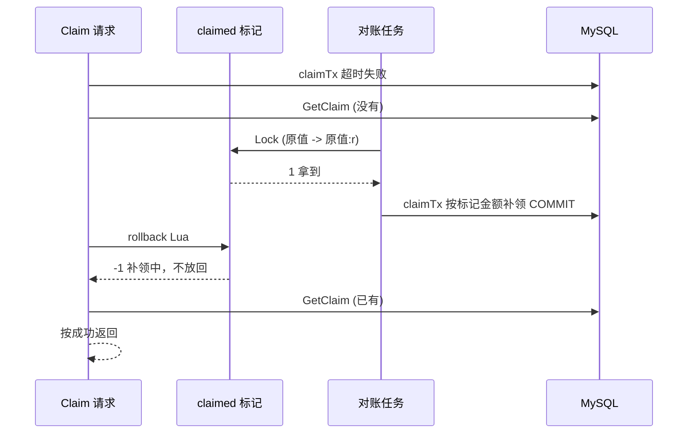

# 18 红包：Redis 分发与 DB 记账的一致性

> 抢红包同时是高并发分发和小额资金转移。Redis 决定谁能拿到哪一份，DB 决定钱到底有没有动。这一讲沿 `internal/redpacket` 和 `repository/cache/redpacket.go` 讲清楚：两边可能在哪里对不上，代码又是怎样让它们收敛到同一个结果的。

## 本讲目标

讲完后，学生应该能：

- 说清二倍均值预拆和 Lua `LPOP` 抢包的分工，以及为什么热路径上不算金额；
- 画出发包、领包、退款三段经过 `redpacket_escrow` 托管账户的复式分录，解释 `ref` 和 `biz_type` 怎样设计才幂等；
- 解释领取事务和退款事务靠哪一把行锁串行，为什么 `FOR UPDATE` 必须是退款事务的第一条语句；
- 说清领取事务失败后什么时候把份额还给 Redis、什么时候不能还，以及回补和对账补领怎样互斥；
- 解释 claimed 对账任务怎样补领孤儿领取、怎样识别份额池丢失并提前退款。

---

## 一、先看四张客诉单

**本节判断：红包的资金以 DB 为准，Redis 只负责发份额；所有事故都出在这两边的交界处。**

上线后客服可能收到四类工单：

| 工单 | 用户看到的现象 | 本讲对应位置 |
|---|---|---|
| A | 点了“抢”，接口报错；再点一次，这份还能不能抢 | 4.1、4.4 |
| B | 最后一份被抢走的同一秒红包过期，发包人退款和领取人金额加起来会不会超过总额 | 4.2、4.3 |
| C | 抢的时候显示抢到了，钱包里却没有 | 5.2 |
| D | 发红包扣了钱，但所有人都抢不了 | 5.3 |

四张单子各对应一种机制：A 靠“先查库、再比较标记”的 Saga 回补，B 靠红包行锁让领取和退款串行，C 靠 claimed 对账补领，D 靠立即补偿加份额池对账。

先看模块分工。存储结构写在缓存文件顶部（`repository/cache/redpacket.go:16-22`）：

```go
// 红包在 Redis 的存储结构：
//   redpacket:{id}:amounts   LIST  发包时一次性 RPUSH 预拆好的金额数组，LPOP 即抢
//   redpacket:{id}:claimed   HASH  userID -> "抢到金额:抢到时间(unix 秒)[:r]" (兜底单用户去重 + 对账找孤儿；
//                                  :r 表示对账任务已接手补领，Saga 回滚不再放回这一份)
```

claimed 标记不只是去重位，它记了金额和抢到时间，是第五节对账的输入。`:r` 后缀的含义放到 4.4 讲。

DB 侧两张表（`internal/redpacket/model.go:20-44`）：

```go
type RedPacket struct {
	dbmodel.Model
	UserID    uint      // 发包人
	Total     int64     // 总额，单位：分
	Count     int       // 红包总份数
	Remaining int       // 剩余份数，领取事务内递减
	ExpireAt  time.Time // 过期时间
	Status    uint      // 1 active / 3 finished / 4 refunded
	Greeting  string    `gorm:"size:128"`
	// ShareCode 领取口令：随机生成，只给发包人，由发包人分享出去。id 是自增主键可以扫号，
	// 拿着口令才能领、才能看领取明细。迁移前的老红包为空串，按老规则放行。
	ShareCode string `gorm:"size:16"`
}

type RedPacketClaim struct {
	dbmodel.Model
	RedPacketID uint  `gorm:"not null;uniqueIndex:uk_rp_user,priority:1"`
	UserID      uint  `gorm:"not null;uniqueIndex:uk_rp_user,priority:2;index"`
	Amount      int64 `gorm:"not null"` // 抢到金额，单位：分
}
// （省略 gorm 标签中与本讲无关的部分）
```

记住一条守恒式，后面每一节都在守它：

```text
Total = SUM(red_packet_claim.amount) + 退回发包人的金额
```

它只用 DB 里的数算，Redis 里的数一个都不参与。

### 1.1 接入层：护栏和口令

接入层的护栏一句话带过：发包挂 `Idempotency`，抢包挂按用户的 `SlidingWindow`（3 次/秒）和 `Idempotency`（`internal/redpacket/routes.go:16-24`），原理见第 15 讲。同一文件还挂了“我收到的红包” `GET redpacket/received` 和管理端 `POST redpacket/reconcile`（`routes.go:27-29`）。前者按领取记录 id 倒序游标分页，再用 `ListByIDs` 一次批量取回发包人和祝福语（`service.go:346-380`），`last_id` 是领取记录 id。

红包 id 是自增主键，可以扫号。所以发包时生成一个 16 位十六进制口令（`internal/redpacket/service.go:152-158`），只在发包人的响应里返回（`toRedPacketResp(rp, true)`），由发包人随分享链接发出去。领取和查看明细都要比对口令（`service.go:161-166`）：

```go
func codeMatches(rp *RedPacket, code string, legacyOK bool) bool {
	if rp.ShareCode == "" {
		return legacyOK
	}
	return subtle.ConstantTimeCompare([]byte(rp.ShareCode), []byte(code)) == 1
}
```

- **领取**：`Claim` 一开始就校验，不对返回 `ErrRedPacketForbidden`（错误码 84006），不会走到 Lua（`service.go:191-194`）。
- **详情**：`Show` 对发包人、已经领过的人直接放行，其他人要带对口令（`service.go:309-318`）。口令相当于“在群里”。
- **老红包**：上线前创建的红包没有口令。领取时 `legacyOK=true`，照旧不带口令也能领；详情传 `false`，没口令的旁观者看不了明细。
- 比较用 `ConstantTimeCompare`，避免按响应时间逐位猜口令。

红包相关的业务错误统一在 `pkg/e/code.go:87-92`，84001–84006 分别是不存在、已结束、已过期、已抢完、重复领取、无权限。祝福语在 DTO 上加了 `max=128`（`internal/redpacket/dto.go:11`），和列宽对齐，进事务之前就拦住。

---

## 二、分发模型：发包时拆好，抢包时只 LPOP

**本节判断：金额在发包时一次算完，抢包的热路径只做一次原子出队，不做任何计算和加锁。**

### 2.1 二倍均值预拆

`SplitRedPacket`（`repository/cache/redpacket.go:127-167`）：

```go
func SplitRedPacket(total int64, count int) ([]int64, error) {
	if count <= 0 || total < int64(count) {
		return nil, ErrRedPacketSplitInvalid
	}
	out := make([]int64, count)
	remain := total
	splitRand.Lock()
	defer splitRand.Unlock()

	for i := 0; i < count-1; i++ {
		left := int64(count - i)
		avg := remain / left * 2           // 二倍均值上界
		if avg < 2 {
			avg = 2
		}
		maxThisRound := remain - int64(count-1-i) // 给后面每份留 1 分
		// （省略 maxThisRound < 1 的兜底）
		hi := avg - 1
		if hi > maxThisRound {
			hi = maxThisRound
		}
		// （省略 hi < 1 的兜底）
		amt := splitRand.r.Int63n(hi) + 1  // [1, hi]
		out[i] = amt
		remain -= amt
	}
	out[count-1] = remain                  // 最后一份拿剩下的全部
	splitRand.r.Shuffle(count, func(i, j int) { out[i], out[j] = out[j], out[i] })
	return out, nil
}
```

三条规则要讲清楚：

1. **每份至少 1 分。** 入口先校验 `total >= count`（`internal/redpacket/service.go:68-70`），每轮的上界不超过 `remain - 后面份数`。
2. **总和严格等于 total。** 前 `count-1` 份随机，最后一份直接取余数，不存在舍入误差。
3. **单份期望等于当前均值。** 每轮在 `[1, 2*avg-1]` 上均匀取值，期望约等于 `remain/left`，所以“先抢后抢”的期望大致相同。

最后一份没有上界：前面每轮都抽到小值时，它可能远大于均值。代码用 `Shuffle` 打乱顺序，让这份大额不固定落在最后一个抢的人手里。这只是打乱位置，分布本身没变。

`splitRand` 是带锁的独立随机源（`repository/cache/redpacket.go:118-121`），避开 `math/rand` 全局源的锁竞争。拆包只在发包时调用，不在抢包热路径上。三条规则由 `TestSplitRedPacketInvariants`（`repository/cache/redpacket_test.go:16-48`）守着。

入口还有两个敞口限制：单个红包上限 200 元（`internal/redpacket/dto.go:5`、`service.go:71-73`），有效期最长 7 天（`service.go:83-89`）。发包前还要校验支付密码（`service.go:75-81`），和 `paydown` 一样。

### 2.2 一个 Lua 写入，一个 Lua 抢

发包时把整组金额一次 `RPUSH` 进 LIST（`repository/cache/redpacket.go:36-45`），抢包时一个脚本完成去重、出队和打标记（`redpacket.go:55-66`）：

```lua
if redis.call('HEXISTS', KEYS[2], ARGV[1]) == 1 then
    return -2                      -- 已领过
end
local amt = redis.call('LPOP', KEYS[1])
if not amt then
    return -1                      -- 已抢完
end
redis.call('HSET', KEYS[2], ARGV[1], amt .. ':' .. ARGV[3])
redis.call('EXPIRE', KEYS[2], tonumber(ARGV[2]))
return tonumber(amt)
```

`ARGV[3]` 是调用方传入的当前 unix 秒（`redpacket.go:197-202`），标记长成 `金额:抢到时间`。时间戳让对账任务能区分“刚抢到、DB 事务还在跑”和“抢到很久了、DB 里还是没有”。

为什么不在抢包时实时算金额？实时拆需要读当前剩余金额和份数、计算、写回，三步必须原子，要么上分布式锁，要么把整个二倍均值算法写进 Lua。预拆以后，抢包只剩一个 `LPOP`，Redis 单线程执行脚本，天然不会超发，也不需要 `WATCH/MULTI`。`TestClaimRedPacketLuaConcurrent`（`redpacket_test.go:63-124`）用并发抢包验证不超发、不重复。

代价是金额序列在发包时就定了，写进 Redis 后不可再调整。对红包这种业务，这个代价可以接受。

和第 12 讲库存预占的思路一样：Redis 先扣，DB 为准，失败回补。区别是库存扣的是数量，这里扣的是一份带金额的值，回补时要把同一个金额还回去。

---

## 三、资金模型：钱先进托管，再分给领取人

**本节判断：发包时钱不直接进任何领取人的钱包，而是先进 `redpacket_escrow` 托管账户；三段资金流各自是一组复式分录，各自幂等。**

### 3.1 三段分录

`settle.go` 顶部注释写明了三段（`internal/redpacket/settle.go:15-22`）：

| 阶段 | 函数 | ref | biz_type | 分录 |
|---|---|---|---|---|
| 发包 | `settleSendTx` | 红包 id | `redpacket_send` | 发包人 debit / 托管 credit |
| 领包 | `settleClaimTx` | 领取记录 id | `redpacket_claim` | 托管 debit / 领取人 credit |
| 退款 | `settleRefundTx` | 红包 id | `redpacket_refund` | 托管 debit / 发包人 credit |

托管账户是系统账户 `user_id = 0`、`account_code = redpacket_escrow`（`internal/money/ledger_model.go:44-55`，注释和常量定义）。系统账户共用 user_id 0，靠 `account_code` 区分资金语义：外部清算是 `external_clearing`，商户托管是 `merchant_escrow`，拼团在途款是 `groupbuy_escrow`，红包在途款单独一个 `redpacket_escrow`，各自对账。历史上记在 `legacy_system` 的红包流水由迁移回填过来（`internal/migrate/migrate.go:88-92`），条件限定 `user_id=0` 且 `biz_type` 是三个红包子类型，可重复执行。

一个 100 元、3 份的红包，领走 30 + 50，过期退 20：

```text
发包  发包人 debit 10000   托管 credit 10000
领包  托管 debit 3000      领取人1 credit 3000
领包  托管 debit 5000      领取人2 credit 5000
退款  托管 debit 2000      发包人 credit 2000
redpacket_escrow 净额 = 10000 - 3000 - 5000 - 2000 = 0
```

托管账户在一个红包生命周期结束后归零，这是对账检查守恒的依据。后面多个测试的最后一句都是 `escrowBalance(t, db) == 0`（`internal/redpacket/claim_test.go:52-65`）。

### 3.2 ref 和 biz_type 怎么选

台账唯一键是 `(ref_order_id, direction, biz_type)`（`internal/money/ledger_model.go:72-76`）。

- 发包和退款都用红包 id 做 ref。关键在于唯一键里没有 `user_id`：同一个 ref 下，“发包人退款 credit”和“托管发包 credit”方向相同，只能靠 `biz_type` 区分。所以拆成 `redpacket_send` 和 `redpacket_refund`（`ledger_model.go:31-36`）。
- 领包用领取记录 id 做 ref。同一个红包有多个领取人，如果用红包 id，第二个领取人的 credit 就会撞第一个人的唯一键。

### 3.3 改余额和写台账在同一事务

`adjustWallet`（`internal/redpacket/settle.go:27-73`）先按 `(ref, direction, biz_type)` 查台账，已有就返回 `skipped=true`；否则 `GetUserByIdForUpdate` 锁住用户行、解密余额、出账不允许透支（`user.ErrInsufficientBalance`），再写回加密余额并 `AppendTransaction`。先查后写的预检加唯一索引兜底，这套做法和第 02 讲余额支付一致，不再展开。托管账户没有 `users.money` 行，`adjustClearing` 只追加流水，走 `AppendSystemTransaction(money.AccountCodeRedPacketEscrow, ...)`，`balance_after` 记 0（`settle.go:77-97`）。`AppendSystemTransaction` 只接受白名单里的系统账户码（`internal/money/ledger_repo.go:48-52`），写错账户名会直接报错。

发包时整笔都在一个事务里（`internal/redpacket/service.go:112-131`）：写红包主记录（含口令）、`settleSendTx`、写 outbox。余额不足时整笔回滚。测试 `TestSendRejectsInsufficientBalance`（`internal/redpacket/service_test.go:29-50`）手写了同样形态的事务（建红包 + `settleSendTx`，不含 outbox），验证余额、台账和红包表都没有残留。

### 3.4 一组分录的两条腿：先用户，后托管

三个 `settleXxxTx` 的结构完全一样，以发包为例（`internal/redpacket/settle.go:101-110`）：

```go
func settleSendTx(tx *gorm.DB, rpID, senderID uint, total int64) (wrote bool, err error) {
	if total <= 0 {
		return false, errors.New("redpacket settle: invalid total")
	}
	skipped, _, err := adjustWallet(tx, senderID, rpID, -total, money.BizTypeRedPacketSend)
	if err != nil || skipped {
		return false, err
	}
	return true, adjustClearing(tx, rpID, total, money.BizTypeRedPacketSend)
}
```

几个设计点：

- **用户腿在前。** 用户钱包这一侧有余额校验和行锁，最可能失败；它失败时托管腿还没写，事务回滚也没有半边分录要清理。
- **`skipped` 一起短路。** 用户腿已经入过账，说明这一组分录之前整组提交过（两条腿总在同一事务里），托管腿不用再看。`adjustClearing` 自己也带同样的 `(ref, direction, biz_type)` 预检（`settle.go:87-95`），即使被单独调用也不会重复记账。
- **`wrote` 告诉调用方这次有没有真的记账。** 同步事务里调用方不关心它；5.5 的结算消费者靠它判断“同步事务是否漏了腿”。
- **金额边界各有口径。** 发包和领包遇到非正数直接报错（`settle.go:102-104`、`115-117`），因为这两段一定有钱在动；退款的 `left <= 0` 返回 `(false, nil)`（`settle.go:127-129`），剩余为 0 是正常情况，不是错误。

方向由 `delta` 的正负推出，金额取绝对值写台账，调用方只需要关心“谁加、谁减”。同一个 `ref` 下两条腿方向相反，所以托管腿和用户腿不会互相撞唯一键。

---

## 四、一致性边界：Redis 先扣，DB 说了算

**本节判断：Redis 出队成功只代表“拿到了一份的资格”，钱是否到账由领取事务决定；失败后先问 DB，再决定要不要把份额还回去。**

### 4.1 领取主链路



领取事务抽成了 `claimTx`，`Claim` 和对账补领共用（`internal/redpacket/service.go:254-289`）：

```go
func claimTx(db *gorm.DB, rpID, uid uint, amount int64) (*RedPacketClaim, error) {
	claim := &RedPacketClaim{RedPacketID: rpID, UserID: uid, Amount: amount}
	err := db.Transaction(func(tx *gorm.DB) error {
		txDao := NewRedPacketDaoByDB(tx)
		if e := txDao.CreateClaim(claim); e != nil {
			return e
		}
		n, e := txDao.DecrRemaining(rpID)
		if e != nil {
			return e
		}
		if n == 0 {
			return errRedPacketClosed
		}
		if e := txDao.MarkFinishedIfDrained(rpID); e != nil {
			return e
		}
		if _, e := settleClaimTx(tx, claim.ID, uid, amount); e != nil {
			return e
		}
		return outbox.NewOutboxDaoByDB(tx).Insert(/* red_packet.claimed */)
	})
	// （省略 err 返回）
	return claim, nil
}
```

DB 有两道兜底：

- `uk_rp_user (red_packet_id, user_id)` 唯一索引（`model.go:41-42`），Redis 的 claimed 被清掉以后，同一用户也插不进第二条领取记录。`Claim` 和对账同时为同一个人补，也只有一方能成功；
- `DecrRemaining` 带条件 `remaining > 0 AND status = active`（`internal/redpacket/repo.go:50-55`），DB 的剩余份数才是权威。

`claimed` HASH 的 TTL 设成红包过期后再留 24 小时（`service.go:202`）。红包在有效期内，同一用户的去重标记和对账要用的金额一直在。

### 4.2 失败之后：先问 DB

事务返回错误，不等于事务没提交。网络断在 COMMIT 回包上时，客户端拿到的是 `invalid connection` 一类错误，DB 里这笔领取其实已经落了。这时把份额放回 Redis，后面的人会多领走一份，托管被多付。所以失败分支先查库（`internal/redpacket/service.go:213-238`）：

```go
if _, txErr := doClaimTx(rpDao.DB, rp.ID, u.Id, amount); txErr != nil {
	existing, qErr := rpDao.GetClaim(rp.ID, u.Id)
	switch {
	case qErr != nil:
		// 查不清楚就不回补：claimed 标记留着，对账任务按 DB 唯一索引补领或确认
	case existing != nil:
		return &RedPacketClaimResp{RedPacketID: rp.ID, Amount: existing.Amount}, nil
	case errors.Is(txErr, errRedPacketClosed):
		// 红包已结束时剩余金额已按 DB 退回，这份不能再塞回 Redis 给别人抢。
	default:
		rbErr := rollbackClaimCache(ctx, rp.ID, u.Id, amount)
		if errors.Is(rbErr, cache.ErrRedPacketClaimRepairing) {
			if c, e := rpDao.GetClaim(rp.ID, u.Id); e == nil && c != nil {
				return &RedPacketClaimResp{RedPacketID: rp.ID, Amount: c.Amount}, nil
			}
		}
		// （省略回补失败的日志）
	}
	return nil, txErr
}
```

四个分支各有理由：

| 分支 | 判断 | 处理 |
|---|---|---|
| 查询出错 | DB 状态不明 | 不回补，claimed 标记留着，交给 5.2 的对账按唯一索引补领或确认 |
| 库里已有 | 提交其实成功了 | 按成功返回库里的金额，份额不放回 |
| 红包已结束 | 剩余已按 DB 退给发包人 | 不回补，否则同一笔钱在 Redis 里多出一份 |
| 确认没落库 | 真失败 | 调回补 Lua，比较标记后放回 |

`doClaimTx` 和 `rollbackClaimCache` 留成函数变量（`service.go:247-250`），测试才能模拟“提交成功但回包丢了”。`TestClaimCommitUnknownDoesNotRollback`（`internal/redpacket/claim_test.go:215-255`）让事务提交后再返回错误，断言回补一次都没被调用、接口按成功返回、第二个人领完后 Redis 里不多出一份、托管余额归零。

### 4.3 领取和退款为什么不会把同一笔钱发两次

这是工单 B。退款事务的写法（`internal/redpacket/task.go:61-84`）：

```go
err := dao.NewDBClient(ctx).Transaction(func(tx *gorm.DB) error {
	txDao := NewRedPacketDaoByDB(tx)
	// 必须是事务第一条语句：MySQL RR 下加锁读不建快照，下面的 SUM 才在拿到锁之后建快照、
	// 看得到刚提交的领取。往前面插任何普通读，快照会提前建立，SUM 漏掉并发提交的领取，同一份钱退两次。
	rp, err := txDao.GetForUpdate(rpID)
	if err != nil {
		return err
	}
	if rp.Status == RedPacketStatusRefunded || rp.Status == RedPacketStatusFinished {
		return nil
	}
	claimed, err := txDao.SumClaimed(rpID)
	if err != nil {
		return err
	}
	left = rp.Total - claimed
	// （省略：MarkStatus(refunded)、left<=0 提前返回、settleRefundTx、outbox）
})
```

领取事务里的 `DecrRemaining` 是一条 `UPDATE red_packet ... WHERE id = ?`，会去拿同一行的 X 锁。两边谁先拿到锁，谁先走：



反过来，退款先拿到锁并提交，领取事务的 `UPDATE` 等到锁后发现 `status = refunded`，影响 0 行，返回 `errRedPacketClosed`，刚插入的领取记录随事务回滚。两种顺序都满足守恒式。

退款函数遇到 `finished` 也直接返回：最后一份领走时剩余一定是 0，不需要退，也不该把状态改成 `refunded`。

### 4.4 快照在什么时候建立

退款事务第一条语句是加锁读。MySQL InnoDB 在 RR 隔离级别下，普通 `SELECT` 的一致性快照在**事务里第一次普通读**时建立，加锁读不建快照、读最新已提交版本。所以 `SumClaimed` 这条普通读建快照时，已经拿到了行锁，排在它前面的领取事务都已提交，快照里能看到它们的领取记录。

假设有人“优化”一下，在 `GetForUpdate` 之前加一条普通读，比如先 `Get(rpID)` 判断是否已退款：

```text
退款: SELECT red_packet (普通读，快照在此建立)
领取: INSERT claim(a)  UPDATE remaining-1  COMMIT
退款: SELECT ... FOR UPDATE (拿到锁，读到最新行)
退款: SUM(claim)            (用的是旧快照，看不到 a)
退款: 退 Total - SUM        (多退了 a)
```

领取人拿到了 a，发包人又被退了 a，托管账户变成负数。这种“语句顺序即正确性”的约束由并发测试 `TestClaimAndRefundRaceConservesMoney`（`internal/redpacket/claim_test.go:137-187`）固定下来：每轮 20 个用户并发抢、同时跑一次退款，断言 `已领 + 退款 == 2000`，最后发包人加领取人余额守恒、托管归零。

这个测试只有接真 MySQL 才守得住锁顺序。测试库默认是内存 SQLite 且 `SetMaxOpenConns(1)`（`service_test.go:139`），所有事务串行，没有行锁也没有 RR 快照，插错了也测不出来，测试会打一行日志说明只校验资金守恒。设置了 `REDPACKET_TEST_MYSQL_DSN` 就切到 MySQL（`service_test.go:122-131`），CI 的 Go 流水线起了一个 `mysql:8.0` service 并注入这个变量（`.github/workflows/ci-go.yml:36-59`），所以每次 PR 都按 InnoDB 语义跑。

### 4.5 回补：比较之后再放回

回到工单 A。确认 DB 里没有这条领取后，`Claim` 调 `RollbackRedPacketClaim`（`repository/cache/redpacket.go:235-248`），脚本是（`redpacket.go:92-99`）：

```lua
local v = redis.call('HGET', KEYS[2], ARGV[1])
if not v then return 0 end
if string.sub(v, -2) == ':r' then return -1 end
redis.call('LPUSH', KEYS[1], ARGV[2])
redis.call('HDEL', KEYS[2], ARGV[1])
return 1
```

几个细节：

- **还的是同一个金额。** 回补参数里的 `amount` 就是刚才 Lua 出队的那一份，不重新计算。LIST 里所有份额加起来仍然等于“Total - 已领总额”，守恒式在 Redis 侧也成立。
- **`LPUSH` 而不是 `RPUSH`。** 抢包从头部 `LPOP`，放回头部让这一份最先被下一次抢走，状态最接近“这次没抢过”。份额顺序在发包时已经 `Shuffle` 过，放回哪头都不改变分布。
- **份额和标记一起还。** 只还份额不删标记，本人再也抢不了；只删标记不还份额，LIST 比 DB 的 `remaining` 少一份。
- **标记不在就不放回（返回 0）。** 说明这一份已经被回补过，再 `LPUSH` 就重复了。
- **标记带 `:r` 就不放回（返回 -1）。** 这表示对账任务已经接手、正在按标记补领（见 5.2）。这时放回，对账补领入账后 Redis 又多出一份。Go 侧把 -1 转成 `ErrRedPacketClaimRepairing`，`Claim` 收到后再查一次 DB，补上了就按成功返回。

撤掉标记后，本人可以再抢：他第二次点“抢”时，Lua 的 `HEXISTS` 不再拦截，会重新走一遍完整链路，DB 的唯一索引和 `DecrRemaining` 条件仍然是最终裁决。`TestClaimTxFailureRollsBackRedis`（`claim_test.go:190-212`）让一个没有钱包的用户抢唯一一份，事务必然失败，断言标记被撤、份额回到 LIST、下一个人能领到这 500 分。

---

## 五、兜底：对账、补偿和过期回收

**本节判断：退款金额永远按 DB 算，不读 Redis；孤儿领取先补给领取人，剩下的才退给发包人。**

### 5.1 状态机



红包只有三个状态（`internal/redpacket/model.go:9-14`），值 2 保留不复用。“是否过期”看 `expire_at`，不靠状态位，回收直接 `active -> refunded`。

`finished` 只在领取事务里 DB 剩余份数归零时写入（`repo.go:58-62`），一定没有余额，过期回收不扫它，退款函数遇到它也直接返回。`refunded` 在退款事务里写入，退款函数遇到它直接返回。

两个终态的写入点都在持有红包行锁的事务里：`finished` 跟着最后一笔 `DecrRemaining`，`refunded` 跟着 `GetForUpdate`。所以一个红包不可能既 `finished` 又被退款，也不可能先 `refunded` 再被领到最后一份。

### 5.2 claimed 对账：补领孤儿领取

这是工单 C。Lua 抢到了，进程在 DB 事务提交前崩了，或者事务失败后回补 Lua 也失败了。结果是 Redis 里有这个人的标记、DB 里没有他的领取记录：他再点只会得到“已领取过”，钱也没到。

`RunRedPacketClaimReconcile` 每 2 分钟跑一次（`initialize/cron.go:90-98`），按 id 游标分批扫完全部进行中红包（`internal/redpacket/task.go:125-145`）：每批取完逐个调 `reconcileRedPacket`，取不满一批就结束，否则把游标推到这批最后一个 id。`ListActive` 取 `status = active AND id > afterID`，按 id 升序（`repo.go:142-146`），每批 `reconcileBatch = 500`（`task.go:148`）。分批游标保证新红包也会被扫到，`TestReconcileScansAllActiveInBatches`（`claim_test.go:559-581`）把每批调成 2、造 5 个红包，断言全部处理到。

单个红包的对账逻辑在 `reconcileRedPacket`（`task.go:153-230`）。补领部分（`task.go:179-211`）：

```go
for uid, m := range marks {
	if inDB[uid] {
		continue
	}
	if time.Since(m.At) < claimOrphanGrace {
		r.pending = true
		continue
	}
	locked, err := cache.LockRedPacketClaimForRepair(ctx, rp.ID, uid, m.Raw)
	// （省略 err：记 pending 后跳过）
	if !locked {
		continue
	}
	if _, err := claimTx(rpDao.DB, rp.ID, uid, m.Amount); err != nil {
		if errors.Is(err, errRedPacketClosed) {
			break // 已回收 / 抢完，剩下的标记补不了也不用补
		}
		if c, qErr := rpDao.GetClaim(rp.ID, uid); qErr == nil && c != nil {
			continue // 原请求刚好提交了
		}
		r.pending = true
		continue
	}
	r.repaired++
}
```

逐条看：

- **在途窗口。** 标记比 `claimOrphanGrace = 1 分钟`（`task.go:107-112`）新的，当成 DB 事务还在跑，不碰，记 `pending`。`ListRedPacketClaimed`（`repository/cache/redpacket.go:270-294`）解析 `金额:时间[:r]`，只有金额的老格式时间记零值，视为早已过了在途窗口。
- **先抢占标记再补。** `LockRedPacketClaimForRepair` 是一个比较后改写的脚本（`redpacket.go:108-115`）：标记还等于刚读到的原值，就改成 `原值:r`，返回 1。改不动说明原请求已经回补（标记被删），或者用户回补后又重抢了（标记换成了新值），这一份不归对账管。
- **补的是标记里的金额，补给领取人。** 用户抢到的就是这一份，补领走和 `Claim` 同一个 `claimTx`，唯一索引兜底，和原请求撞上也只成一次。
- **补不了的情况。** 红包已经结束时剩下的标记都不用补；补领失败但库里其实已有记录，说明原请求恰好提交了。

抢占和回补的互斥是这样成立的：两段 Lua 都先读同一个标记，回补看到 `:r` 就让路，抢占看到值变了就让路，Redis 单线程执行脚本，谁先改到标记谁处理这一份。



`TestRollbackAndRepairLockAreExclusive`（`repository/cache/redpacket_test.go:163-207`）让两个 goroutine 真并发抢同一个标记 200 轮，断言每轮恰好一方处理；`TestRepairLockRequiresOriginalMark`（`redpacket_test.go:210-240`）断言标记被撤或被换后对账拿不到；`TestClaimRollbackYieldsToReconcileRepair`（`internal/redpacket/claim_test.go:480-525`）在 `Claim` 查完 DB、开始回补之前插进 3 个并发对账，断言 `Claim` 返回成功、后面两人都能领到、Redis 不多出一份、托管余额为 0。`TestReconcileRepairsOrphanClaim`（`claim_test.go:259-314`）则覆盖最基本的场景：一个过了窗口的孤儿被补上、一个刚抢到的在途标记不被碰，4 个对账并发跑也只补一次。

客服接到工单 C 不必等 cron：管理端 `POST redpacket/reconcile` 调 `AdminReconcile`（`internal/redpacket/service.go:383-396`），对单个红包立即跑一遍 `reconcileRedPacket`，返回补领了几笔、是否退款。

### 5.3 份额池丢失：发包补偿和提前退款

这是工单 D。钱已经进了托管，LIST 却没写进去，所有人抢都会得到“红包已抢完”。

第一道是发包时的立即补偿（`internal/redpacket/service.go:137-146`）：`PrepareRedPacket` 失败时当场调过期回收用的同一个 `refundRedPacketLeft`，再把 Redis 的错误返回给发包人。此时还没有任何领取记录，`SUM` 是 0，剩余金额就是 `Total`，整笔原路退回，红包置为 `refunded`。LIST 的 TTL 比红包过期多 1 小时，给回收留出窗口。

补偿本身也失败，或者红包运行中 Redis 丢了数据时，第二道是 claimed 对账里的份额池检查（`internal/redpacket/task.go:155-165`、`212-229`）：

```go
poolGone := false
if time.Since(rp.CreatedAt) >= claimOrphanGrace {
	exists, err := poolExists(ctx, rp.ID)
	if err != nil {
		return r, err
	}
	poolGone = !exists
}
marks, err := cache.ListRedPacketClaimed(ctx, rp.ID)
// ……补领循环……
if r.pending || !poolGone {
	return r, nil
}
fresh, err := rpDao.Get(rp.ID)
// （省略 err）
if fresh.Status != RedPacketStatusActive || fresh.Remaining == 0 {
	return r, nil
}
left, err := refundRedPacketLeft(ctx, rp.ID)
// （省略 err）
r.refunded = true
```

LIST 不存在而 DB 还剩份数，就没人还能抢到，不必等到过期（最长 7 天），立即按 DB 退给发包人。三个前提缺一不可：红包创建超过 1 分钟（刚发出的包 LIST 可能还没写完）、没有在途或补领失败的标记（`pending` 为假）、DB 里仍是 `active` 且有剩余份数。

**顺序为什么是先 EXISTS 再读标记。** LIST 被抢空时 Redis 会自动删掉这个 key，“正常抢完最后一份”和“份额池丢失”在 EXISTS 上看起来一样。区分它们靠标记：抢最后一份的人的标记一定在，而且刚打上，会让本轮 `pending`。抢包 Lua 的 `LPOP` 和 `HSET` 原子完成，所以 EXISTS 返回 false 之后再读到的标记，一定包含抢走最后一份的人。顺序反过来，先读标记、再 EXISTS，中间有人正常抢走最后一份，读到的标记里没有他，EXISTS 又是 false，就会把他的领取误判成丢失并提前退款，他的领取事务随后撞上 `refunded` 被作废。

`poolExists` 留成函数变量（`task.go:151`），`TestReconcileDoesNotRefundWhenLastShareTakenDuringScan`（`claim_test.go:529-556`）在 EXISTS 前插入一次抢走最后一份，断言他的领取事务能成功、红包变成 `finished`、托管余额为 0。`TestReconcileRefundsWhenPoolMissing`（`claim_test.go:344-364`）删掉一个红包的 LIST，断言它被退款、另一个正常红包不受影响。

### 5.4 过期回收

cron 每 5 分钟跑一次 `RunRedPacketExpireCheck`（`initialize/cron.go:78-89`），扫描条件（`internal/redpacket/repo.go:132-139`）：

```go
err := d.DB.Where("status = ? AND expire_at <= ?", RedPacketStatusActive, time.Now()).
	Where("total > (SELECT COALESCE(SUM(c.amount), 0) FROM red_packet_claim c WHERE c.red_packet_id = red_packet.id)").
	Limit(limit).
	Find(&out).Error
```

注意两点：

- 用 `total > 已领总额` 判断是否还有余额，而不是看 Redis 里 LIST 是否为空。Redis 被清空、过期，或者根本没写进去，DB 都能算出该退多少；
- 只扫 `active`，不写成 `status <> refunded`，否则抢完的 `finished` 红包每轮都要跑一次子查询（`repo.go:128-131` 的注释）。

退款前先对账（`internal/redpacket/task.go:32-50`）：

```go
for _, rp := range rows {
	r, err := reconcileRedPacket(ctx, rp)
	// （省略 err 日志）
	if (err != nil || r.pending) && time.Since(rp.ExpireAt) < refundHoldForReconcile {
		continue // 留一段时间给对账补领；超时照退，钱回发包人不会丢
	}
	if r.refunded {
		continue
	}
	left, err := refundRedPacketLeft(ctx, rp.ID)
	// （省略日志）
}
```

顺序是“先补孤儿，再退剩余”：不先补，抢到了的那一份会被算进剩余退给发包人，领取人就再也拿不到。还有在途标记或补领失败时，退款最多等 `refundHoldForReconcile = 1 小时`；超时照退，钱回到发包人手里，不会丢。`TestExpireRepairsOrphanBeforeRefund`（`claim_test.go:317-341`）造一个已过期红包和一个孤儿标记，断言领取人拿到他那份、发包人只拿回剩下的、托管归零。

退款提交以后才清 Redis 里剩下的份额（`task.go:101-103`）。清理脚本一边 `LPOP` 一边累加（`repository/cache/redpacket.go:72-80`），返回的总额被忽略，不参与退款计算。清理失败只记日志：即使有人再从 LIST 里 `LPOP` 到一份，领取事务也会因为 `status = refunded` 影响 0 行而作废，并且按 4.2 的分支不会回补。

测试 `TestExpireRefundsLeftoverFromDBWhenRedisIsEmpty`（`internal/redpacket/service_test.go:52-117`）把 Redis 清理函数替换成永远返回 0，种了四个红包：

| 红包 | 状态 | 已领 | 期望 |
|---|---|---|---|
| 1 | active，已过期 | 300 + 200 / 1000 | 退 500 |
| 2 | active，已过期 | 100 / 800 | 退 700 |
| 3 | finished，已过期 | 500 / 500 | 不动 |
| 4 | active，未过期 | 0 / 600 | 不动 |

跑两遍 cron，断言发包人余额是 1200、退款台账 4 条（红包 1、2 各一借一贷）、其中托管腿 2 条落在 `redpacket_escrow`、Redis 清理只调用 2 次，证明退款按 DB 算、记账科目正确、而且重跑幂等。

### 5.5 settle 消费者：台账对账

`consumer.go` 订阅 `red_packet.*`，独立队列 `redpacket.settle`（`internal/redpacket/consumer.go:16-20`）。发、抢、退的资金和 outbox 在同一个事务里提交，事件被投递时台账必然已在，正常情况下每条消息走到 `adjustWallet` 都命中 `skipped`。所以这个消费者的职责是对账：事件到了却发现台账缺腿（有人改坏了同事务结构、手工改库等），就按事件补记，并由 `reportRepair` 打 Error 告警（`consumer.go:80-87`）。

`wrote` 就是 3.4 里 `settleXxxTx` 的第一个返回值，经 `settleInTx` 在独立事务里跑一遍后传出来（`settle.go:138-144`）。补记了台账说明同步事务漏了腿，这本身是要人看的异常。

三个处理函数的写法（`consumer.go:26-77`）：

- **解码失败、关键字段为 0 的消息标成 `errSettlePoisonMessage`**，直接进 DLQ，不会无限回灌；
- **领包事件不带领取记录 id**，消费者用 `(red_packet_id, user_id)` 反查 `GetClaim`，靠 `uk_rp_user` 保证只有一行，入账金额取库里的 `claim.Amount`。查询出错按可重试处理（比如主从延迟），查到为空才判为脏事件；
- **退款事件 `RefundTotal <= 0` 直接确认**，和 `settleRefundTx` 对 `left <= 0` 的处理口径一致。

`TestSettleConsumerRepairsMissingLedger`（`claim_test.go:452-467`）在没有同步发包事务的情况下投递两次 `red_packet.created`，断言第一次按事件补记、第二次幂等跳过，发包人只被扣一次、托管余额等于红包总额。毒消息和退避重试的通用机制见第 05 讲。

---

## 六、故障演练 / 课堂演示

**本节判断：每个演练都只看一件事——DB 里的守恒式和托管余额是否还成立。**

### 演示 1：Redis 清空后照样按 DB 退款

```bash
go test ./internal/redpacket -run TestExpireRefundsLeftoverFromDBWhenRedisIsEmpty -v
```

现场把 `refundRedPacketLeft` 里的 `left = rp.Total - claimed` 改成用 `releaseRedPacketCache` 的返回值当退款额（也就是“按 Redis 剩余退款”），再跑一次：清理函数返回 0，发包人余额停在 0，测试失败。说明退款额只能按 DB 算。

### 演示 2：回补和对账补领互斥

```bash
go test ./repository/cache -run 'TestRollbackAndRepairLockAreExclusive|TestRepairLockRequiresOriginalMark' -v
go test ./internal/redpacket -run 'TestClaimTxFailureRollsBackRedis|TestClaimCommitUnknownDoesNotRollback|TestClaimRollbackYieldsToReconcileRepair' -v
```

现场把回补 Lua 里 `if string.sub(v, -2) == ':r' then return -1 end` 这一行注释掉，再跑 `TestClaimRollbackYieldsToReconcileRepair`：对账补领入账后回补又把份额放回，最后会断言 “redis has an extra share” 失败。再把 `Claim` 失败分支里的 `existing != nil` 分支删掉，`TestClaimCommitUnknownDoesNotRollback` 会抓到回补被调用。

### 演示 3：对账顺序

```bash
go test ./internal/redpacket -run 'TestReconcile|TestExpireRepairsOrphanBeforeRefund' -v
```

把 `reconcileRedPacket` 里 EXISTS 和 `ListRedPacketClaimed` 两段调换顺序，`TestReconcileDoesNotRefundWhenLastShareTakenDuringScan` 会失败，报错是最后一位领取人被拒“红包已结束”。再把 `RunRedPacketExpireCheck` 里先对账的那几行删掉，`TestExpireRepairsOrphanBeforeRefund` 会看到孤儿那份被退给了发包人。

### 演示 4：快照时机

本地起一个 MySQL，用 DSN 跑并发测试：

```bash
REDPACKET_TEST_MYSQL_DSN='root@tcp(127.0.0.1:3306)/rptest?charset=utf8mb4&parseTime=True&loc=Local' \
  go test ./internal/redpacket -run TestClaimAndRefundRaceConservesMoney -count=3 -v
```

然后在 `refundRedPacketLeft` 的 `GetForUpdate` 前面加一条 `txDao.Get(rpID)`，再跑一次，会看到 `claimed X + refunded Y != 2000`。同样的改动不设 DSN、在 SQLite 下跑能通过，正好说明为什么 CI 要起真 MySQL。

---

## 课后练习

1. **对账窗口调参。** `claimOrphanGrace` 是 1 分钟、`refundHoldForReconcile` 是 1 小时。分析领取事务在锁等待上卡了 2 分钟时，4.5 和 5.2 的路径分别怎么走，用户最终拿到什么结果；再说明把 `claimOrphanGrace` 调成 5 秒会多出哪些 `ErrRedPacketClaimRepairing`。
2. **口令轮换。** 发包人觉得口令泄露了，想换一个。设计一个 `redpacket/rotate-code` 接口，说明旧口令领到的人还能不能看明细、正在进行的领取会不会受影响。
3. **拆包分布。** 对 `SplitRedPacket(10000, 10)` 跑十万次，统计每个位置的平均金额和最大值，验证 2.1 的“期望大致相同”，并解释 `Shuffle` 前后最后一个位置的最大值分布有什么不同。
4. **定向红包。** 给红包加一个可选的接收人列表或群 id，说明校验应该放在口令校验处、Lua 之前还是 DB 事务里，`Show` 的领取明细应该对谁返回。
5. **托管余额巡检。** 写一个只读巡检：对已经 `finished` 或 `refunded` 的红包，按 `account_code = redpacket_escrow`、ref 关联红包 id 和领取记录 id，算出每个红包的托管净额，列出不为 0 的。说明为什么领包流水不能直接用红包 id 去查。
6. **结算异步化。** 假设把领包入账从 `claimTx` 里拿出来，只靠 `red_packet.claimed` 事件驱动，列出 5.5 的消费者要改哪些地方，`reportRepair` 的告警语义要怎么变，守恒式在哪个时间窗口里会暂时不成立。

---

## 代码索引

| 主题 | 文件 | 入口 |
|---|---|---|
| Redis 存储结构与 Lua | `repository/cache/redpacket.go` | `prepareRedPacketScript`、`claimRedPacketScript`、`rollbackRedPacketClaimScript`、`lockRedPacketClaimForRepairScript` |
| 标记解析与份额池 | `repository/cache/redpacket.go` | `ListRedPacketClaimed`、`RedPacketPoolExists`、`LockRedPacketClaimForRepair` |
| 二倍均值拆包 | `repository/cache/redpacket.go` | `SplitRedPacket` |
| 表结构与状态 | `internal/redpacket/model.go` | `RedPacket`、`RedPacketClaim` |
| 发包 / 抢包 / 详情 / 列表 | `internal/redpacket/service.go` | `Create`、`Claim`、`claimTx`、`Show`、`ListMine`、`ListReceived`、`AdminReconcile` |
| 口令 | `internal/redpacket/service.go` | `newShareCode`、`codeMatches` |
| 剩余份数与扫描 | `internal/redpacket/repo.go` | `DecrRemaining`、`GetForUpdate`、`SumClaimed`、`GetExpired`、`ListActive`、`ListReceived` |
| 三段资金流 | `internal/redpacket/settle.go` | `adjustWallet`、`adjustClearing`、`settleSendTx`、`settleClaimTx`、`settleRefundTx` |
| 过期回收与对账 | `internal/redpacket/task.go` | `RunRedPacketExpireCheck`、`refundRedPacketLeft`、`RunRedPacketClaimReconcile`、`reconcileRedPacket` |
| 事件消费 | `internal/redpacket/consumer.go` | `StartSettleConsumer`、`DispatchSettleEvent`、`reportRepair` |
| 路由与护栏 | `internal/redpacket/routes.go` | `RegisterRoutes` |
| 台账与系统账户 | `internal/money/ledger_model.go`、`internal/money/ledger_repo.go` | `AccountCodeRedPacketEscrow`、`AppendSystemTransaction` |
| 历史流水回填 | `internal/migrate/migrate.go` | `legacy_system` 到 `redpacket_escrow` |
| 定时任务 | `initialize/cron.go` | 过期回收 `0 */5 * * * *`、claimed 对账 `@every 2m` |
| 错误码 | `pkg/e/code.go` | 84001–84006 |
| 测试 | `internal/redpacket/service_test.go`、`internal/redpacket/claim_test.go`、`repository/cache/redpacket_test.go` | 见各节 |
