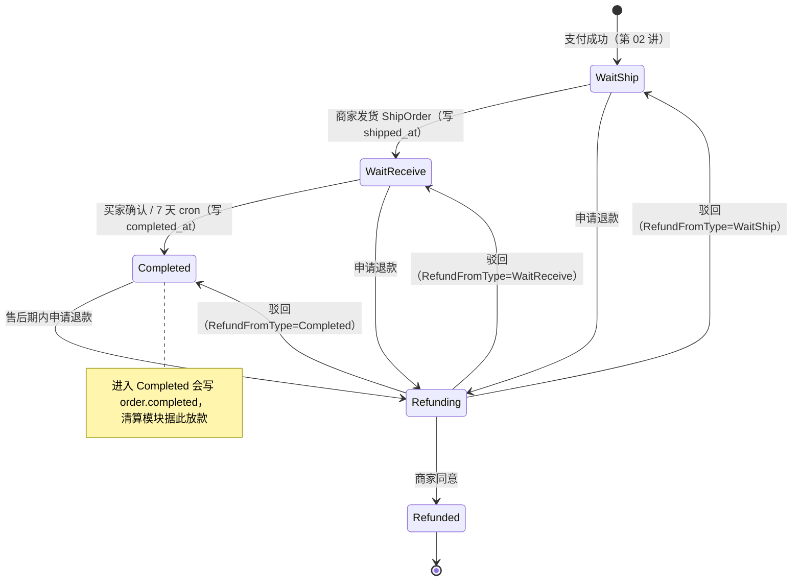
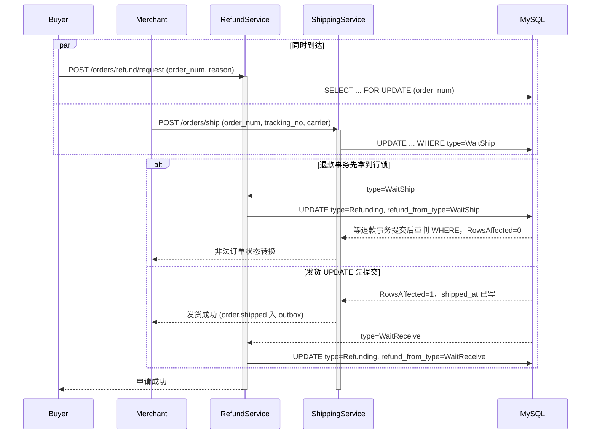
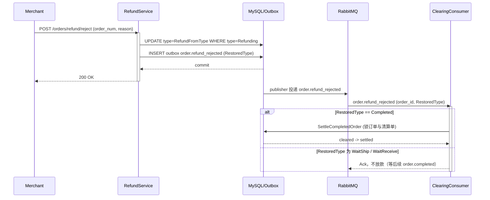
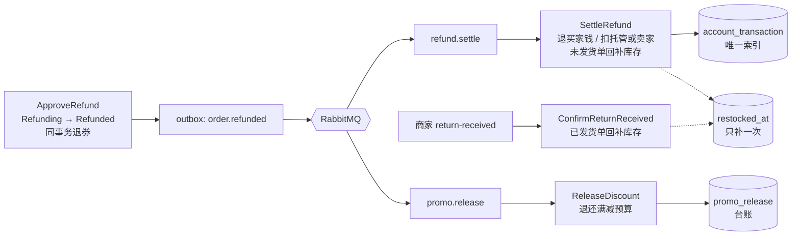

# 19 履约与售后：确认收货是放款指令，退款要把四样东西一起拉回来

> gomall · 发货落物流 / 确认收货 / 7 天自动确认 / 售后时效 / `RefundFromType` / 退货入库 / `order.refunded` 双队列

---

## 一、先看三个必须答对的场景

**退款和收货不只是改订单状态。它们同时决定钱给谁、货算谁的、满减预算退不退、7 天倒计时从哪天算。任何一项算错，都会变成客诉或资损。**

三个典型场景：

| 编号 | 场景 | 必须保证的结果 |
|---|---|---|
| A | 买家点“确认收货”的同一秒，7 天兜底 cron 也扫到了这张单 | `order.completed` 只写一条，卖家只被放款一次 |
| B | 买家在待发货阶段申请退款，商家驳回 | 订单回到待发货继续履约，不能直接变成已完成、提前给卖家放款 |
| C | 买家在待收货阶段申请退款并获批，`order.refunded` 被重复投递 | 钱只退一次；货还在买家手里，库存要等商家确认退货入库才回补，而且只补一次 |

这三件事分别落在履约时钟、售后状态机和退款落地上，下面按订单状态的推进顺序看代码。

付款之后订单的完整状态图如下（数值见 `internal/order/model.go:26` 的注释，合法边见 `internal/order/state.go:21-28`）：



`state.go` 里的 `orderStateTransitions` 和这张图一一对应：`Refunding` 有四条出边，一条去 `Refunded`，三条“驳回”回到申请前的状态。申请退款和驳回在推进前都会先调 `CanTransition`（`state.go:39`）过一遍这张表。具体走哪条驳回边，要看订单进入退款前的状态，这是第四节的重点。

---

## 二、发货：物流信息和状态在同一条 SQL 里落库

**service 层的 `if order.Type != WaitShip` 只负责给出友好的报错；真正挡住并发的是 `WHERE type = WaitShip` 加 `RowsAffected` 判断。读完再写的 `if` 挡不住两个同时到达的请求。**

### 2.1 service 层：必填校验、归属、同事务写事件

```go
// internal/order/shipping.go:60-102
func (s *ShippingSrv) ShipOrder(ctx context.Context, orderNum uint64, trackingNo, carrier string) error {
	trackingNo, carrier = strings.TrimSpace(trackingNo), strings.TrimSpace(carrier)
	if trackingNo == "" || carrier == "" {
		return ErrTrackingRequired
	}
	bossID, err := MerchantScope(ctx)
	if err != nil {
		return err
	}
	baseDao := NewOrderDao(ctx)
	order, err := baseDao.GetOrderByOrderNum(orderNum)
	// ... 省略：订单不存在的判断
	if bossID != 0 && order.BossID != bossID {
		return ErrOrderForbidden
	}
	if order.Type != consts.OrderWaitShip {
		return ErrInvalidOrderStateTransition
	}
	return baseDao.DB.Transaction(func(tx *gorm.DB) error {
		ok, err := NewOrderDaoByDB(tx).ShipOrder(orderNum, bossID, trackingNo, carrier)
		if err != nil {
			return err
		}
		if !ok {
			return ErrInvalidOrderStateTransition
		}
		return outbox.NewOutboxDaoByDB(tx).Insert(
			"order", "OrderShipped", "order.shipped", order.ID,
			events.OrderShipped{ /* ... */ TrackingNo: trackingNo, Carrier: carrier},
		)
	})
}
```

四件事按顺序做：

1. 物流单号和承运商必填。请求结构体 `ShipOrderReq`（`internal/order/dto_shipping.go:4-8`）用 `binding:"required"` 先挡一层，service 里去掉空白后再查一次，两层都不让空单号进来。原因写在 `dto_shipping.go:3` 的注释里：发货就会开始 7 天自动收货倒计时，没有单号的发货等于让买家在不知道货在哪的情况下开始计时；
2. `MerchantScope`（`shipping.go:37-50`）从 DB 读当前操作者的角色。admin 返回 `bossID=0`，表示不限归属；商家返回自己的 id。路由上的 merchant 中间件只校验角色，不校验订单归属，这一点第 01 讲和第 14 讲都讲过；
3. 预检归属和状态，失败时给出明确错误；
4. 在一个事务里推进状态、落物流信息，并写 `order.shipped`。

### 2.2 DAO 层：条件 UPDATE 才是状态机

```go
// internal/order/repo.go:389-417
func whereBoss(q *gorm.DB, bossID uint) *gorm.DB {
	if bossID == 0 {
		return q
	}
	return q.Where("boss_id=?", bossID)
}

func (d *OrderDao) ShipOrder(orderNum uint64, bossID uint, trackingNo, carrier string) (bool, error) {
	res := whereBoss(d.DB.Model(&Order{}), bossID).
		Where("order_num=? AND type=?", orderNum, consts.OrderWaitShip).
		Updates(map[string]interface{}{
			"type":        consts.OrderWaitReceive,
			"tracking_no": trackingNo,
			"carrier":     carrier,
			"shipped_at":  time.Now(),
		})
	if res.Error != nil {
		return false, res.Error
	}
	// ... 省略：RowsAffected>0 时清用户订单列表缓存
	return res.RowsAffected > 0, nil
}
```

`whereBoss` 让归属检查在 SQL 里再执行一次。即使 service 层的预检被绕过，商家也改不动别人的订单。`type=WaitShip` 是状态守卫：订单已经被别的请求推进时，`RowsAffected=0`，上层返回“非法订单状态转换”，事务里的 outbox 也不会写入。

状态、`tracking_no`、`carrier`、`shipped_at` 四列在同一条 UPDATE 里写。这样“订单变成待收货”和“有物流单号、有发货时间”是同一个事实，不存在状态推进了、单号还没写的中间态。`Order` 模型里这几列的定义和用途见 `model.go:56-64`，订单详情接口直接返回单号和承运商，买家查物流、客诉对账都以订单表为准。

测试 `TestShipOrderRequiresTrackingAndPersistsItUnderConcurrency`（`internal/order/fulfillment_test.go:107`）让 8 个 goroutine 同时对一张单发货：只有 1 次成功，订单表里单号落库，outbox 里只有 1 条 `order.shipped`。

### 2.3 “发货”和“申请退款”同时到达

最有代表性的竞争是：买家在待发货阶段点了退款，商家同一秒点了发货。



两种顺序都收敛到合法状态：要么发货失败、订单在退款中；要么发货成功、退款记录的来路是 `WaitReceive`。不会出现“已经进入退款，又被推成待收货”的结果。来路是 `WaitShip` 还是 `WaitReceive`，后面还会决定库存什么时候回补（5.2）。

### 2.4 每个 DAO 方法就是状态图上的一条边

把付款后所有推进状态的 DAO 方法列在一起，会发现它们是同一个模板：`WHERE order_num=? AND type=<起点>`，`SET type=<终点>`（加上这条边该写的附属列），返回 `RowsAffected>0`。

| DAO 方法 | 位置 | 起点（WHERE） | 终点（SET） | 同时写入 | 归属过滤 |
|---|---|---|---|---|---|
| `ShipOrder` | `repo.go:401` | `WaitShip` | `WaitReceive` | `tracking_no`、`carrier`、`shipped_at` | `whereBoss` |
| `ConfirmReceive` | `repo.go:422` | `WaitReceive` | `Completed` | `completed_at` | 由 service 校验买家 |
| `RequestRefund` | `repo.go:438` | 调用方读到的 `fromType`，且 `refund_count<上限` | `Refunding` | `refund_from_type`、`refund_reason`、`refund_count+1` | 由 service 校验买家 |
| `ApproveRefund` | `repo.go:457` | `Refunding` | `Refunded` | 无 | `whereBoss` |
| `RejectRefund` | `repo.go:473` | `Refunding` | 调用方传入的 `restoreType` | 无 | `whereBoss` |

状态守卫和写入是一条原子语句，任何两个并发请求争同一个起点，数据库保证只有一个人赢；输的一方拿到 `RowsAffected=0`，在 service 层统一翻译成 `ErrInvalidOrderStateTransition`，事务回滚，outbox 也跟着不写。上图里的每一条箭头，都能在这张表里找到对应的那一行 SQL。

另外注意两个“变量起点/终点”：`RequestRefund` 的起点和 `RejectRefund` 的终点都不是写死的常量，而是由调用方从订单行里读出来再传进去。第四节会讲，正是这两个变量让一条 `Refunding` 状态能够正确地“原路返回”。

---

## 三、确认收货和 7 天兜底：两条路走同一条 SQL

**确认收货在资金上等于“通知平台放款”。所以买家手动确认和 cron 自动确认必须共用同一条条件 UPDATE、写同一个事件，保证一张订单只放款一次。**

### 3.1 买家确认和 cron 自动确认

买家确认 `ShippingSrv.ConfirmReceive`（`internal/order/shipping.go:108-146`）的结构和发货一样：校验 `order.UserID == 当前用户`，预检 `type == WaitReceive`，再在事务里推进状态并写 `order.completed`（`Auto: false`）。cron 那一侧按 id 游标翻页，一轮扫到没有为止：

```go
// internal/order/task.go:218-236
func (s *OrderTaskService) RunAutoConfirmReceive() {
	ctx := context.Background()
	baseDao := NewOrderDao(ctx)
	var cursor uint
	for {
		orders, err := baseDao.GetTimeoutWaitReceive(autoConfirmReceiveDays, cursor, autoConfirmBatch)
		if err != nil {
			util.LogrusObj.Errorf("Cron Job Error: fetch wait-receive orders failed: %v", err)
			return
		}
		for _, order := range orders {
			s.autoConfirmOne(baseDao, order)
		}
		if len(orders) < autoConfirmBatch {
			return
		}
		cursor = orders[len(orders)-1].ID
	}
}
```

每一单由 `autoConfirmOne`（`task.go:239-263`）各开一个事务：调 `ConfirmReceive`，`!ok` 时返回“订单状态已变更”让事务回滚，成功则写 `order.completed`（`Auto: true`）。单张失败只记日志，循环继续。

两条路径都调用 `OrderDao.ConfirmReceive`：

```go
// internal/order/repo.go:422-433
func (d *OrderDao) ConfirmReceive(orderNum uint64) (bool, error) {
	res := d.DB.Model(&Order{}).
		Where("order_num=? AND type=?", orderNum, consts.OrderWaitReceive).
		Updates(map[string]interface{}{"type": consts.OrderCompleted, "completed_at": time.Now()})
	// ...
	return res.RowsAffected > 0, nil
}
```

由此得到三个保证：

| 场景 | 结果 |
|---|---|
| 买家点确认的同时 cron 扫到这张单 | 只有一方 `RowsAffected=1`，另一方事务回滚，`order.completed` 只写一条 |
| 多个实例同时跑 cron | 同上，条件 UPDATE 互斥 |
| 订单正在退款中 | `GetTimeoutWaitReceive` 只扫 `type=WaitReceive`（`repo.go:498`），退款中的订单不会被自动完成放款 |

`Auto` 字段只用来区分来源，下游的结算逻辑对两者一视同仁。结算本身见第 05 讲。这就是场景 A 的答案：两条路径争的是同一行、同一个起点，谁先提交谁写事件，另一方的事务连同 outbox 一起回滚。`completed_at` 也在这条 UPDATE 里写，它是第四节售后时效的计时起点。

cron 的节奏：注册在 `initialize/cron.go:101`，表达式 `0 0 * * * *`，每小时整点跑一次。每页取 `autoConfirmBatch=100` 单（`task.go:212`），按 `id` 升序翻页，直到某一页不足 100 单为止，所以积压再多也能在一轮里清完。游标用 id 而不是 offset：前一页的单子被确认后就不再满足 `type=WaitReceive`，用 offset 会跳过一部分单子，用 `id > cursor` 不受影响。cron 外层套了 `recover`，单次 panic 不会让整个调度器退出。

测试 `TestAutoConfirmReceiveUsesShippedAtAndDrainsBacklog`（`internal/order/fulfillment_test.go:164`）造了 230 单积压，一轮全部确认；同时让买家并发手动确认，断言每单只写一条 `order.completed`。

### 3.2 `order.completed` 不能丢，`order.shipped` 可以丢

Outbox publisher 对事件分了级：

```go
// internal/shared/outbox/publisher.go:74-81
var fundsRoutingKeys = map[string]bool{
	"order.completed": true, "order.refund_rejected": true, "order.refunded": true, "order.cancelled": true,
	"groupbuy.expired": true, "web3.payment.confirmed": true,
}

func isFundsRoutingKey(key string) bool {
	return fundsRoutingKeys[key] || strings.HasPrefix(key, "red_packet.")
}
```

`drainBatch` 上方的注释（`publisher.go:83-85`）写明：资金事件不标 dead，一直退避重试；没有订阅者、被 broker 退回的非资金事件，按“已发送”处理。

`order.shipped` 不在资金名单里，它是纯通知事件：物流单号、承运商、发货时间都已经在发货那条 UPDATE 里落进订单表（`events.go:45` 的注释也写明“事件只做通知”）。没有队列订阅它时被 broker 退回，直接按已发送处理，不占用资金事件的重试资源，也不会丢任何数据。

分级的依据是“丢了会不会错账”。`order.completed` 丢了，卖家永远拿不到钱；`order.refunded` 丢了，买家永远退不到款；`order.refund_rejected` 丢了，已完成订单被驳回后不会补放款。这几类必须投递成功，所以无限退避重试，再加上 5.5 的补偿 cron 作为第二道兜底。履约流程的推进（7 天兜底、确认收货）只看订单表，不依赖 `order.shipped` 是否到达。

### 3.3 7 天从哪天开始算：`shipped_at`

```go
// internal/order/repo.go:489-503
func (d *OrderDao) GetTimeoutWaitReceive(days int, afterID uint, limit int) (orders []*Order, err error) {
	// ... 省略 days/limit 默认值
	expireTime := time.Now().Add(-time.Duration(days) * 24 * time.Hour)
	err = d.DB.Model(&Order{}).
		Where("type=? AND shipped_at <=? AND id>?", consts.OrderWaitReceive, expireTime, afterID).
		Order("id").
		Limit(limit).
		Find(&orders).Error
	return
}
```

计时器是 `shipped_at`，只在 `ShipOrder` 那条 UPDATE 里写一次，之后任何操作都不会改它。所以 7 天严格从首次发货开始算：

- 正常路径：发货写入 `shipped_at`，7 天后订单进入扫描范围；
- 退款进行中：订单处于 `Refunding`，`WHERE type=WaitReceive` 把它排除，不会被自动确认；
- 退款被驳回：`RejectRefund` 把订单恢复成 `WaitReceive`，但 `shipped_at` 不变。如果发货已经超过 7 天，驳回后的下一轮 cron 就会自动确认收货，买家不会因为申请过退款而多得一段收货期。

为什么不能用 `updated_at` 计时？GORM 的 `Update/Updates` 会自动刷新 `updated_at`，申请退款、驳回退款都会刷新它。如果按 `updated_at` 计时，买家每次“申请退款—被驳回”都把 7 天重新拉回第 0 天，卖家的放款就能被无限推迟。`model.go:60-62` 的注释把这条理由写在了字段旁边。再配合 4.1 的申请次数上限，一张订单最多只能进三次退款流程。

测试 `TestRejectedRefundDoesNotResetAutoConfirmClock`（`internal/refund/aftersales_test.go:93`）正是这个场景：订单 8 天前发货，买家申请退款、商家驳回，紧接着跑一次 `RunAutoConfirmReceive`，订单直接变成 `Completed`。

存量订单在加列之前没有 `shipped_at`。迁移时 `order.BackfillFulfillmentColumns`（`model.go:98-105` 的注释）只对本次新建的列回填一次，用旧的 `updated_at` 近似 `shipped_at` 和 `completed_at`，保证老的待收货单也能被自动确认。是否“本次新建”由迁移前的 `MissingFulfillmentColumns` 判断，所以进程重启不会重复回填。

`updated_at` 在订单表里仍然有用：5.5 的补偿 cron 用它判断“这张单进入当前状态有没有超过 10 分钟”。所以对账类的后台标记仍然用 `UpdateColumn` 写，不刷新时间戳，例如库存对账用的 `SetStockCommitPending`（`repo.go:149-155`）。约定可以记成一句话：**改状态用 `Update`，改附属字段用 `UpdateColumn`。** 后面 5.2 的 `MarkRestocked` 写 `restocked_at` 也是同样的写法。

---

## 四、退款状态机：`RefundFromType` 记住来路

**退款是一条可以被撤回的岔路，撤回时必须回到原来的位置。待发货的订单被驳回后应该继续等发货，不能直接跳到已完成，否则会绕过履约，还会提前给卖家放款。**

### 4.1 谁能从哪里申请、能申请几次

`refundAllowedFrom`（`internal/refund/service.go:52-56`）只有 `WaitShip`、`WaitReceive`、`Completed` 三项。`WaitPay` 不在列表里，未付款订单走关单（第 12 讲）。`Refunding` 和 `Refunded` 也不在列表里，所以同一张订单在一次退款结束前不能再次申请，已退款的订单也不能重复退。

在此之上还有两条业务约束（`service.go:58-63`）：

| 约束 | 常量 | 依据字段 | 超出时 |
|---|---|---|---|
| 已完成订单只能在确认收货后 15 天内申请 | `afterSalesWindow` | `completed_at` | `ErrAfterSalesExpired`，转人工客服 |
| 同一订单最多申请 3 次 | `maxRefundRequests` | `refund_count` | `ErrTooManyRefundRequests` |

售后时效只约束 `Completed` 这一个起点。待发货、待收货的订单还没放款，随时可以申请。已完成订单的资金已经结算给卖家，退款要从卖家余额扣回（5.2），所以要有一个截止时间。次数上限防的是另一件事：每次驳回都回到原状态，不设上限，买家就能反复申请骚扰商家。

### 4.2 申请：行锁加条件 UPDATE 两层防护

```go
// internal/refund/service.go:80-133（省略取用户、订单不存在）
func (s *RefundSrv) RequestRefund(ctx context.Context, orderNum uint64, reason string) error {
	// ...
	return baseDao.DB.Transaction(func(tx *gorm.DB) error {
		orderDao := orderpkg.NewOrderDaoByDB(tx)
		order, err := orderDao.GetOrderByOrderNumForUpdate(orderNum)
		// ...
		if order.UserID != u.Id {
			return orderpkg.ErrOrderForbidden
		}
		fromType := order.Type
		if !inUintSlice(fromType, refundAllowedFrom) || !orderpkg.CanTransition(fromType, consts.OrderRefunding) {
			return orderpkg.ErrInvalidOrderStateTransition
		}
		if fromType == consts.OrderCompleted {
			completedAt := order.UpdatedAt
			if order.CompletedAt != nil {
				completedAt = *order.CompletedAt
			}
			if time.Since(completedAt) > afterSalesWindow {
				return ErrAfterSalesExpired
			}
		}
		if order.RefundCount >= maxRefundRequests {
			return ErrTooManyRefundRequests
		}
		ok, err := orderDao.RequestRefund(orderNum, fromType, reason, maxRefundRequests)
		// ... 省略：err / !ok
		return outbox.NewOutboxDaoByDB(tx).Insert(
			"order", "OrderRefunding", "order.refunding", order.ID,
			events.OrderRefunding{ /* ... */ FromType: fromType, Reason: reason},
		)
	})
}
```

DAO 把来路、原因、次数一起写进去：

```go
// internal/order/repo.go:438-454
func (d *OrderDao) RequestRefund(orderNum uint64, fromType uint, reason string, maxCount int) (bool, error) {
	res := d.DB.Model(&Order{}).
		Where("order_num=? AND type=? AND refund_count<?", orderNum, fromType, maxCount).
		Updates(map[string]interface{}{
			"type":             consts.OrderRefunding,
			"refund_from_type": fromType,
			"refund_reason":    reason,
			"refund_count":     gorm.Expr("refund_count + 1"),
		})
	// ...
	return res.RowsAffected > 0, nil
}
```

`FOR UPDATE` 让“读到的 `fromType`、`refund_count`”和“写入的值”在同一把锁下，不会读到 `WaitShip`、写的时候订单已经发货。`WHERE type=fromType AND refund_count<?` 是第二道防线，即使有人在锁外调用这个 DAO，也越不过状态和次数上限。路由上还挂了幂等中间件（`internal/refund/routes.go:12`，原理见第 03 讲）。

`reason` 是必填项（`internal/refund/dto.go:6-9`，`binding:"required,max=255"`），落进订单表的 `refund_reason` 列。商家用 `GET orders/refund/list`（`routes.go:17`，实现见 `service.go:487-505` 的 `ListRefunding`）查看自己名下的待审批退款单，列表里带原因、申请次数、来路和物流单号。商家只看得到 `boss_id` 是自己的单，admin 看全部，按 `last_id` 倒序翻页。

测试 `TestRequestRefundEnforcesAfterSalesWindowAndLimit`（`internal/refund/aftersales_test.go:47`）覆盖了三件事：超过 15 天返回 `ErrAfterSalesExpired`、第 4 次申请被拒、并发申请只受理一次且原因落库。

对比一下：`ApproveRefund` 和 `RejectRefund` 不加行锁，先在事务外读订单做预检（`service.go:148-160`、`208-228`），再只靠 `WHERE type=Refunding` 的条件 UPDATE 推进。这样做也是对的：它们只有一个合法起点 `Refunding`，条件 UPDATE 已经足够。申请退款有三个可能的起点，还要判断时效和次数，需要先把“从哪来、来过几次”读准，所以要加锁。

### 4.3 驳回：恢复到申请前的状态

```go
// internal/refund/service.go:221-247（省略归属与状态预检）
	restoreType := order.RefundFromType
	if !inUintSlice(restoreType, refundAllowedFrom) {
		// 兼容迁移前已经处于 Refunding、没有记录来源状态的旧订单，沿用旧行为恢复 Completed。
		restoreType = consts.OrderCompleted
	}
	if !orderpkg.CanTransition(consts.OrderRefunding, restoreType) {
		return orderpkg.ErrInvalidOrderStateTransition
	}
	return baseDao.DB.Transaction(func(tx *gorm.DB) error {
		ok, err := orderpkg.NewOrderDaoByDB(tx).RejectRefund(orderNum, restoreType, bossID)
		// ... 省略：err / !ok
		return outbox.NewOutboxDaoByDB(tx).Insert(
			"order", "OrderRefundRejected", "order.refund_rejected", order.ID,
			events.OrderRefundRejected{ /* ... */ Reason: reason, RestoredType: restoreType},
		)
	})
```

`RefundFromType` 的默认值是 0（`model.go:28`），0 不在允许列表里，说明这是加字段之前就进入退款的订单，这类订单按 `Completed` 恢复。恢复目标确定后再过一次 `CanTransition`，保证写回去的状态是状态表里 `Refunding` 的合法出边。

这就是场景 B 的答案：待发货订单申请退款时，`refund_from_type` 记下 `WaitShip`；商家驳回时，`RejectRefund` 把 `WaitShip` 作为终点写回去。订单回到待发货，等商家正常发货、买家确认收货，才会产生 `order.completed`。DAO 层 `RejectRefund` 的注释（`repo.go:470-472`）也写得很直接：恢复目标来自持久化的来路，不能一律跳到 `Completed` 绕过履约。

驳回不改 `shipped_at`，也不清 `refund_count`。前者让 7 天计时继续（3.3），后者让次数上限对整个订单生命周期有效。

### 4.4 驳回和放款的握手

`RestoredType` 会跟着 `order.refund_rejected` 发给清算模块：

```go
// internal/clearing/consumer.go:32-45（省略解码）
func HandleRefundRejectedEvent(ctx context.Context, payload []byte) error {
	// ...
	// WaitShip / WaitReceive 的退款被驳回后只是恢复履约，不应提前给卖家放款。
	if evt.RestoredType != consts.OrderCompleted {
		return nil
	}
	return SettleCompletedOrder(ctx, evt.OrderID)
}
```

为什么驳回需要单独触发结算？因为 `SettleCompletedOrder` 遇到 `Refunding/Refunded` 的订单直接返回（`internal/clearing/service.go:301-303`）。已完成的订单进入退款以后，即使 `order.completed` 迟到也不会放款；驳回回到 `Completed` 时，需要这个事件把放款补上。



`refund_rejected` 在资金事件名单里，不会被标 dead。如果它丢了，5.5 的补偿 cron 会按“订单 `Completed` + 清算单 `cleared`”的组合补上结算。

---

## 五、一个 `order.refunded`，两条队列

**退款获批是一个事实，资金回退和满减预算退还是两个独立的后果。用一个事件、两条队列、两本幂等台账，比在审批接口里同步做完两件事更可靠。**

### 5.1 审批推进状态、退券、写事件

```go
// internal/refund/service.go:163-188（省略归属与状态预检）
	amount := refundAmount(order)
	txErr := baseDao.DB.Transaction(func(tx *gorm.DB) error {
		ok, err := orderpkg.NewOrderDaoByDB(tx).ApproveRefund(orderNum, bossID)
		// ... 省略：err / !ok
		if err := coupon.NewCouponDaoByDB(tx).ReleaseForOrderInTx(order.UserCouponID, order.ID, time.Now()); err != nil {
			return err
		}
		return outbox.NewOutboxDaoByDB(tx).Insert(
			"order", "OrderRefunded", "order.refunded", order.ID,
			events.OrderRefundedEvent{
				OrderID: order.ID, OrderNum: order.OrderNum, UserID: order.UserID,
				Amount:             amount,
				PromoRuleID:        order.PromoRuleID,
				PromoDiscountCents: order.PromoDiscountCents,
				PromoBudgetDate:    promo.BudgetDay(order.CreatedAt),
			},
		)
	})
```

同一个事务里做三件事：状态从 `Refunding` 推到 `Refunded`；把这单核销的优惠券退回给买家（没用券时 `UserCouponID=0`，直接跳过）；写 `order.refunded`。券的退还和状态在一个事务里，是因为它和订单是同一个库里的两行，不需要跨服务。满减预算则交给事件异步处理。

事件自带 `promo_rule_id`、`promo_discount_cents` 和 `promo_budget_date`（下单那天），促销侧消费时不用回查订单表。`Amount` 用 `refundAmount` 计算，和 `SettleRefund` 实际打款同一口径（5.4）。测试 `TestApproveRefundEventAmountMatchesSettlement`（`aftersales_test.go:112`）用满减抵扣到 0 的订单验证事件金额是 0。



### 5.2 `refund.settle`：资金和库存

队列声明见 `internal/refund/consumer.go:18`。消费者只取 `OrderID`，交给 `SettleRefund`（`consumer.go:26-37`）。资金从托管还是从卖家余额扣、和结算之间怎样加锁、为什么金额以清算单为准，第 05 讲第四节已经逐段讲过，这里补四点。

**第一点，0 元订单也要写流水。**

```go
// internal/refund/service.go:342-363（节选）
	// 买家 credit：即使实付为 0，也写一组 0 元幂等流水，避免重复消息反复回补库存。
	buyerAfter := buyerBal + amount
	if amount > 0 {
		// ... 省略：加密并更新买家余额
	}
	if err = ledgerDao.AppendTransaction(o.UserID, o.ID, money.DirectionCredit, amount, buyerAfter, refundBizType); err != nil {
		return err
	}
```

`service.go:313-323` 的幂等预检按“这张订单有没有买家 credit 流水”判断是否已经退过。满减把实付抵扣到 0 的订单钱不用退，也写一条 0 元流水，重复消息来了就能查到记录、直接放行。这条流水是幂等锚点，不是账务需要。测试见 `TestZeroAmountLegacyRefundIsIdempotent`（`service_test.go:142`）。

**第二点，卖家余额不能被扣成负数。** 从卖家余额扣款前，`service.go:380-389` 先算 `sellerAfter := sellerBal - amount`，小于 0 就不扣。这只会发生在“清算单已经 `settled`”或“没有清算单的旧订单”上，也就是钱已经到了卖家手里。这时返回 `ErrSellerBalanceInsufficient`，整个事务回滚，买家这时也不会先到账，账上不会出现一边加了一边没扣的状态。事务外，`SettleRefund`（`service.go:428-433`）调 `clearing.RecordRefundShortfall`（`internal/clearing/service.go:190`）落一张 `refund_seller_shortfall` 异常单，进入运营的待审核队列。

异常单的流转是这样的：运营追回货款或平台垫付后，把异常单标成 `resolved`；补偿 cron（5.5）只扫没有未结异常单的订单，标 `resolved` 后下一轮就会自动重放这笔退款。重放时余额仍不够，异常单退回 `pending_review`。测试 `TestSettleRefundNeverDrivesSellerNegative`（`aftersales_test.go:139`）验证了：并发请求都被拒，卖家余额不变，买家没到账；补足余额、标 `resolved` 后补偿任务把这笔退完。

**第三点，库存回补分两条路，`restocked_at` 保证只补一次。**

```go
// internal/refund/service.go:404-416
	// 库存回补只给未发货就退款的订单：货还在仓库里。已发货的货在途或在买家手里，
	// 这时回补会超卖，要等商家确认退货入库（ConfirmReturnReceived）再补。
	ok, err := orderDao.MarkRestocked(o.ID, 0, true)
	if err != nil {
		return err
	}
	if ok {
		if _, err = product.NewProductDaoWithDB(tx).RollbackStock(o.ProductID, o.Num); err != nil {
			util.LogrusObj.Error(err)
			return err
		}
		restocked = o
	}
```

`MarkRestocked` 是一条条件抢占：

```go
// internal/order/repo.go:508-518
func (d *OrderDao) MarkRestocked(orderID, bossID uint, fromWaitShip bool) (bool, error) {
	q := whereBoss(d.DB.Model(&Order{}), bossID).
		Where("id=? AND type=? AND restocked_at IS NULL", orderID, consts.OrderRefunded)
	if fromWaitShip {
		q = q.Where("refund_from_type=?", consts.OrderWaitShip)
	} else {
		q = q.Where("refund_from_type<>?", consts.OrderWaitShip)
	}
	res := q.UpdateColumn("restocked_at", time.Now())
	return res.RowsAffected > 0, res.Error
}
```

两条路按来路分开：

| 来路 | 货在哪 | 谁触发回补 | 调用 |
|---|---|---|---|
| `WaitShip` | 还在仓库 | `SettleRefund`，和资金同一个事务 | `MarkRestocked(id, 0, true)` |
| `WaitReceive` / `Completed` | 在途或在买家手里 | 商家调 `POST orders/refund/return-received` 确认退货入库 | `MarkRestocked(id, bossID, false)` |

已发货的货还没回到仓库，这时把库存加回去，就会把一件不存在的货卖给下一个人。所以这类订单结算时只动钱，库存等商家确认收到退货再补。只退款不退货的订单，商家不点这个接口，库存也就不会凭空多出来。

商家那条路的入口是 `ConfirmReturnReceived`（`service.go:453-484`）：先用 `MerchantScope` 校验归属，再在事务里抢 `MarkRestocked`、加回 MySQL 库存，抢不到返回 `ErrNotReturnable`。`restocked_at IS NULL` 让两条路互斥、各自也只能成功一次：重复消息、商家连点、多个实例并发，都只有一次 `RowsAffected=1`。

这就是场景 C 的答案：待收货阶段的退款获批后，`refund.settle` 退钱（重复消息被流水预检挡住），库存不动；商家确认退货入库时补一次，再点一次返回 `ErrNotReturnable`。测试 `TestReturnReceivedRestocksShippedRefundOnce`（`aftersales_test.go:259`）用 8 个并发请求验证只补一次。

Redis 的可售库存（两桶库存见第 12 讲）在两条路上都放在 DB 事务提交之后再加（`restockRedis`，`service.go:443-448`）。顺序不能反：如果先加 Redis 再提交 DB，DB 回滚时 Redis 里就多出一批对不上的库存。Redis 这一步失败只记日志，因为 MySQL 已经是真相，库存对账会把两边拉齐。

**第四点，金额以清算单为准，订单字段只用来交叉校验。**

```go
// internal/refund/service.go:325-336
	amount := refundAmount(o)
	if clearingFound {
		// 清算单是资金事实，不能在退款时仅靠可能被修改的订单字段重新算钱。
		// 当前尚未实现手续费拆分退款，因此 fee!=0 或 gross!=net 时拒绝自动处理，交人工对账。
		if clearingRecord.FeeCents != 0 || clearingRecord.GrossCents != clearingRecord.NetCents {
			return errors.New("退款暂不支持含手续费的清算单")
		}
		if amount != clearingRecord.GrossCents {
			return clearing.ErrClearingOrderMismatch
		}
		amount = clearingRecord.GrossCents
	}
```

订单表按 `refundAmount` 算出的实付，必须和支付时落下的清算单 `GrossCents` 一致，否则拒绝自动处理、返回错误让消息重试或进入人工对账。两份独立记录对得上才动钱，这是资金代码里常见的“双账核对”。

### 5.3 `promo.release`：满减预算

`promo.release` 的消费者 `HandleOrderRefundedEvent`（`internal/promo/consumer.go:40-50`）对没命中满减的订单直接放行，其余交给 `ReleaseDiscount`（`internal/promo/service.go:294-335`）：先写 `promo_release` 台账，写入成功才恢复预算。预算按天计，`budgetDay` 是下单那天；跨天退款只记台账、不回补当天预算，台账的 `restored` 字段如实记录预算是否真的回补。台账唯一键、关单和退款共用一本台账的细节第 16 讲第四节已经讲过，这里不重复。

两条队列互不等待。资金侧因为 DB 抖动重试时，预算可能已经退还；反过来也一样。两者最终都会完成，中间允许短暂不一致。

### 5.4 退款金额口径：`refundAmount`

```go
// internal/order/model.go:149-154（refundAmount 见 internal/refund/service.go:252-254，直接返回它）
func (o *Order) PayableCents() int64 {
	if o.PromoRuleID != 0 || o.UserCouponID != 0 {
		return o.FinalCents
	}
	return o.Money * int64(o.Num)
}
```

口径收口在 `Order.PayableCents`，支付、清算、退款共用：命中满减或用了券，以折后实付 `FinalCents` 为准，否则用折前价 `Money*Num`。判断条件是“有没有用优惠”，而不是“`FinalCents` 是否大于 0”：全额抵扣时 `FinalCents==0` 是合法实付，按 `>0` 判断会回退到原价，多退钱。审批事件里的 `Amount`、`SettleRefund` 实际打款、商家列表里的金额都走这个函数，三处数字一致。

还要注意谁在用这个金额。`refund.settle` 的消费者只从事件里取 `OrderID`（`consumer.go:26-37`），金额在 `SettleRefund` 里从数据库重新读订单、再和清算单核对。事件里的 `Amount` 给通知和统计用，落地的金额始终来自事务内加锁读到的最新事实。

### 5.5 事件丢了怎么办：补偿 cron

补偿 cron 注册在 `initialize/cron.go:130`，每 10 分钟一次。它不依赖事件，直接按“订单状态 × 清算单状态 × 台账”的组合找出漏掉的单子：

```go
// internal/refund/service.go:546-581（节选）
	before := time.Now().Add(-settleCompensationDelay) // 10 分钟
	// 已完成但清算单还是 cleared → 补结算
	eachPendingOrder(withClearing(consts.OrderCompleted, "status = ?", clearing.StatusCleared), func(o *orderpkg.Order) {
		clearing.SettleCompletedOrder(ctx, o.ID)
	})
	// 已退款但清算单不是 refunded → 补退款
	eachPendingOrder(withClearing(consts.OrderRefunded, "status <> ?", clearing.StatusRefunded), refund)
	// 已退款、没有清算单、refund_count>0、也没有买家退款 credit 流水 → 重新结算
	eachPendingOrder(func() *gorm.DB {
		return db.Model(&orderpkg.Order{}).
			Where("type = ? AND refund_count > 0 AND updated_at <= ?", consts.OrderRefunded, before).
			Where("id NOT IN (?)", db.Model(&clearing.PaymentClearing{}).Select("order_id")).
			Where("id NOT IN (?)", /* 买家退款 credit 流水 */).
			Where("id NOT IN (?)", shortfallOpen())
	}, refund)
	s.compensatePromoRelease(ctx, db, before)
```

一共四类：

| 类别 | 条件 | 动作 |
|---|---|---|
| 漏结算 | 订单 `Completed`，清算单 `cleared` | `SettleCompletedOrder` |
| 漏退款 | 订单 `Refunded`，清算单不是 `refunded` | `SettleRefund` |
| 无清算单的退款 | 订单 `Refunded`、`refund_count>0`，没有清算单，没有买家退款 credit 流水 | `SettleRefund` |
| 漏退满减预算 | 订单 `Closed`/`Refunded`、命中满减，没有 `promo_release` 台账，24 小时内 | `ReleaseDiscount` |

几个细节：

- 所有资金类查询都排除了 `shortfallOpen()`，即还有未结 `refund_seller_shortfall` 异常单的订单（`service.go:548-551`）。转人工的单子不每轮空转，运营标 `resolved` 后自然重新进入扫描范围；
- 第三类必须带 `refund_count>0`。`refund_count` 只有走 `RequestRefund` 才会加 1，用它能圈出“经过当前退款流程”的单子，那些很早以前就处于已退款、本来就没有退款流水的订单不会被自动打款；
- 满减补退只回看 24 小时（`promoReleaseLookback`，`service.go:585`），因为预算按天重置，更早的单子补了也只记台账。`ReleaseDiscount` 按台账唯一键幂等，和 `promo.release` 消费者并发也只退一次。这样资金和预算各有“消费者重试 + 补偿 cron”两层兜底。

每一类都通过 `eachPendingOrder`（`service.go:515-531`）按 id 游标翻页：每页 `compensationPageSize=100` 单，`WHERE id > lastID ORDER BY id`，某一页不足 100 单就结束。为什么不能每轮固定取前 100 单？因为补偿任务里会有长期失败的单，比如清算单金额对不上、等人工处理的单。它们每轮都还满足条件，如果总是取前 100 单，排在前面的失败单会占满名额，后面能正常补的单永远轮不到。游标翻页让失败单只在本轮被跳过一次，一轮总能扫到最后。测试 `TestSettleCompensationNotStarvedByPermanentFailures`（`aftersales_test.go:221`）在前面放了 105 张长期失败的单，断言后面那张正常单一轮内补完。

补偿和正常消费者并发也只会生效一次：结算和退款两边都锁清算单（第 05 讲 4.2），无清算单的单子靠买家 credit 流水预检和唯一索引兜底，满减靠 `promo_release` 唯一键。

---

## 六、故障演练 / 课堂演示

### 6.1 现有测试能证明什么

| 测试 | 文件 | 证明的结论 |
|---|---|---|
| `TestMerchantCannotShipAnotherMerchantsOrder` | `internal/order/order_test.go:30` | 商家 A 发不了商家 B 的货，admin 可以 |
| `TestShipOrderRequiresTrackingAndPersistsItUnderConcurrency` | `internal/order/fulfillment_test.go:107` | 发货必填单号；8 个并发发货只成功 1 次、只写 1 条事件 |
| `TestAutoConfirmReceiveUsesShippedAtAndDrainsBacklog` | `internal/order/fulfillment_test.go:164` | 按 `shipped_at` 计时，230 单积压一轮清完，和手动确认并发不重复放款 |
| `TestRequestRefundEnforcesAfterSalesWindowAndLimit` | `internal/refund/aftersales_test.go:47` | 15 天售后期、3 次上限、并发申请只受理 1 次 |
| `TestRejectedRefundDoesNotResetAutoConfirmClock` | `internal/refund/aftersales_test.go:93` | 驳回不重置 7 天计时 |
| `TestRejectRefundRestoresOriginalState` | `internal/refund/service_test.go:232` | 三种来路驳回后都回到原状态，事件 `RestoredType` 一致 |
| `TestMerchantCannotHandleAnotherMerchantsRefund` | `internal/refund/service_test.go:283` | 跨商家审批、驳回都被拒，订单仍在退款中 |
| `TestZeroAmountLegacyRefundIsIdempotent` | `internal/refund/service_test.go:142` | 0 元退款重复消费不会重复回补库存 |
| `TestReturnReceivedRestocksShippedRefundOnce` | `internal/refund/aftersales_test.go:259` | 已发货退款等商家确认入库才回补，8 个并发只补一次 |
| `TestSettleRefundNeverDrivesSellerNegative` | `internal/refund/aftersales_test.go:139` | 卖家余额不足时整笔回滚，补足并标 `resolved` 后补偿任务退完 |
| `TestSettleCompensationSettlesMissedOrders` | `internal/refund/service_test.go:185` | 事件丢失后补偿 cron 能补结算、补退款 |
| `TestSettleCompensationRetriesNoClearingRefundAfterSellerFunded` | `internal/refund/aftersales_test.go:183` | 无清算单的退款能被补上且只退一次，`refund_count=0` 的单不被打款 |
| `TestSettleCompensationNotStarvedByPermanentFailures` | `internal/refund/aftersales_test.go:221` | 长期失败的单不会饿死后面的正常单 |
| `TestSettleCompensationReleasesMissedPromoBudget` | `internal/refund/aftersales_test.go:305` | 满减预算漏退能补，并发只退一次，超过 24 小时不补 |

课堂上先跑一遍 `go test ./internal/refund/ ./internal/order/ -run 'Refund|Ship|Confirm|Settle|Return' -v`，这些测试用 SQLite 内存库，不依赖 MySQL。

### 6.2 现场演示：退款期间暂停自动确认，驳回后计时照旧

在测试库里造一张 `WaitReceive` 订单，把 `shipped_at` 设成 8 天前：

1. 调用 `GetTimeoutWaitReceive(7, 0, 100)`，订单出现在结果里，说明它已经满足自动确认条件；
2. 以买家身份 `RequestRefund`（带上原因），再调用一次：订单不在结果里，因为它已经是 `Refunding`，退款中的订单不会被自动完成放款。查订单表，`refund_reason` 已落库、`refund_count=1`；
3. 以商家身份 `RejectRefund`，查订单：`type` 回到 `WaitReceive`（来路被正确恢复），`updated_at` 是刚才驳回的时刻，`shipped_at` 仍是 8 天前；
4. 第三次调用 `GetTimeoutWaitReceive(7, 0, 100)`：订单马上又出现在结果里。跑一次 `RunAutoConfirmReceive`，订单变成 `Completed`，`completed_at` 被写入。

这一步把 3.3 讲的“计时看 `shipped_at`，退款只暂停、不重置”直接演示出来。可以再追加一步：把订单改回 `WaitReceive`、重复申请和驳回三次，第四次申请返回 `ErrTooManyRefundRequests`。

---

## 课后练习

1. **验证未发货退款的库存回补幂等：** 从 `WaitShip` 申请退款并获批，调用 `SettleRefund` 后断言商品库存加回了 `Num`、`restocked_at` 已写、清算单变成 `refunded`；再调用一次 `SettleRefund`，断言库存和流水条数都不再变化。说明是哪一行让第二次调用直接返回。
2. **验证已发货退款的库存时机：** 从 `WaitReceive` 申请退款并获批，调用 `SettleRefund`，断言买家到账但库存没变；以商家身份调 `ConfirmReturnReceived`，断言库存加回；再调一次，断言返回 `ErrNotReturnable`。换成另一个商家调用，会在哪一行被拒？
3. **验证一次放款：** 造一张 `WaitReceive` 订单，先调用 `ConfirmReceive`，再对同一订单跑一次 `RunAutoConfirmReceive`（把 `shipped_at` 改到 8 天前）。断言 outbox 里 `order.completed` 只有一条，`Auto=false`。再反过来先跑 cron、后手动确认，断言手动确认返回非法状态转换。
4. **讲清资金来源：** 分别写出清算单为 `cleared`（还在托管）和 `settled`（已结算给卖家）时退款 100 元的两组分录，对照 `SettleRefund` 里 `fromEscrow` 的分支（`service.go:307`）解释为什么待发货阶段的退款不需要动卖家余额，以及为什么只有 `settled`（或没有清算单的旧订单）这一支可能遇到 `ErrSellerBalanceInsufficient`。
5. **设计扩展：部分退款：** 如果业务要求一张 3 件的订单只退其中 1 件，你会怎样改？说明 `refundAmount`、清算单 `GrossCents` 校验、`restocked_at`（现在是“整单补一次”）和 `Refunded` 终态分别要怎么调整，哪些幂等锚点需要从“按订单”改成“按退款单”。

---

## 代码索引

| 主题 | 文件 | 入口 |
|---|---|---|
| 状态转换表 | `internal/order/state.go` | `orderStateTransitions`、`CanTransition` |
| 发货 / 确认收货 service | `internal/order/shipping.go` | `MerchantScope`、`ShipOrder`、`ConfirmReceive` |
| 状态推进 SQL | `internal/order/repo.go` | `whereBoss`、`ShipOrder`、`ConfirmReceive`、`RequestRefund`、`ApproveRefund`、`RejectRefund`、`GetTimeoutWaitReceive`、`MarkRestocked` |
| 7 天自动确认 | `internal/order/task.go`、`initialize/cron.go` | `RunAutoConfirmReceive`、`autoConfirmOne` |
| 订单字段与口径 | `internal/order/model.go` | `RefundFromType`、`TrackingNo`、`ShippedAt`、`CompletedAt`、`RefundCount`、`RestockedAt`、`PayableCents` |
| 履约列迁移回填 | `internal/order/model.go` | `MissingFulfillmentColumns`、`BackfillFulfillmentColumns` |
| 发货请求 | `internal/order/dto_shipping.go` | `ShipOrderReq` |
| 退款请求与路由 | `internal/refund/dto.go`、`internal/refund/routes.go` | `RequestRefundReq`、`orders/refund/list`、`orders/refund/return-received` |
| 退款审批 | `internal/refund/service.go` | `RequestRefund`、`ApproveRefund`、`RejectRefund`、`ListRefunding` |
| 退款落地与退货入库 | `internal/refund/service.go` | `SettleRefund`、`ConfirmReturnReceived`、`refundAmount` |
| 补偿 cron | `internal/refund/service.go` | `RunSettleCompensation`、`eachPendingOrder`、`compensatePromoRelease` |
| 卖家余额不足转人工 | `internal/clearing/service.go` | `RecordRefundShortfall` |
| 退款队列 | `internal/refund/consumer.go` | `refund.settle` |
| 满减预算退还 | `internal/promo/consumer.go`、`internal/promo/service.go` | `promo.release`、`ReleaseDiscount` |
| 驳回后放款握手 | `internal/clearing/consumer.go` | `HandleRefundRejectedEvent` |
| 资金事件分级 | `internal/shared/outbox/publisher.go` | `fundsRoutingKeys`、`drainBatch` |
| 事件定义 | `service/events/events.go` | `OrderShipped`、`OrderRefunding`、`OrderRefundedEvent`、`OrderRefundRejected` |
| 测试 | `internal/order/fulfillment_test.go`、`internal/order/order_test.go`、`internal/refund/service_test.go`、`internal/refund/aftersales_test.go` | 见第六节表格 |
