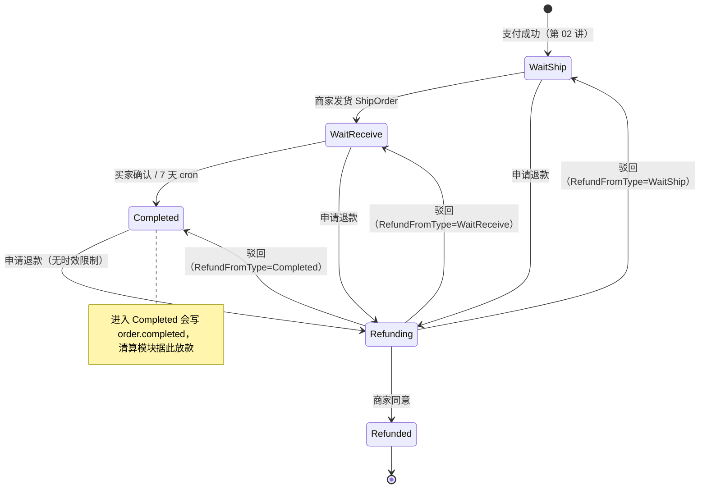
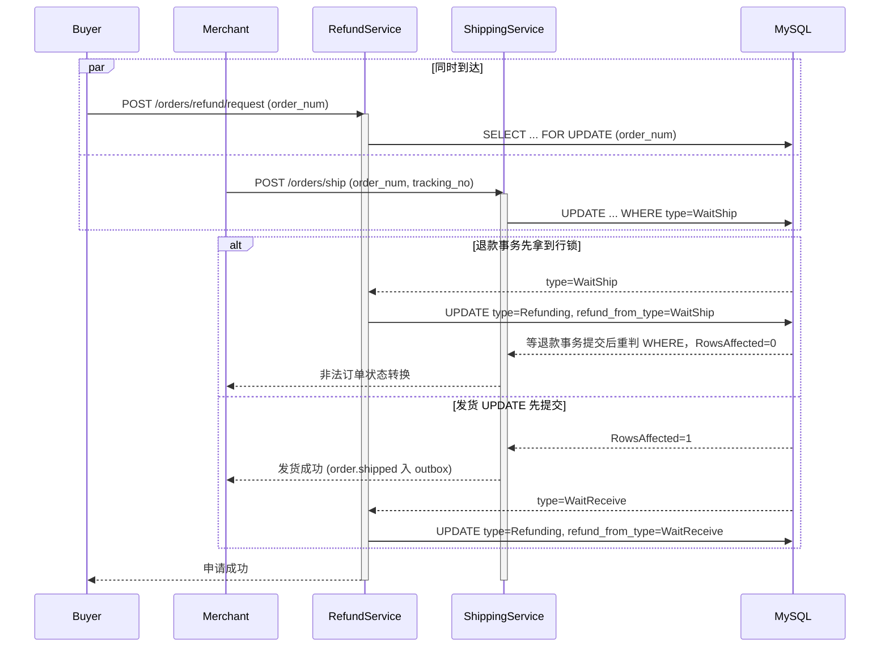
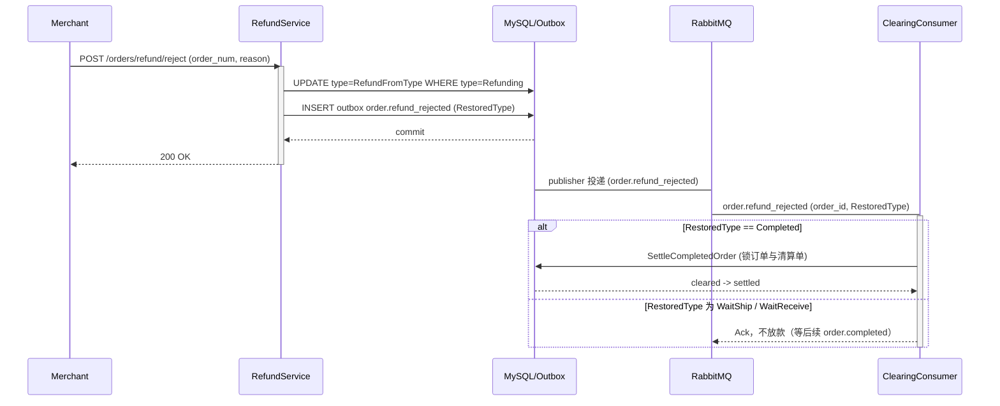
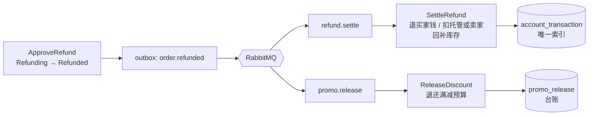

# 19 履约与售后：确认收货是放款指令，退款要把四样东西一起拉回来

> gomall · 发货 / 确认收货 / 7 天自动确认 / `RefundFromType` / `order.refunded` 双队列
>
> 这一讲回答一个问题：订单付款以后，状态每往前走一步或往回退一步，资金、库存、促销预算和履约时钟要跟着发生什么变化。

## 本讲目标

讲完后，学生应该能：

- 说清发货、确认收货、7 天自动确认在资金上的含义：确认收货就是放款指令；
- 解释为什么状态机的并发正确性必须落在条件 `UPDATE` 上，而不是 service 里的 `if`；
- 讲出 `RefundFromType` 怎样让“驳回退款”回到正确的状态，并影响清算模块要不要放款；
- 画出一个 `order.refunded` 事件被 `refund.settle` 和 `promo.release` 两条队列各自消费的路径；
- 指出当前实现的缺口：未退货就回补库存、没有售后时效、驳回会重置自动收货计时、物流单号没有落库等，并给出修法。

本讲默认学生已经学过：Outbox 和同事务写事件（第 00 讲下）、清算单与托管账户（第 04 讲）、`order.completed` 驱动结算以及退款资金来源和结算/退款并发锁（第 05 讲）。这些只引用，不重讲。

---

## 一、先看三张客诉单

**判断：退款和收货不只是改订单状态。它们同时决定钱给谁、货算谁的、满减预算退不退、7 天倒计时从哪天算。漏掉任何一项，都会变成客诉或资损。**

把三张真实形态的客诉单放在一起：

| 编号 | 谁投诉 | 现象 |
|---|---|---|
| A | 买家 | 商家点了“发货”，物流单号是空的；7 天后订单自动完成，卖家拿到了钱，买家还没收到货，也查不到物流 |
| B | 卖家 | 订单发货半个月了，钱一直没到账。查下来，买家申请退款、被驳回、再申请、再被驳回，订单反复在待收货和退款中之间来回 |
| C | 运营 | 一件已签收商品退款通过，买家拿回了钱，库存也加了 1；第二天这件“库存”被卖出，仓库里却没有货 |

这三件事分别落在履约时钟、售后状态机和库存回补上。本讲按订单状态的推进顺序走一遍代码，每一节最后回到这三张单子，看当前实现守住了什么、漏了什么。

付款之后订单的完整状态图如下（数值见 `internal/order/model.go:18` 的注释）：



注意 `Refunding` 有三条“驳回”出边，具体走哪条要看订单进入退款前的状态。这是第四节的重点。

---

## 二、发货：状态守卫落在 SQL 上

**判断：service 层的 `if order.Type != WaitShip` 只负责给出友好的报错；真正挡住并发的是 `WHERE type = WaitShip` 加 `RowsAffected` 判断。读完再写的 `if` 挡不住两个同时到达的请求。**

### 2.1 service 层：归属、预检、同事务写事件

```go
// internal/order/shipping.go:56-94
func (s *ShippingSrv) ShipOrder(ctx context.Context, orderNum uint64, trackingNo, carrier string) error {
	bossID, err := MerchantScope(ctx)
	if err != nil {
		return err
	}
	baseDao := NewOrderDao(ctx)
	order, err := baseDao.GetOrderByOrderNum(orderNum)
	// ... 省略：订单不存在的判断
	if bossID != 0 && order.BossID != bossID {
		return ErrOrderForbidden
	}
	if order.Type != consts.OrderWaitShip {
		return ErrInvalidOrderStateTransition
	}
	return baseDao.DB.Transaction(func(tx *gorm.DB) error {
		ok, err := NewOrderDaoByDB(tx).ShipOrder(orderNum, bossID)
		if err != nil {
			return err
		}
		if !ok {
			return ErrInvalidOrderStateTransition
		}
		return outbox.NewOutboxDaoByDB(tx).Insert(
			"order", "OrderShipped", "order.shipped", order.ID,
			events.OrderShipped{ /* ... */ TrackingNo: trackingNo, Carrier: carrier},
		)
	})
}
```

三件事按顺序做：

1. `MerchantScope`（`shipping.go:36-49`）从 DB 读当前操作者的角色。admin 返回 `bossID=0`，表示不限归属；商家返回自己的 id。路由上的 merchant 中间件只校验角色，不校验订单归属，这一点第 01 讲和第 14 讲都讲过；
2. 预检归属和状态，失败时给出明确错误；
3. 在一个事务里推进状态并写 `order.shipped`。

### 2.2 DAO 层：条件 UPDATE 才是状态机

```go
// internal/order/repo.go:378-402
func whereBoss(q *gorm.DB, bossID uint) *gorm.DB {
	if bossID == 0 {
		return q
	}
	return q.Where("boss_id=?", bossID)
}

func (d *OrderDao) ShipOrder(orderNum uint64, bossID uint) (bool, error) {
	res := whereBoss(d.DB.Model(&Order{}), bossID).
		Where("order_num=? AND type=?", orderNum, consts.OrderWaitShip).
		Update("type", consts.OrderWaitReceive)
	if res.Error != nil {
		return false, res.Error
	}
	// ... 省略：RowsAffected>0 时清用户订单列表缓存
	return res.RowsAffected > 0, nil
}
```

`whereBoss` 让归属检查在 SQL 里再执行一次。即使 service 层的预检被绕过，商家也改不动别人的订单。`type=WaitShip` 是状态守卫：订单已经被别的请求推进时，`RowsAffected=0`，上层返回“非法订单状态转换”，事务里的 outbox 也不会写入。

### 2.3 “发货”和“申请退款”同时到达

最有代表性的竞争是：买家在待发货阶段点了退款，商家同一秒点了发货。



两种顺序都收敛到合法状态：要么发货失败、订单在退款中；要么发货成功、退款记录的来路是 `WaitReceive`。不会出现“已经进入退款，又被推成待收货”的结果。

### 2.4 状态转换表只是文档

`internal/order/state.go` 有一张转换表：

```go
// internal/order/state.go:21-28
var orderStateTransitions = map[uint][]uint{
	consts.OrderWaitPay:     {consts.OrderWaitShip, consts.OrderClosed},
	consts.OrderWaitShip:    {consts.OrderWaitReceive, consts.OrderRefunding},
	consts.OrderWaitReceive: {consts.OrderCompleted, consts.OrderRefunding},
	consts.OrderCompleted:   {consts.OrderRefunding},
	consts.OrderRefunding:   {consts.OrderRefunded, consts.OrderCompleted},
	consts.OrderWaitGroup:   {consts.OrderWaitShip, consts.OrderClosed},
}
```

这张表写着 `Refunding` 只能去 `Refunded/Completed`，可实际驳回能回到 `WaitShip/WaitReceive`。表没有跟着改，是因为生产路径里没有任何地方调用 `CanTransition`，全仓库只有 `order_state_test.go` 用到它。`internal/refund/handler.go:40` 和 `internal/refund/dto.go:14` 的注释也还写着“驳回回到 Completed”。

**当前实现的边界：** 状态机的真实定义散落在各个 DAO 方法的 `WHERE type=?` 里，转换表和注释已经过时。要让表真正生效，可以让 DAO 的状态推进统一走一个 `transition(from, to)` 函数，先 `CanTransition` 再执行条件 UPDATE，并补上 `Refunding → WaitShip/WaitReceive` 两条边。

---

## 三、确认收货和 7 天兜底：两条路走同一条 SQL

**判断：确认收货在资金上等于“通知平台放款”。所以买家手动确认和 cron 自动确认必须共用同一条条件 UPDATE、写同一个事件，保证一张订单只放款一次。**

### 3.1 买家确认和 cron 自动确认

买家确认 `ShippingSrv.ConfirmReceive`（`internal/order/shipping.go:100-137`）的结构和发货一样：校验 `order.UserID == 当前用户`，预检 `type == WaitReceive`，再在事务里推进状态并写 `order.completed`（`Auto: false`）。cron 那一侧是这样：

```go
// internal/order/task.go:204-237（省略日志）
func (s *OrderTaskService) RunAutoConfirmReceive() {
	ctx := context.Background()
	baseDao := NewOrderDao(ctx)
	orders, err := baseDao.GetTimeoutWaitReceive(autoConfirmReceiveDays, 100)
	// ...
	for _, order := range orders {
		err := baseDao.DB.Transaction(func(tx *gorm.DB) error {
			ok, err := NewOrderDaoByDB(tx).ConfirmReceive(order.OrderNum)
			if err != nil {
				return err
			}
			if !ok {
				return errors.New("自动确认收货失败：订单状态已变更")
			}
			return outbox.NewOutboxDaoByDB(tx).Insert(
				"order", "OrderCompleted", "order.completed", order.ID,
				events.OrderCompletedEvent{ /* ... */ Auto: true},
			)
		})
		// 单条失败只记日志，继续下一条
	}
}
```

两条路径都调用 `OrderDao.ConfirmReceive`：

```go
// internal/order/repo.go:404-417
// 用户主动确认与 7d 兜底 cron 共用同一条 SQL，依靠 WHERE 兜底幂等。
func (d *OrderDao) ConfirmReceive(orderNum uint64) (bool, error) {
	res := d.DB.Model(&Order{}).
		Where("order_num=? AND type=?", orderNum, consts.OrderWaitReceive).
		Update("type", consts.OrderCompleted)
	// ...
	return res.RowsAffected > 0, nil
}
```

由此得到三个保证：

| 场景 | 结果 |
|---|---|
| 买家点确认的同时 cron 扫到这张单 | 只有一方 `RowsAffected=1`，另一方事务回滚，`order.completed` 只写一条 |
| 多个实例同时跑 cron | 同上，条件 UPDATE 互斥 |
| 订单正在退款中 | `GetTimeoutWaitReceive` 只扫 `type=WaitReceive`（`repo.go:474-475`），退款中的订单不会被自动完成放款 |

`Auto` 字段只用来区分来源，下游的结算逻辑对两者一视同仁。结算本身见第 05 讲。

### 3.2 `order.completed` 不能丢，`order.shipped` 可以丢

Outbox publisher 对事件分了级：

```go
// internal/shared/outbox/publisher.go:73-81
var fundsRoutingKeys = map[string]bool{
	"order.completed": true, "order.refund_rejected": true, "order.refunded": true, "order.cancelled": true,
	"groupbuy.expired": true, "web3.payment.confirmed": true,
}
```

`publisher.go:83-85` 的注释写明：资金事件不标 dead，一直退避重试；非资金事件如果没有队列订阅、被 broker 退回，就按“已发送”处理。

`order.shipped` 不在资金名单里。全仓库搜索 `order.shipped`，只命中发送端 `shipping.go:84` 和 `service/events/events.go:7` 的注释，没有任何消费者。所以 `order.shipped` 发出后被 broker 退回，直接按已发送处理。物流单号只放在这个事件里（`dto_shipping.go:3` 的注释：“本期仅经事件透传，不入主表”），等于没有存下来。

再看请求结构：

```go
// internal/order/dto_shipping.go:4-8
type ShipOrderReq struct {
	OrderNum   uint64 `form:"order_num" json:"order_num" binding:"required"`
	TrackingNo string `form:"tracking_no" json:"tracking_no"`
	Carrier    string `form:"carrier" json:"carrier"`
}
```

`TrackingNo` 没有 `binding:"required"`。客诉 A 的完整链路就清楚了：空单号也能发货，发货就开始计 7 天，7 天后 cron 写 `order.completed`，清算模块放款。

### 3.3 7 天从哪天开始算

```go
// internal/order/repo.go:466-479
func (d *OrderDao) GetTimeoutWaitReceive(days int, limit int) (orders []*Order, err error) {
	// ... 省略 days/limit 默认值
	expireTime := time.Now().Add(-time.Duration(days) * 24 * time.Hour)
	err = d.DB.Model(&Order{}).
		Where("type=? AND updated_at <=?", consts.OrderWaitReceive, expireTime).
		Limit(limit).
		Find(&orders).Error
	return
}
```

计时器是 `updated_at`，`Order` 上没有 `shipped_at` 字段。GORM 的 `Update/Updates` 会自动刷新 `updated_at`，所以订单行在待收货期间被任何一次 UPDATE 碰到，7 天都会重新计算。

项目里有一处代码专门绕开这个问题：

```go
// internal/order/repo.go:141-147
// 用 UpdateColumn 不刷 updated_at：自动确认收货、补偿结算都按它计时。
func (d *OrderDao) SetStockCommitPending(orderID uint, pending bool) (bool, error) {
	res := d.DB.Model(&Order{}).
		Where("id = ? AND stock_commit_pending = ?", orderID, !pending).
		UpdateColumn("stock_commit_pending", pending)
	return res.RowsAffected > 0, res.Error
}
```

这说明作者知道 `updated_at` 被当成计时器在用，但只在库存对账这一处做了防护。驳回退款用的是普通 `Update`（`repo.go:452-454`），会刷新 `updated_at`。这就是客诉 B 的根因，第四节再展开。

### 3.4 另外两处履约缺口

- **吞吐上限：** cron 每 6 小时一次（`initialize/cron.go:66`），每次 `limit=100`（`task.go:207`），单实例每天最多自动确认约 400 单，大促后放款会被拖到远超 7 天。
- **没有地址快照：** `Order` 只存 `AddressID`（`model.go:15`），列表和详情实时 `LEFT JOIN address`（`repo.go:173`、`213`），而地址可改、删除是物理删除。下单后改地址会改写历史订单，事后无法核对商家按哪个地址发的货。

---

## 四、退款状态机：`RefundFromType` 记住来路

**判断：退款是一条可以被撤回的岔路，撤回时必须回到原来的位置。待发货的订单被驳回后应该继续等发货，不能直接跳到已完成，否则会绕过履约，还会提前给卖家放款。**

### 4.1 谁能从哪里申请

`refundAllowedFrom`（`internal/refund/service.go:47-51`）只有 `WaitShip`、`WaitReceive`、`Completed` 三项。`WaitPay` 不在列表里，未付款订单走关单（第 12 讲）。`Completed` 在列表里，而且没有任何时间判断，这一点放到第六节讨论。

### 4.2 申请：行锁加条件 UPDATE 两层防护

```go
// internal/refund/service.go:57-98（省略取用户、订单不存在）
func (s *RefundSrv) RequestRefund(ctx context.Context, orderNum uint64, reason string) error {
	// ...
	return baseDao.DB.Transaction(func(tx *gorm.DB) error {
		orderDao := orderpkg.NewOrderDaoByDB(tx)
		order, err := orderDao.GetOrderByOrderNumForUpdate(orderNum)
		// ...
		if order.UserID != u.Id {
			return orderpkg.ErrOrderForbidden
		}
		fromType := order.Type
		if !inUintSlice(fromType, refundAllowedFrom) {
			return orderpkg.ErrInvalidOrderStateTransition
		}
		ok, err := orderDao.RequestRefund(orderNum, fromType)
		// ... 省略：err / !ok
		return outbox.NewOutboxDaoByDB(tx).Insert(
			"order", "OrderRefunding", "order.refunding", order.ID,
			events.OrderRefunding{ /* ... */ FromType: fromType, Reason: reason},
		)
	})
}
```

DAO 把来路一起写进去：

```go
// internal/order/repo.go:421-432
func (d *OrderDao) RequestRefund(orderNum uint64, fromType uint) (bool, error) {
	res := d.DB.Model(&Order{}).
		Where("order_num=? AND type=?", orderNum, fromType).
		Updates(map[string]interface{}{"type": consts.OrderRefunding, "refund_from_type": fromType})
	// ...
	return res.RowsAffected > 0, nil
}
```

`FOR UPDATE` 让“读到的 `fromType`”和“写入的 `refund_from_type`”在同一把锁下，不会读到 `WaitShip`、写的时候订单已经发货。`WHERE type=fromType` 是第二道防线。路由上还挂了幂等中间件（`internal/refund/routes.go:12`，原理见第 03 讲）。

对比一下：`ApproveRefund` 和 `RejectRefund` 不加行锁，先在事务外读订单做预检（`service.go:112-124`、`172-184`），再只靠 `WHERE type=Refunding` 的条件 UPDATE 推进。这样做也是对的：它们只有一个合法起点 `Refunding`，条件 UPDATE 已经足够。申请退款有三个可能的起点，需要先把“从哪来”读准，所以要加锁。

### 4.3 驳回：恢复到申请前的状态

```go
// internal/refund/service.go:185-208（省略归属与状态预检）
	restoreType := order.RefundFromType
	if !inUintSlice(restoreType, refundAllowedFrom) {
		// 兼容迁移前已经处于 Refunding、没有记录来源状态的旧订单，沿用旧行为恢复 Completed。
		restoreType = consts.OrderCompleted
	}
	return baseDao.DB.Transaction(func(tx *gorm.DB) error {
		ok, err := orderpkg.NewOrderDaoByDB(tx).RejectRefund(orderNum, restoreType, bossID)
		// ... 省略：err / !ok
		return outbox.NewOutboxDaoByDB(tx).Insert(
			"order", "OrderRefundRejected", "order.refund_rejected", order.ID,
			events.OrderRefundRejected{ /* ... */ Reason: reason, RestoredType: restoreType},
		)
	})
```

`RefundFromType` 的默认值是 0（`model.go:20`），0 不在允许列表里，说明这是加字段之前就进入退款的旧订单。旧代码驳回一律回到 `Completed`，这里为兼容保留了这个行为。

### 4.4 驳回和放款的握手

`RestoredType` 会跟着 `order.refund_rejected` 发给清算模块：

```go
// internal/clearing/consumer.go:32-45（省略解码）
func HandleRefundRejectedEvent(ctx context.Context, payload []byte) error {
	// ...
	// WaitShip / WaitReceive 的退款被驳回后只是恢复履约，不应提前给卖家放款。
	if evt.RestoredType != consts.OrderCompleted {
		return nil
	}
	return SettleCompletedOrder(ctx, evt.OrderID)
}
```

为什么驳回需要单独触发结算？因为 `SettleCompletedOrder` 遇到 `Refunding/Refunded` 的订单直接返回（`internal/clearing/service.go:223-225`）。已完成的订单进入退款以后，即使 `order.completed` 迟到也不会放款；驳回回到 `Completed` 时，需要这个事件把放款补上。



`refund_rejected` 在资金事件名单里，不会被标 dead。如果它丢了，5.5 的补偿 cron 会按“订单 `Completed` + 清算单 `cleared`”的组合补上结算。

---

## 五、一个 `order.refunded`，两条队列

**判断：退款获批是一个事实，资金回退和满减预算退还是两个独立的后果。用一个事件、两条队列、两本幂等台账，比在审批接口里同步做完两件事更可靠。**

### 5.1 审批只推进状态、写事件

```go
// internal/refund/service.go:128-152（省略归属与状态预检）
	amount := order.FinalCents
	if amount <= 0 {
		amount = order.Money * int64(order.Num)
	}
	txErr := baseDao.DB.Transaction(func(tx *gorm.DB) error {
		ok, err := orderpkg.NewOrderDaoByDB(tx).ApproveRefund(orderNum, bossID)
		// ... 省略：err / !ok
		return outbox.NewOutboxDaoByDB(tx).Insert(
			"order", "OrderRefunded", "order.refunded", order.ID,
			events.OrderRefundedEvent{
				OrderID: order.ID, OrderNum: order.OrderNum, UserID: order.UserID,
				Amount:             amount,
				PromoRuleID:        order.PromoRuleID,
				PromoDiscountCents: order.PromoDiscountCents,
			},
		)
	})
```

事件自带 `promo_rule_id` 和 `promo_discount_cents`，促销侧消费时不用回查订单表。



### 5.2 `refund.settle`：资金和库存

队列声明见 `internal/refund/consumer.go:16-18`。消费者只取 `OrderID`，交给 `SettleRefund`（`consumer.go:26-37`）。资金从托管还是从卖家余额扣、和结算之间怎样加锁、为什么金额以清算单为准，第 05 讲第四节已经逐段讲过，这里只补两点第 05 讲没讲的。

第一点，0 元订单也要写流水：

```go
// internal/refund/service.go:302-323（节选）
	// 买家 credit：即使实付为 0，也写一组 0 元幂等流水，避免重复消息反复回补库存。
	buyerAfter := buyerBal + amount
	if amount > 0 {
		// ... 省略：加密并更新买家余额
	}
	if err = ledgerDao.AppendTransaction(o.UserID, o.ID, money.DirectionCredit, amount, buyerAfter, refundBizType); err != nil {
		return err
	}
```

满减把实付抵扣到 0 的订单，钱不用退，但库存要回补。如果不写这条 0 元流水，`service.go:273-283` 的幂等预检永远查不到记录，重复消息每来一次就回补一次库存。这条流水是幂等锚点，不是账务需要。测试见 `TestZeroAmountLegacyRefundIsIdempotent`（`service_test.go:126`）。

第二点，库存回补不区分退款来源：

```go
// internal/refund/service.go:355-360、375-380
	// 库存回补：把订单数量加回在售库存（支付时已扣减，退款是其逆操作）。
	if _, err = product.NewProductDaoWithDB(tx).RollbackStock(o.ProductID, o.Num); err != nil {
		return err
	}
	// ... 事务提交后
	if e := cache.RestockAvailable(ctx, restocked.ProductID, int64(restocked.Num)); e != nil {
		// 失败只记日志，交给库存对账
	}
```

`SettleRefund` 没有读 `RefundFromType`。从 `WaitShip` 退款时货还在仓库，回补没有问题；从 `WaitReceive` 或 `Completed` 退款时，货在路上或在买家手里，MySQL 和 Redis 的可售库存（两桶库存见第 12 讲）却立刻加了回去。这就是客诉 C。

### 5.3 `promo.release`：满减预算

`promo.release` 的消费者 `HandleOrderRefundedEvent`（`internal/promo/consumer.go:40-50`）对没命中满减的订单直接放行，其余交给 `ReleaseDiscount`（`internal/promo/service.go:260-293`）：先写 `promo_release` 台账，写入成功才恢复预算。台账唯一键、关单和退款共用一本台账的细节第 16 讲第四节已经讲过，这里不重复。

两条队列互不等待。资金侧因为 DB 抖动重试时，预算可能已经退还；反过来也一样。两者最终都会完成，中间允许短暂不一致。

### 5.4 事件里的 `Amount` 和实际退款口径不同

对比审批时的金额和落地时的金额：

```go
// internal/refund/service.go:128-131 —— 写进事件的 Amount
	amount := order.FinalCents
	if amount <= 0 {
		amount = order.Money * int64(order.Num)
	}

// internal/refund/service.go:214-219 —— SettleRefund 实际使用的金额
func refundAmount(o *orderpkg.Order) int64 {
	if o.PromoRuleID != 0 {
		return o.FinalCents
	}
	return o.Money * int64(o.Num)
}
```

`refundAmount` 的注释说得很清楚：满减全额抵扣时 `FinalCents==0` 是合法实付，不能用 `>0` 判断。审批代码恰好用的是 `<=0`，所以满减抵扣到 0 的订单，事件里的 `Amount` 是原价。目前 `refund.settle` 只读 `OrderID`、不读 `Amount`，不会多退钱，但事件数据是错的。将来如果有对账或通知服务按 `Amount` 消费，就会出问题。修法是审批时直接调用 `refundAmount(order)`。

### 5.5 事件丢了怎么办：补偿 cron

```go
// internal/refund/service.go:391-420（节选）
	before := time.Now().Add(-settleCompensationDelay) // 10 分钟
	// 已完成但清算单还是 cleared → 补结算
	for _, id := range missed(consts.OrderCompleted, "status = ?", clearing.StatusCleared) {
		clearing.SettleCompletedOrder(ctx, id)
	}
	// 已退款但清算单不是 refunded → 补退款
	for _, id := range missed(consts.OrderRefunded, "status <> ?", clearing.StatusRefunded) {
		s.SettleRefund(ctx, id)
	}
```

注册在 `initialize/cron.go:95`，每 10 分钟一次。它直接按“订单状态 × 清算单状态”的组合找出漏掉的单子，和正常消费者并发也只会生效一次，因为两边都锁清算单（第 05 讲 4.2）。这条 cron 只补资金，不补促销预算。outbox 对 `order.refunded` 的无限重试只保证事件投递到 broker；如果 `promo.release` 消费者重试耗尽进了 DLQ（`internal/promo/consumer.go:96`），预算就不会退还，只能人工从 DLQ 重放。

---

## 六、当前实现的缺口

**判断：这一块已经实现的是“退款审批状态机 + 资金落地”，还不是完整的售后系统。下面每一条都能在代码里找到行号，也都能写出一条现在会失败的测试。**

| # | 缺口 | 证据 | 后果 | 修法方向 |
|---|---|---|---|---|
| 1 | 没有退货就回补库存 | `refund/service.go:356`、`377` 不看 `RefundFromType` | 已签收商品退款后库存可售，超卖（客诉 C） | `RefundFromType==WaitShip` 才立即回补；其余等退货入库事件再回补 |
| 2 | 已完成订单没有售后时效 | `refund/service.go:47-51` 无时间判断 | 一年前的订单仍可申请退款，从卖家余额扣钱 | 加 `completed_at`，超过 N 天拒绝申请或转人工 |
| 3 | 卖家余额可以被扣成负数 | `refund/service.go:340-347` 无下限检查 | 卖家已提现时形成负余额，平台承担坏账 | 余额不足时挂应收、冻结提现，或转人工 |
| 4 | 反复驳回会重置自动收货计时 | 驳回用 `Update`（`repo.go:452-454`）刷新 `updated_at`；cron 按 `updated_at` 计时（`repo.go:475`）；申请次数无上限 | 买家反复申请退款可以无限拖延放款（客诉 B） | 新增 `shipped_at` 作为计时起点；限制同一订单的申请次数 |
| 5 | 物流单号不必填、也不落库 | `dto_shipping.go:4-8` 无 `required`；只进 `order.shipped`，无消费者 | 空单号发货也能开始 7 天倒计时（客诉 A）；用户查不到物流 | 发货强制单号；建物流表或在订单上存 `tracking_no/carrier/shipped_at` |
| 6 | 退款原因不落库 | `reason` 只进 `order.refunding` 事件（`refund/service.go:94`），无消费者 | 商家审批时看不到买家为什么退 | 建退款单表，保存原因、凭证、审批意见和每次申请记录 |
| 7 | 事件 `Amount` 口径错误 | `refund/service.go:128-131` 对比 `214-219` | 满减抵扣到 0 的订单，事件显示原价 | 审批时复用 `refundAmount` |
| 8 | 转换表和注释过时 | `order/state.go:26`；`refund/handler.go:40`；`refund/dto.go:14` | 读文档的人会以为驳回只能回到 Completed | 补上两条驳回边，并让 DAO 真正调用 `CanTransition` |
| 9 | 订单没有地址快照 | `order/model.go:15`；`repo.go:173`、`213` 实时 JOIN | 改地址或删地址会改写历史订单 | 下单时拷贝地址快照 |
| 10 | 自动确认吞吐只有约 400 单/天 | `initialize/cron.go:66`；`task.go:207` | 大促后放款严重延迟 | 游标循环扫到空，或提高频率 |
| 11 | 满减预算退还没有兜底 | `RunSettleCompensation`（`refund/service.go:391-420`）只补结算和退款 | `promo.release` 进 DLQ 后预算永久少退 | 补偿 cron 增加“已退款且命中满减、但无 `promo_release` 台账”的扫描 |

此外，模型里只有整单退款。部分退款、仅退款和退货退款的区分、退货物流、售后时效窗口，这些在代码里都不存在，讲课时不要说成“已经实现”。

缺口 1 和缺口 4 都和 `RefundFromType` 有关：前者是该看它的地方没看，后者是驳回时恢复了状态，却顺手把计时器也重置了。一个字段能记住订单从哪里来，但订单在那个状态待了多久，需要另一个字段来记。

---

## 七、故障演练 / 课堂演示

### 7.1 现有测试能证明什么

| 测试 | 文件 | 证明的判断 |
|---|---|---|
| `TestMerchantCannotShipAnotherMerchantsOrder` | `internal/order/order_test.go:30` | 商家 A 发不了商家 B 的货，admin 可以 |
| `TestRejectRefundRestoresOriginalState` | `internal/refund/service_test.go:216` | 三种来路驳回后都回到原状态，事件 `RestoredType` 一致 |
| `TestMerchantCannotHandleAnotherMerchantsRefund` | `internal/refund/service_test.go:267` | 跨商家审批、驳回都被拒，订单仍在退款中 |
| `TestZeroAmountLegacyRefundIsIdempotent` | `internal/refund/service_test.go:126` | 0 元退款重复消费不会重复回补库存 |
| `TestSettleCompensationSettlesMissedOrders` | `internal/refund/service_test.go:169` | 事件丢失后补偿 cron 能补结算、补退款 |
| `TestSettleRefundChoosesFundingSourceByClearingState` | `internal/refund/service_test.go:30` | 资金来源取决于清算状态（第 05 讲） |

课堂上先跑一遍 `go test ./internal/refund/ ./internal/order/ -run 'Refund|Ship' -v`，这些测试用 SQLite 内存库，不依赖 MySQL。

### 7.2 现场演示：驳回会重置 7 天计时

在测试库里造一张 `WaitReceive` 订单，把 `updated_at` 改成 8 天前：

1. 调用 `GetTimeoutWaitReceive(7, 100)`，订单出现在结果里；
2. 以买家身份 `RequestRefund`，再以商家身份 `RejectRefund`；
3. 再次调用 `GetTimeoutWaitReceive(7, 100)`，订单消失了，因为驳回把 `updated_at` 刷成了现在。

这一步不需要改任何代码，直接演示客诉 B 的根因。

---

## 课后练习

1. **补一条会失败的测试：** 从 `WaitReceive` 申请退款并获批，调用 `SettleRefund` 后断言商品库存不变。当前会失败，说明缺口 1。然后按 `RefundFromType` 修好它，思考退货入库时由谁、靠哪个事件把库存加回去。
2. **加 `shipped_at`：** 给 `Order` 加 `ShippedAt *time.Time`，在 `OrderDao.ShipOrder` 的同一条 UPDATE 里写入，把 `GetTimeoutWaitReceive` 改成按 `shipped_at` 判定。再跑 7.2 的演示，确认驳回不再重置计时。注意存量订单 `shipped_at` 为空时怎么处理。
3. **售后时效：** 设计一个“确认收货后 15 天内可申请退款”的规则。说明需要哪个时间字段、判断放在 service 还是 SQL 的 `WHERE` 里，以及 `RequestRefund` 的 `FOR UPDATE` 是否还需要。
4. **卖家负余额：** 写出卖家余额 30 元、退款 100 元时你认为正确的分录和状态，并说明 `SettleRefund` 应该失败重试、挂应收还是转人工，各自对买家体验的影响。
5. **口径统一：** 把 `ApproveRefund` 的金额计算换成 `refundAmount`，补一条满减抵扣到 0 的订单测试，断言事件 `Amount==0`。

---

## 代码索引

| 主题 | 文件 | 入口 |
|---|---|---|
| 发货 / 确认收货 service | `internal/order/shipping.go` | `MerchantScope`、`ShipOrder`、`ConfirmReceive` |
| 状态推进 SQL | `internal/order/repo.go` | `whereBoss`、`ShipOrder`、`ConfirmReceive`、`RequestRefund`、`ApproveRefund`、`RejectRefund`、`GetTimeoutWaitReceive` |
| 不刷新计时器的写法 | `internal/order/repo.go` | `SetStockCommitPending` |
| 7 天自动确认 | `internal/order/task.go`、`initialize/cron.go` | `RunAutoConfirmReceive` |
| 状态转换表（未接入生产） | `internal/order/state.go` | `orderStateTransitions`、`CanTransition` |
| 订单字段 | `internal/order/model.go` | `RefundFromType`、`AddressID`、`FinalCents` |
| 发货请求 | `internal/order/dto_shipping.go` | `ShipOrderReq` |
| 退款审批 | `internal/refund/service.go` | `RequestRefund`、`ApproveRefund`、`RejectRefund` |
| 退款落地与补偿 | `internal/refund/service.go` | `SettleRefund`、`refundAmount`、`RunSettleCompensation` |
| 退款队列 | `internal/refund/consumer.go` | `refund.settle` |
| 满减预算退还 | `internal/promo/consumer.go`、`internal/promo/service.go` | `promo.release`、`ReleaseDiscount` |
| 驳回后放款握手 | `internal/clearing/consumer.go` | `HandleRefundRejectedEvent` |
| 资金事件分级 | `internal/shared/outbox/publisher.go` | `fundsRoutingKeys`、`drainBatch` |
| 事件定义 | `service/events/events.go` | `OrderShipped`、`OrderRefunding`、`OrderRefundRejected` |
| 测试 | `internal/order/order_test.go`、`internal/refund/service_test.go` | 见第七节表格 |
