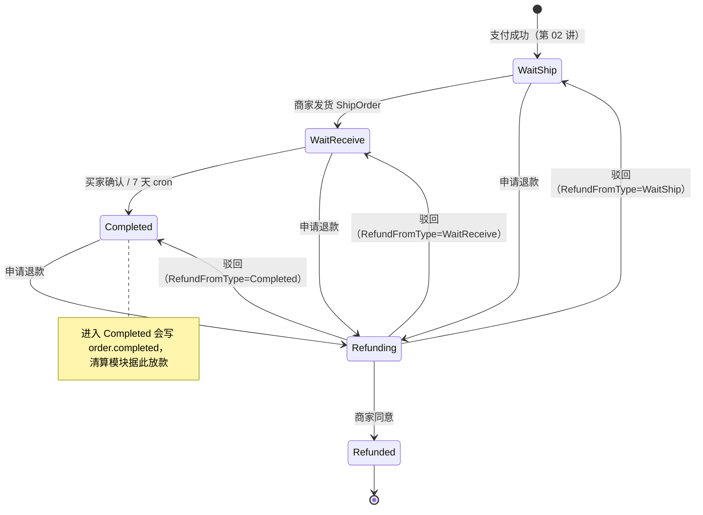
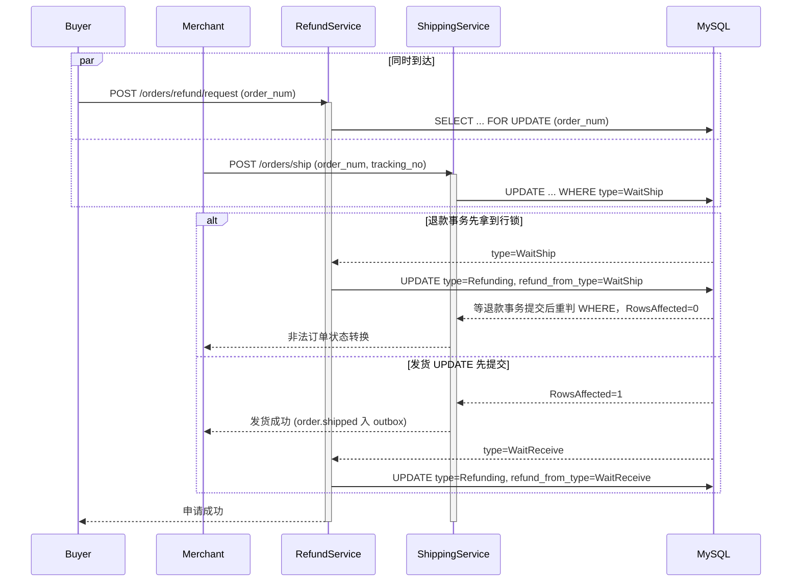
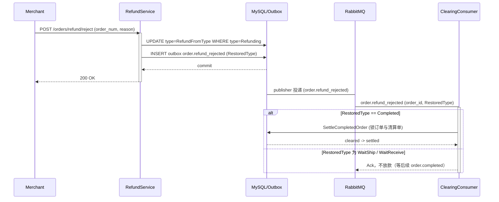
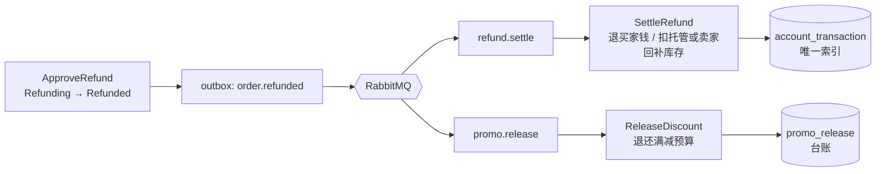

# 19 履约与售后：确认收货是放款指令，退款要把四样东西一起拉回来

> gomall · 发货 / 确认收货 / 7 天自动确认 / `RefundFromType` / `order.refunded` 双队列
>
> 这一讲回答一个问题：订单付款以后，状态每往前走一步或往回退一步，资金、库存、促销预算和履约时钟要跟着发生什么变化。

## 本讲目标

讲完后，学生应该能：

- 说清发货、确认收货、7 天自动确认在资金上的含义：确认收货就是放款指令；
- 解释为什么状态机的并发正确性必须落在条件 `UPDATE` 上，而不是 service 里的 `if`；
- 讲出 `RefundFromType` 怎样让“驳回退款”回到正确的状态，并影响清算模块要不要放款；
- 画出一个 `order.refunded` 事件被 `refund.settle` 和 `promo.release` 两条队列各自消费的路径；
- 说清 7 天兜底 cron、资金补偿 cron 和幂等台账怎样配合，让一张订单只放款一次、只退款一次、库存只回补一次。

本讲默认学生已经学过：Outbox 和同事务写事件（第 00 讲下）、清算单与托管账户（第 04 讲）、`order.completed` 驱动结算以及退款资金来源和结算/退款并发锁（第 05 讲）。这些只引用，不重讲。

---

## 一、先看三个必须答对的场景

**判断：退款和收货不只是改订单状态。它们同时决定钱给谁、货算谁的、满减预算退不退、7 天倒计时从哪天算。任何一项算错，都会变成客诉或资损。**

先把三个典型场景摆出来，后面每一节都回答其中一个：

| 编号 | 场景 | 必须保证的结果 |
|---|---|---|
| A | 买家点“确认收货”的同一秒，7 天兜底 cron 也扫到了这张单 | `order.completed` 只写一条，卖家只被放款一次 |
| B | 买家在待发货阶段申请退款，商家驳回 | 订单回到待发货继续履约，不能直接变成已完成、提前给卖家放款 |
| C | 满减把实付抵扣到 0 的订单退款成功，`order.refunded` 被重复投递 | 钱不用退，库存只回补一次 |

这三件事分别落在履约时钟、售后状态机和退款落地上。本讲按订单状态的推进顺序走一遍代码，看每个场景是靠哪一行守住的。

付款之后订单的完整状态图如下（数值见 `internal/order/model.go:18` 的注释）：



注意 `Refunding` 有三条“驳回”出边，具体走哪条要看订单进入退款前的状态。这是第四节的重点。

---

## 二、发货：状态守卫落在 SQL 上

**判断：service 层的 `if order.Type != WaitShip` 只负责给出友好的报错；真正挡住并发的是 `WHERE type = WaitShip` 加 `RowsAffected` 判断。读完再写的 `if` 挡不住两个同时到达的请求。**

### 2.1 service 层：归属、预检、同事务写事件

```go
// internal/order/shipping.go:56-94
func (s *ShippingSrv) ShipOrder(ctx context.Context, orderNum uint64, trackingNo, carrier string) error {
	bossID, err := MerchantScope(ctx)
	if err != nil {
		return err
	}
	baseDao := NewOrderDao(ctx)
	order, err := baseDao.GetOrderByOrderNum(orderNum)
	// ... 省略：订单不存在的判断
	if bossID != 0 && order.BossID != bossID {
		return ErrOrderForbidden
	}
	if order.Type != consts.OrderWaitShip {
		return ErrInvalidOrderStateTransition
	}
	return baseDao.DB.Transaction(func(tx *gorm.DB) error {
		ok, err := NewOrderDaoByDB(tx).ShipOrder(orderNum, bossID)
		if err != nil {
			return err
		}
		if !ok {
			return ErrInvalidOrderStateTransition
		}
		return outbox.NewOutboxDaoByDB(tx).Insert(
			"order", "OrderShipped", "order.shipped", order.ID,
			events.OrderShipped{ /* ... */ TrackingNo: trackingNo, Carrier: carrier},
		)
	})
}
```

三件事按顺序做：

1. `MerchantScope`（`shipping.go:36-49`）从 DB 读当前操作者的角色。admin 返回 `bossID=0`，表示不限归属；商家返回自己的 id。路由上的 merchant 中间件只校验角色，不校验订单归属，这一点第 01 讲和第 14 讲都讲过；
2. 预检归属和状态，失败时给出明确错误；
3. 在一个事务里推进状态并写 `order.shipped`。

### 2.2 DAO 层：条件 UPDATE 才是状态机

```go
// internal/order/repo.go:378-402
func whereBoss(q *gorm.DB, bossID uint) *gorm.DB {
	if bossID == 0 {
		return q
	}
	return q.Where("boss_id=?", bossID)
}

func (d *OrderDao) ShipOrder(orderNum uint64, bossID uint) (bool, error) {
	res := whereBoss(d.DB.Model(&Order{}), bossID).
		Where("order_num=? AND type=?", orderNum, consts.OrderWaitShip).
		Update("type", consts.OrderWaitReceive)
	if res.Error != nil {
		return false, res.Error
	}
	// ... 省略：RowsAffected>0 时清用户订单列表缓存
	return res.RowsAffected > 0, nil
}
```

`whereBoss` 让归属检查在 SQL 里再执行一次。即使 service 层的预检被绕过，商家也改不动别人的订单。`type=WaitShip` 是状态守卫：订单已经被别的请求推进时，`RowsAffected=0`，上层返回“非法订单状态转换”，事务里的 outbox 也不会写入。

### 2.3 “发货”和“申请退款”同时到达

最有代表性的竞争是：买家在待发货阶段点了退款，商家同一秒点了发货。



两种顺序都收敛到合法状态：要么发货失败、订单在退款中；要么发货成功、退款记录的来路是 `WaitReceive`。不会出现“已经进入退款，又被推成待收货”的结果。

### 2.4 每个 DAO 方法就是状态图上的一条边

把付款后所有推进状态的 DAO 方法列在一起，会发现它们是同一个模板：`WHERE order_num=? AND type=<起点>`，`SET type=<终点>`，返回 `RowsAffected>0`。

| DAO 方法 | 位置 | 起点（WHERE） | 终点（SET） | 归属过滤 |
|---|---|---|---|---|
| `ShipOrder` | `repo.go:391` | `WaitShip` | `WaitReceive` | `whereBoss` |
| `ConfirmReceive` | `repo.go:406` | `WaitReceive` | `Completed` | 由 service 校验买家 |
| `RequestRefund` | `repo.go:421` | 调用方读到的 `fromType` | `Refunding`，同时写 `refund_from_type` | 由 service 校验买家 |
| `ApproveRefund` | `repo.go:435` | `Refunding` | `Refunded` | `whereBoss` |
| `RejectRefund` | `repo.go:451` | `Refunding` | 调用方传入的 `restoreType` | `whereBoss` |

这样设计的好处是：状态守卫和写入是一条原子语句，任何两个并发请求争同一个起点，数据库保证只有一个人赢；输的一方拿到 `RowsAffected=0`，在 service 层统一翻译成 `ErrInvalidOrderStateTransition`，事务回滚，outbox 也跟着不写。上图里的每一条箭头，都能在这张表里找到对应的那一行 SQL。

另外注意两个“变量起点/终点”：`RequestRefund` 的起点和 `RejectRefund` 的终点都不是写死的常量，而是由调用方从订单行里读出来再传进去。第四节会讲，正是这两个变量让一条 `Refunding` 状态能够正确地“原路返回”。

---

## 三、确认收货和 7 天兜底：两条路走同一条 SQL

**判断：确认收货在资金上等于“通知平台放款”。所以买家手动确认和 cron 自动确认必须共用同一条条件 UPDATE、写同一个事件，保证一张订单只放款一次。**

### 3.1 买家确认和 cron 自动确认

买家确认 `ShippingSrv.ConfirmReceive`（`internal/order/shipping.go:100-137`）的结构和发货一样：校验 `order.UserID == 当前用户`，预检 `type == WaitReceive`，再在事务里推进状态并写 `order.completed`（`Auto: false`）。cron 那一侧是这样：

```go
// internal/order/task.go:204-237（省略日志）
func (s *OrderTaskService) RunAutoConfirmReceive() {
	ctx := context.Background()
	baseDao := NewOrderDao(ctx)
	orders, err := baseDao.GetTimeoutWaitReceive(autoConfirmReceiveDays, 100)
	// ...
	for _, order := range orders {
		err := baseDao.DB.Transaction(func(tx *gorm.DB) error {
			ok, err := NewOrderDaoByDB(tx).ConfirmReceive(order.OrderNum)
			if err != nil {
				return err
			}
			if !ok {
				return errors.New("自动确认收货失败：订单状态已变更")
			}
			return outbox.NewOutboxDaoByDB(tx).Insert(
				"order", "OrderCompleted", "order.completed", order.ID,
				events.OrderCompletedEvent{ /* ... */ Auto: true},
			)
		})
		// 单条失败只记日志，继续下一条
	}
}
```

两条路径都调用 `OrderDao.ConfirmReceive`：

```go
// internal/order/repo.go:404-417
// 用户主动确认与 7d 兜底 cron 共用同一条 SQL，依靠 WHERE 兜底幂等。
func (d *OrderDao) ConfirmReceive(orderNum uint64) (bool, error) {
	res := d.DB.Model(&Order{}).
		Where("order_num=? AND type=?", orderNum, consts.OrderWaitReceive).
		Update("type", consts.OrderCompleted)
	// ...
	return res.RowsAffected > 0, nil
}
```

由此得到三个保证：

| 场景 | 结果 |
|---|---|
| 买家点确认的同时 cron 扫到这张单 | 只有一方 `RowsAffected=1`，另一方事务回滚，`order.completed` 只写一条 |
| 多个实例同时跑 cron | 同上，条件 UPDATE 互斥 |
| 订单正在退款中 | `GetTimeoutWaitReceive` 只扫 `type=WaitReceive`（`repo.go:474-475`），退款中的订单不会被自动完成放款 |

`Auto` 字段只用来区分来源，下游的结算逻辑对两者一视同仁。结算本身见第 05 讲。这就是场景 A 的答案：两条路径争的是同一行、同一个起点，谁先提交谁写事件，另一方的事务连同 outbox 一起回滚。

cron 本身的节奏也值得看一眼：它注册在 `initialize/cron.go:66`，表达式 `0 0 */6 * * *`，每 6 小时扫一次；每次取一批（`task.go:207` 传入 `limit=100`），每张订单各开一个事务。单张失败只记日志、继续下一张，不会因为一张订单状态已变更就把整批拖垮；没处理到的订单下一轮还会被扫到，因为条件只看“状态 + 时间”，不看上一次是否处理过。cron 外层还套了 `recover`，单次 panic 不会让整个调度器退出。

### 3.2 `order.completed` 不能丢，`order.shipped` 可以丢

Outbox publisher 对事件分了级：

```go
// internal/shared/outbox/publisher.go:73-81
var fundsRoutingKeys = map[string]bool{
	"order.completed": true, "order.refund_rejected": true, "order.refunded": true, "order.cancelled": true,
	"groupbuy.expired": true, "web3.payment.confirmed": true,
}
```

`publisher.go:83-85` 的注释写明：资金事件不标 dead，一直退避重试；非资金事件如果没有队列订阅、被 broker 退回，就按“已发送”处理。

`order.shipped` 不在资金名单里。它的发送端是 `shipping.go:84`，目前没有队列订阅它，属于通知类事件：发出后如果被 broker 退回，直接按已发送处理，不占用资金事件的重试资源。物流单号和承运商随这个事件透传（`dto_shipping.go:3`），订单主表只记录状态。

分级的依据是“丢了会不会错账”。`order.completed` 丢了，卖家永远拿不到钱；`order.refunded` 丢了，买家永远退不到款；`order.refund_rejected` 丢了，已完成订单被驳回后不会补放款。这几类必须投递成功，所以无限退避重试，再加上 5.5 的补偿 cron 作为第二道兜底。`order.shipped` 只是通知，履约流程的推进（7 天兜底、确认收货）都只看订单表里的状态，不依赖这个事件是否到达。

### 3.3 7 天从哪天开始算

```go
// internal/order/repo.go:466-479
func (d *OrderDao) GetTimeoutWaitReceive(days int, limit int) (orders []*Order, err error) {
	// ... 省略 days/limit 默认值
	expireTime := time.Now().Add(-time.Duration(days) * 24 * time.Hour)
	err = d.DB.Model(&Order{}).
		Where("type=? AND updated_at <=?", consts.OrderWaitReceive, expireTime).
		Limit(limit).
		Find(&orders).Error
	return
}
```

计时器是 `updated_at`。GORM 的 `Update/Updates` 会自动刷新 `updated_at`，而 2.4 表里的每条状态推进都走 `Update/Updates`，所以对一张处于 `WaitReceive` 的订单来说，`updated_at` 就是“它进入待收货的时刻”：

- 正常路径：`ShipOrder` 把 `WaitShip` 推到 `WaitReceive` 时刷新 `updated_at`，7 天正好从发货开始算；
- 退款被驳回：`RejectRefund` 把 `Refunding` 恢复成 `WaitReceive` 时同样刷新 `updated_at`，7 天从恢复履约那一刻重新起算，买家在退款中等待审批的这段时间不计入收货期；
- 退款进行中：订单处于 `Refunding`，`WHERE type=WaitReceive` 直接把它排除，不会被自动确认。

这样一来，计时规则不需要额外字段：只要“状态推进刷新时间戳、非状态字段不刷新”这条约定成立，`updated_at` 就等价于“进入当前状态的时间”。

约定的另一半在这里：

```go
// internal/order/repo.go:141-147
// 用 UpdateColumn 不刷 updated_at：自动确认收货、补偿结算都按它计时。
func (d *OrderDao) SetStockCommitPending(orderID uint, pending bool) (bool, error) {
	res := d.DB.Model(&Order{}).
		Where("id = ? AND stock_commit_pending = ?", orderID, !pending).
		UpdateColumn("stock_commit_pending", pending)
	return res.RowsAffected > 0, res.Error
}
```

`stock_commit_pending` 是库存对账用的后台标记，和订单所处的业务状态无关。如果用普通 `Update`，一次对账就会把一张已经待收货 6 天的订单重新拉回第 0 天。所以这里用 `UpdateColumn`：只改这一列，不触发 GORM 的时间戳回调。

可以把这条规则记成一句话：**改状态用 `Update`，改附属字段用 `UpdateColumn`。** 以后给订单表加任何不代表状态变化的字段（对账标记、缓存版本号之类），都应该沿用这种写法。7 天兜底和 5.5 的补偿 cron 都按 `updated_at` 筛单，这条约定同时保护着这两处计时。

---

## 四、退款状态机：`RefundFromType` 记住来路

**判断：退款是一条可以被撤回的岔路，撤回时必须回到原来的位置。待发货的订单被驳回后应该继续等发货，不能直接跳到已完成，否则会绕过履约，还会提前给卖家放款。**

### 4.1 谁能从哪里申请

`refundAllowedFrom`（`internal/refund/service.go:47-51`）只有 `WaitShip`、`WaitReceive`、`Completed` 三项。`WaitPay` 不在列表里，未付款订单走关单（第 12 讲）。`Completed` 也在列表里：已经确认收货、已经放款的订单仍然可以发起售后，这时资金要从卖家余额扣回，具体由清算单状态决定（5.2）。`Refunding` 和 `Refunded` 不在列表里，所以同一张订单在一次退款结束前不能再次申请，已退款的订单也不能重复退。

### 4.2 申请：行锁加条件 UPDATE 两层防护

```go
// internal/refund/service.go:57-98（省略取用户、订单不存在）
func (s *RefundSrv) RequestRefund(ctx context.Context, orderNum uint64, reason string) error {
	// ...
	return baseDao.DB.Transaction(func(tx *gorm.DB) error {
		orderDao := orderpkg.NewOrderDaoByDB(tx)
		order, err := orderDao.GetOrderByOrderNumForUpdate(orderNum)
		// ...
		if order.UserID != u.Id {
			return orderpkg.ErrOrderForbidden
		}
		fromType := order.Type
		if !inUintSlice(fromType, refundAllowedFrom) {
			return orderpkg.ErrInvalidOrderStateTransition
		}
		ok, err := orderDao.RequestRefund(orderNum, fromType)
		// ... 省略：err / !ok
		return outbox.NewOutboxDaoByDB(tx).Insert(
			"order", "OrderRefunding", "order.refunding", order.ID,
			events.OrderRefunding{ /* ... */ FromType: fromType, Reason: reason},
		)
	})
}
```

DAO 把来路一起写进去：

```go
// internal/order/repo.go:421-432
func (d *OrderDao) RequestRefund(orderNum uint64, fromType uint) (bool, error) {
	res := d.DB.Model(&Order{}).
		Where("order_num=? AND type=?", orderNum, fromType).
		Updates(map[string]interface{}{"type": consts.OrderRefunding, "refund_from_type": fromType})
	// ...
	return res.RowsAffected > 0, nil
}
```

`FOR UPDATE` 让“读到的 `fromType`”和“写入的 `refund_from_type`”在同一把锁下，不会读到 `WaitShip`、写的时候订单已经发货。`WHERE type=fromType` 是第二道防线。路由上还挂了幂等中间件（`internal/refund/routes.go:12`，原理见第 03 讲）。

对比一下：`ApproveRefund` 和 `RejectRefund` 不加行锁，先在事务外读订单做预检（`service.go:112-124`、`172-184`），再只靠 `WHERE type=Refunding` 的条件 UPDATE 推进。这样做也是对的：它们只有一个合法起点 `Refunding`，条件 UPDATE 已经足够。申请退款有三个可能的起点，需要先把“从哪来”读准，所以要加锁。

### 4.3 驳回：恢复到申请前的状态

```go
// internal/refund/service.go:185-208（省略归属与状态预检）
	restoreType := order.RefundFromType
	if !inUintSlice(restoreType, refundAllowedFrom) {
		// 兼容迁移前已经处于 Refunding、没有记录来源状态的旧订单，沿用旧行为恢复 Completed。
		restoreType = consts.OrderCompleted
	}
	return baseDao.DB.Transaction(func(tx *gorm.DB) error {
		ok, err := orderpkg.NewOrderDaoByDB(tx).RejectRefund(orderNum, restoreType, bossID)
		// ... 省略：err / !ok
		return outbox.NewOutboxDaoByDB(tx).Insert(
			"order", "OrderRefundRejected", "order.refund_rejected", order.ID,
			events.OrderRefundRejected{ /* ... */ Reason: reason, RestoredType: restoreType},
		)
	})
```

`RefundFromType` 的默认值是 0（`model.go:20`），0 不在允许列表里，说明这是加字段之前就进入退款的旧订单。旧代码驳回一律回到 `Completed`，这里为兼容保留了这个行为。

这就是场景 B 的答案：待发货订单申请退款时，`refund_from_type` 记下 `WaitShip`；商家驳回时，`RejectRefund` 把 `WaitShip` 作为终点写回去。订单回到待发货，等商家正常发货、买家确认收货，才会产生 `order.completed`。DAO 层 `RejectRefund` 的注释（`repo.go:448-449`）也把这条约束写得很直接：恢复目标来自持久化的来路，不能一律跳到 `Completed` 绕过履约。

### 4.4 驳回和放款的握手

`RestoredType` 会跟着 `order.refund_rejected` 发给清算模块：

```go
// internal/clearing/consumer.go:32-45（省略解码）
func HandleRefundRejectedEvent(ctx context.Context, payload []byte) error {
	// ...
	// WaitShip / WaitReceive 的退款被驳回后只是恢复履约，不应提前给卖家放款。
	if evt.RestoredType != consts.OrderCompleted {
		return nil
	}
	return SettleCompletedOrder(ctx, evt.OrderID)
}
```

为什么驳回需要单独触发结算？因为 `SettleCompletedOrder` 遇到 `Refunding/Refunded` 的订单直接返回（`internal/clearing/service.go:223-225`）。已完成的订单进入退款以后，即使 `order.completed` 迟到也不会放款；驳回回到 `Completed` 时，需要这个事件把放款补上。



`refund_rejected` 在资金事件名单里，不会被标 dead。如果它丢了，5.5 的补偿 cron 会按“订单 `Completed` + 清算单 `cleared`”的组合补上结算。

---

## 五、一个 `order.refunded`，两条队列

**判断：退款获批是一个事实，资金回退和满减预算退还是两个独立的后果。用一个事件、两条队列、两本幂等台账，比在审批接口里同步做完两件事更可靠。**

### 5.1 审批只推进状态、写事件

```go
// internal/refund/service.go:128-152（省略归属与状态预检）
	amount := order.FinalCents
	if amount <= 0 {
		amount = order.Money * int64(order.Num)
	}
	txErr := baseDao.DB.Transaction(func(tx *gorm.DB) error {
		ok, err := orderpkg.NewOrderDaoByDB(tx).ApproveRefund(orderNum, bossID)
		// ... 省略：err / !ok
		return outbox.NewOutboxDaoByDB(tx).Insert(
			"order", "OrderRefunded", "order.refunded", order.ID,
			events.OrderRefundedEvent{
				OrderID: order.ID, OrderNum: order.OrderNum, UserID: order.UserID,
				Amount:             amount,
				PromoRuleID:        order.PromoRuleID,
				PromoDiscountCents: order.PromoDiscountCents,
			},
		)
	})
```

事件自带 `promo_rule_id` 和 `promo_discount_cents`，促销侧消费时不用回查订单表。



### 5.2 `refund.settle`：资金和库存

队列声明见 `internal/refund/consumer.go:16-18`。消费者只取 `OrderID`，交给 `SettleRefund`（`consumer.go:26-37`）。资金从托管还是从卖家余额扣、和结算之间怎样加锁、为什么金额以清算单为准，第 05 讲第四节已经逐段讲过，这里只补两点第 05 讲没讲的。

第一点，0 元订单也要写流水：

```go
// internal/refund/service.go:302-323（节选）
	// 买家 credit：即使实付为 0，也写一组 0 元幂等流水，避免重复消息反复回补库存。
	buyerAfter := buyerBal + amount
	if amount > 0 {
		// ... 省略：加密并更新买家余额
	}
	if err = ledgerDao.AppendTransaction(o.UserID, o.ID, money.DirectionCredit, amount, buyerAfter, refundBizType); err != nil {
		return err
	}
```

满减把实付抵扣到 0 的订单，钱不用退，但库存要回补。`service.go:273-283` 的幂等预检按“这张订单有没有买家 credit 流水”判断是否已经退过，所以 0 元订单也写一条 0 元流水，重复消息来了就能查到记录、直接放行。这条流水是幂等锚点，不是账务需要。测试见 `TestZeroAmountLegacyRefundIsIdempotent`（`service_test.go:126`）。这就是场景 C 的答案。

第二点，库存回补和资金写在同一个事务里：

```go
// internal/refund/service.go:355-360、375-380
	// 库存回补：把订单数量加回在售库存（支付时已扣减，退款是其逆操作）。
	if _, err = product.NewProductDaoWithDB(tx).RollbackStock(o.ProductID, o.Num); err != nil {
		return err
	}
	// ... 事务提交后
	if e := cache.RestockAvailable(ctx, restocked.ProductID, int64(restocked.Num)); e != nil {
		// 失败只记日志，交给库存对账
	}
```

MySQL 的 `RollbackStock` 和买家流水、卖家/托管流水、清算单改成 `refunded`（`service.go:362-364`）在同一个事务里提交：要么四件事都发生，要么都不发生。重复消息进来时，幂等预检查到流水已存在，整个事务直接返回，库存不会被加第二次。

Redis 的可售库存（两桶库存见第 12 讲）放在事务提交之后再加。顺序不能反：如果先加 Redis 再提交 DB，DB 回滚时 Redis 里就多出一批卖不出去也对不上的库存。Redis 这一步失败只记日志，因为 MySQL 已经是真相，库存对账会把两边拉齐。

第三点，金额以清算单为准，订单字段只用来交叉校验：

```go
// internal/refund/service.go:285-296（节选）
	amount := refundAmount(o)
	if clearingFound {
		// 清算单是资金事实，不能在退款时仅靠可能被修改的订单字段重新算钱。
		if clearingRecord.FeeCents != 0 || clearingRecord.GrossCents != clearingRecord.NetCents {
			return errors.New("退款暂不支持含手续费的清算单")
		}
		if amount != clearingRecord.GrossCents {
			return clearing.ErrClearingOrderMismatch
		}
		amount = clearingRecord.GrossCents
	}
```

订单表按 `refundAmount` 算出的实付，必须和支付时落下的清算单 `GrossCents` 一致，否则拒绝自动处理、返回错误让消息重试或进入人工对账。两份独立记录对得上才动钱，这是资金代码里常见的“双账核对”。

### 5.3 `promo.release`：满减预算

`promo.release` 的消费者 `HandleOrderRefundedEvent`（`internal/promo/consumer.go:40-50`）对没命中满减的订单直接放行，其余交给 `ReleaseDiscount`（`internal/promo/service.go:260-293`）：先写 `promo_release` 台账，写入成功才恢复预算。台账唯一键、关单和退款共用一本台账的细节第 16 讲第四节已经讲过，这里不重复。

两条队列互不等待。资金侧因为 DB 抖动重试时，预算可能已经退还；反过来也一样。两者最终都会完成，中间允许短暂不一致。

### 5.4 退款金额口径：`refundAmount`

```go
// internal/refund/service.go:214-219
func refundAmount(o *orderpkg.Order) int64 {
	if o.PromoRuleID != 0 {
		return o.FinalCents
	}
	return o.Money * int64(o.Num)
}
```

口径和支付侧保持一致：命中促销时以折后实付 `FinalCents` 为准，否则用折前价 `Money*Num`。判断条件是“有没有命中促销”，而不是“`FinalCents` 是否大于 0”：满减全额抵扣时 `FinalCents==0` 是合法实付，按 `>0` 判断会回退到原价，多退钱。

还要注意谁在用这个金额。`refund.settle` 的消费者只从事件里取 `OrderID`（`consumer.go:26-37`），金额在 `SettleRefund` 里从数据库重新读订单、再和清算单核对。事件只负责“通知哪张单该退了”，不负责“退多少”。这样即使事件在 broker 里滞留、被重放，落地的金额始终来自事务内加锁读到的最新事实。

### 5.5 事件丢了怎么办：补偿 cron

```go
// internal/refund/service.go:391-420（节选）
	before := time.Now().Add(-settleCompensationDelay) // 10 分钟
	// 已完成但清算单还是 cleared → 补结算
	for _, id := range missed(consts.OrderCompleted, "status = ?", clearing.StatusCleared) {
		clearing.SettleCompletedOrder(ctx, id)
	}
	// 已退款但清算单不是 refunded → 补退款
	for _, id := range missed(consts.OrderRefunded, "status <> ?", clearing.StatusRefunded) {
		s.SettleRefund(ctx, id)
	}
```

注册在 `initialize/cron.go:95`，每 10 分钟一次。它直接按“订单状态 × 清算单状态”的组合找出漏掉的单子，和正常消费者并发也只会生效一次，因为两边都锁清算单（第 05 讲 4.2）。补偿 cron 管资金侧，促销侧由 `promo.release` 自己的重试兜底：处理失败的消息经 `RetryToQueueOrDLQ` 重新入队，判定为毒消息或重试耗尽的进入 DLQ（`internal/promo/consumer.go:86-97`）。DLQ 里的消息可以原样重放，`promo_release` 台账的唯一键保证重放多少次预算都只退一次。两条队列、两套兜底，各自对自己的台账负责。

---

## 六、故障演练 / 课堂演示

### 6.1 现有测试能证明什么

| 测试 | 文件 | 证明的判断 |
|---|---|---|
| `TestMerchantCannotShipAnotherMerchantsOrder` | `internal/order/order_test.go:30` | 商家 A 发不了商家 B 的货，admin 可以 |
| `TestRejectRefundRestoresOriginalState` | `internal/refund/service_test.go:216` | 三种来路驳回后都回到原状态，事件 `RestoredType` 一致 |
| `TestMerchantCannotHandleAnotherMerchantsRefund` | `internal/refund/service_test.go:267` | 跨商家审批、驳回都被拒，订单仍在退款中 |
| `TestZeroAmountLegacyRefundIsIdempotent` | `internal/refund/service_test.go:126` | 0 元退款重复消费不会重复回补库存 |
| `TestSettleCompensationSettlesMissedOrders` | `internal/refund/service_test.go:169` | 事件丢失后补偿 cron 能补结算、补退款 |
| `TestSettleRefundChoosesFundingSourceByClearingState` | `internal/refund/service_test.go:30` | 资金来源取决于清算状态（第 05 讲） |

课堂上先跑一遍 `go test ./internal/refund/ ./internal/order/ -run 'Refund|Ship' -v`，这些测试用 SQLite 内存库，不依赖 MySQL。

### 6.2 现场演示：退款期间暂停收货计时，驳回后重新起算

在测试库里造一张 `WaitReceive` 订单，把 `updated_at` 改成 8 天前：

1. 调用 `GetTimeoutWaitReceive(7, 100)`，订单出现在结果里，说明它已经满足自动确认条件；
2. 以买家身份 `RequestRefund`，再调用一次 `GetTimeoutWaitReceive(7, 100)`：订单不在结果里，因为它已经是 `Refunding`，退款中的订单不会被自动完成放款；
3. 以商家身份 `RejectRefund`，查订单：`type` 回到 `WaitReceive`（来路被正确恢复），`updated_at` 是刚才驳回的时刻；
4. 第三次调用 `GetTimeoutWaitReceive(7, 100)`：订单仍不在结果里，买家重新获得完整的 7 天收货期。

这一步不需要改任何代码，把 3.3 讲的“`updated_at` 等于进入当前状态的时间”直接演示出来。

---

## 课后练习

1. **验证库存回补幂等：** 从 `WaitShip` 申请退款并获批，调用 `SettleRefund` 后断言商品库存加回了 `Num`、清算单变成 `refunded`；再调用一次 `SettleRefund`，断言库存和流水条数都不再变化。说明是哪一行让第二次调用直接返回。
2. **验证一次放款：** 造一张 `WaitReceive` 订单，先调用 `ConfirmReceive`，再对同一订单跑一次 `RunAutoConfirmReceive`（把 `updated_at` 改到 8 天前）。断言 outbox 里 `order.completed` 只有一条，`Auto=false`。再反过来先跑 cron、后手动确认，断言手动确认返回非法状态转换。
3. **设计扩展：售后时效：** 设计一个“确认收货后 15 天内可申请退款”的规则。说明需要哪个时间字段、写入时机放在哪条状态推进 SQL 里、判断放在 service 还是 SQL 的 `WHERE` 里，以及 `RequestRefund` 的 `FOR UPDATE` 是否还需要。
4. **讲清资金来源：** 分别写出清算单为 `cleared`（还在托管）和 `settled`（已结算给卖家）时退款 100 元的两组分录，对照 `SettleRefund` 里 `fromEscrow` 的分支（`service.go:267`）解释为什么待发货阶段的退款不需要动卖家余额。
5. **设计扩展：独立的发货时间：** 如果业务要求 7 天严格从首次发货起算、退款中的时间也计入，你会怎样改？给 `Order` 加 `ShippedAt *time.Time`，在 `OrderDao.ShipOrder` 的同一条 UPDATE 里写入，把 `GetTimeoutWaitReceive` 改成按 `shipped_at` 判定。重跑 6.2 的演示，对比两种口径下第 4 步的结果，并说明存量订单 `shipped_at` 为空时怎么处理。

---

## 代码索引

| 主题 | 文件 | 入口 |
|---|---|---|
| 发货 / 确认收货 service | `internal/order/shipping.go` | `MerchantScope`、`ShipOrder`、`ConfirmReceive` |
| 状态推进 SQL | `internal/order/repo.go` | `whereBoss`、`ShipOrder`、`ConfirmReceive`、`RequestRefund`、`ApproveRefund`、`RejectRefund`、`GetTimeoutWaitReceive` |
| 不刷新计时器的写法 | `internal/order/repo.go` | `SetStockCommitPending` |
| 7 天自动确认 | `internal/order/task.go`、`initialize/cron.go` | `RunAutoConfirmReceive` |
| 订单字段 | `internal/order/model.go` | `RefundFromType`、`FinalCents`、`PromoRuleID` |
| 发货请求 | `internal/order/dto_shipping.go` | `ShipOrderReq` |
| 退款审批 | `internal/refund/service.go` | `RequestRefund`、`ApproveRefund`、`RejectRefund` |
| 退款落地与补偿 | `internal/refund/service.go` | `SettleRefund`、`refundAmount`、`RunSettleCompensation` |
| 退款队列 | `internal/refund/consumer.go` | `refund.settle` |
| 满减预算退还 | `internal/promo/consumer.go`、`internal/promo/service.go` | `promo.release`、`ReleaseDiscount` |
| 驳回后放款握手 | `internal/clearing/consumer.go` | `HandleRefundRejectedEvent` |
| 资金事件分级 | `internal/shared/outbox/publisher.go` | `fundsRoutingKeys`、`drainBatch` |
| 事件定义 | `service/events/events.go` | `OrderShipped`、`OrderRefunding`、`OrderRefundRejected` |
| 测试 | `internal/order/order_test.go`、`internal/refund/service_test.go` | 见第六节表格 |
