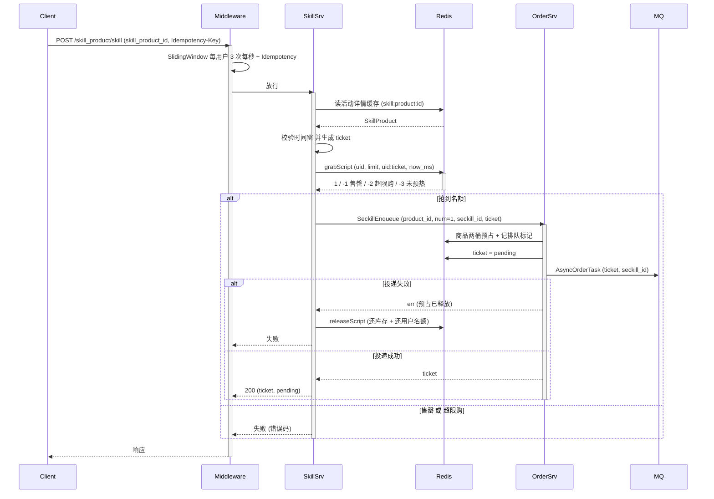
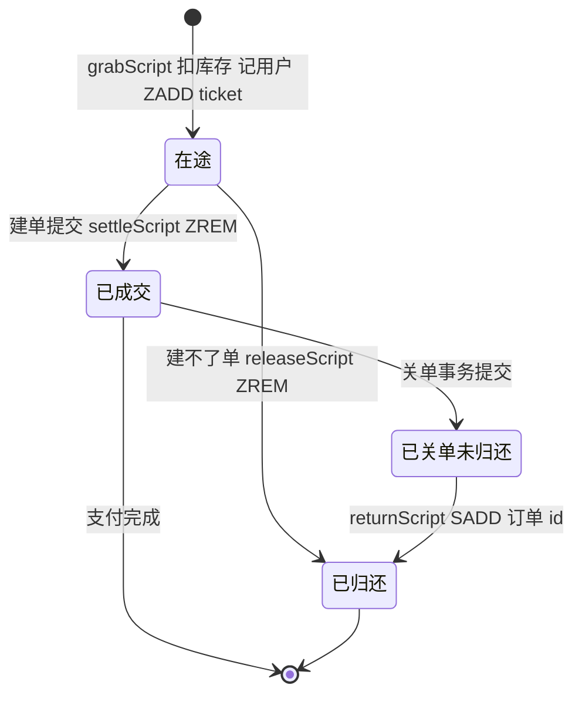
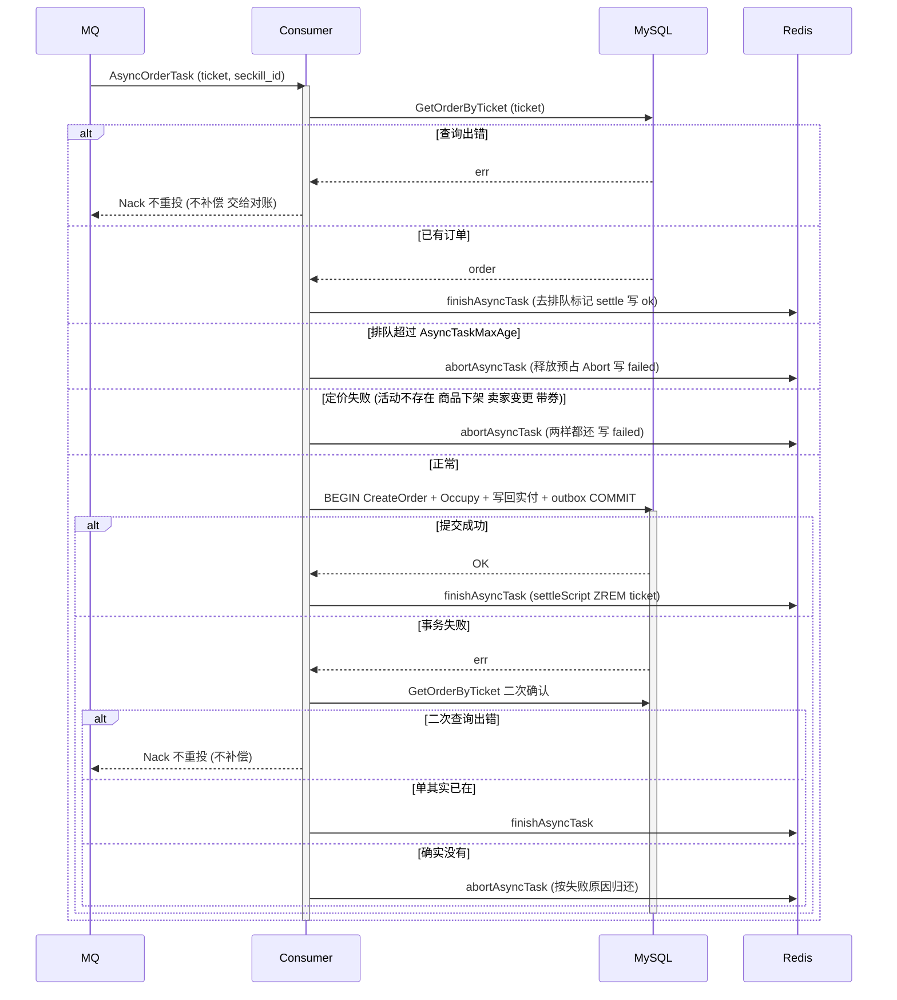
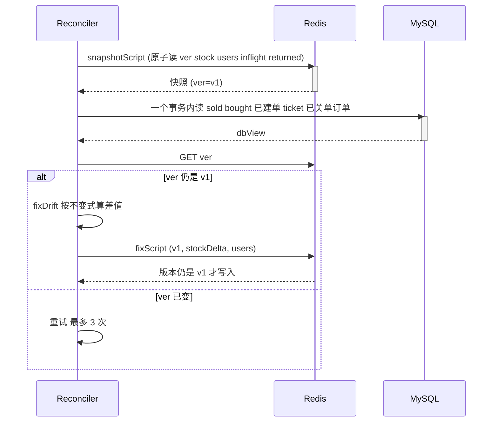

# 20 秒杀：流量尖峰下的不超卖、不重复购买

> 秒杀把三件事压进同一秒：几万人抢几十件货、每人只许买一件、抢到的人还要走完异步建单和支付。Redis 挡住流量，DB 守住数量，中间的 MQ 可能积压、进程可能崩溃、关单可能写不进 Redis。这一讲沿 `internal/skill` 和它挂进订单链路的几个扩展点，讲清楚每一个名额从被抢到、到成交或归还，账是怎么记的。

## 本讲目标

讲完后，学生应该能：

- 说清秒杀的三道闸门：接入层限流幂等、Redis Lua 抢名额、DB 条件更新兜底，各自挡的是什么；
- 画出一场活动在 Redis 里的 5 个 key，写出库存和用户名额的两条不变式；
- 解释为什么每个名额都要按 ticket 或订单 id 记账，归还为什么一定是幂等的；
- 说清消费端建不了单时，“售罄”“超限购”“其他失败”三种原因分别还什么、为什么这样还；
- 解释对账为什么能区分“MQ 积压”和“名额泄漏”，整体纠偏为什么要靠版本号确认两边是同一时刻。

---

## 一、先看四张客诉单

**本节判断：秒杀的难点不在“扣得快”，而在“每个名额的去向都说得清”；所有事故都是某个名额在 Redis、MQ、DB 三处中丢了账。**

一场 10 件、每人限购 1 件的秒杀，上线后可能收到这几类工单：

| 工单 | 现象 | 本讲对应位置 |
|---|---|---|
| A | 运营发现成交了 11 单 | 第二节 |
| B | 同一用户开两个标签页，成交了两单 | 2.2、2.3 |
| C | 用户抢到了、页面一直“排队中”，几分钟后名额被别人抢走 | 第四节、6.1 |
| D | 用户超时没付款，订单关了，名额却再也回不来，活动结束时显示“已抢完”但只卖出 9 件 | 第五节、6.2 |

A 和 B 是“多卖”，C 和 D 是“少卖”。多卖是资损，靠 DB 兜底一票否决；少卖是体验和营收损失，靠按 ticket 记账加对账收回。两类问题的修法方向相反，所以本讲会反复问同一个问题：这一步失败时，Redis 是多了还是少了。

### 1.1 数据模型

DB 两张表加订单上的一列（`internal/skill/model.go:7-29`）：

```go
type SkillProduct struct {
	Id           uint      `gorm:"primarykey" json:"id"`
	ProductId    uint      `gorm:"not null;uniqueIndex:uk_skill_product_start,priority:1" json:"product_id"`
	BossId       uint      `gorm:"not null" json:"boss_id"` // 卖家，创建时取自商品表
	PriceCents   int64     `gorm:"not null;default:0" json:"price_cents"`  // 秒杀价（分）
	Num          int       `gorm:"not null" json:"num"`                    // 秒杀库存
	Sold         int       `gorm:"not null;default:0" json:"-"`            // 有效成单件数（关单归还），DB 兜底：sold + n <= num
	PerUserLimit int       `gorm:"not null;default:1" json:"per_user_limit"`
	StartAt      time.Time `gorm:"uniqueIndex:uk_skill_product_start,priority:2" json:"start_at"`
	EndAt        time.Time `gorm:"index" json:"end_at"`
	// （省略 Title、OriginCents 与时间戳）
}

type SkillUser struct {
	Id             uint `gorm:"primarykey"`
	SkillProductId uint `gorm:"not null;uniqueIndex:uk_skill_user,priority:1"`
	UserId         uint `gorm:"not null;uniqueIndex:uk_skill_user,priority:2"`
	Bought         int  `gorm:"not null;default:0"`
}
```

订单表多了 `SeckillID`（`internal/order/model.go:75-76`），非 0 表示秒杀单，关单时据此归还名额。

几个设计点：

- **`(product_id, start_at)` 唯一。** 运营重复点“创建”按幂等返回已有活动，配置不同才报 `ErrSkillConflict`（`internal/skill/service.go:203-224`）。
- **价格和卖家在活动表里定死。** 创建时从商品表取卖家和原价，秒杀价不能高于原价、库存不能超过商品库存（`service.go:170-190`）。下单请求里只有场次和地址，客户端无法指定价格。
- **`Sold` 和 `Bought` 是 DB 的权威计数。** Redis 再怎么漂，最后放行的件数都由这两列的条件更新决定。

### 1.2 两条不变式

先把要守的东西写下来，后面每一节都在守它（`internal/skill/service.go:31-32`）：

```text
stock + 在途件数 + 已关单未归还件数 = num - sold
users[u] = bought[u] + u 的在途件数 + u 已关单未归还件数
```

左边全是 Redis，右边全是 DB。“在途”是 Redis 已扣、DB 还没落单的名额；“已关单未归还”是 DB 已经还了、Redis 还没还的名额。这两项就是两边之间的时间差，必须逐个记账才能区分“正常的时间差”和“真正丢了的账”。

### 1.3 和前面几讲的关系

| 复用的能力 | 讲义 | 本讲怎么用 |
|---|---|---|
| 商品两桶库存 `available / reserved` | 第 12 讲 | 秒杀单照样预占商品库存，支付时核销 |
| 异步下单 ticket、MQ 消费建单 | 第 09 讲 | 秒杀单走同一条链路，多带一个 `SeckillID` |
| 滑动窗口限流、幂等键 | 第 14、15 讲 | 挂在秒杀下单路由上 |
| 超时关单 | 第 12 讲 | 关单事务里多归还 `sold` 和 `bought` |

这些机制本讲只引用，不重讲。秒杀自己的东西是：活动级的库存和限购、ticket 级的名额记账、以及围绕它们的补偿和对账。

---

## 二、三道闸门

**本节判断：接入层挡重复点击，Redis 挡流量，DB 挡错误；前两道追求快，第三道追求对，任何一道失守都不能导致多卖。**

### 2.1 主链路



路由在 `internal/skill/routes.go:18-26`，限流和幂等的原理见第 14、15 讲。这里只强调一点：幂等中间件挡的是“同一次点击发了两个请求”，挡不住“开两个标签页各点一次”。后者带着两个不同的幂等键，会真的走进 Redis，靠的是下一道闸门。

### 2.2 Redis：一段 Lua 完成五件事

`grabScript`（`internal/skill/service.go:77-93`）：

```lua
local stock = redis.call('GET', KEYS[1])
if stock == false then
    return -3
end
if tonumber(redis.call('HGET', KEYS[2], ARGV[1]) or '0') >= tonumber(ARGV[2]) then
    return -2
end
if tonumber(stock) <= 0 then
    return -1
end
redis.call('DECR', KEYS[1])
redis.call('HINCRBY', KEYS[2], ARGV[1], 1)
redis.call('ZADD', KEYS[3], ARGV[4], ARGV[3])
touch()
return 1
```

检查限购、检查剩余、扣库存、记用户名额、把 ticket 放进在途集合，五步在 Redis 里原子执行。工单 B 的两个标签页，第二个请求一定看到 `users[u] = 1`，返回 -2。

三个细节：

- **先查限购，再查库存。** 已经抢到的用户再点，得到的是“超出限购”而不是“已抢完”，提示更准确。
- **ticket 在抢名额之前就生成。** `SkillProduct` 先调 `order.NewTicket()`，再跑 Lua（`service.go:425-428`）。这样名额从被扣下的那一刻起就挂在一个 ticket 上，之后无论在哪一步崩溃，对账都能按这个 ticket 找回它。
- **-3 时懒预热重试一次。** Redis 丢数据或预热失败时，`grab` 按 DB 快照重建再试（`service.go:443-466`），不需要运营手工介入。

### 2.3 DB：条件更新一票否决

消费端建单时，同一个事务里执行 `Occupy`（`internal/skill/repo.go:88-113`）：

```go
func (d *SkillGoodsDao) Occupy(sp *SkillProduct, userId uint, n int) error {
	res := d.Model(&SkillProduct{}).
		Where("id = ? AND sold + ? <= num", sp.Id, n).
		UpdateColumn("sold", gorm.Expr("sold + ?", n))
	// （省略 res.Error 判断）
	if res.RowsAffected == 0 {
		return e.New(e.ErrSkillSoldOut)
	}
	if err := d.DB.Clauses(clause.OnConflict{DoNothing: true}).
		Create(&SkillUser{SkillProductId: sp.Id, UserId: userId}).Error; err != nil {
		return err
	}
	res = d.Model(&SkillUser{}).
		Where("skill_product_id = ? AND user_id = ? AND bought + ? <= ?", sp.Id, userId, n, sp.PerUserLimit).
		UpdateColumn("bought", gorm.Expr("bought + ?", n))
	// （省略 res.Error 判断）
	if res.RowsAffected == 0 {
		return e.New(e.ErrSkillLimitExceeded)
	}
	return nil
}
```

三步的顺序是有讲究的：

1. **先扣活动库存。** `sold + n <= num` 是 DB 的权威上限。这条 UPDATE 拿到活动行的行锁，同一场活动的建单事务从这里开始串行。
2. **再插入用户行，已存在就跳过。** 插入的 `bought` 是 0，不承载业务含义，只是保证下一步的 UPDATE 有行可改。
3. **最后条件加 `bought`。** 超过限购就影响 0 行，判超限购。

为什么不直接“插入 `bought=1`，撞唯一索引就判重复”？限购大于 1 时，同一用户的第一张和第二张单并发落库，两个事务都想插第一行，后到的那个撞唯一索引会被误拒。“先占位再条件更新”把“这行存在吗”和“还能不能再买”拆成两件事，限购是几都能用同一个写法。测试 `TestSeckillPerUserLimitConcurrentFirstOrders`（`internal/skill/service_test.go:458-475`）用两个消费者并发落库，断言限购 2 时两单都成交。

`Occupy` 返回错误，整个建单事务回滚，订单和 outbox 都不会留下。这就是工单 A 的答案：Redis 被错误放大到 100，DB 也只放过 `num` 件（`TestSeckillDBGuardWhenRedisDrifts`，`service_test.go:93-125`）。

### 2.4 扩展点：秒杀怎样挂进订单链路

`skill` 依赖 `order`，`order` 不能反向 import。订单包只定义一个接口（`internal/order/seckill.go:12-25`）：

| 方法 | 调用时机 | 做什么 |
|---|---|---|
| `Price` | 消费端建单前 | 取活动价和活动卖家，要求商品仍在售、卖家没变 |
| `BindTx` | 建单事务内 | `Occupy` |
| `UnbindTx` | 关单事务内 | 归还 `sold` 和 `bought` |
| `Settle` | 建单提交后 | ticket 移出在途集合 |
| `Abort` | 确定建不了单 | 按原因归还 Redis 名额 |
| `Return` | 关单提交后 | 归还 Redis 名额 |

`skill` 包在 `init` 里注册实现（`internal/skill/service.go:51-53`）。`Price` 是建单前的一次读；`BindTx`、`UnbindTx` 在 DB 事务里；`Settle`、`Abort`、`Return` 都在 DB 结果确定之后才动 Redis（事务已提交，或确定建不了单）。这条分界线很重要：名额的转正和归还在 Redis 里只会比 DB 晚，不会比 DB 早。

`Price` 每次都从活动表和商品表重新取（`service.go:487-510`）。活动进行中商品被下架，排队中的单到了消费端也成交不了，名额按失败归还（`TestSeckillRejectsOffSaleProduct`，`service_test.go:436-456`）。

### 2.5 秒杀价就是成交价

普通异步单在消费端会试算满减、校验要用的券，建单事务里扣满减预算、核销券（第 16 讲）。秒杀单走同一个入口 `resolveTaskSettlement`，但在这里分了岔（`internal/order/consumer.go:199-207`）：

```go
if task.UserCouponID != 0 {
	return 0, 0, nil, errors.New("秒杀单不能用券")
}
// 秒杀价即成交价，不叠满减 / 券。
cents, bossID, err := seckillBinder.Price(ctx, task.SeckillID, task.ProductID)
// （省略 err 判断）
return cents, bossID, &orderQuote{subtotal: cents * int64(task.Num)}, nil
```

秒杀单的优惠方案只有小计。建单事务照常调 `applyDiscountsInTx`（`consumer.go:54-56`），对秒杀单它只把 `FinalCents` 写成秒杀价，不碰满减预算和券。秒杀下单请求本身没有券字段（`internal/skill/dto.go:15-21`），消息里带券只可能是伪造的，按失败收尾、名额两样都还。秒杀价已是让利后的底价，再叠满减会低于运营预期；满减预算是按天的共享计数，也不该被秒杀尖峰拖进来。

---

## 三、名额记账：五个 key 和在途集合

**本节判断：Redis 不只记“还剩几件”，还记“扣掉的每一件现在在谁手里”；只有这样，归还才能做到同一个名额只还一次。**

### 3.1 五个 key

`cache.SkillKeys(id)` 返回一场活动的全部 key（`repository/cache/key.go:43-51`），`{id}` 是 cluster hash tag，保证它们落在同一个槽，Lua 才能一起操作：

| key | 类型 | 内容 |
|---|---|---|
| `skill:{id}:stock` | 字符串 | 剩余库存 |
| `skill:{id}:users` | 哈希 | userID → 已占件数 |
| `skill:{id}:inflight` | 有序集合 | 在途 ticket，成员 `userID:ticket`，分数是抢到的毫秒时间 |
| `skill:{id}:returned` | 集合 | 已归还过 Redis 名额的关单订单 id |
| `skill:{id}:ver` | 字符串 | 版本号，每次改动 +1 |

对照 1.2 的不变式：`inflight` 记的是“在途件数”，`returned` 的补集记的是“已关单未归还件数”。有了这两个集合，不变式的每一项都能逐个点名，不用靠差值去猜。

### 3.2 所有脚本共用的 touch

```lua
local function touch()
    redis.call('INCR', KEYS[5])
    local ttl = redis.call('TTL', KEYS[1])
    if ttl > 0 then
        for i = 2, 5 do redis.call('EXPIRE', KEYS[i], ttl) end
    end
end
```

（`internal/skill/service.go:60-73`）两件事：

- **版本号 +1。** 任何改动名额的脚本都会推动版本，对账靠它判断“我读快照期间有没有人动过”（第六节）。
- **TTL 跟着库存 key 走。** `HINCRBY`、`ZADD`、`SADD` 第一次写入时创建的 key 没有过期时间。`touch` 每次都把其余 4 个 key 的 TTL 对齐到库存 key，库存 key 的 TTL 是活动结束后再留 24 小时（`service.go:36`、`242-246`）。活动结束一天后，整场活动在 Redis 里一起消失。测试 `TestSeckillInitOverridesNullCacheAndKeysExpire`（`service_test.go:496-517`）断言用户哈希和在途集合都带 TTL。

### 3.3 一个名额的生命周期



每条边都是一段 Lua，每段 Lua 都用一个“只能成功一次”的操作做闸门：

| 脚本 | 闸门 | 重复执行时 |
|---|---|---|
| `settleScript` | `ZREM` 返回 1 | 返回 1 但不改任何东西 |
| `releaseScript` | `ZREM` 返回 1 | 返回 0 |
| `returnScript` | `SADD` 返回 1 | 返回 0 |

`releaseScript`（`service.go:97-109`）：

```lua
if redis.call('ZREM', KEYS[3], ARGV[2]) == 0 then
    return 0
end
if ARGV[4] == '1' then
    decrUser(ARGV[1])
end
if ARGV[3] == '1' and redis.call('EXISTS', KEYS[1]) == 1 then
    redis.call('INCR', KEYS[1])
end
touch()
return 1
```

`ZREM` 成功才归还，意味着同一个 ticket 被消费端 `Abort` 和对账同时处理时，只有一方能真正还回去。“还库存”和“还用户名额”是两个独立开关，第四节会看到为什么要分开。

`returnScript`（`service.go:122-133`）用订单 id 做闸门：

```lua
if redis.call('EXISTS', KEYS[1]) == 0 then
    return 0
end
if redis.call('SADD', KEYS[4], ARGV[2]) == 0 then
    return 0
end
redis.call('INCR', KEYS[1])
decrUser(ARGV[1])
touch()
return 1
```

库存 key 不存在时直接跳过、也不记 `returned`。这时 Redis 已经没有这场活动的状态了，下一次预热会按 DB 重建，DB 里的 `sold` 已经包含这次关单，不需要 Redis 再记一笔。

---

## 四、建不了单时还什么

**本节判断：补偿不是“失败了就全还”，而是先判断 Redis 这一侧是多了还是少了，只还真正该还的那部分。**

### 4.1 消费端时序



对应 `HandleAsyncOrderTask`（`internal/order/consumer.go:77-163`）。普通异步单的幂等、按 ticket 去重在第 09 讲讲过，这里只看秒杀多出来的部分：`persistAsyncOrder` 在建单事务里调 `BindTx`（`consumer.go:46-53`），提交后 `finishAsyncTask` 调 `Settle`（`consumer.go:166-172`），失败时 `abortAsyncTask` 调 `Abort`（`consumer.go:211-223`）。订单上的收货地址用的是入队时取的快照 `task.ShipTo`（`consumer.go:122`），用户在排队期间改地址不影响这张单。

### 4.2 三种失败，三种还法

`binder.Abort`（`internal/skill/service.go:536-545`）：

```go
func (binder) Abort(ctx context.Context, seckillID, userID uint, ticket string, cause error) {
	switch e.CodeOf(cause) {
	case e.ErrSkillSoldOut:
		release(ctx, seckillID, userID, ticket, false, true)
	case e.ErrSkillLimitExceeded:
		release(ctx, seckillID, userID, ticket, true, false)
	default:
		release(ctx, seckillID, userID, ticket, true, true)
	}
}
```

| 失败原因 | 还库存 | 还用户名额 | 推理 |
|---|---|---|---|
| DB 判售罄 | 否 | 是 | DB 说没货了，Redis 却放了这个请求进来，说明 Redis 库存多了；这一件不加回去，多出来的就此消掉 |
| DB 判超限购 | 是 | 否 | DB 说这个用户已经买够了，Redis 却放行，说明 Redis 少记了这个用户；名额不还，少记的就此补上 |
| 其他失败（商品下架、DB 故障等） | 是 | 是 | Redis 和 DB 都没问题，只是这一单没建成 |

售罄那一行最容易写错。如果“售罄也把库存加回去”，Redis 的虚高永远消不掉：每个被 DB 拒掉的请求都会把那一件还回来，下一个请求再抢到、再被拒，DB 一直被这些注定失败的请求打。`TestSeckillDBGuardWhenRedisDrifts` 断言：Redis 库存人为改成 100、活动只有 2 件，5 个请求里 3 个被 DB 拒掉之后，Redis 库存是 95 而不是 98（`service_test.go:110-116`）。剩下的虚高交给第六节的对账一次纠正。

### 4.3 投 MQ 失败

`enqueue` 依次做：未支付单数上限、取收货地址快照（同时校验归属）、商品两桶预占、记排队标记、写 pending、投 MQ（`internal/order/async.go:186-259`）。预占之后任何一步失败，都先释放商品预占、再去掉排队标记，投递失败还会写 ticket 失败（`async.go:216-256`），然后返回错误。秒杀入口拿到错误，按 ticket 把库存和用户名额都还回去（`internal/skill/service.go:434-438`）：

```go
if err != nil {
	log.LogrusObj.Errorf("seckill enqueue failed skill=%d user=%d err=%v", sp.Id, u.Id, err)
	release(context.WithoutCancel(ctx), sp.Id, u.Id, ticket, true, true)
	return nil, err
}
```

用 `context.WithoutCancel` 是因为这时客户端可能已经断开，请求 ctx 被取消，归还不能跟着一起失败。`TestSeckillCompensatesOnFailure`（`service_test.go:191-221`）覆盖了投递失败和建单失败两条路径，两条都断言名额和商品预占归还，建单失败那条还断言 ticket 是 failed。

### 4.4 查不清就不补偿

建单事务报错后，代码会再查一次订单（`internal/order/consumer.go:130-147`）：

```go
err = defaultAsyncOrderWriter(ctx, task, order, quote)
if err != nil {
	existing, lookErr := NewOrderDao(ctx).GetOrderByTicket(task.Ticket)
	if lookErr != nil {
		// 查不清单在不在就不补偿：补偿了而单其实已提交，会把还占着的预占 / 秒杀名额放出去超卖。
		// 预占和在途标记留给对账（按 ticket 查 DB 决定转正还是归还）。
		util.LogrusObj.Errorf("async order recheck ticket failed ticket=%s txErr=%v err=%v", task.Ticket, err, lookErr)
		return err
	}
	// （省略：已有订单按成功收尾，确实没有才 abortAsyncTask）
}
```

“事务报错”不等于“没提交”：COMMIT 成功、响应在网络上丢了，客户端看到的也是错误。这时如果直接补偿，Redis 多出一件，而这件在 DB 里已经卖掉了，下一个抢到它的人会被 DB 拒掉（不会超卖，但会多一次无效请求和一次错误提示）；商品两桶那边则会把还在用的预占放回 `available`，那是真的多卖。

所以宁可让名额暂时挂着，交给对账按 ticket 去 DB 核实。挂着的代价是什么，见 7.2。

### 4.5 排队超时直接收尾

ticket 的 TTL 是 1 小时（`internal/order/async.go:27`）。ticket 过期后，对账会把在途集合里“没有 ticket 状态”的成员当作没人处理的单归还。如果此时 MQ 里那条消息才被消费，消费端建单成功、对账又归还了名额，同一件货就算了两次。

`AsyncTaskMaxAge` 比 ticket TTL 短 10 分钟（`async.go:144`），消费端拿 snowflake ticket 解析出生成时刻，排队超过它就直接按失败收尾（`consumer.go:96-101`）：

```go
if at, err := snowflake.TimeOf(task.Ticket); err == nil && time.Since(at) > AsyncTaskMaxAge {
	staleErr := errors.New("排队超时，请重新下单")
	util.LogrusObj.Errorf("async order task stale ticket=%s age=%v", task.Ticket, time.Since(at))
	abortAsyncTask(ctx, task, staleErr)
	return staleErr
}
```

这样就切出了一条清楚的时间线：50 分钟以内，只有消费端会处理这张单；50 分钟以后消费端不再建单；60 分钟以后对账才会接手。两者之间留了 10 分钟，没有重叠。`TestSeckillStaleTaskAborts`（`service_test.go:384-401`）手工构造一个 51 分钟前的 ticket，断言不建单、名额全部归还。ticket 是 snowflake，`TimeOf`（`pkg/utils/snowflake/snowflake.go:23-30`）直接解析出时间戳，消息体里不用再放入队时间。

---

## 五、关单归还与预热

**本节判断：DB 先还、Redis 后还，中间崩溃留下的差额由 `returned` 集合点名；预热按 DB 重建时把这份点名一起带上。**

### 5.1 关单

`CancelUnpaidOrder` 的通用逻辑见第 12 讲：关单事务里条件关单、退回用过的券、写 `order.cancelled`，提交后释放商品预占。秒杀单没有券，退券那一步对它是空操作；秒杀多出两步（`internal/order/cancel.go:47-92`）：

- 关单事务里调 `UnbindTx`（`cancel.go:60-64`），执行 `Release` 条件归还 `sold` 和 `bought`（`internal/skill/repo.go:155-164`），条件里带 `sold >= n`，不会减成负数；
- 事务提交后调 `Return`（`cancel.go:90-92`），跑 `returnScript`，用订单 id 做幂等闸门。

关单事务本身由 `CloseOrderWithCheck` 保证只生效一次，重复关单在 DB 这一层就是 no-op，不会走到 `Return`。`TestSeckillTimeoutCloseReturnsQuota`（`service_test.go:223-270`）关两次单，断言 `sold`、`bought`、Redis 名额都只还一次，同一用户可以再抢。

工单 D 是提交之后、`returnScript` 之前进程崩了，或者 Redis 写失败。这时 DB 的 `sold` 已经减了，订单状态是已关闭，但订单 id 不在 `returned` 里。对账第二步专门处理它（6.2）。

### 5.2 预热要连同 returned 一起重建

`preheatScript`（`internal/skill/service.go:138-153`）在库存 key 不存在时，按一次 DB 事务的快照重建整场活动：

```lua
if redis.call('EXISTS', KEYS[1]) == 1 then
    return 0
end
redis.call('DEL', KEYS[2], KEYS[3], KEYS[4])
local n = tonumber(ARGV[3])
for i = 0, n - 1 do
    redis.call('HSET', KEYS[2], ARGV[4 + 2 * i], ARGV[5 + 2 * i])
end
for i = 4 + 2 * n, #ARGV do
    redis.call('SADD', KEYS[4], ARGV[i])
end
redis.call('SET', KEYS[1], ARGV[1], 'EX', ARGV[2])
touch()
return 1
```

参数来自 `loadDBView`（`internal/skill/repo.go:123-152`），在一个事务里读活动、所有 `bought > 0` 的用户、所有已关单的秒杀订单 id。

为什么已关单的订单 id 要写进 `returned`？DB 快照里的 `num - sold` 已经包含了这些关单的归还。如果 `returned` 是空的，稍后一个迟到的 `returnScript`（关单提交后、预热之后才执行到）会发现订单 id 不在集合里，再加一次库存，这一件就算了两遍。把已关单的 id 预先写进去，迟到的归还会被 `SADD` 返回 0 挡住。

在途集合被清空。这些 ticket 对应的单如果后来落库成功，DB 的 `sold` 会增加，而 Redis 的库存是按落库前的 `sold` 算的，会多出几件。多出来的部分由 DB 兜底拒单（4.2 售罄那一行，不加回库存）和对账纠偏收敛，不会超卖。

`EXISTS` 判断和重建在同一段 Lua 里，所以懒预热（`grab` 返回 -3 时）和运营手工预热并发也只有一个生效。

---

## 六、对账：按 ticket、按订单、按版本

**本节判断：对账先逐个核对能点名的名额，再对整体做一次精确纠偏；整体纠偏只在确认 Redis 和 DB 是同一时刻的值时才动手。**

`RunSeckillReconcile` 每 5 分钟跑一次（`initialize/cron.go:67-75`），用 Redis 锁保证多实例只跑一个，范围是结束不到 24 小时的活动（`internal/skill/task.go:79-95`）。每场活动分三步（`task.go:97-143`）。

### 6.1 第一步：按 ticket 核对在途集合

```go
for _, t := range snap.inflight {
	if v.settled[t.ticket] {
		b.Settle(ctx, id, t.user, t.ticket)
		continue
	}
	st, exists, err := order.AsyncOrderTicketStoreInstance().Get(ctx, t.ticket)
	// （省略 err 判断）
	if (exists && st.Status == order.OrderTicketStatusFailed) || (!exists && time.Since(t.at) > orphanTicketGrace) {
		log.LogrusObj.Warnf("SeckillReconcile 归还泄漏名额 skill=%d user=%d ticket=%s", id, t.user, t.ticket)
		release(ctx, id, t.user, t.ticket, true, true)
	}
}
```

（`internal/skill/task.go:103-117`）

| DB 有单吗 | ticket 状态 | 处理 | 典型成因 |
|---|---|---|---|
| 有 | 任意 | 移出在途集合 | 建单提交后 `settleScript` 没执行 |
| 没有 | failed | 归还 | `Abort` 写 Redis 失败 |
| 没有 | 不存在且超过 1 分钟 | 归还 | 抢名额后、写 pending 前崩溃，或 ticket 已过期 |
| 没有 | pending | 不动 | 还在 MQ 里排队 |

工单 C 的答案在最后一行。如果按“采两次样、差值稳定就补回”来判泄漏，MQ 积压超过采样间隔时排队中的单会被当成泄漏，名额放给后来者，前面的单落库时又被 DB 判售罄，用户看到“抢到了又没了”。判断依据是 ticket 本身的状态：只要还是 pending，积压多久都不动。

`orphanTicketGrace` 是 1 分钟（`task.go:19`）。抢名额之后紧接着就写 pending，正常情况下两步相隔远小于 1 分钟；ticket 过期（超过 1 小时）同样没有状态，那时消费端已经按 4.5 不会再建单。

`TestSeckillReconcileKeepsQueuedTickets`（`service_test.go:329-382`）把宽限期设成 0，只留 pending 这一条保护，断言对账不补库存、不删用户名额；`TestSeckillReconcileRecoversLeakedQuota`（`service_test.go:303-327`）断言宽限期内不动、过了宽限期按 ticket 归还。

### 6.2 第二步：按订单核对关单

```go
for i := range v.closed {
	if o := &v.closed[i]; !snap.returned[o.ID] {
		log.LogrusObj.Warnf("SeckillReconcile 补归还关单名额 skill=%d order=%d", id, o.ID)
		o.SeckillID = id
		b.Return(ctx, o)
	}
}
```

（`task.go:118-124`）

已关单、订单 id 不在 `returned` 里，就补一次 `returnScript`。补的动作和关单时一样用 `SADD` 做闸门，所以就算和一个迟到的关单归还撞在一起，也只会还一次。`TestSeckillReconcileReturnsMissedCancel`（`service_test.go:403-434`）模拟工单 D，连跑两轮对账，断言库存只加回 1。

### 6.3 第三步：整体纠偏

前两步处理的是能点名的偏差。Redis 丢数据、有人手工改了 key、某个 bug 让计数错了，这些偏差没有 ticket 也没有订单 id，只能按不变式整体算一遍差值。难点在于“同一时刻”：Redis 每秒在变，DB 也在变，读 Redis 和读 DB 之间只要有一次抢购，算出来的差值就是错的，纠偏会把正确的值改错。

做法是三次读：



（`internal/skill/task.go:126-142`）

为什么版本号没变就能确认两边是同一时刻？DB 的 `sold` 和 `bought` 只在建单和关单事务里变，而每一次建单提交之后都会跑 `settleScript`、每一次关单之后都会跑 `returnScript`，它们都会推版本号。反过来说，版本号在“读 Redis → 读 DB”这段时间里没变，说明这段时间里要么没有 DB 改动，要么有改动但它对应的 Redis 脚本还没跑。后一种情况，这张单的 ticket 还在在途集合里，或者订单 id 还不在 `returned` 里，不变式里的“在途件数”和“已关单未归还件数”恰好把它算了进去，等式两边依然对得上。

`fixDrift`（`task.go:146-187`）按不变式算出每个用户应有的件数和库存差值：

```go
held := int64(0)
for _, t := range snap.inflight {
	if !v.settled[t.ticket] { // 已建单的那张已经算在 sold / bought 里
		want[t.user]++
		held++
	}
}
for _, o := range v.closed {
	if !snap.returned[o.ID] {
		want[o.UserID]++
		held++
	}
}
stockDelta := int64(v.sp.Num-v.sp.Sold) - held - snap.stock
```

`fixScript`（`task.go:41-55`）在写入前再比一次版本号，不一致就放弃。这样从 Lua 快照到 Lua 写入，整段时间都在版本号的保护下。

两个方向都能纠：Redis 多了（被错误放大）就扣回去，Redis 少了（丢了归还）就补上。一个直观的疑问是：Redis 少了的时候它会提前显示售罄，会不会一直有人在抢、版本一直在变、纠偏永远做不成？不会。`grabScript` 在返回 -1 时不改任何 key、也不调 `touch`，售罄期间的抢购请求不推版本，纠偏能在一轮之内完成。

`TestSeckillReconcileKeepsQueuedTickets` 的后半段把库存改成 3（多了）、删掉一个用户名额（少了），对账后两者都回到正确值；再把库存改成 0，对账后补回 1（`service_test.go:369-381`）。

### 6.4 商品两桶的对账也认识排队中的单

商品预占对账（第 12 讲）在秒杀高峰会遇到同样的问题：MQ 积压超过采样间隔，排队中的预占会被当成泄漏回收。`enqueue` 预占成功后把 ticket 记进 `order:async:inflight:{pid}`（`internal/order/async.go:148-160`、`215`），落库或放弃时去掉；预占对账把这部分件数算作合法占用（`internal/order/task.go:197-206`）：

```go
queued, err := asyncInflightNum(ctx, pid)
// （省略 err 判断）
if diff := reserved - waitPaySum[pid] - inflightSum[pid] - queued; diff > 0 {
	leak[pid] = diff
}
```

`asyncInflightNum` 顺手清掉分数超过 ticket TTL 的成员（`async.go:165-184`）。`enqueue` 失败时先释放预占、再去标记（`async.go:216-222`），中间被对账看到只会少回收，不会多回收。

---

## 七、设计取舍

**本节判断：秒杀的每一个“不做”都对应一个更重要的“守住”；讲清楚取舍，比列举功能更有用。**

### 7.1 退款不归还秒杀名额

已付款的秒杀单发生售后退款，`sold` 和 `bought` 不减，秒杀名额不回到 Redis。要分清两本账：商品库存照常回补（第 19 讲 5.2），未发货就退的单在退款结算时回补，已发货的单要等商家确认退货入库才回补，靠 `restocked_at` 保证只补一次；货回到了普通售卖，但它不再回到秒杀价的那 `num` 件里。退给用户的金额按订单实付 `PayableCents()` 算，秒杀单没有满减和券，就是秒杀价。

理由有三：售后退款大多发生在活动结束之后，Redis 的 key 已随 TTL 消失，归还的名额也没人能抢；按“卖出过”计限购是常见口径，防止同一用户“买了退、退了再买”反复占用低价名额；退款链路涉及资金和履约，再让它反向改秒杀计数，会把只在活动期间活跃的模块拉进售后长尾。关单（未付款）一定归还，退款（已付款）不归还。

### 7.2 DB 故障时名额延后释放

4.4 讲过，消费端二次查单也失败时不做补偿，消息 Nack 且不重投，ticket 停在 pending。对账看到 pending 不会动它，要等 ticket 一小时过期、变成“没有状态”之后才归还。

这一个小时里不会超卖，只是这一件名额暂时抢不到。用“晚一点卖出”换“绝不多卖”，是秒杀场景里划算的交换：多卖要人工处理订单、和用户沟通、可能赔付；晚卖一件，最坏的结果是活动结束时少卖几件，而 DB 故障本身就是低频事件。

### 7.3 每单 1 件

下单请求不接受数量，`SeckillEnqueue` 固定传 `Num: 1`（`internal/skill/service.go:429-433`），限购大于 1 时靠多次下单累计。这让 Redis 侧的一个 ticket 永远对应一件货，`releaseScript`、`decrUser` 都只需要 ±1，在途集合的成员数就是在途件数，不变式里的每一项都能直接数出来。

---

## 八、故障演练 / 课堂演示

**本节判断：每个演练只看一件事——不变式是否成立、成交件数是否不超过 `num`。**

### 演示 1：并发不超卖

```bash
go test -race ./internal/skill -run TestSeckillConcurrentGrabNeverOversells -v
```

200 个用户各抢 5 次，共 1000 个并发请求抢 10 件，8 个消费者并发落库。断言成交恰好 10 单、每人最多一单、全部按秒杀价和活动卖家建单、Redis 库存是 0、商品 `reserved` 是 10（`service_test.go:45-91`）。

测试默认用内存 SQLite。设置 `SKILL_TEST_MYSQL_DSN` 后会换成真 MySQL（`service_test.go:641-650`），行锁、唯一索引、并发事务都按 InnoDB 语义执行：

```bash
SKILL_TEST_MYSQL_DSN='root:pass@tcp(127.0.0.1:3306)/gomall_test?parseTime=true' \
  go test -race -count=1 ./internal/skill/
```

现场把 `Occupy` 的 `sold + ? <= num` 条件删掉，在 MySQL 上跑 `TestSeckillDBGuardWhenRedisDrifts`：5 个并发消费者成交 5 单，测试失败。这说明 Redis 被放大时，真正挡住超卖的是这一个 WHERE 条件。

### 演示 2：MQ 积压不被误补

```bash
go test ./internal/skill -run TestSeckillReconcileKeepsQueuedTickets -v
```

现场把 `reconcileSkill` 里的判断改成“pending 也归还”，测试在第一次对账后就失败：库存从 1 变成 3，两个排队中的用户名额被删。再把 `asyncInflightNum` 从预占对账里去掉，`reserved` 被回收成 0。两处改动分别对应工单 C 在秒杀侧和商品侧的表现。

### 演示 3：售罄拒单不加回库存

```bash
go test ./internal/skill -run TestSeckillDBGuardWhenRedisDrifts -v
```

现场把 `Abort` 里售罄那一支改成 `release(..., true, true)`，测试在“售罄拒单不应加回库存”处失败：Redis 库存是 98 而不是 95。然后讨论：如果线上真的这样写，Redis 库存永远停在虚高状态，DB 会被持续打多久？

### 演示 4：手工制造工单 D

本地起服务，创建一场 1 件的活动，用户 A 抢到并建单，`redis-cli SMEMBERS 'skill:{1}:returned'` 为空。在 `CancelUnpaidOrder` 里临时注释掉 `seckillBinder.Return(ctx, order)`，触发关单：

- DB 里订单是已关闭，`sold` 回到 0；
- Redis 库存仍是 0，用户 B 抢会得到“已抢完”；
- 手工触发一次 `RunSeckillReconcile`，日志出现“补归还关单名额”，库存变成 1，`returned` 里有了这张订单的 id；
- 再触发一次对账，库存仍是 1。

恢复注释后重跑 `TestSeckillReconcileReturnsMissedCancel`，对照测试里的断言。

---

## 课后练习

1. **画不变式表。** 对 3.3 状态图的每一条边，写出它对 `stock`、`users[u]`、`inflight`、`returned`、`sold`、`bought[u]` 各自的影响，验证 1.2 的两条不变式在每条边前后都成立。
2. **限购改成按金额。** 假设运营要求“每人在本场秒杀累计不超过 200 元”，说明 `grabScript`、`Occupy`、`Abort` 各要改什么，`users` 哈希里应该存件数还是金额。
3. **预热时有在途单。** 构造一个测试：抢到名额、投递成功，但消费前手工 `DEL skill:{id}:stock` 触发懒预热，然后让消息被消费。断言最终成交件数不超过 `num`，并说明 Redis 多出来的那件是在哪一步被消掉的。
4. **把关单归还放进 outbox。** 现在关单提交后直接调 `returnScript`，失败靠对账补。如果改成在关单事务里写一条 `seckill.quota_returned` 事件、由消费者执行归还，`returned` 集合还需要吗？对账的第二步还需要吗？
5. **活动提前下线。** 运营在活动进行中把它下线。列出需要改的地方：入口时间窗、排队中的消息、已建未付的订单、Redis key 的 TTL，并说明每一处应该“拒绝”“放行”还是“等关单”。
6. **退款归还名额。** 如果业务决定已付款的秒杀单退款也要归还名额，归还应该挂在退款流程的哪一步？活动已结束、Redis key 已过期时该怎么处理？结合 7.1 说明你会怎样向业务方解释这个需求的代价。

---

## 代码索引

| 主题 | 文件 | 入口 |
|---|---|---|
| 表结构 | `internal/skill/model.go` | `SkillProduct`、`SkillUser` |
| Redis key | `repository/cache/key.go` | `SkillKeys`、`SkillStockKey`、`OrderAsyncInflightKey` |
| 抢 / 还 / 转正 / 关单归还 / 预热 Lua | `internal/skill/service.go` | `luaTouch`、`grabScript`、`releaseScript`、`settleScript`、`returnScript`、`preheatScript` |
| 创建活动与详情缓存 | `internal/skill/service.go` | `InitSkillGoods`、`preheat`、`loadSkillProduct` |
| 秒杀下单入口 | `internal/skill/service.go` | `SkillProduct`、`resolveSkill`、`grab`、`release` |
| 订单链路扩展点 | `internal/order/seckill.go`、`internal/skill/service.go` | `SeckillBinder`、`binder` |
| DB 兜底与快照 | `internal/skill/repo.go` | `Occupy`、`Release`、`loadDBView` |
| 异步投递与排队标记 | `internal/order/async.go` | `SeckillEnqueue`、`enqueue`、`AsyncTaskMaxAge`、`asyncInflightNum` |
| 消费端建单与补偿 | `internal/order/consumer.go` | `HandleAsyncOrderTask`、`persistAsyncOrder`、`resolveTaskSettlement`、`finishAsyncTask`、`abortAsyncTask` |
| 关单 | `internal/order/cancel.go` | `CancelUnpaidOrder` |
| 秒杀对账 | `internal/skill/task.go` | `RunSeckillReconcile`、`reconcileSkill`、`fixDrift`、`snapshotScript`、`fixScript` |
| 商品预占对账 | `internal/order/task.go` | `sampleReservationLeak` |
| 可用库存对账 | `service/inventory/syncer.go` | `ReconcileAvailable`、`commitPendingBounds`、`pickDrift` |
| ticket 时间解析 | `pkg/utils/snowflake/snowflake.go` | `TimeOf` |
| 路由与护栏 | `internal/skill/routes.go` | `RegisterRoutes` |
| 定时任务 | `initialize/cron.go` | `RunSeckillReconcile` 注册 |
| 测试 | `internal/skill/service_test.go` | `TestSeckillConcurrentGrabNeverOversells`、`TestSeckillDBGuardWhenRedisDrifts`、`TestSeckillReconcileKeepsQueuedTickets`、`TestSeckillReconcileReturnsMissedCancel`、`TestSeckillStaleTaskAborts` |
